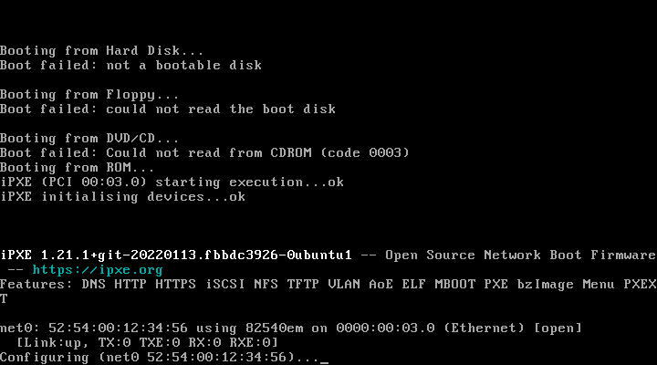
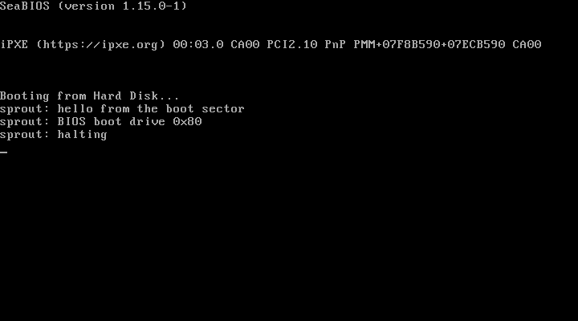

# Chapter 1 — Power On

This chapter follows a PC from the moment it gets power to the first instruction of *our* code.
The CPU starts at a fixed address inside the firmware, the BIOS tests and sets up the machine,
reads the first 512 bytes of the boot disk to address 0x7C00 and jumps there in 16-bit real mode.
Those 512 bytes are the boot sector, and writing one is how this course starts. You set up NASM
and QEMU, boot a two-byte infinite loop, watch the BIOS refuse a disk without a signature, and
print text with the BIOS and with the first serial port. The project starts here too: **sprout**,
a tiny 32-bit kernel with its own boot loader. In this chapter sprout is a seed: one boot sector
that greets the world on the screen and on COM1, then halts.

Next: [Chapter 2](02-loading-more-code.md).

## What an operating system is, and what this course builds

An operating system is the program that owns the machine. It runs first, it decides which code
gets the CPU and which memory belongs to whom, and it is the only code that talks to the
hardware directly. Everything else asks it for service: in learn-c, `write(1, ...)` was such a
request, and in learn-linux-nasm you made the same request by hand with `syscall`.

This course writes the other side of those requests. There is no libc, no kernel underneath, no
`printf` and no `malloc` until we write them. We do it on the simplest real boot path that still
exists everywhere: a 32-bit x86 PC with a BIOS, emulated by QEMU. Modern PCs boot through UEFI
into 64-bit long mode, but they all still contain the old machine, and the old path teaches every
idea (real mode, segments, interrupts, paging, privilege levels) with less ceremony. Chapter 10
points at the 64-bit and UEFI roads.

The project is called **sprout**. It starts as a seed of 512 bytes and grows a little in every
chapter; its version number is `0.N` after Chapter N.

| Chapter | sprout gains |
|---|---|
| 1 | a boot sector that prints to the screen and COM1 |
| 2 | a loader: stage 2 read from disk, the BIOS memory map (E820) |
| 3 | protected mode: A20, a GDT, 32-bit code, the VGA text buffer |
| 4 | a freestanding C kernel at 1 MiB, `kprintf`, a serial driver, `panic` |
| 5 | interrupts: the IDT, exception dumps, the PIC, timer ticks |
| 6 | a PS/2 keyboard driver and a small shell |
| 7 | a physical frame allocator, paging, a page-fault handler, a heap |
| 8 | kernel threads and a round-robin scheduler |
| 9 | user mode: a TSS, ring 3, system calls, user programs |
| 10 | debugging with gdb, and where to go next |

You need learn-linux-nasm (NASM syntax, registers, the stack, calls) and learn-c (C11,
pointers, Makefiles). The assembly in this chapter is 16-bit, which is new, but every
instruction is one you know from 64-bit code with a smaller register.

## Tools and the disk image

Three programs do all the work in the first three chapters:

- **NASM** assembles our boot code. We use `-f bin`: no ELF, no object file, just the bytes,
  because the BIOS will run whatever bytes sit in the first sector of the disk.
- **QEMU** (`qemu-system-i386`) emulates a whole PC: CPU, RAM, VGA card, disk controller,
  serial port and the BIOS firmware itself. QEMU's BIOS is SeaBIOS, an open-source BIOS.
- **ndisasm** comes with NASM and disassembles raw bytes, which `objdump` cannot do without
  being told a lot.

On Ubuntu or Debian:

```console
$ sudo apt install build-essential nasm qemu-system-x86 gdb
```

The course was verified with NASM 3.02 and QEMU 6.2 (SeaBIOS 1.15). The NASM in Ubuntu 22.04
is 2.15; everything here should assemble with it, but that was not tested.

```console
$ nasm -v
NASM version 3.02 compiled on Nov 18 2026
$ qemu-system-i386 --version
QEMU emulator version 6.2.0 (Debian 1:6.2+dfsg-2ubuntu6.31)
Copyright (c) 2003-2021 Fabrice Bellard and the QEMU Project developers
```

The "disk" is an ordinary file. QEMU treats a file given with `-drive format=raw,file=X` as the
contents of an IDE hard disk, byte for byte: byte 0 of the file is byte 0 of sector 0. Our
Makefiles build the boot sector, copy it into an image file and extend the file to 1 MiB with
`truncate`, so QEMU sees a small but believable hard disk of 2048 sectors.

The QEMU options this course uses most:

| Option | Meaning |
|---|---|
| `-drive format=raw,file=build/sprout.img` | the image is the first hard disk, raw bytes |
| `-serial stdio` | COM1 is connected to this terminal |
| `-display none` / `-display curses` | no window / VGA text in the terminal |
| `-monitor stdio` | the QEMU monitor (a debugging console) on this terminal |
| `-no-reboot` | exit instead of rebooting when the guest resets |
| `-S` | do not start the CPU; wait for the monitor or a debugger |
| `-m 128M` | RAM size (default 128 MiB) |

Every run in this course is wrapped in `timeout` when it is not interactive. A halted guest does
not exit by itself, and a test that hangs forever is worse than one that fails.

## From power-on to 0x7C00

Here is what happens before our code runs.

**1. Reset.** A CPU starts at a fixed address called the reset vector. On the 8086 that was
F000:FFF0, physical 0xFFFF0, 16 bytes below the 1 MiB limit. A 386 or later starts higher: its
segment registers have a hidden "base" part, and right after reset CS holds the selector F000
but the base 0xFFFF0000, so the first instruction is fetched from 0xFFFFFFF0, 16 bytes below
4 GiB. The chipset maps the firmware ROM there. Intel documents this in the SDM, Volume 3A,
in the chapter on processor initialisation.

QEMU lets us look. `-S` creates the machine but does not start the CPU, and `-monitor stdio`
gives us QEMU's monitor console. `info registers` prints the CPU state and `xp` examines
physical memory (`/2i`: two instructions; `/16xb`: sixteen hex bytes). I cut the
`info registers` output after CR0 (FPU, SSE and debug registers follow) and removed FS, GS, LDT
and TR, which look like DS:

```console
$ qemu-system-i386 -S -drive format=raw,file=build/sprout.img -display none -monitor stdio
QEMU 6.2.0 monitor - type 'help' for more information
(qemu) info registers
EAX=00000000 EBX=00000000 ECX=00000000 EDX=00000663
ESI=00000000 EDI=00000000 EBP=00000000 ESP=00000000
EIP=0000fff0 EFL=00000002 [-------] CPL=0 II=0 A20=1 SMM=0 HLT=0
ES =0000 00000000 0000ffff 00009300
CS =f000 ffff0000 0000ffff 00009b00
SS =0000 00000000 0000ffff 00009300
DS =0000 00000000 0000ffff 00009300
GDT=     00000000 0000ffff
IDT=     00000000 0000ffff
CR0=60000010 CR2=00000000 CR3=00000000 CR4=00000000
(qemu) xp /2i 0xfffffff0
0xfffffff0:  ljmp   $0xf000,$0xe05b
0xfffffff5:  xor    %dh,0x322f
(qemu) xp /16xb 0xfffffff0
00000000fffffff0: 0xea 0x5b 0xe0 0x00 0xf0 0x30 0x36 0x2f
00000000fffffff8: 0x32 0x33 0x2f 0x39 0x39 0x00 0xfc 0x00
(qemu) xp /16xb 0xffff0
00000000000ffff0: 0xea 0x5b 0xe0 0x00 0xf0 0x30 0x36 0x2f
00000000000ffff8: 0x32 0x33 0x2f 0x39 0x39 0x00 0xfc 0x00
(qemu) q
```

- `CS =f000 ffff0000 0000ffff ...` reads: selector 0xF000, base 0xFFFF0000, limit 0xFFFF.
  With EIP = 0xFFF0, the first fetch is at 0xFFFF0000 + 0xFFF0 = 0xFFFFFFF0.
- The instruction there is a far jump (QEMU's disassembler uses AT&T syntax): `jmp
  0xF000:0xE05B`. A far jump loads CS the ordinary way, base = 0xF000 × 16 = 0xF0000, and from
  then on the BIOS runs from its copy just below 1 MiB. The last two dumps show the same bytes at
  both addresses.
- The "instruction" after the jump is not code: bytes `30 36 2f 32 33 2f 39 39` are the ASCII
  text `06/23/99`. SeaBIOS's source puts its power-up entry point at offset 0xFFF0 of the BIOS
  segment and a BIOS date string at 0xFFF5 (`src/romlayout.S`).
- EDX = 0x663 is not garbage: after reset EDX holds the processor's identification (family,
  model, stepping), here for QEMU's default 32-bit CPU model.

**2. POST.** The BIOS runs its power-on self test: it finds RAM, sets up the interrupt
controller and timer, scans the PCI bus, runs the VGA card's own ROM, finds disks, keyboard and
serial ports. SeaBIOS writes a log of all this to I/O port 0x402 (`DebugOutputPort` in
`src/hw/serialio.c`), and QEMU's `-debugcon` option can capture that port into a file. The full
log is 96 lines; `grep` picks the milestones:

```console
$ timeout 3 qemu-system-i386 -drive format=raw,file=build/sprout.img -no-reboot \
    -display none -monitor none -serial null \
    -debugcon file:build/seabios.log -global isa-debugcon.iobase=0x402
qemu-system-i386: terminating on signal 15 from pid 1114543 (timeout)
$ wc -l build/seabios.log
96 build/seabios.log
$ grep -n -E 'SeaBIOS|Running on|Found|keyboard|ata0-0|DVD/CD \[|e820 map|handle_19|Booting' build/seabios.log
1:SeaBIOS (version 1.15.0-1)
4:Running on QEMU (i440fx)
5:Found QEMU fw_cfg
13:Found 6 PCI devices (max PCI bus is 00)
35:Found 1 cpu(s) max supported 1 cpu(s)
55:SeaBIOS (version 1.15.0-1)
60:Found 1 lpt ports
61:Found 1 serial ports
62:PS2 keyboard initialized
63:ata0-0: QEMU HARDDISK ATA-7 Hard-Disk (1 MiBytes)
66:DVD/CD [ata1-0: QEMU DVD-ROM ATAPI-4 DVD/CD]
86:e820 map has 6 items:
93:enter handle_19:
95:Booting from Hard Disk...
96:Booting from 0000:7c00
```

The first line, "terminating on signal 15", is QEMU telling us `timeout` stopped it after three
seconds, as intended. Line 55 repeats the banner: it comes right after the VGA ROM has set text
mode, and this copy is the one you see on the screen. Line 63 is our 1 MiB image. The E820 map on
line 86 is the subject of Chapter 2.

**3. Boot.** `handle_19` is SeaBIOS's handler for interrupt 0x19, the "bootstrap loader" since
the first IBM PC. It walks the boot order (hard disk first by default in QEMU), and for a disk:

1. reads sector 0 (512 bytes) to physical address **0x7C00**;
2. checks that the last two bytes, offsets 510 and 511, are **0x55, 0xAA**: the boot signature;
3. jumps to 0x7C00 in real mode with the **boot drive number in DL** (0x80 is the first hard
   disk, 0x00 the first floppy).

The last log line shows the jump target as segment:offset `0000:7c00`. What that notation means
is the next section.

## Real mode in one page

The CPU wakes up pretending to be an 8086 from 1978. This is **real mode**:

- Registers are 16 bits wide: `ax bx cx dx si di bp sp`, with `al`/`ah` and friends, plus `ip`
  and `flags`. The 32-bit `eax` and friends exist (we are on a 386 or later) and work in real
  mode, as Chapter 2 uses. There is no `rax`, no `r8`.
- Memory addresses are built from two 16-bit numbers, a **segment** and an **offset**:
  `physical = segment × 16 + offset`. Four segment registers say which segment an access uses:
  `cs` for code, `ds` for most data, `ss` for the stack, `es` for string destinations.
- The largest address is 0xFFFF × 16 + 0xFFFF = 0x10FFEF, just over 1 MiB, and the 8086 had
  only 20 address lines, so it really is a 1 MiB machine. Chapter 3 deals with the extra 64 KiB.
- There is no memory protection, no privilege, no paging. Any instruction can write anywhere,
  including over the BIOS's data.
- The "standard library" is the BIOS. Its services are software interrupts: `int 0x10` for the
  screen, `int 0x13` for disks, `int 0x16` for the keyboard. The interrupt vector table at
  physical address 0 holds 256 far pointers to the BIOS routines.

Segment arithmetic means many segment:offset pairs name the same byte:

| segment:offset | physical |
|---|---|
| 0000:7C00 | 0x0000 × 16 + 0x7C00 = 0x7C00 |
| 07C0:0000 | 0x07C0 × 16 + 0x0000 = 0x7C00 |
| 0700:0C00 | 0x7000 + 0x0C00 = 0x7C00 |

The BIOS promises that our code is at physical 0x7C00, not which pair it used to get there.
SeaBIOS used 0000:7C00, as its log said, but some BIOSes jump to 07C0:0000. That matters because
NASM computes the address of every label from the `org` directive: with `org 0x7C00`, a label 5
bytes into the file has the offset 0x7C05, which is right only if CS (and DS, for data) is 0. The
cure is one instruction at the very start: a far jump to `0x0000:next`, which sets CS to the value
we assumed, whatever the BIOS did.

## The smallest boot sector

The smallest boot sector that boots is an infinite loop.

`examples/ch01/hang.asm`

```nasm
; hang.asm — the smallest boot sector that boots: loop forever.
bits 16
org 0x7C00

    jmp $                       ; jump to this very instruction

    times 510 - ($ - $$) db 0   ; pad to byte 510
    dw 0xAA55                   ; the boot signature: bytes 55 AA
```

- `bits 16` makes NASM emit 16-bit code. The CPU is in real mode and will decode the bytes that
  way, so the assembler must agree.
- `org 0x7C00` tells NASM the address the code will run at, for computing label addresses.
- `$` is the address of the current line, `$$` the start of the section. `jmp $` jumps to itself.
- `times 510 - ($ - $$) db 0` emits zero bytes until the file is 510 bytes long.
- `dw 0xAA55` stores the word little-endian: byte 0x55 at offset 510, 0xAA at offset 511. Those
  two bytes are what the BIOS checks.

The examples Makefile builds every `NAME.asm` into `build/NAME.img`:

`examples/ch01/Makefile` (the header comment and `clean` rule omitted)

```make
NASM  ?= nasm
QEMU  ?= qemu-system-i386
NAMES := $(basename $(wildcard *.asm))

all: $(NAMES:%=build/%.img)

build/%.img: %.asm
	@mkdir -p build
	$(NASM) -f bin -w+all -w-reloc -o build/$*.bin $<
	cp build/$*.bin $@
	truncate -s 1M $@

run: build/$(NAME).img
	$(QEMU) -drive format=raw,file=$< -no-reboot -serial stdio

serial: build/$(NAME).img
	-timeout 3 $(QEMU) -drive format=raw,file=$< -no-reboot \
	    -display none -serial stdio -monitor none
```

`-w+all` turns on every NASM warning; `-w-reloc` then turns one family off again, because in a
flat binary NASM 3 would warn about every absolute address. The `-` in front of `timeout` in the
`serial` rule tells make to ignore the exit status: `timeout` returns 124 when it had to stop
QEMU, which is how every headless run of a halted guest ends.

```console
$ make build/hang.img
nasm -f bin -w+all -w-reloc -o build/hang.bin hang.asm
cp build/hang.bin build/hang.img
truncate -s 1M build/hang.img
$ ls -l build/hang.bin build/hang.img
-rw-r--r-- 1 tbangma tbangma     512 Nov 18 22:04 build/hang.bin
-rw-r--r-- 1 tbangma tbangma 1048576 Nov 18 22:04 build/hang.img
$ xxd build/hang.bin | head -2
00000000: ebfe 0000 0000 0000 0000 0000 0000 0000  ................
00000010: 0000 0000 0000 0000 0000 0000 0000 0000  ................
$ xxd -s 496 build/hang.bin
000001f0: 0000 0000 0000 0000 0000 0000 0000 55aa  ..............U.
$ ndisasm -b 16 -o 0x7c00 build/hang.bin | head -3
00007C00  EBFE              jmp 0x7c00
00007C02  0000              add [bx+si],al
00007C04  0000              add [bx+si],al
```

The whole program is two bytes: `EB FE`, a short jump with displacement −2, back to its own
start. ndisasm does not know where code ends, so it decodes the zero padding as `add [bx+si],al`
instructions too; reading a disassembly always means knowing which bytes are code. `-o 0x7c00`
tells ndisasm the load address so the jump target reads 0x7C00.

Boot it with the monitor on the terminal, wait a moment, and look at the registers (FPU and
other lines removed again):

```console
$ qemu-system-i386 -drive format=raw,file=build/hang.img -display none -monitor stdio
QEMU 6.2.0 monitor - type 'help' for more information
(qemu) info registers
EAX=0000aa55 EBX=00000000 ECX=00000000 EDX=00000080
ESI=00000000 EDI=00000000 EBP=00000000 ESP=00006f00
EIP=00007c00 EFL=00000202 [-------] CPL=0 II=0 A20=1 SMM=0 HLT=0
ES =0000 00000000 0000ffff 00009300
CS =0000 00000000 0000ffff 00009b00
...
(qemu) xp /4xb 0x7c00
0000000000007c00: 0xeb 0xfe 0x00 0x00
(qemu) q
```

The CPU is spinning at CS:IP = 0000:7C00, our `jmp $`. Note DL = 0x80 in EDX.

Now forget the signature:

`examples/ch01/nosig.asm`

```nasm
; nosig.asm — the same, but with the signature forgotten. The BIOS refuses it.
bits 16
org 0x7C00

    jmp $

    times 512 - ($ - $$) db 0   ; 512 bytes, last two are 00 00
```

```console
$ xxd -s 496 build/nosig.bin
000001f0: 0000 0000 0000 0000 0000 0000 0000 0000  ................
$ make run NAME=nosig
```



SeaBIOS read the sector, saw no 0x55 0xAA, and moved on: "Boot failed: not a bootable disk".
Then it tried the floppy (there is none), the CD drive (empty), and finally the network card's
ROM: iPXE, which tries to boot from the network and would sit there trying. The same story is in
SeaBIOS's debug log, from the `-debugcon` command above with `build/nosig.img`:

```text
enter handle_19:
  NULL
Booting from Hard Disk...
Boot failed: not a bootable disk

enter handle_18:
  NULL
Booting from Floppy...
...
```

Between attempts the log shows `handle_18`: SeaBIOS uses interrupt 0x18 to move on to the next
boot device. When you see this screen for your own image, check the last two bytes with `xxd`
before anything else.

## Printing with the BIOS: int 0x10

A boot sector cannot call `printf` or `write`. It can call the BIOS. Video service 0x0E of
interrupt 0x10, "teletype output", prints the character in AL at the cursor and moves the
cursor, scrolling when it reaches the bottom of the screen:

```nasm
    mov ah, 0x0E                ; function: teletype output
    mov al, 'A'                 ; the character
    xor bh, bh                  ; display page 0
    int 0x10
```

`int 0x10` works like a `call` through the interrupt vector table: the CPU pushes FLAGS, CS and
IP, loads CS:IP from entry 0x10 of the table (physical address 0x40) and the BIOS's `iret`
returns. The function number in AH and the arguments in other registers are a convention, like
the Linux syscall convention from learn-linux-nasm, and Ralf Brown's Interrupt List documents
them for every BIOS service. Teletype output understands control characters: 13 (CR) moves the
cursor to column 0, 10 (LF) one line down. To start a new line you send both.

## COM1: a serial port we can diff

The screen is for people. For tests we want text in a file, and the oldest way for a PC to emit
text is the serial port. COM1 is a 16550-compatible UART at I/O ports 0x3F8–0x3FF. QEMU's
`-serial stdio` connects it to the terminal, so every byte the guest writes to COM1 appears on
QEMU's standard output, where a shell script can capture and `diff` it. Every chapter of this
course ends with such a test.

The UART is programmed through I/O ports with `out` and `in`, which you have not needed in
user space (a Linux process is not allowed to use them). The registers we use, as offsets from
0x3F8:

| Offset | Register (DLAB = 0) | With DLAB = 1 |
|---|---|---|
| +0 | transmit/receive data | divisor, low byte |
| +1 | interrupt enable | divisor, high byte |
| +3 | line control (LCR); bit 7 is DLAB | same |
| +5 | line status (LSR); bit 5: transmitter holding register empty | same |

Setting it up means: no UART interrupts (we will poll), set DLAB, write the baud rate divisor
(the UART divides 115200 by it; 3 gives 38400 baud), clear DLAB and set the frame format
"8N1": 8 data bits, no parity, 1 stop bit (LCR = 0x03). Sending a byte means: wait until LSR
bit 5 says there is room, then write the byte to +0. QEMU ignores the speed, but a real UART and
the terminal at the other end of the cable must agree on it, so we set it anyway.

## What the BIOS hands us

The BIOS promises little: code at 0x7C00, the drive number in DL. What does the rest of the
machine look like? This example saves every interesting register before changing any, then
prints them in hex on COM1.

`examples/ch01/regs.asm` (the three small print helpers elided)

```nasm
; regs.asm — what state does the BIOS hand us? Print it on COM1, untouched.
;
; We save every register before changing any, then print them in hex.
; IP comes from a call/pop trick: call pushes the address after itself.
bits 16
org 0x7C00

COM1 equ 0x3F8

start:
    ; DS could be anything, so address our variables through CS. That
    ; assumes CS = 0 (the line we print for CS checks it).
    mov [cs:save_ax], ax
    mov [cs:save_ds], ds
    mov [cs:save_sp], sp
    mov [cs:save_ss], ss
    mov [cs:save_dx], dx
    mov [cs:save_cs], cs
    call .here
.here:
    pop ax                      ; ax = address of .here
    sub ax, .here - start       ; = address of start, as the CPU sees it
    mov [cs:save_ip], ax
    pushf
    pop ax
    mov [cs:save_fl], ax

    xor ax, ax
    mov ds, ax
    mov si, names
    mov di, save_cs
    mov cx, 8
.next:
    call puts                   ; "AX=" etc.; si moves to the next name
    mov ax, [di]
    call hex16
    mov al, ' '
    call putc
    add di, 2
    loop .next
    mov al, 13
    call putc
    mov al, 10
    call putc
    cli
    hlt

; putc, puts and hex16: COM1 output, a string, four hex digits (see the file;
; the project's versions below work the same way).

names:  db "CS=", 0, "IP=", 0, "DS=", 0, "SS=", 0, "SP=", 0, "DX=", 0, "AX=", 0, "FLAGS=", 0
save_cs: dw 0                   ; eight words in the order of names:
save_ip: dw 0                   ; save_ds, save_ss, save_sp, save_dx,
; ...                           ; save_ax and save_fl follow

    times 510 - ($ - $$) db 0
    dw 0xAA55
```

```console
$ make serial NAME=regs
timeout 3 qemu-system-i386 -drive format=raw,file=build/regs.img -no-reboot \
    -display none -serial stdio -monitor none
CS=0000 IP=7C00 DS=0000 SS=0000 SP=6F00 DX=0080 AX=AA55 FLAGS=0206 
qemu-system-i386: terminating on signal 15 from pid 1058560 (timeout)
make: [Makefile:24: serial] Error 124 (ignored)
```

- The `cs:` prefix on the stores overrides the default DS: we do not know DS yet, but we know CS
  points at our code (and the printed CS=0000 confirms the assumption).
- `call .here` / `pop ax` is the classic way to read IP, which no instruction can `mov` from:
  `call` pushes the return address, and we pop it.
- SeaBIOS left CS = DS = SS = 0, the stack at 0000:6F00 (inside SeaBIOS's own area, below our
  code), DL = 0x80, and AX = 0xAA55, the signature it just compared. FLAGS = 0x0206: IF
  (interrupts enabled, bit 9), PF (bit 2) and bit 1, which is always 1.
- This example does not initialise the UART. QEMU's emulated UART does not care about the baud
  rate, and SeaBIOS left it usable. The project does it properly.
- **Only DL is promised.** Other BIOSes leave other values, and some jump to 07C0:0000. A boot
  sector that depends on anything else works on one machine and fails on the next. That is why
  sprout's boot sector sets every segment register and the stack itself.

## The project: sprout's boot sector

`project/ch01/` holds four files:

| Path | What |
|---|---|
| `Makefile` | assemble the boot sector, pad it to a 1 MiB disk image; run, test, demo |
| `boot/boot.asm` | the boot sector: segments, stack, print via BIOS and COM1, halt, `55 AA` |
| `tests/boot.expected` | what COM1 must show |
| `tools/qemu-test.sh` | boot headless, capture COM1, diff with the expected output |

### Setting up the machine

`project/ch01/boot/boot.asm` (start)

```nasm
; boot.asm — sprout's boot sector.
;
; The BIOS reads the first 512 bytes of the boot disk to physical address
; 0x7C00 and jumps there in 16-bit real mode, with the boot drive number in
; DL. We set up segments and a stack, then greet the world twice: on the
; screen through the BIOS (int 0x10) and on the first serial port (COM1),
; which `make test` captures. Then we halt.

bits 16
org 0x7C00

COM1        equ 0x3F8           ; I/O port base of the first serial port
COM1_LSR    equ COM1 + 5        ; line status register
LSR_THRE    equ 0x20            ; bit 5: transmit holding register empty

start:
    ; The BIOS promises CS:IP points at our first byte, but not which
    ; CS:IP: 0000:7C00 and 07C0:0000 are the same address. A far jump
    ; makes it 0000:7C00, which is what `org 0x7C00` assumed.
    jmp 0x0000:.flush
.flush:
    cli                         ; no interrupts while the stack moves
    xor ax, ax
    mov ds, ax                  ; data at 0000:xxxx, like org assumed
    mov es, ax
    mov ss, ax
    mov sp, 0x7C00              ; stack grows down, below our code
    sti
    cld                         ; lodsb walks forwards

    mov [boot_drive], dl        ; the BIOS's only argument to us
```

Line by line:

- `jmp 0x0000:.flush` is the far jump from the real-mode section. It is the first instruction,
  so nothing before it depends on CS.
- `cli` ... `sti`: an interrupt (the BIOS timer fires about 18 times a second) pushes onto the
  stack at SS:SP. Between `mov ss, ax` and `mov sp, ...` that pair is half-changed, so we keep
  interrupts off while we move the stack. (The CPU itself also delays interrupts for one
  instruction after a write to SS, for exactly this reason; `cli` makes it obvious.)
- Segment registers cannot be loaded with an immediate, only from a register or memory: hence
  `xor ax, ax` then `mov ds, ax`.
- The stack starts at 0x7C00 and grows down, into the free memory between the BIOS data area
  (which ends at 0x4FF) and our code: about 30 KiB, far more than we need.
- `cld` clears the direction flag so `lodsb` increments SI. We do not know what the BIOS left
  there, so we say what we want.
- DL is the only thing the BIOS gave us. We store it before any BIOS call can change DX.

### Printing

```nasm
    call serial_init

    mov si, msg_hello
    call print
    mov si, msg_drive
    call print
    mov al, [boot_drive]
    call print_hex8
    mov si, msg_crlf
    call print
    mov si, msg_halt
    call print

halt:
    cli
    hlt                         ; sleep until an interrupt; with IF=0
    jmp halt                    ; only an NMI wakes us, so loop
```

`hlt` stops the CPU until the next interrupt. With interrupts disabled only a non-maskable
interrupt can wake it, and the `jmp` sends it back to sleep. This is how every sprout stage ends
when it has nothing left to do; unlike `jmp $` it does not burn a host CPU core at 100 %.

Then the four routines. Each has a contract header (what it does, inputs, outputs, what it
clobbers), the style from learn-linux-nasm:

```nasm
; ----------------------------------------------------------------------------
; serial_init — 38400 baud, 8 data bits, no parity, 1 stop bit (8N1).
;   Clobbers: ax, dx
;   Notes:    The divisor latch (DLAB, bit 7 of the line control register)
;             turns ports +0/+1 into the 16-bit baud rate divisor:
;             115200 / 3 = 38400 baud. QEMU ignores the speed, real UARTs
;             do not.
; ----------------------------------------------------------------------------
serial_init:
    mov dx, COM1 + 1            ; interrupt enable register
    xor al, al
    out dx, al                  ; no UART interrupts: we poll
    mov dx, COM1 + 3            ; line control register
    mov al, 0x80
    out dx, al                  ; DLAB = 1
    mov dx, COM1 + 0
    mov al, 3
    out dx, al                  ; divisor low byte
    mov dx, COM1 + 1
    xor al, al
    out dx, al                  ; divisor high byte
    mov dx, COM1 + 3
    mov al, 0x03
    out dx, al                  ; DLAB = 0, 8N1
    ret

; ----------------------------------------------------------------------------
; putc — one character to the screen (BIOS teletype) and to COM1.
;   In:       al = character
;   Clobbers: nothing
; ----------------------------------------------------------------------------
putc:
    pusha
    mov bl, al                  ; keep the character
    mov ah, 0x0E                ; int 0x10, AH=0x0E: teletype output
    xor bh, bh                  ; page 0 (BL is the colour, ignored in text mode)
    int 0x10

    mov dx, COM1_LSR
.wait:
    in al, dx
    test al, LSR_THRE           ; room for another byte?
    jz .wait
    mov dx, COM1
    mov al, bl
    out dx, al
    popa
    ret
```

- `out dx, al` writes AL to the I/O port number in DX. Ports above 0xFF must be in DX.
- `pusha`/`popa` save and restore all eight 16-bit general registers (186 and later), so
  `putc` keeps every register: callers can print in the middle of anything.
- The BIOS call may change AL, so the character waits in BL for the serial half.

```nasm
; ----------------------------------------------------------------------------
; print — a zero-terminated string.
;   In:       si = string
;   Clobbers: si, al
; ----------------------------------------------------------------------------
print:
    lodsb                       ; al = [ds:si], si += 1
    test al, al
    jz .done
    call putc
    jmp print
.done:
    ret

; ----------------------------------------------------------------------------
; print_hex8 — a byte as "0x" and two hex digits.
;   In:       al = value
;   Clobbers: ax, cx
; ----------------------------------------------------------------------------
print_hex8:
    mov ah, al                  ; keep the value
    mov al, '0'
    call putc
    mov al, 'x'
    call putc
    mov cl, 4
    mov al, ah
    shr al, cl                  ; high nibble first
    call .digit
    mov al, ah
    and al, 0x0F
.digit:                         ; called for the high nibble, falls in for the low
    cmp al, 10
    jb .num
    add al, 'a' - '0' - 10
.num:
    add al, '0'
    jmp putc                    ; tail call: putc's ret returns for us
```

`print_hex8` uses `.digit` twice: once as a subroutine for the high nibble, then by falling into
it for the low one. Its last instruction is a `jmp putc`, a tail call: `putc`'s `ret` returns
to whoever called `.digit` (or `print_hex8`). In 512 bytes, such tricks are worth knowing. They
are not worth much more than that; later chapters spend bytes on clarity.

### Data and the signature

```nasm
msg_hello:  db "sprout: hello from the boot sector", 13, 10, 0
msg_drive:  db "sprout: BIOS boot drive ", 0
msg_crlf:   db 13, 10, 0
msg_halt:   db "sprout: halting", 13, 10, 0

boot_drive: db 0

    ; Pad to 510 bytes, then the two signature bytes the BIOS checks.
    times 510 - ($ - $$) db 0
    dw 0xAA55
```

Every line sprout's loader prints starts with `sprout: `, so you can tell its output apart from
the BIOS's on the screen. Strings end in CR LF for the teletype and a zero for `print`.

### The test harness

`tests/boot.expected` is what COM1 must show, three lines. `tools/qemu-test.sh` boots the image
without a display, captures COM1, and compares. The same script is used unchanged in every
chapter:

`project/ch01/tools/qemu-test.sh`

```sh
#!/bin/sh
# qemu-test.sh — boot an image headless and compare its serial output.
#
#   tools/qemu-test.sh QEMU IMAGE EXPECTED [INPUT]
#
# Boots IMAGE with no display, COM1 on stdin/stdout. INPUT (default: none)
# is fed to COM1 as if typed. We stop when QEMU exits by itself or when the
# last line of EXPECTED shows up in the output, whichever is first, or after
# TIMEOUT seconds. Then the output (CRs removed) must equal EXPECTED.
# The output is kept in build/serial.log.

set -u
QEMU=$1 IMAGE=$2 EXPECTED=$3 INPUT=${4:-/dev/null}
TIMEOUT=${TIMEOUT:-10}
LOG=build/serial.log
RAW=build/serial.raw

last=$(tail -n 1 "$EXPECTED")
rm -f "$LOG"
: >"$RAW"           # exists before the first poll

timeout "$TIMEOUT" $QEMU -drive format=raw,file="$IMAGE" \
    -display none -serial stdio -monitor none -no-reboot \
    <"$INPUT" >"$RAW" 2>build/qemu.err &
pid=$!

# Poll ten times a second until QEMU is gone or the last line arrived.
while kill -0 "$pid" 2>/dev/null; do
    if tr -d '\r' <"$RAW" | grep -qxF -- "$last"; then
        sleep 0.2                       # let anything after it arrive
        kill "$pid" 2>/dev/null
        break
    fi
    sleep 0.1
done
wait "$pid" 2>/dev/null

tr -d '\r' <"$RAW" >"$LOG"
if diff -u "$EXPECTED" "$LOG"; then
    echo "PASS: $IMAGE ($(wc -l <"$LOG") lines of serial output match $EXPECTED)"
else
    echo "FAIL: serial output differs from $EXPECTED (see $LOG)"
    exit 1
fi
```

- A halted guest never exits. The script watches for the last expected line, then stops QEMU;
  if it never comes, `timeout` ends the run after `TIMEOUT` seconds (10 by default).
- `$QEMU` is deliberately unquoted so the Makefile can pass extra options in it, as Chapter 2
  does with `-m 128M`.
- `<"$INPUT"` feeds a file to COM1 as keyboard input; Chapter 6 uses it to type into the shell.
- QEMU's stderr goes to `build/qemu.err`. Its "terminating on signal 15" message must not end up
  in the serial log, or every test would fail.
- `tr -d '\r'` turns our CR LF line ends into a normal text file.
- `: >"$RAW"` creates the file before the first poll. Without it, the first `tr` could run
  before QEMU's redirection created the file and complain "cannot open build/serial.raw".

### Build, run, test

The Makefile has the same build rule as the examples plus a listing, and one target per
command (abridged; `run-nox`, `demo`, `disasm` and `clean` are similar one-liners):

```make
$(BUILD)/boot.bin: boot/boot.asm | $(BUILD)
	$(NASM) $(NASMFLAGS) -l $(BUILD)/boot.lst -o $@ $<

$(IMAGE): $(BUILD)/boot.bin
	cp $< $@
	truncate -s 1M $@

run: $(IMAGE)
	$(QEMU) $(QEMUFLAGS) -serial stdio

test: $(IMAGE)
	sh tools/qemu-test.sh "$(QEMU)" $(IMAGE) tests/boot.expected
```

`-l build/boot.lst` writes a listing: every source line with its offset and bytes. It is the
quickest way to see how big each part is.

```console
$ make
mkdir -p build
nasm -f bin -w+all -w-reloc -l build/boot.lst -o build/boot.bin boot/boot.asm
cp build/boot.bin build/sprout.img
truncate -s 1M build/sprout.img
$ make test
sh tools/qemu-test.sh "qemu-system-i386" build/sprout.img tests/boot.expected
PASS: build/sprout.img (3 lines of serial output match tests/boot.expected)
$ make demo
sprout: hello from the boot sector
sprout: BIOS boot drive 0x80
sprout: halting
$ ls -l build/boot.bin build/sprout.img
-rw-r--r-- 1 tbangma tbangma     512 Nov 18 18:59 build/boot.bin
-rw-r--r-- 1 tbangma tbangma 1048576 Nov 18 18:59 build/sprout.img
$ tail -3 build/boot.lst
   146                                      ; Pad to 510 bytes, then the two signature bytes the BIOS checks.
   147 000000F6 00<rep 108h>                times 510 - ($ - $$) db 0
   148 000001FE 55AA                        dw 0xAA55
```

The whole `make test` boots a PC and compares its output in about 0.3 seconds on this machine
(your timing will vary). The listing says code and data end at offset 0xF6: 246 bytes used, 264
(0x108) bytes of padding to spare.

`make run` opens a QEMU window and puts COM1 on your terminal, so you see the text twice:



The first lines are the BIOS's: the SeaBIOS banner, the iPXE network ROM announcing itself, and
"Booting from Hard Disk...". Then ours. `make run-nox` does the same inside the terminal with
`-display curses`; to quit, press Esc then 2 for the monitor, and type `q`.

## Disassembling a boot sector

`make disasm` runs `ndisasm` over the 512 bytes. The start is exactly our source:

```console
$ make disasm
ndisasm -b 16 -o 0x7C00 build/boot.bin
00007C00  EA057C0000        jmp word 0x0:word 0x7c05
00007C05  FA                cli
00007C06  31C0              xor ax,ax
00007C08  8ED8              mov ds,ax
00007C0A  8EC0              mov es,ax
00007C0C  8ED0              mov ss,ax
00007C0E  BC007C            mov sp,0x7c00
00007C11  FB                sti
00007C12  FC                cld
00007C13  8816F57C          mov [0x7cf5],dl
00007C17  E82200            call 0x7c3c
00007C1A  BEA27C            mov si,0x7ca2
...
00007CA2  7370              jnc 0x7d14
00007CA4  726F              jc 0x7d15
00007CA6  7574              jnz 0x7d1c
00007CA8  3A20              cmp ah,[bx+si]
...
00007DFD  0055AA            add [di-0x56],dl
```

- `EA 05 7C 00 00` is the far jump: opcode EA, offset 0x7C05, segment 0x0000, little-endian.
- `mov [0x7cf5],dl`: `boot_drive` is at offset 0xF5 of the file, and `org` added 0x7C00.
- `E8 22 00` is `call serial_init`. The operand is not the address 0x7C3C but the distance
  0x0022 from the next instruction (0x7C1A + 0x22 = 0x7C3C). Near calls and jumps are relative,
  so they would work at any address; absolute addresses like `mov si, msg_hello` are what `org`
  is for.
- At 0x7CA2 the "instructions" `jnc`, `jc`, `jnz` are the bytes `73 70 72 6F 75 74 3A 20`:
  "sprout: ". ndisasm cannot tell data from code.
- The last line swallows the signature into a bogus `add`. Disassembly is a guess about where
  instructions start; the listing file is the truth.

The mode matters just as much. Here is `regs.bin` decoded as 32-bit code by mistake, and then
correctly:

```console
$ ndisasm -b 32 -o 0x7c00 build/regs.bin | head -4
00007C00  2EA3C07C2E8C      mov [cs:0x8c2e7cc0],eax
00007C06  1E                push ds
00007C07  B87C2E8926        mov eax,0x26892e7c
00007C0C  BC7C2E8C16        mov esp,0x168c2e7c
$ ndisasm -b 16 -o 0x7c00 build/regs.bin | head -4
00007C00  2EA3C07C          mov [cs:0x7cc0],ax
00007C04  2E8C1EB87C        mov word [cs:0x7cb8],ds
00007C09  2E8926BC7C        mov [cs:0x7cbc],sp
00007C0E  2E8C16BA7C        mov word [cs:0x7cba],ss
```

The same opcode `A3` means "store AX at a 16-bit address" in 16-bit mode and "store EAX at a
32-bit address" in 32-bit mode. The 32-bit decoder eats two bytes too many, and every following
instruction is misaligned. The CPU has the same problem: if it runs code in the wrong mode, it
executes nonsense. Chapter 3 shows that happening for real.

## Common mistakes

**No `org`.** Comment out `org 0x7C00` in a copy of the project and NASM assumes offset 0. The
far jump now goes to 0000:0005, inside the interrupt vector table, and every string address is
0x7C00 too small:

```console
$ ndisasm -b 16 -o 0x7C00 build/boot.bin | sed -n '1p;12,14p'
00007C00  EA05000000        jmp word 0x0:word 0x5
00007C1A  BEA200            mov si,0xa2
00007C1D  E85400            call 0x7c74
00007C20  BEC700            mov si,0xc7
$ timeout 3 qemu-system-i386 -drive format=raw,file=build/sprout.img -no-reboot \
    -display none -serial stdio -monitor none 2>/dev/null | od -c
0000000 360   S 377   0   x   8   0   S 377 360   S 377
0000014
```

The CPU executed interrupt vectors as instructions, wandered, and the serial port got 12 bytes of
junk with a `0x80` in the middle. Note that the relative `call` is still fine; only absolute
addresses broke. "Garbage or nothing, and the code looks right" usually means a wrong `org` or a
wrong segment register.

**Too much code.** Add `big_table: times 300 db 0xFF` after `boot_drive` and the boot sector no
longer fits:

```console
$ make
mkdir -p build
nasm -f bin -w+all -w-reloc -l build/boot.lst -o build/boot.bin boot/boot.asm
boot/boot.asm:148: error: TIMES value -36 is negative
make: *** [Makefile:26: build/boot.bin] Error 1
```

246 + 300 = 546 bytes, 36 more than the 510 available. The `times` line is our size check.
Chapter 2's answer is not to squeeze, but to load more code.

**No signature, or a signature in the wrong place.** The BIOS says "Boot failed: not a bootable
disk" and moves on to the next device, as shown above. Exercise 2 produces the second variant.

**Letting QEMU guess the image format.** `-hda file` or a bare file name still works, but QEMU
warns, and it protects sector 0 against writes, which a loader that writes to its own disk would
trip over:

```console
$ timeout 2 qemu-system-i386 -hda build/sprout.img -display none -serial stdio -monitor none
WARNING: Image format was not specified for 'build/sprout.img' and probing guessed raw.
         Automatically detecting the format is dangerous for raw images, write operations on block 0 will be restricted.
         Specify the 'raw' format explicitly to remove the restrictions.
sprout: hello from the boot sector
...
```

**Disassembling in the wrong mode** and **trusting the BIOS's registers** were shown above:
always say `-b 16` for boot code, and set CS, DS, ES, SS, SP and the direction flag yourself.

## In the wild: why 0x7C00?

The address looks arbitrary, and it is in a sense: it is a choice made in 1981 that nobody could
change afterwards. The IBM Personal Computer, model 5150, was released on August 12, 1981, from
US$1,565 with 16 KB of RAM. Its ROM BIOS had an interrupt 0x19 handler that read the first
sector of the floppy disk into memory and jumped to it, and 0x7C00 first appears there.

According to an archived article on the subject, the BIOS team (the choice is credited to David
Bradley) put the boot sector at the very end of 32 KiB, the smallest memory size that could run
DOS 1.0, so that the operating system could load itself below it without overwriting the loader.
32 KiB is 0x8000; minus 1 KiB is 0x7C00: 512 bytes for the boot sector and 512 more for its data
and stack. A Retrocomputing Stack Exchange discussion gives the same 32 KiB-minus-1-KiB
explanation, and points out a circularity: the 32 KiB minimum was as much the BIOS's requirement
as DOS's. The machine itself could be bought with 16 KiB.

Every PC BIOS since has kept the address, the 0x55 0xAA signature and the "drive number in DL"
convention, because boot sectors written for the IBM PC had to keep working. SeaBIOS, the BIOS in
QEMU, is an open-source implementation of that 16-bit BIOS interface. Its home page describes it
as the default BIOS for QEMU and KVM, and it can also run on real hardware as a payload of the
coreboot firmware. As you saw in its log, it still names its boot routine `handle_19` after the
IBM PC's interrupt.

Real-world boot sectors usually go one step further than sprout. A hard disk's sector 0 is the
Master Boot Record: it relocates itself out of the way (traditionally to 0000:0600), reads the
partition table at the end of its own sector, loads the first sector of the active partition to
0x7C00 and jumps to it, so the partition's boot sector sees the same environment as if the BIOS
had loaded it. sprout does not partition its disk and skips that step.

## Summary

- At reset the CPU fetches its first instruction from the firmware ROM near the top of memory
  (0xFFFFFFF0 on a 386 or later); the BIOS runs POST, then interrupt 0x19 boots.
- The BIOS reads sector 0 of the boot disk to physical 0x7C00, checks for bytes 0x55 0xAA at
  offsets 510–511 and jumps there in real mode with the drive number in DL. That is all.
- Real mode: 16-bit registers, `segment × 16 + offset`, 1 MiB, no protection, BIOS services
  through `int`. 0000:7C00 and 07C0:0000 are the same byte; a far jump fixes CS to match `org`.
- A boot sector is a flat binary: `bits 16`, `org 0x7C00`, `times 510 - ($ - $$) db 0`,
  `dw 0xAA55`. The `times` line doubles as a size check.
- `int 0x10` AH=0x0E prints a character; COM1 (a 16550 UART at 0x3F8) gives us text we can
  capture with `-serial stdio` and diff in a test.
- QEMU's monitor (`info registers`, `xp`) and SeaBIOS's debug log (`-debugcon`) show what the
  machine is doing when the screen does not.
- sprout 0.1 sets up segments and a stack, prints three lines and halts with `cli; hlt`;
  `make test` checks it in a fraction of a second.

## Exercises

1. **Ask the BIOS about memory.** Interrupt 0x12 returns in AX the amount of conventional memory
   (below 640 KiB) in KiB. Print it in hex after the boot drive line, as
   `sprout: conventional memory 0x.... KiB`. You will need a `print_hex16`. What is wrong with
   simply calling `print_hex8` for AH and then for AL?

   <details><summary>Solution</summary>

   Calling `print_hex8` twice prints the `0x` prefix twice. That was tried:

   ```console
   $ make demo
   sprout: hello from the boot sector
   sprout: BIOS boot drive 0x80
   0x020x7f
   sprout: halting
   ```

   So split the prefix from the digits. `print_hex8` becomes "print `0x`, then fall into
   `hex_digits8`", and `print_hex16` prints the prefix once and `hex_digits8` twice:

   ```diff
   +    mov si, msg_mem             ; "sprout: conventional memory "
   +    call print
   +    int 0x12                    ; AX = KiB of conventional memory
   +    call print_hex16
   +    mov si, msg_kib             ; " KiB", 13, 10
   +    call print
   ...
   +; print_0x — the "0x" prefix.  Clobbers: al
   +print_0x:
   +    mov al, '0'
   +    call putc
   +    mov al, 'x'
   +    jmp putc
   +
    print_hex8:
   +    push ax
   +    call print_0x
   +    pop ax
   +    ; fall through
   +hex_digits8:                    ; al as two hex digits, no prefix
        mov ah, al                  ; keep the value
   -    mov al, '0'
   -    call putc
   -    mov al, 'x'
   -    call putc
        mov cl, 4
   ...
   +; print_hex16 — a word as "0x" and four hex digits.
   +;   In:       ax = value
   +;   Clobbers: ax, cx
   +print_hex16:
   +    push ax
   +    call print_0x
   +    pop ax
   +    push ax
   +    mov al, ah                  ; high byte first
   +    call hex_digits8
   +    pop ax
   +    jmp hex_digits8             ; then the low byte
   ```

   ```console
   $ make demo
   sprout: hello from the boot sector
   sprout: BIOS boot drive 0x80
   sprout: conventional memory 0x027f KiB
   sprout: halting
   ```

   0x27F = 639 KiB: 640 KiB minus 1 KiB that SeaBIOS keeps for itself just below 640 KiB
   (Chapter 2 meets that kilobyte again in the memory map). The boot sector now uses 0x13D of its
   510 bytes. Remember to update `tests/boot.expected` if you keep the change.

   </details>

2. **Delete the `times` line.** Remove `times 510 - ($ - $$) db 0` from `boot.asm` and rebuild.
   How big is `boot.bin`, where does `55 AA` end up, and what does the BIOS do with the image?

   <details><summary>Solution</summary>

   ```console
   $ make
   mkdir -p build
   nasm -f bin -w+all -w-reloc -l build/boot.lst -o build/boot.bin boot/boot.asm
   cp build/boot.bin build/sprout.img
   truncate -s 1M build/sprout.img
   $ ls -l build/boot.bin
   -rw-r--r-- 1 tbangma tbangma 248 Nov 18 22:08 build/boot.bin
   $ xxd -s 0xf0 build/boot.bin
   000000f0: 6e67 0d0a 0000 55aa                      ng....U.
   $ xxd -s 0x1f0 -l 16 build/sprout.img
   000001f0: 0000 0000 0000 0000 0000 0000 0000 0000  ................
   $ make test
   sh tools/qemu-test.sh "qemu-system-i386" build/sprout.img tests/boot.expected
   --- tests/boot.expected
   +++ build/serial.log
   @@ -1,3 +0,0 @@
   -sprout: hello from the boot sector
   -sprout: BIOS boot drive 0x80
   -sprout: halting
   FAIL: serial output differs from tests/boot.expected (see build/serial.log)
   make: *** [Makefile:41: test] Error 1
   ```

   (Timestamps removed from the diff header.) `boot.bin` is 248 bytes: 246 of code and data plus
   the signature, which now sits at offset 0xF6. `truncate` pads the image with zeros, so offsets
   510–511 are `00 00`. NASM was happy; the file is just not a boot sector. The test waited its
   full 10 seconds for a line that never came. SeaBIOS's debug log (the `-debugcon` command from
   this chapter) shows why:

   ```text
   Booting from Hard Disk...
   Boot failed: not a bootable disk
   ```

   </details>

3. **Echo the keyboard.** After the greeting, read keys with interrupt 0x16, AH=0 (it waits for
   a key and returns the ASCII code in AL) and print each one with `putc`. The Enter key gives
   only CR (13); print an LF after it so lines advance.

   <details><summary>Solution</summary>

   Replace the "halting" message and fall into an endless echo loop:

   ```nasm
       mov si, msg_type
       call print

   echo:
       xor ah, ah                  ; int 0x16, AH=0: wait for a key
       int 0x16                    ; AL = ASCII (0 for special keys), AH = scancode
       call putc
       cmp al, 13                  ; Enter gives CR only; add the LF
       jne echo
       mov al, 10
       call putc
       jmp echo
   ...
   msg_type:   db "sprout: type something", 13, 10, 0
   ```

   `putc` keeps all registers, so AL still holds the key for the `cmp`. Interrupt 0x16 reads the
   PS/2 keyboard, not COM1: type into the QEMU window (`make run`), not into the terminal. For a
   scripted check, the QEMU monitor's `sendkey` command presses keys; after the three greeting
   lines, sending `h i ret o k ret` produced `hi` and `ok` on two lines of COM1.

   </details>

4. **The other address.** Rewrite the boot sector for `org 0`, so that it runs as 07C0:0000:
   which lines change? Where should the stack go?

   <details><summary>Solution</summary>

   ```diff
   -org 0x7C00
   +org 0
   ...
   -    jmp 0x0000:.flush
   +    jmp 0x07C0:.flush
    .flush:
        cli                         ; no interrupts while the stack moves
   -    xor ax, ax
   -    mov ds, ax                  ; data at 0000:xxxx, like org assumed
   +    mov ax, 0x07C0
   +    mov ds, ax                  ; data at 07C0:xxxx, like org 0 assumed
        mov es, ax
        mov ss, ax
   -    mov sp, 0x7C00              ; stack grows down, below our code
   +    xor sp, sp                  ; first push goes to 07C0:FFFE
   ```

   ```console
   $ make test
   sh tools/qemu-test.sh "qemu-system-i386" build/sprout.img tests/boot.expected
   PASS: build/sprout.img (3 lines of serial output match tests/boot.expected)
   $ ndisasm -b 16 build/boot.bin | head -2
   00000000  EA0500C007        jmp word 0x7c0:word 0x5
   00000005  FA                cli
   ```

   Every label is now an offset from 0x7C00, so CS, DS and SS must all be 0x07C0. With SS =
   0x07C0, `sp = 0` makes the first push wrap to offset 0xFFFE: physical 0x7C00 + 0xFFFE =
   0x17BFE, 64 KiB above our code and free. (Keeping the old stack would need SS = 0 and SP =
   0x7C00, which is fine too: the stack segment does not have to match the others.) Linux 0.01's
   boot sector took this route: it calls the segment `BOOTSEG = 0x07c0`. sprout keeps `org
   0x7C00` and segment 0, because later stages and the kernel think in physical addresses, and
   with zero segments offset and physical address are the same number.

   </details>

Sources for this chapter: [REFERENCES.md](REFERENCES.md#chapter-1--power-on)
