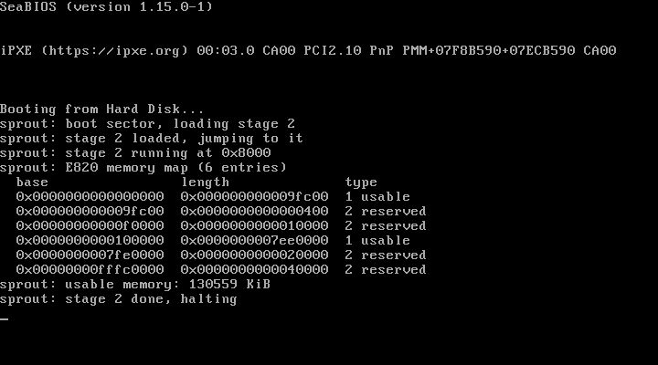

# Chapter 2 — Loading More Code

Chapter 1's boot sector already filled about half of its 510 bytes with code and text, and the
`times` line showed how hard the limit is. A kernel needs tens of kilobytes, and before
sprout can leave real mode for good it has questions to ask the BIOS. So the boot sector changes
jobs. It becomes a *loader*: it asks the BIOS to read 16 more sectors from the disk, puts them
at 0x8000 and jumps there. That code, **stage 2**, has 8 KiB to work with, and it uses them to
ask the most important question an operating system has: where is the RAM? The answer is the
E820 memory map, and by the end of the chapter sprout prints it. On the way you read sectors the
old way (cylinder, head, sector) and the modern way (a plain sector number), give the disk image
a layout, and see why the map has holes in it.

Previous: [Chapter 1](01-power-on.md). Next: [Chapter 3](03-protected-mode.md).

## Why two stages

The BIOS loads exactly one sector. Everything else is up to the code in it, and 510 bytes (minus
whatever a partition table takes) are enough to do one thing well: load more code. So nearly
every PC boot loader is split:

- **Stage 1** lives in the boot sector. It knows where on the disk the next stage is, reads it
  with the BIOS, and jumps to it.
- **Stage 2** can be as large as it needs to be. It talks to the BIOS some more, finds the
  kernel, switches the CPU to protected mode and starts the kernel.

GRUB Legacy, the boot loader of most Linux distributions in the 2000s, is the classic example,
with a stage 1.5 in between (see "In the wild" below). sprout's version is the simplest
possible: stage 2 sits right after the boot sector on the disk, at a fixed place and with a fixed
size, so stage 1 needs no file system at all. It just reads sectors 1 to 16.

Why not have the boot sector do everything with very compact code? Because the BIOS is only
available in real mode. Once sprout switches to protected mode (Chapter 3), the BIOS can no
longer be called, so everything the kernel will need from it (the memory map, the boot drive,
later the kernel file itself) must be collected before that switch. That takes room, and stage 2
has it.

## Disks as numbered sectors

A disk, as the BIOS sees it, is an array of 512-byte sectors. There are two ways to name one.

**CHS** (cylinder, head, sector) is the original. A hard disk has several platters, one
read/write head per surface, and the heads move together over concentric tracks. A *cylinder*
is the set of tracks under all heads at one position; a *head* selects the surface; a *sector*
selects a piece of the track. Sectors are numbered from **1**, cylinders and heads from 0.

**LBA** (logical block addressing) just numbers the sectors from 0. Our boot sector is LBA 0,
stage 2 starts at LBA 1.

Given a geometry of `heads` heads and `spt` sectors per track, the conversion is:

```text
sector   = LBA % spt + 1
head     = (LBA / spt) % heads
cylinder = (LBA / spt) / heads
```

The geometry of a modern disk (or a disk image) is a fiction: there are no 63-sector tracks on
an SSD, and a raw file has no heads at all. The BIOS makes a geometry up so that old software
keeps working, and translates CHS back to LBA internally. The example below asks the BIOS for
that made-up geometry, converts LBA 1 to CHS, and reads that sector the old way.

### Reading a sector with CHS: int 0x13 AH=0x02

The examples for this chapter build a two-sector disk image: a boot sector `NAME.asm`, then
`payload.asm`, one sector holding a message, at LBA 1. The rest of the 1 MiB is zeros.

`examples/ch02/payload.asm`

```nasm
; payload.asm — one sector of data for the loaders to fetch: LBA 1.
    db "sprout: this text came from sector LBA 1", 13, 10, 0
    times 512 - ($ - $$) db 0
```

`examples/ch02/Makefile` is Chapter 1's, with `payload` left out of the example names and a
new image rule:

```make
build/%.img: build/%.bin build/payload.bin
	cat $^ > $@
	truncate -s 1M $@
```

`cat` glues the boot sector and the payload together, `truncate` pads the result to 1 MiB. The
examples print only to COM1, with four tiny helpers in `examples/ch02/com1.inc`: `putc` (AL),
`puts` (string at DS:SI), `putd` (AX in decimal) and `puthex8` (AL as two hex digits). They work
like Chapter 1's, so here is only the interesting part of `chs.asm`. The printing between the
steps is elided; the file has it all.

`examples/ch02/chs.asm` (abridged)

```nasm
; chs.asm — read LBA 1 the old way: cylinder/head/sector (int 0x13 AH=0x02).
bits 16
org 0x7C00

LBA equ 1

start:
    ; ... far jump, DS = ES = SS = 0, SP = 0x7C00, DL saved in [drive] ...

    ; AH=0x08: get drive parameters. Returns DH = last head number,
    ; CL bits 0-5 = sectors per track, CH + CL bits 6-7 = last cylinder.
    mov ah, 0x08
    xor di, di                  ; ES:DI = 0:0 works around old BIOS bugs
    int 0x13
    jc fail
    movzx ax, dh
    inc ax
    mov [heads], ax
    mov al, cl
    and ax, 0x3F
    mov [spt], ax
    mov al, ch                  ; low 8 bits of the last cylinder
    mov ah, cl
    shr ah, 6                   ; bits 8-9
    inc ax
    mov [cyls], ax
    ; ... print "geometry: ..." ...

    ; LBA -> CHS:  sector   = LBA % spt + 1   (sectors count from 1!)
    ;              head     = (LBA / spt) % heads
    ;              cylinder = (LBA / spt) / heads
    mov ax, LBA
    xor dx, dx
    div word [spt]              ; ax = LBA / spt, dx = LBA % spt
    inc dx
    mov [sec], dx
    xor dx, dx
    div word [heads]            ; ax = cylinder, dx = head
    mov [cyl], ax
    mov [head], dx
    ; ... print "LBA 1 = C/H/S ..." ...

    ; AH=0x02: read AL sectors. CH = cylinder low 8 bits, CL = sector
    ; (bits 0-5) + cylinder bits 8-9 (bits 6-7), DH = head, ES:BX = buffer.
    mov ax, [cyl]
    mov ch, al
    mov cl, ah
    shl cl, 6
    or cl, [sec]
    mov dh, [head]
    mov dl, [drive]
    mov bx, 0x8000
    mov ax, 0x0201              ; AH=0x02 read, AL=1 sector
    int 0x13
    jc fail
    mov si, 0x8000
    call puts
    jmp halt
```

```console
$ cd examples/ch02
$ make
nasm -f bin -w+all -w-reloc -o build/badread.bin badread.asm
nasm -f bin -w+all -w-reloc -o build/payload.bin payload.asm
cat build/badread.bin build/payload.bin > build/badread.img
truncate -s 1M build/badread.img
nasm -f bin -w+all -w-reloc -o build/chs.bin chs.asm
cat build/chs.bin build/payload.bin > build/chs.img
truncate -s 1M build/chs.img
rm build/chs.bin build/badread.bin build/payload.bin
$ make serial NAME=chs
timeout 3 qemu-system-i386 -drive format=raw,file=build/chs.img -no-reboot \
    -display none -serial stdio -monitor none
geometry: 1 cylinders, 16 heads, 63 sectors per track
LBA 1 = C/H/S 0/0/2
sprout: this text came from sector LBA 1
qemu-system-i386: terminating on signal 15 from pid 418489 (timeout)
make: [Makefile:23: serial] Error 124 (ignored)
```

The last line of `make` is GNU make deleting the `.bin` files it considers intermediate; the
images stay. LBA 1 is the second sector of the first track: C/H/S 0/0/2. The off-by-one in
"sector" (it counts from 1, LBA from 0) is the classic bug of CHS code.

The register packing is the other source of bugs. A cylinder number has 10 bits: the low 8 go
in CH, the top 2 in bits 6–7 of CL, and the sector number fills bits 0–5 of CL. With DH for the
head, the BIOS's CHS address is 10 + 8 + 6 = 24 bits. That limit is at the heart of the "In the
wild" section below.

"1 cylinders" looks odd for a 1 MiB disk: 2048 sectors / (16 × 63) is 2.03, so there should be
two. SeaBIOS's own debug log (the `-debugcon` trick from Chapter 1) agrees there are two:

```text
drive 0x000f5940: PCHS=2/16/63 translation=none LCHS=2/16/63 s=2048
```

But AH=0x08 returns the number of the *last* cylinder, and SeaBIOS's `disk_1308` function
subtracts one more for hard disks: `nlc--;  // last sector reserved`, where `nlc` is the
cylinder count. So it reports last cylinder 0, which the example turns into "1 cylinders". This
is one more reason not to trust CHS geometry for anything that matters.

## int 0x13 extensions: reading by LBA

Since the 1990s, BIOSes have a second set of disk functions that take a 64-bit LBA instead of
CHS registers. They are called the *INT 13h extensions*, standardised as Phoenix's Enhanced Disk
Drive (EDD) specification. Two functions are all a loader needs.

**AH=0x41, "installation check".** Call it with BX = 0x55AA and DL = the drive. If the
extensions exist, the BIOS returns CF = 0, BX = 0xAA55 (the bytes swapped, to prove someone
answered) and a bitmap in CX. Bit 0 of CX means "the packet functions work", which includes the
read we want. AH comes back with the EDD version. SeaBIOS's answer is in its source, in
`src/disk.c`:

```c
disk_1341(struct bregs *regs, struct drive_s *drive_fl)
{
    regs->bx = 0xaa55;  // install check
    regs->cx = 0x0007;  // ext disk access and edd, removable supported
    disk_ret(regs, DISK_RET_SUCCESS);
    regs->ah = 0x30;    // EDD 3.0
}
```

**AH=0x42, "extended read".** DL = drive, DS:SI = a *disk address packet* (DAP) in memory that
says what to read and where to put it:

| offset | size | field |
| --- | --- | --- |
| 0 | byte | size of the packet: 16 |
| 1 | byte | reserved, 0 |
| 2 | word | number of sectors to read |
| 4 | word | buffer offset |
| 6 | word | buffer segment |
| 8 | qword | first sector, as an LBA |

The buffer address is offset first, then segment: in memory a far pointer is stored as two
little-endian words, low word first. On success CF = 0; on failure CF = 1 and AH holds a status
code.

### When a read fails

Error handling in a boot sector means: print the status code and stop. To see one, the second
example asks for a sector far past the end of the 1 MiB disk:

`examples/ch02/badread.asm` (abridged)

```nasm
    ; ... segment and stack setup as in chs.asm ...
    mov ah, 0x42
    mov si, dap                 ; DL is still the boot drive
    int 0x13
    jc .error
    ; ... .error prints "int 0x13 AH=0x42 failed, AH=0x" and AH ...

dap:
    db 16, 0
    dw 1                        ; one sector
    dw 0x8000, 0                ; to 0000:8000
    dq 100000                   ; LBA 100000: ~49 MiB into a 1 MiB disk
```

```console
$ make serial NAME=badread
timeout 3 qemu-system-i386 -drive format=raw,file=build/badread.img -no-reboot \
    -display none -serial stdio -monitor none
int 0x13 AH=0x42 failed, AH=0x01
qemu-system-i386: terminating on signal 15 from pid 418499 (timeout)
make: [Makefile:23: serial] Error 124 (ignored)
```

Status 0x01 is "invalid function in AH or invalid parameter" in Ralf Brown's Interrupt List. In
SeaBIOS it is `DISK_RET_EPARAM`, which `extended_access` returns when the requested LBA is not
below the disk's sector count. Other codes you may meet on real hardware: 0x04 (sector not
found), 0x20 (controller failure), 0x80 (timeout, drive not ready). Real disks also fail
transiently; serious loaders retry a read a few times, resetting the disk (AH=0x00) in between.
sprout, which boots from an emulated disk, prints the code and stops.

## A layout for disk and memory

Stage 1 and stage 2 now have to agree on numbers: where stage 2 is on the disk, how long it is,
where it goes in memory. Later the kernel (in C) has to agree with stage 2 about where stage 2
left the memory map. Numbers that two programs must agree on belong in one file. For sprout that
file is `boot/layout.inc`, and both assembly files include it:

`project/ch02/boot/layout.inc`

```nasm
; layout.inc — where things live, on the disk and in memory.
;
; Shared by boot.asm and stage2.asm (and mirrored in C by the kernel later),
; so both sides of every hand-off agree on the numbers.

%ifndef LAYOUT_INC
%define LAYOUT_INC

; --- disk (512-byte sectors, numbered from 0 = LBA) -------------------------
SECTOR_SIZE     equ 512
STAGE2_LBA      equ 1           ; stage 2 starts right after the boot sector
STAGE2_SECTORS  equ 16          ; and is padded to exactly 8 KiB

; --- memory (physical addresses) -----------------------------------------------
;   0x00000-0x004FF  real-mode interrupt vectors + BIOS data area: hands off
;   0x00500          BOOT_INFO: what stage 2 found out, for the kernel
;   0x00600          the E820 memory map entries
;   0x07C00          the boot sector (loaded by the BIOS); stack grows down from here
;   0x08000          stage 2 (loaded by the boot sector)
BOOT_INFO       equ 0x0500
E820_MAP        equ 0x0600
E820_MAX        equ 32          ; entries; 32 * 24 bytes ends at 0x0900
BOOT_ADDR       equ 0x7C00
STAGE2_ADDR     equ 0x8000

; BOOT_INFO layout. The kernel's C struct boot_info must match it.
struc BI
    .boot_drive:    resd 1      ; BIOS drive number we booted from (0x80...)
    .e820_count:    resd 1      ; valid entries at E820_MAP
    .e820_map:      resd 1      ; = E820_MAP
endstruc

; One E820 entry as the BIOS writes it: 24 bytes.
struc E820
    .base:          resq 1
    .length:        resq 1
    .type:          resd 1      ; 1 usable, 2 reserved, 3 ACPI reclaimable, ...
    .acpi:          resd 1      ; ACPI 3.0 extended attributes (bit 0: valid)
endstruc

%endif
```

- `equ` defines a constant; it takes no space in the output.
- `%ifndef LAYOUT_INC` is an include guard, as in C headers.
- `struc`/`endstruc` define field offsets, not memory. `BI.e820_count` is 4 and `E820.type` is
  16; NASM also defines `E820_size` (24) and `BI_size` (12). `[BOOT_INFO + BI.e820_count]` then
  reads like a C struct access.
- The first 0x500 bytes of memory belong to the CPU's real-mode interrupt vector table (0x000 to
  0x3FF) and the BIOS data area (0x400 to 0x4FF). From 0x500 to the boot sector at 0x7C00 is
  conventional memory that nobody uses during boot, so BOOT_INFO and the map go there. The stack
  grows down from 0x7C00 towards them, with almost 29 KiB of room.

The memory below 1 MiB now looks like this:

| address | size | what |
| --- | --- | --- |
| 0x00000 | 1 KiB | interrupt vector table (CPU) |
| 0x00400 | 256 B | BIOS data area |
| 0x00500 | 12 B | BOOT_INFO |
| 0x00600 | 768 B | E820_MAP, up to 32 entries of 24 bytes |
| … 0x07C00 | | stack, growing down |
| 0x07C00 | 512 B | boot sector |
| 0x08000 | 8 KiB | stage 2 |
| 0x9FC00 | | first byte the BIOS reserves (we will see why below) |

And the disk:

| LBA | what | file |
| --- | --- | --- |
| 0 | boot sector | `build/boot.bin`, 512 bytes |
| 1–16 | stage 2 | `build/stage2.bin`, 8192 bytes |
| 17–2047 | zeros | `truncate -s 1M` |

The Makefile builds the image exactly like the examples did: `cat` the two binaries, then
`truncate`. Because stage 2 is padded to exactly 16 sectors, its first byte is at offset 512 of
the image:

```console
$ cd project/ch02
$ make
mkdir -p build
nasm -f bin -w+all -w-reloc -I boot/ -MD build/boot.d -MP -l build/boot.lst -o build/boot.bin boot/boot.asm
nasm -f bin -w+all -w-reloc -I boot/ -MD build/stage2.d -MP -l build/stage2.lst -o build/stage2.bin boot/stage2.asm
cat build/boot.bin build/stage2.bin > build/sprout.img
truncate -s 1M build/sprout.img
$ ls -l build/*.bin build/sprout.img
-rw-r--r-- 1 tbangma tbangma     512 Nov 18 19:03 build/boot.bin
-rw-r--r-- 1 tbangma tbangma 1048576 Nov 18 19:03 build/sprout.img
-rw-r--r-- 1 tbangma tbangma    8192 Nov 18 19:03 build/stage2.bin
$ xxd -l 16 -s 512 build/sprout.img
00000200: e9a6 0060 88c3 b40e 30ff cd10 bafd 03ec  ...`....0.......
```

`e9 a6 00` is stage 2's first instruction, a near jump; more on it below.

## The new boot sector

`boot/boot.asm` keeps Chapter 1's setup, `serial_init`, `putc`, `print` and `print_hex8`
unchanged; the messages are new. It has `%include "layout.inc"` right after `org 0x7C00`, uses
`mov sp, BOOT_ADDR` instead of the literal, and has a new middle, between the greeting and the
halt:

```nasm
    ; Does this BIOS have the "extended" disk services (LBA addressing)?
    ; int 0x13, AH=0x41, BX=0x55AA: on success CF=0, BX=0xAA55 and bit 0
    ; of CX says the packet-based functions (AH=0x42 read) work.
    mov ah, 0x41
    mov bx, 0x55AA
    mov dl, [boot_drive]
    int 0x13
    jc no_lba
    cmp bx, 0xAA55
    jne no_lba
    test cx, 1
    jz no_lba

    ; int 0x13, AH=0x42: read the sectors described by the disk address
    ; packet at DS:SI. On error CF=1 and AH holds a status code.
    mov ah, 0x42
    mov dl, [boot_drive]
    mov si, dap
    int 0x13
    jc disk_error

    mov si, msg_loaded
    call print
    mov dl, [boot_drive]        ; stage 2 gets the drive number, too
    jmp 0x0000:STAGE2_ADDR

no_lba:
    mov si, msg_no_lba
    call print
    jmp halt

disk_error:
    mov si, msg_disk_error
    call print
    mov al, ah                  ; the BIOS status code (print kept AH)
    call print_hex8
    mov si, msg_crlf
    call print
```

- The code checks all three answers of AH=0x41. CF = 0 alone is weak evidence; BX = 0xAA55
  shows that something which knows the function answered, and CX bit 0 that the read we need is
  among the functions it supports.
- DL is reloaded from `boot_drive` before every call. The BIOS may change it, and `int 0x13`
  needs it every time.
- The far jump `jmp 0x0000:STAGE2_ADDR` sets CS = 0 explicitly, the same reason as in Chapter 1:
  stage 2 is assembled with `org 0x8000` and needs CS:IP = 0000:8000. DL carries the drive
  number on, the same hand-off the BIOS gave us.
- `disk_error` prints the AH the BIOS returned. That works because `print` only clobbers SI and
  AL (its contract header says so), so AH survives the message.

The packet itself sits with the messages at the end of the sector:

```nasm
; The disk address packet (DAP) for int 0x13 AH=0x42.
dap:
    db 16                       ; size of this packet
    db 0                        ; reserved
    dw STAGE2_SECTORS           ; sectors to read
    dw STAGE2_ADDR, 0           ; buffer, as offset then segment
    dq STAGE2_LBA               ; first sector (LBA, 64 bits)
```

The listing (`build/boot.lst`) shows where it ended up and the bytes NASM produced. They match
the table above: 16, 0, count 0x0010, offset 0x8000, segment 0, LBA 1, all little-endian:

```text
   168                                  dap:
   169 000000D8 10                          db 16                       ; size of this packet
   170 000000D9 00                          db 0                        ; reserved
   171 000000DA 1000                        dw STAGE2_SECTORS           ; sectors to read
   172 000000DC 00800000                    dw STAGE2_ADDR, 0           ; buffer, as offset then segment
   173 000000E0 0100000000000000            dq STAGE2_LBA               ; first sector (LBA, 64 bits)
...
   184 00000186 00<rep 78h>                 times 510 - ($ - $$) db 0
   185 000001FE 55AA                        dw 0xAA55
```

The boot sector now uses 0x186 = 390 bytes and pads 120. Room to spare, but stage 1 is done
growing: its only job is to load stage 2.

## Stage 2

Stage 2 is a flat binary like the boot sector, assembled for the address where stage 1 puts it.
It has no signature and no 510-byte limit, but it has a different size limit: exactly the
`STAGE2_SECTORS` sectors stage 1 reads. Its structure:

```nasm
; stage2.asm — sprout's second stage loader (16-bit real mode, for now).

%include "layout.inc"             ; first: org needs STAGE2_ADDR

bits 16
org STAGE2_ADDR

SMAP        equ 0x534D4150      ; "SMAP": the E820 magic, in EAX and EDX

stage2:
    jmp main                    ; skip over the included helper functions

%include "print16.inc"

main:
    movzx edx, dl
    mov [BOOT_INFO + BI.boot_drive], edx
    mov dword [BOOT_INFO + BI.e820_map], E820_MAP

    PRINT `sprout: stage 2 running at 0x8000\r\n`

    call e820_detect
    jc .no_e820
    call e820_print
    jmp halt
.no_e820:
    PRINT `sprout: no E820 memory map, giving up\r\n`

halt:
    PRINT `sprout: stage 2 done, halting\r\n`
.forever:
    cli
    hlt
    jmp .forever
    ; ... e820_detect, e820_print, print_type_name ...

    ; Pad to exactly STAGE2_SECTORS sectors: that is what the boot sector
    ; reads. If stage 2 outgrows them, NASM stops here with "TIMES value
    ; ... is negative": raise STAGE2_SECTORS in layout.inc.
    times STAGE2_SECTORS * SECTOR_SIZE - ($ - $$) db 0
```

Three ordering rules hide in the first lines; "Common mistakes" below shows what breaks when
each is ignored:

1. `layout.inc` comes before `org`, because `org` needs the value of `STAGE2_ADDR` right away.
   (The boot sector can include it after `org 0x7C00`, which is a literal.)
2. The first byte of stage 2 is where stage 1 jumps, so it must be code. `%include` pastes
   `print16.inc` right where it stands, and its first instruction is `putc`'s `pusha`. Hence
   `jmp main` first: `e9 a6 00` in the `xxd` dump above, a near jump 0xA6 bytes forward from
   0x8003 (the next instruction) to `main` at 0x80A9. `ndisasm -b 16 -o 0x8000` shows it as
   `jmp 0x80a9`, followed by `pusha`.
3. `print16.inc` defines the `PRINT` macro, and a macro must be defined before its first use.

`main` starts by recording what it knows in BOOT_INFO: the drive number, zero-extended to 32
bits because the struct's fields are dwords, and where the map will be. Stage 2 is the first
sprout code that uses 32-bit registers. That works in real mode on any CPU from the 386 on: the
instruction encodings are the same, and NASM, which assembles for `bits 16`, puts an
*operand-size prefix* 0x66 in front of each 32-bit instruction. The listing shows it:

```text
    21                                  main:
    22 000000A9 660FB6D2                    movzx edx, dl
    23 000000AD 6689160005                  mov [BOOT_INFO + BI.boot_drive], edx
    24 000000B2 66C706080500060000          mov dword [BOOT_INFO + BI.e820_map], E820_MAP
```

`0F B6 D2` alone would be `movzx dx, dl`; the 66 makes it EDX. In 32-bit code (Chapter 3) the
meaning flips: the 32-bit form is the default and the prefix selects 16 bits.

### print16.inc

The output functions move to `boot/print16.inc`, shared by everything in stage 2 that still runs
in real mode. `putc` is Chapter 1's (screen and COM1; the UART was initialised by stage 1, and
it stays initialised). `print` now saves SI and AX, so callers can print anywhere without saving
anything themselves. The new parts are a macro and three number printers.

```nasm
; PRINT "text" — print a string literal kept next to the code.
; Fine for messages printed once; the string lands in the middle of the
; code, so we jump over it.
%macro PRINT 1
    push si
    jmp %%skip
%%str: db %1, 0
%%skip:
    mov si, %%str
    call print
    pop si
%endmacro
```

`%%str` and `%%skip` are macro-local labels: NASM gives them a new name at every expansion, so
the macro can be used any number of times. The backquoted strings in `stage2.asm` are NASM's
C-style strings, where `\r\n` means bytes 13 and 10. One expansion in the listing (NASM marks
macro lines with `<1>`):

```text
    26                                      PRINT `sprout: stage 2 running at 0x8000\r\n`
    58 000000BB 56                  <1>  push si
    59 000000BC EB24                <1>  jmp %%skip
    60 000000BE 7370726F75743A2073- <1> %%str: db %1, 0
    60 000000C7 746167652032207275- <1>
    60 000000D0 6E6E696E6720617420- <1>
    60 000000D9 3078383030300D0A00  <1>
    61                              <1> %%skip:
    62 000000E2 BE[BE00]            <1>  mov si, %%str
    63 000000E5 E834FF              <1>  call print
    64 000000E8 5E                  <1>  pop si
```

The string sits between `jmp` and `mov`, and the `jmp` (`EB 24`, 0x24 bytes forward) hops over
it. The brackets in `BE[BE00]` mark an address that NASM fills in when it writes the output; the
listing shows it relative to the start of the file. The real bytes include the `org`:

```console
$ xxd -s 0xe2 -l 3 build/stage2.bin
000000e2: bebe 80                                  ...
```

`mov si, 0x80BE`. Each `PRINT` costs 10 bytes of code plus the string. That is more than a
`mov si, msg` / `call print` pair, but each message is next to the code that prints it, and
stage 2 has the room.

The number printers:

```nasm
; print_hex64 — the 64-bit value at [si] as "0x" and sixteen hex digits.
print_hex64:
    push eax
    mov eax, [si + 4]           ; high half first: it holds the leading digits
    call print_hex32
    mov eax, [si]
    call print_hex32_digits
    pop eax
    ret

; print_dec32 — eax as unsigned decimal.
print_dec32:
    push eax
    push ecx
    push edx
    push bx
    mov ecx, 10
    xor bx, bx                  ; digit count
.divide:
    xor edx, edx
    div ecx                     ; eax = v / 10, edx = v % 10
    push dx
    inc bx
    test eax, eax
    jnz .divide
.emit:
    pop ax
    add al, '0'
    call putc
    dec bx
    jnz .emit
    pop bx
    pop edx
    pop ecx
    pop eax
    ret
```

- `print_hex64` works on memory, not registers: a 64-bit value does not fit any register in
  16- or 32-bit code. x86 is little-endian, so the high dword is at `[si + 4]` and is printed
  first.
- `div ecx` divides the 64-bit EDX:EAX by ECX. EDX must be zeroed first, or the quotient can
  overflow 32 bits, which makes the CPU raise a divide error (interrupt 0). Division yields the
  lowest digit first, so the digits go on the stack and come back off in printing order.
- Not shown: `print_hex32` prints "0x" and falls into `print_hex32_digits`, which works like
  Chapter 1's hex printer on 32 bits: `rol edx, 4` moves the top nibble to the bottom, eight
  times, so the digits come out most significant first and EDX ends as it was. `print_crlf`
  prints 13 and 10.

## The memory map: int 0x15, EAX=0xE820

An operating system must know which physical addresses are RAM it may use. It cannot just probe
by writing and reading back: some addresses belong to devices, some to the firmware, and some
RAM is in use by the BIOS or holds ACPI tables the OS needs later. The firmware knows the answer,
and the standard way to ask a PC BIOS is **int 0x15 with EAX = 0xE820**, "query system address
map". The name is simply the value in AX.

Each call returns one *entry*: a 64-bit base address, a 64-bit length and a 32-bit type, plus
(since ACPI 3.0) a 32-bit attributes field. The registers:

| in | meaning |
| --- | --- |
| EAX | 0xE820 |
| EDX | 0x534D4150: 0x53 0x4D 0x41 0x50 are the ASCII codes of "SMAP" |
| EBX | continuation value: 0 for the first call, then whatever the last call returned |
| ECX | size of our buffer: 24 (at least 20) |
| ES:DI | where the BIOS should write the entry |

| out | meaning |
| --- | --- |
| CF | 1 on error (or, after the first entry, "no more entries") |
| EAX | "SMAP" again, to show the BIOS understood |
| EBX | continuation value for the next call; 0 if this was the last entry |
| ECX | bytes actually written: 20 or 24 |

The types sprout knows: 1 usable RAM, 2 reserved, 3 ACPI reclaimable (holds ACPI tables; usable
once the OS has read them), 4 ACPI NVS (must be preserved), 5 bad memory. Anything else prints
as "unknown". Only type 1 counts as usable.

### e820_detect

```nasm
e820_detect:
    mov di, E820_MAP            ; ES:DI = where the BIOS writes the entry
    xor ebx, ebx                ; continuation: 0 = start from the beginning
    xor bp, bp                  ; entries stored
.next:
    mov dword [di + E820.acpi], 1
    mov eax, 0xE820
    mov edx, SMAP
    mov ecx, E820_size          ; 24: we can take the ACPI 3.0 field
    int 0x15
    jc .end                     ; CF=1: no more entries (or no E820 at all)
    cmp eax, SMAP               ; the BIOS echoes "SMAP" if it understood
    jne .fail
    mov eax, [di + E820.length]
    or eax, [di + E820.length + 4]
    jz .skip                    ; ignore empty entries
    inc bp
    add di, E820_size
    cmp bp, E820_MAX
    je .done                    ; table full: keep what we have
.skip:
    test ebx, ebx
    jnz .next
    jmp .done
.end:
    test bp, bp                 ; CF on the very first call: no E820
    jz .fail
.done:
    movzx eax, bp
    mov [BOOT_INFO + BI.e820_count], eax
    clc
    ret
.fail:
    stc
    ret
```

- EAX, ECX and EDX are set again before *every* call. The BIOS overwrites EAX and ECX with its
  answers, and the example code on OSDev's memory detection page resets EDX too, with the
  comment "Some BIOSes apparently trash this register?".
- The loop has two ways to end. EBX may come back as 0 with the last entry; if it does not, the
  call after the last entry returns CF = 1. Only CF on the very first call means "no E820".
- `.acpi` is preset to 1 ("valid") because a BIOS that writes only 20 bytes leaves the field
  alone, and a later reader of the table should not see garbage there. SeaBIOS is such a BIOS.
- Entries with length 0 are to be ignored, so they are skipped. `.skip` reuses the same slot,
  since DI did not advance.
- Up to 32 entries; QEMU reports 6 or 7, real PCs often more. The BIOS does not promise a
  sorted list, and sprout does not sort it; the kernel will not care about the order.
- The function returns its result in CF, a common convention for BIOS-style assembly: `call
  e820_detect` / `jc .no_e820`.

What does SeaBIOS check? Its handler, `handle_15e820` in `src/system.c`, fails (CF = 1) if EDX is
not "SMAP", if EBX is past the last entry, or if ECX is below 20. Otherwise it copies a 20-byte
entry, returns EAX = "SMAP", ECX = 20, and EBX = the next index, or 0 after the last entry.

### e820_print

Printing the table is mostly `PRINT` and the number printers. The interesting part is the sum
of the usable memory:

```nasm
    cmp dword [si + E820.type], 1
    jne .not_usable
    mov eax, [si + E820.length]
    mov edx, [si + E820.length + 4]
    shrd eax, edx, 10           ; eax = the 64-bit length / 1024
    add edi, eax
.not_usable:
```

`shrd eax, edx, 10` shifts EAX right by 10 bits and fills the top bits from EDX: the low 32 bits
of the 64-bit length divided by 1024. In KiB, a 32-bit sum is good for 4 TiB, plenty for a hobby
kernel. `print_type_name` maps a type above 5 to 0, then prints the string that a table of
pointers, `type_names: dw .unknown, .usable, .reserved, ...`, holds for it, with `mov si,
[type_names + eax * 2]`. That is a 32-bit addressing mode (scaled index), legal in real mode on
a 386 or later as long as the result stays below 64 KiB. NASM adds an address-size prefix
(0x67).

### Running it

```console
$ make test
sh tools/qemu-test.sh "qemu-system-i386 -m 128M" build/sprout.img tests/boot.expected
PASS: build/sprout.img (13 lines of serial output match tests/boot.expected)
$ make demo
sprout: boot sector, loading stage 2
sprout: stage 2 loaded, jumping to it
sprout: stage 2 running at 0x8000
sprout: E820 memory map (6 entries)
  base                length              type
  0x0000000000000000  0x000000000009fc00  1 usable
  0x000000000009fc00  0x0000000000000400  2 reserved
  0x00000000000f0000  0x0000000000010000  2 reserved
  0x0000000000100000  0x0000000007ee0000  1 usable
  0x0000000007fe0000  0x0000000000020000  2 reserved
  0x00000000fffc0000  0x0000000000040000  2 reserved
sprout: usable memory: 130559 KiB
sprout: stage 2 done, halting
```

`tools/qemu-test.sh` is unchanged from Chapter 1. The Makefile now passes `"$(QEMU) -m 128M"`
as the QEMU command, because the memory map depends on the amount of RAM, and the expected
output must not change if QEMU's default ever does. In the window (`make run`) the same text
appears below SeaBIOS's banner:



The table is now in memory, where the kernel will find it. The QEMU monitor can show it. With
the monitor on stdin instead of `-monitor none` (the `-serial null` throws COM1 away):

```console
$ timeout 10 qemu-system-i386 -m 128M -drive format=raw,file=build/sprout.img -no-reboot \
    -display none -serial null -monitor stdio
QEMU 6.2.0 monitor - type 'help' for more information
(qemu) xp /3wx 0x500
0000000000000500: 0x00000080 0x00000006 0x00000600
(qemu) xp /12wx 0x600
0000000000000600: 0x00000000 0x00000000 0x0009fc00 0x00000000
0000000000000610: 0x00000001 0x00000001 0x0009fc00 0x00000000
0000000000000620: 0x00000400 0x00000000 0x00000002 0x00000001
(qemu) quit
```

BOOT_INFO: drive 0x80, 6 entries, map at 0x600. The first entry is base 0 (two dwords), length
0x9FC00 (two dwords), type 1, attributes 1; the second starts at 0x618 with base 0x9FC00. The
attributes are our preset 1: SeaBIOS wrote 20 bytes per entry.

### Why the map has holes

QEMU was given 128 MiB, which is 131072 KiB. The map reports 639 + 129920 = 130559 KiB usable.
Where did the other 513 KiB go?

| range | KiB | what |
| --- | --- | --- |
| 0x9FC00–0x9FFFF | 1 | reserved: SeaBIOS's *extended BIOS data area* (EBDA) |
| 0xA0000–0xEFFFF | 320 | **not in the map at all**: VGA memory (0xA0000–0xBFFFF) and option ROMs, like the VGA BIOS at 0xC0000 |
| 0xF0000–0xFFFFF | 64 | reserved: the BIOS itself, as seen below 1 MiB |
| 0x7FE0000–0x7FFFFFF | 128 | reserved: the top 128 KiB of RAM, where SeaBIOS keeps ACPI tables |

1 + 320 + 64 + 128 = 513. The last entry, 256 KiB at 0xFFFC0000, is not RAM at all: it is the
BIOS ROM mapped just below 4 GiB, where Chapter 1's CPU fetched its first instruction at
0xFFFFFFF0.

Two lessons. First, *absent* is not the same as *usable*: the 384 KiB from 0xA0000 to 0xFFFFF
are the classic "upper memory area" of the PC, and an OS must not hand them out just because the
map has no entry for them. Treat anything that is not listed as type 1 as reserved. Second, the
reserved RAM at the top is real memory that the OS must not overwrite. SeaBIOS's debug log (run
with `-debugcon file:build/seabios.log -global isa-debugcon.iobase=0x402` as in Chapter 1)
prints the same map just before booting, as ranges, and an earlier line shows the ACPI tables
inside that reserved top:

```text
ACPI: parse DSDT at 0x07fe0040 (len 6009)
...
e820 map has 6 items:
  0: 0000000000000000 - 000000000009fc00 = 1 RAM
  1: 000000000009fc00 - 00000000000a0000 = 2 RESERVED
  2: 00000000000f0000 - 0000000000100000 = 2 RESERVED
  3: 0000000000100000 - 0000000007fe0000 = 1 RAM
  4: 0000000007fe0000 - 0000000008000000 = 2 RESERVED
  5: 00000000fffc0000 - 0000000100000000 = 2 RESERVED
```

The BIOS data area at 0x413 has its own, older answer for the memory below 640 KiB; exercise 3
compares it with the first entry.

## Different amounts of memory

The map changes with QEMU's `-m`. With 4 GiB (pass the QEMU command to the test script by hand;
the comparison then fails, which is fine, and `build/serial.log` has the output):

```console
$ sh tools/qemu-test.sh "qemu-system-i386 -m 4G" build/sprout.img tests/boot.expected >/dev/null
$ sed -n '4,13p' build/serial.log
sprout: E820 memory map (7 entries)
  base                length              type
  0x0000000000000000  0x000000000009fc00  1 usable
  0x000000000009fc00  0x0000000000000400  2 reserved
  0x00000000000f0000  0x0000000000010000  2 reserved
  0x0000000000100000  0x00000000bfee0000  1 usable
  0x00000000bffe0000  0x0000000000020000  2 reserved
  0x00000000fffc0000  0x0000000000040000  2 reserved
  0x0000000100000000  0x0000000040000000  1 usable
sprout: usable memory: 4193791 KiB
```

The RAM below 4 GiB ends at 0xC0000000, 3 GiB. The fourth gigabyte of addresses, 0xC0000000 to
0xFFFFFFFF, is the *PCI hole*: room for device memory (graphics memory, PCI device registers)
and the BIOS ROM. QEMU's PC machine moves the RAM that would be there to above 4 GiB: the new
seventh entry, 1 GiB at 0x100000000. A 32-bit CPU without PAE cannot reach that last gigabyte,
and sprout will not use it, but a 64-bit kernel would. That is why the map is 64-bit, and why
E820 is the BIOS call to use: older memory-size calls cannot describe memory above 4 GiB.

## The Makefile: one rule, two binaries, tracked includes

The changes from Chapter 1's Makefile:

```make
NASMFLAGS := -f bin -w+all -w-reloc -I boot/

# 128 MiB of RAM, always: the memory map in the test output depends on it.
QEMUFLAGS := -m 128M -drive format=raw,file=$(IMAGE) -no-reboot

# -MD/-MP: record which .inc files each .asm used (build/*.d, included
# at the bottom), so editing layout.inc rebuilds both binaries.
$(BUILD)/%.bin: boot/%.asm | $(BUILD)
	$(NASM) $(NASMFLAGS) -MD $(@:.bin=.d) -MP -l $(@:.bin=.lst) -o $@ $<

$(IMAGE): $(BUILD)/boot.bin $(BUILD)/stage2.bin
	cat $^ > $@
	truncate -s 1M $@

disasm: $(BUILD)/boot.bin $(BUILD)/stage2.bin
	ndisasm -b 16 -o 0x7C00 $(BUILD)/boot.bin
	ndisasm -b 16 -o 0x8000 $(BUILD)/stage2.bin

-include $(wildcard $(BUILD)/*.d)
```

- `-I boot/` adds `boot/` to the directories `%include` searches; make runs NASM from the
  project root.
- One pattern rule builds both `.bin` files. `$(@:.bin=.d)` turns `build/stage2.bin` into
  `build/stage2.d`.
- `-MD file` makes NASM write a dependency file while it assembles, in make's syntax, the same
  idea as `gcc -MD`. `-MP` adds an empty rule for each header, so deleting an `.inc` file does
  not break the build with "No rule to make target".

```console
$ cat build/stage2.d
build/stage2.bin : boot/stage2.asm boot/layout.inc \
  boot/print16.inc

boot/stage2.asm :

boot/layout.inc :

boot/print16.inc :

```

The `-include` line at the bottom reads these files (the `-` means "no error if there are none
yet", as on a fresh checkout). Without it, editing `STAGE2_SECTORS` in `layout.inc` would
rebuild nothing, and the boot sector would keep reading the old number of sectors. Exercise 2
shows it working.

## Common mistakes

**`org` before the include that defines its value.** Move `%include "layout.inc"` in stage 2 below
`org STAGE2_ADDR` and rebuild:

```console
$ make
nasm -f bin -w+all -w-reloc -I boot/ -MD build/stage2.d -MP -l build/stage2.lst -o build/stage2.bin boot/stage2.asm
boot/stage2.asm:10: error: symbol `STAGE2_ADDR' not defined before use
boot/stage2.asm:10: error: No or invalid offset specified in ORG directive.
make: *** [Makefile:33: build/stage2.bin] Error 1
```

NASM resolves most symbols after reading the whole file, but `org` is needed while it assembles.

**A macro used before it is defined.** Move `%include "print16.inc"` (with the `jmp main`) to the
end of stage 2, after the code that uses `PRINT`. NASM has never heard of `PRINT`, so it reads
the line as a label followed by garbage, and then complains about the "label" again at every use:

```console
$ make
...
boot/stage2.asm:21: error: instruction expected, found `PRINT sprout: stage 2 running at 0x8000
'
boot/stage2.asm:28: error: label `PRINT' inconsistently redefined
boot/stage2.asm:21: info: label `PRINT' originally defined here
...
```

(The full output is 41 lines; the `'` on its own line is the `\r\n` in the string, printed
literally.) The order rule for macros is the C preprocessor's: define before use. For functions
it is not, since NASM resolves labels in a later pass, which is why the functions in
`print16.inc` could live anywhere.

**Forgetting to jump over the included code.** Remove `jmp main` but keep the include where it
is, and stage 1 jumps straight into `putc`. It prints whatever AL holds, which is the 0 that
ended stage 1's last string, and then `ret`urns with no caller: the CPU pops two bytes of
whatever is on the stack into IP. COM1 receives the two boot sector lines and a NUL byte, then
nothing, until `timeout` stops QEMU. `info registers` in the monitor found the CPU wandering in
the BIOS ROM, at `EIP=0000ff53` with `CS =f000`. "Nothing happens after the jump" usually means
the jump target is not the code you think it is.

**Stage 2 too big.** The padding line refuses, with a negative count, exactly as the boot
sector's did in Chapter 1. Exercise 2 triggers it and fixes it.

**Forgetting EDX = "SMAP".** Comment out `mov edx, SMAP`: SeaBIOS rejects the very first call
with CF = 1, and stage 2 reports that there is no map. The test catches it (the six removed
table lines are cut here):

```console
$ make test
sh tools/qemu-test.sh "qemu-system-i386 -m 128M" build/sprout.img tests/boot.expected
--- tests/boot.expected	2026-11-18 22:07:17.364692191 -0500
+++ build/serial.log	2026-11-18 22:18:26.037664576 -0500
@@ -1,13 +1,5 @@
 sprout: boot sector, loading stage 2
 sprout: stage 2 loaded, jumping to it
 sprout: stage 2 running at 0x8000
-sprout: E820 memory map (6 entries)
-  base                length              type
...
-sprout: usable memory: 130559 KiB
+sprout: no E820 memory map, giving up
 sprout: stage 2 done, halting
FAIL: serial output differs from tests/boot.expected (see build/serial.log)
make: *** [Makefile:48: test] Error 1
```

Setting EDX only once, before the loop, is the subtler version of the same bug: it works on
BIOSes that preserve EDX, and fails on the next machine.

**Reading into a buffer that crosses a 64 KiB boundary.** The classic BIOS read uses the old
DMA controller on some machines, which cannot cross a 64 KiB physical boundary in one transfer;
the read then fails with status 0x09. sprout's 8 KiB at 0x8000 ends at 0xA000, well inside the
first 64 KiB, but a loader that reads a large kernel must split the read at each boundary.
Chapter 4's kernel loader reads its kernel in pieces of 64 sectors (32 KiB).

## In the wild: GRUB's stages and the 504 MiB barrier

**GRUB Legacy** split itself the way sprout does, with one more step. Its manual describes
*Stage 1*, exactly 512 bytes, in the MBR or a partition's boot sector. It does not understand
any file system: it stores the location of the next stage on the disk as a *block list* and
loads it. The next stage is either *Stage 2*, the full boot loader with menus and a shell, or a
*Stage 1.5*, the bridge between the two. Each Stage 1.5 understands one file system
(`e2fs_stage1_5` understands ext2, `fat_stage1_5` FAT, and so on) and can be installed in the
area right after the MBR. Because Stage 1.5 reads Stage 2 through the file system, the manual
notes, you can move the Stage 2 file even after GRUB has been installed. sprout's stage 2 is at
a fixed LBA and can skip all that.

**The 504 MiB barrier.** INT 13h's CHS registers allow 1024 cylinders, 256 heads (255 in
practice) and 63 sectors. The original IDE (ATA) interface has its own CHS limits: 65536
cylinders, 16 heads, 255 sectors. A BIOS that passed CHS values straight through to the drive
was limited by the smaller value of each:

```text
1024 cylinders × 16 heads × 63 sectors × 512 bytes = 528,482,304 bytes = 504 MiB
```

Disks larger than that arrived in the mid-1990s, and Microsoft's knowledge base article Q126855
explains the limit to users of the time. BIOSes then started *translating*: they reported a
fake geometry with more heads and fewer cylinders, which pushed the limit to 1024 × 255 × 63 ×
512 bytes, about 8.4 GB (7.8 GiB). Breaking that one required abandoning CHS, which is what the
INT 13h extensions did: introduced by IBM and Microsoft, then standardised by Phoenix as EDD,
with a 64-bit sector number in the packet. The SeaBIOS log line `LCHS=2/16/63` shows the
translation machinery still exists in today's firmware.

**Linux 0.01** (1991) had no second stage. Its `boot/boot.s` is a single 512-byte sector that
the BIOS loads at 0x7C00. It moves itself out of the way to 0x90000, loads the system to 0x10000
with BIOS reads (`SYSSEG = 0x1000`), moves it down to address 0 and switches to protected mode,
all in that one sector. It reads by CHS, and the floppy geometry is fixed when the kernel is
built (`sectors = 18` for 1.44 MB disks, with lines for 1.2 MB and 720 KB disks commented out).
The comment above it: "Having the boot-up procedure hunt for the right disk type is severe
brain-damage." sprout's stage 1 asks the BIOS instead, and lets the BIOS worry about geometry.

## Summary

- The BIOS loads one sector. A boot sector that loads more code is a *stage 1*; sprout's reads
  stage 2 (16 sectors from LBA 1) to 0x8000 and jumps there with DL = drive.
- CHS addressing (int 0x13 AH=0x02) packs a 24-bit address into registers and counts sectors from
  1; `sector = LBA % spt + 1`, `head = (LBA / spt) % heads`, `cylinder = LBA / spt / heads`.
- LBA addressing: check for the extensions with AH=0x41 (BX = 0x55AA in, 0xAA55 out, CX bit 0),
  then read with AH=0x42 and a 16-byte disk address packet. CF = 1 means failure, AH the status.
- `boot/layout.inc` holds every number the stages share: disk layout, memory layout, and the
  BOOT_INFO and E820 structures.
- Stage 2 starts with `jmp main` because `%include` pastes code where it stands; `org` needs its
  value before use, and macros must be defined before use.
- 32-bit registers work in real mode on a 386 or later; NASM adds the 0x66 prefix.
- int 0x15 EAX=0xE820 returns the memory map one entry per call (EDX = "SMAP", ECX = 24, EBX
  continuation). Only type 1 is RAM; gaps in the map are not RAM either. Below 1 MiB, QEMU gives
  us 639 KiB; above it, RAM up to the ACPI tables, and above 3 GiB a PCI hole.
- NASM's `-MD`/`-MP` give make the include dependencies, so changing `layout.inc` rebuilds both
  stages.

## Exercises

1. **Load stage 2 with CHS.** Replace the AH=0x41/0x42 code in `boot.asm` with one AH=0x02
   read of all 16 sectors (stage 2 starts at LBA 1; what is that in CHS?). Check with `make
   test`. Then explain why the course uses LBA even though this works.

   <details><summary>Solution</summary>

   LBA 1 is C/H/S 0/0/2 on any geometry with more than one sector per track. AL = 16 sectors,
   CH = 0, CL = 2 (sectors count from 1), DH = 0, ES:BX = 0000:8000:

   ```nasm
       ; int 0x13, AH=0x02: read AL sectors starting at cylinder CH, head DH,
       ; sector CL (counting from 1) to ES:BX. LBA 1 is C/H/S 0/0/2.
       mov ax, 0x0200 + STAGE2_SECTORS ; AH=0x02, AL=16 sectors
       mov cx, 0x0002              ; CH=0 (cylinder), CL=2 (sector)
       xor dh, dh                  ; head 0
       mov dl, [boot_drive]
       mov bx, STAGE2_ADDR         ; ES:BX = 0000:8000
       int 0x13
       jc disk_error
   ```

   The `dap`, `no_lba` and `msg_no_lba` can go. ES is 0 from the setup code.

   ```console
   $ make test
   sh tools/qemu-test.sh "qemu-system-i386 -m 128M" build/sprout.img tests/boot.expected
   PASS: build/sprout.img (13 lines of serial output match tests/boot.expected)
   ```

   The boot sector shrinks to 0x173 bytes. It works because sectors 2 to 17 of track 0 all exist
   with QEMU's 63 sectors per track. Reasons to prefer LBA: a read that crosses a track or
   cylinder must be split by hand (not every BIOS reads across a track), the geometry must be
   asked for and differs between machines and between floppy and hard disk, and CHS cannot reach
   beyond 8 GB (or 504 MiB on old BIOSes). With LBA, the code says "sector 1" and means it.
   </details>

2. **Outgrow 8 KiB.** Add `big_table: times 8192 db 0x90` just before the padding line of
   `stage2.asm`, and run `make`. Read the error, then fix the build without removing the table.
   Which files does `make` rebuild after your fix, and why?

   <details><summary>Solution</summary>

   ```console
   $ make
   nasm -f bin -w+all -w-reloc -I boot/ -MD build/stage2.d -MP -l build/stage2.lst -o build/stage2.bin boot/stage2.asm
   boot/stage2.asm:159: error: TIMES value -816 is negative
   make: *** [Makefile:33: build/stage2.bin] Error 1
   ```

   Stage 2's code was 0x330 = 816 bytes; with 8192 more it is 816 bytes over the 8 KiB. The fix
   is in `layout.inc`: `STAGE2_SECTORS equ 32`. Both binaries depend on `layout.inc` (through
   the `.d` files), so both are rebuilt. That matters: stage 1 must now read 32 sectors.

   ```console
   $ make
   nasm -f bin -w+all -w-reloc -I boot/ -MD build/boot.d -MP -l build/boot.lst -o build/boot.bin boot/boot.asm
   nasm -f bin -w+all -w-reloc -I boot/ -MD build/stage2.d -MP -l build/stage2.lst -o build/stage2.bin boot/stage2.asm
   cat build/boot.bin build/stage2.bin > build/sprout.img
   truncate -s 1M build/sprout.img
   $ make test
   sh tools/qemu-test.sh "qemu-system-i386 -m 128M" build/sprout.img tests/boot.expected
   PASS: build/sprout.img (13 lines of serial output match tests/boot.expected)
   $ ls -l build/stage2.bin
   -rw-r--r-- 1 tbangma tbangma 16384 Nov 18 22:18 build/stage2.bin
   ```

   If only stage 2 were rebuilt, the boot sector would still load 16 sectors and stage 2 would
   run with half its code missing. Here it would even pass the test, since the table is never
   used, which is exactly why such a bug is hard to find.
   </details>

3. **Ask the BIOS data area.** The word at physical address 0x413 is the BIOS's count of
   conventional memory in KiB (the same value int 0x12 returned in Chapter 1's exercise 1). Print
   it after the "running" line as `sprout: BIOS data area says N KiB of conventional memory`,
   and compare it with the first E820 entry.

   <details><summary>Solution</summary>

   ```nasm
       PRINT `sprout: stage 2 running at 0x8000\r\n`
       PRINT `sprout: BIOS data area says `
       movzx eax, word [0x413]     ; BDA: conventional memory in KiB
       call print_dec32
       PRINT ` KiB of conventional memory\r\n`
   ```

   ```console
   $ make demo | head -5
   sprout: boot sector, loading stage 2
   sprout: stage 2 loaded, jumping to it
   sprout: stage 2 running at 0x8000
   sprout: BIOS data area says 639 KiB of conventional memory
   sprout: E820 memory map (6 entries)
   ```

   639 × 1024 = 654336 = 0x9FC00, exactly the length of the first E820 entry. The missing KiB
   below 640 is the EBDA, which the BIOS subtracts from this count. (`make test` now fails, of
   course: the expected output has no such line.)
   </details>

4. **More memory.** The "Different amounts of memory" section showed 4 GiB. Before you run it,
   predict the map for `-m 512M`: which entries change, and what is the total? Then check:

   ```console
   $ sh tools/qemu-test.sh "qemu-system-i386 -m 512M" build/sprout.img tests/boot.expected
   ```

   <details><summary>Solution</summary>

   Everything below 1 MiB and the ROM below 4 GiB stay the same. The usable range from 1 MiB
   ends where the 128 KiB of ACPI tables start, at 512 MiB − 128 KiB = 0x1FFE0000, so its
   length is 0x1FFE0000 − 0x100000 = 0x1FEE0000. 512 MiB is well below 3 GiB, so there is no
   entry above 4 GiB. The total is 639 + 0x1FEE0000 / 1024 = 639 + 523136 = 523775 KiB.

   ```console
   $ sh tools/qemu-test.sh "qemu-system-i386 -m 512M" build/sprout.img tests/boot.expected
   --- tests/boot.expected	2026-11-18 22:04:27.053646152 -0500
   +++ build/serial.log	2026-11-18 22:18:40.624180835 -0500
   @@ -6,8 +6,8 @@
      0x0000000000000000  0x000000000009fc00  1 usable
      0x000000000009fc00  0x0000000000000400  2 reserved
      0x00000000000f0000  0x0000000000010000  2 reserved
   -  0x0000000000100000  0x0000000007ee0000  1 usable
   -  0x0000000007fe0000  0x0000000000020000  2 reserved
   +  0x0000000000100000  0x000000001fee0000  1 usable
   +  0x000000001ffe0000  0x0000000000020000  2 reserved
      0x00000000fffc0000  0x0000000000040000  2 reserved
   -sprout: usable memory: 130559 KiB
   +sprout: usable memory: 523775 KiB
    sprout: stage 2 done, halting
   FAIL: serial output differs from tests/boot.expected (see build/serial.log)
   ```

   The diff is the cleanest way to see what changed. For 4 GiB the total is 639 + 3144576 (the
   0xBFEE0000 bytes below the PCI hole) + 1048576 (the gigabyte above 4 GiB) = 4193791 KiB:
   3 GiB plus 1 GiB, minus the same 513 KiB as with 128 MiB.
   </details>

Sources for this chapter: [REFERENCES.md](REFERENCES.md#chapter-2--loading-more-code)
