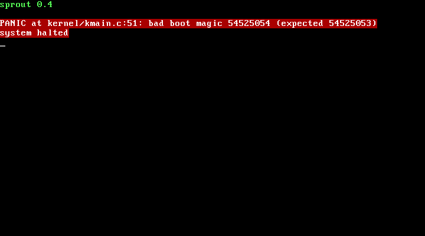
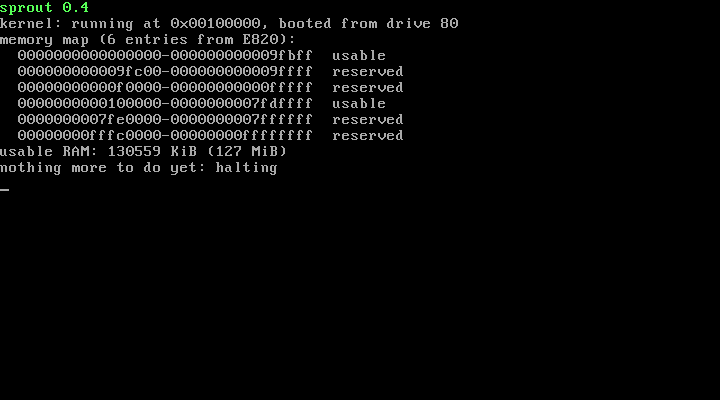

# Chapter 4 — Hello from C

Assembly got sprout into 32-bit protected mode. From here on, the kernel is written in C. This
chapter covers C without an operating system under it, and how the ordinary 64-bit gcc builds
32-bit code with no C library. A linker script places the kernel at 1 MiB, and stage 2 loads
it, copies it there and jumps to it. The kernel gets its first drivers (COM1, the VGA screen),
a `kprintf` with a host-tested formatter, and `panic`. At the end, sprout 0.4 prints the
memory map from C.

Previous: [Chapter 3](03-protected-mode.md). Next: [Chapter 5](05-interrupts.md).

## Hosted and freestanding C

Every C program you have written so far ran in a *hosted* environment: the operating system
loaded it, startup code called `main`, and the whole standard library was there. A kernel has
none of that. No one calls `main`, and there is no library underneath, because the kernel is
what libraries call. C11 (draft N1570, §4) names this case: a *conforming freestanding
implementation* only has to provide nine headers: `<float.h>` and `<limits.h>` (ranges),
`<stdarg.h>` (`va_list`), `<stddef.h>` (`size_t`, `NULL`, `offsetof`), `<stdint.h>`,
`<stdbool.h>`, and `<iso646.h>`, `<stdalign.h>`, `<stdnoreturn.h>` (spellings such as `and`).
All nine contain only types and macros, so none needs a library behind it. The function called
at startup is implementation-defined (§5.1.2.1). sprout's is `kmain`.

gcc switches to this mode with `-ffreestanding`, for the case where "the standard library may
not exist, and program startup may not necessarily be at `main`"; "the most obvious example is
an OS kernel" (GCC manual). Three effects you can see:

```console
$ echo | gcc -m32 -dM -E - | grep HOSTED
#define __STDC_HOSTED__ 1
$ echo | gcc -m32 -ffreestanding -dM -E - | grep HOSTED
#define __STDC_HOSTED__ 0
$ echo '#include <stdint.h>' | gcc -m32 -ffreestanding -H -E - 2>&1 >/dev/null
. /usr/lib/gcc/x86_64-linux-gnu/11/include/stdint.h
.. /usr/lib/gcc/x86_64-linux-gnu/11/include/stdint-gcc.h
```

`__STDC_HOSTED__` is 0, so code can tell which world it is in. `<stdint.h>` comes from gcc's
own directory (`stdint-gcc.h`), not from the C library. And `-ffreestanding` implies
`-fno-builtin`: gcc stops assuming that a function called `strlen` behaves like the standard
one. `#include <stdio.h>` fails here (`fatal error: bits/libc-header-start.h: No such file or
directory`), because this machine has no 32-bit C library. Even with one, there would be no
`printf` to link: glibc's `printf` ends in a `write` system call, and system calls are what *we*
are about to provide.

### Four functions gcc wants anyway

Freestanding doesn't mean gcc never calls a library function. The GCC manual's "Standards"
page: "GCC requires the freestanding environment provide `memcpy`, `memmove`, `memset` and
`memcmp`". gcc emits such calls by itself, for example for a large struct copy:

`copy.c` (a throwaway file)
```c
struct table { int entries[4096]; };

void copy(struct table *dst, const struct table *src)
{
    *dst = *src;
}
```

```console
$ gcc $KCFLAGS -c copy.c && objdump -dr -M intel --no-show-raw-insn copy.o | grep -A1 call
  10:	call   11 <copy+0x11>
			11: R_386_PC32	memcpy
$ ld -m elf_i386 -nostdlib -e copy -o copy.elf copy.o
ld: copy.o: in function `copy':
copy.c:(.text+0x11): undefined reference to `memcpy'
```

`$KCFLAGS` is the kernel's flags from the next section. The 16 KiB struct assignment became
`memcpy(dst, src, 0x4000)`. So `lib/string.c` defines all four, plus some `str*` functions, as
plain byte loops (gcc also expects `memcpy` to work when source and destination are equal).

## Building 32-bit kernel code with the host gcc

The OSDev wiki ("Why do I need a Cross Compiler?") advises building a *cross-compiler* such as
`i686-elf-gcc`: the host gcc's defaults assume Linux, glibc and a dynamic loader, and a bare
`elf` target assumes none of that and comes with a 32-bit `libgcc`. sprout takes the other
road: the gcc you have, every Linux assumption switched off by a flag, and `ld` called directly.
The cost: another distribution's gcc may have other defaults. If a build fails strangely, the
OSDev pages are the next place to look.

`project/ch04/Makefile` (part; the comment above it explains each flag)
```make
KCFLAGS := -m32 -ffreestanding -fno-pie -fno-stack-protector \
           -fcf-protection=none -fno-asynchronous-unwind-tables \
           -mgeneral-regs-only -std=c11 -O2 -g -Wall -Wextra -Werror \
           -Ikernel -Ilib -MMD -MP
KLDFLAGS := -m elf_i386 -nostdlib -T kernel/linker.ld
```

`-m32` means i386 code (`-m elf_i386` for `ld`), `-fcf-protection=none` drops `endbr32`
instructions, and `-std=c11` onwards are learn-c's habits. `-nostdlib` links no `crt1.o`,
`libc` or `libgcc`. `examples/ch04/` shows what the other flags prevent, with the same flags
minus the include paths and `-Werror`.

### No libgcc: 64-bit division

`examples/ch04/divide.c`
```c
/* divide.c — 64-bit division in 32-bit code needs a helper from libgcc. */
#include <stdint.h>

uint64_t average(uint64_t total, uint64_t count)
{
    return total / count;
}
```

```console
$ make divide
gcc -m32 -ffreestanding ... -c divide.c -o divide.o
ld -m elf_i386 -nostdlib -e average -o divide.elf divide.o
ld: divide.o: in function `average':
divide.c:(.text+0x14): undefined reference to `__udivdi3'
make: *** [Makefile:19: divide] Error 1
```

The i386 `div` instruction divides a 64-bit value by a 32-bit one. A 64-by-64 division needs a
loop, so gcc calls `__udivdi3` ("unsigned divide, double-word"), one of libgcc's "integer
library routines" (GCC internals manual), with `__divdi3`, `__moddi3` and `__umoddi3`. Adding
`-lgcc` does not help here: `gcc -m32 -print-libgcc-file-name` names the 64-bit
`/usr/lib/gcc/x86_64-linux-gnu/11/libgcc.a`, and `ld` answers `skipping incompatible ...
cannot find -lgcc`.

Division by a *constant* is fine: `return t / 10;` on a `uint64_t` links, because gcc
multiplies by a fixed-point reciprocal of 10 (`mov ebp,0xcccccccd` … `mul ebp`). So the kernel
has a rule: no 64-bit `/` or `%` by a variable. The one place that needs it, printing 64-bit
numbers, gets its own division function below. (`gcc-multilib` or a cross-compiler would
provide a 32-bit libgcc. sprout works without either.)

### No stack protector

`examples/ch04/canary.c` (part; `read_name` fills the buffer with `"sprout"` and zeros)
```c
size_t name_length(void)
{
    char name[32];
    read_name(name, sizeof name);
    size_t n = 0;
    while (n < sizeof name && name[n])
        n++;
    return n;
}
```

This target compiles the file the way you would compile a normal program, with `-m32 -O2` only:

```console
$ make canary
gcc -m32 -O2 -c canary.c -o canary.o
objdump -dr -M intel --no-show-raw-insn canary.o | grep -E 'gs:|stack_chk'
  44:	mov    eax,gs:0x14
  7a:	sub    edx,DWORD PTR gs:0x14
			89: R_386_PC32	__stack_chk_fail_local
ld -m elf_i386 -nostdlib -e name_length -o canary.elf canary.o
ld: canary.o: in function `name_length':
canary.c:(.text+0x89): undefined reference to `__stack_chk_fail_local'
...
```

Ubuntu's gcc enables `-fstack-protector-strong` by default. A function with a local array
copies a secret *canary* from `gs:0x14` into its frame, checks it before returning, and calls
`__stack_chk_fail_local` if an overflow changed it. In a Linux process, `gs` points at the
thread's control block. In sprout, `gs:0x14` is physical address `0x14`, inside the real-mode
interrupt table, and the failure function doesn't exist. (On this gcc, `-ffreestanding` alone
already disables the default protector, and `-m32` code had no `endbr32` without
`-fcf-protection=none`. The kernel passes both flags because other distributions differ.)

### No position-independent code

`examples/ch04/counter.c`
```c
/* counter.c — a global variable: how does the code find its address? */
int ticks;

int tick(void)
{
    return ++ticks;
}
```

```console
$ make pie
...
--- with PIE (gcc's default):
00000000 <tick>:
   0:	call   1 <tick+0x1>
			1: R_386_PC32	__x86.get_pc_thunk.dx
   5:	add    edx,0x2
			7: R_386_GOTPC	_GLOBAL_OFFSET_TABLE_
   b:	mov    eax,DWORD PTR [edx+0x0]
			d: R_386_GOTOFF	ticks
...
--- with -fno-pie:
00000000 <tick>:
   0:	mov    eax,ds:0x0
			1: R_386_32	ticks
   5:	add    eax,0x1
   8:	mov    ds:0x0,eax
			9: R_386_32	ticks
   d:	ret    
```

- Ubuntu's gcc builds position-independent executables (PIE) by default, so the loader can
  place a program anywhere. i386 has no EIP-relative addressing (x86-64's `[rip+...]` is new
  in 64-bit mode), so PIE code calls a *thunk* (`mov edx,[esp]` / `ret`, trimmed above) that
  reads its own return address off the stack, adds the distance to the global offset table,
  and reaches `ticks` relative to that.
- With `-fno-pie`, `ticks` is an absolute address (`R_386_32`) that `ld` fills in. Nobody
  relocates sprout's kernel, so PIE would cost a call and a register and buy nothing.

### No floating point

`-mgeneral-regs-only` limits gcc to the general-purpose registers: no x87, no SSE. From
Chapter 5 on, interrupt handlers save the general registers and nothing else, so kernel code
must not leave state in the others. With the flag, floating point becomes calls to libgcc's
software routines, which we don't link, so a stray `double` fails at build time. A throwaway
`half.c` holds `double half(double x) { return x / 2; }`:

```console
$ gcc -m32 -ffreestanding -fno-pie -std=c11 -O2 -c half.c && objdump -d -M intel --no-show-raw-insn half.o | grep fmul
   9:	fmul   QWORD PTR [esp+0x10]
$ gcc -m32 -ffreestanding -fno-pie -std=c11 -O2 -mgeneral-regs-only -c half.c
$ ld -m elf_i386 -nostdlib -e half -o half.elf half.o
ld: half.o: in function `half':
half.c:(.text+0x13): undefined reference to `__muldf3'
```

The last flag, `-fno-asynchronous-unwind-tables`, drops `.eh_frame`, the stack-unwinding
tables used by C++ exceptions. The linker script discards any that remain.

## Where the kernel lives

The kernel is linked to run at 1 MiB (`0x100000`), the start of the big usable block in the
memory map. Stage 2 can't load it there directly: `int 0x13` only runs in real mode, where a
buffer address is a `segment:offset` below 1 MiB. So the kernel travels in two steps:

```text
disk LBA 17..        --int 0x13, real mode-->       0x10000   (load address)
0x10000              --rep movsd, protected mode-->  0x100000  (link address)
```

`project/ch04/boot/layout.inc` (part)
```nasm
KERNEL_LBA      equ STAGE2_LBA + STAGE2_SECTORS     ; 17: the kernel follows
...
KERNEL_LOAD_SEG equ 0x1000      ; segment: 0x1000 * 16 = 0x10000
KERNEL_LOAD     equ 0x10000
KERNEL_ADDR     equ 0x100000
KERNEL_MAX_SECTORS equ (0x9F000 - KERNEL_LOAD) / SECTOR_SIZE ; up to the EBDA
BOOT_MAGIC      equ 0x54525053  ; the bytes "SPRT"
```

The load area ends at `0x9F000`, below the Extended BIOS Data Area (reserved from `0x9FC00`):
`KERNEL_MAX_SECTORS` = 1144 sectors, 572 KiB, far more than sprout will need.

### How big is the kernel?

Stage 2 must know how many sectors to read, and that changes with every kernel edit. So the
Makefile builds the kernel first and passes its size on NASM's command line:

`project/ch04/Makefile` (part)
```make
$(BUILD)/stage2.bin: boot/stage2.asm $(BUILD)/kernel.bin | $(BUILD)
	@echo "kernel.bin: $$(stat -c %s $(BUILD)/kernel.bin) bytes," \
	    "$$(( ($$(stat -c %s $(BUILD)/kernel.bin) + 511) / 512 )) sectors"
	$(NASM) $(NASMFLAGS) -MD $(@:.bin=.d) -MP -l $(@:.bin=.lst) \
	    -DKERNEL_SECTORS=$$(( ($$(stat -c %s $(BUILD)/kernel.bin) + 511) / 512 )) \
	    -o $@ $<
```

`$$((...))` is shell arithmetic: the size rounded up to whole sectors. Stage 2 refuses to
assemble without the number, or with one that doesn't fit:

`project/ch04/boot/stage2.asm` (part)
```nasm
LOAD_CHUNK  equ 64              ; sectors per int 0x13 call: 32 KiB

%ifndef KERNEL_SECTORS
  %error "KERNEL_SECTORS is not defined: build with make"
%elif KERNEL_SECTORS > KERNEL_MAX_SECTORS
  %error "the kernel is too big to load below 0x9F000"
%endif
```

```console
$ nasm -f bin -I boot/ -o x.bin boot/stage2.asm 2>&1 | head -1
boot/stage2.asm:20: error: KERNEL_SECTORS is not defined: build with make
$ nasm -f bin -I boot/ -DKERNEL_SECTORS=2000 -o x.bin boot/stage2.asm
boot/stage2.asm:22: error: the kernel is too big to load below 0x9F000
```

Stage 2 prints the LBA, *not* the sector count: a line in `tests/boot.expected` that changed
with every kernel edit would break the test after every edit. The Makefile's `echo` reports the
size instead. Only stable facts go to COM1.

### Loading in chunks

`project/ch04/boot/stage2.asm` (part)
```nasm
load_kernel:
    ...                         ; print "loading kernel from LBA 17 to 0x10000"
    mov cx, KERNEL_SECTORS      ; sectors still to read
.chunk:
    mov ax, LOAD_CHUNK
    cmp cx, ax
    jae .full
    mov ax, cx                  ; the last, partial chunk
.full:
    mov [kernel_dap.count], ax
    push ax
    mov ah, 0x42
    mov dl, [BOOT_INFO + BI.boot_drive]
    mov si, kernel_dap
    int 0x13
    pop dx                      ; dx = sectors just read (pop keeps CF)
    jc .done
    add [kernel_dap.lba], dx
    shl dx, 5                   ; sectors * 512 / 16 = paragraphs
    add [kernel_dap.segment], dx
    shr dx, 5
    sub cx, dx
    jnz .chunk
.done:
    ret
```

This is Chapter 2's extended read (`AH=0x42` with a disk address packet `kernel_dap`, whose
segment starts at `KERNEL_LOAD_SEG` and LBA at `KERNEL_LBA`), in a loop:

- One call can't write past the end of a 64 KiB segment, and many BIOSes refuse more than
  127 sectors per call. So `load_kernel` reads 64 sectors (32 KiB) at a time, then moves the
  LBA on by the sectors read and the buffer *segment* on by the same amount in 16-byte
  paragraphs (`sectors << 5`). The offset stays 0, so no chunk crosses a segment boundary.
- `pop` doesn't touch the flags, so `jc` still sees `int 0x13`'s carry. On an error, `main`
  prints the BIOS status from `AH` and stops. Today's kernel is one partial chunk.

In `main`, `e820_print` becomes a one-line `e820_summary`, followed by `call load_kernel`.

### Copy and hand off

After the switch to protected mode and the `copying kernel` message, `pm_entry` ends with the
copy and the jump:

`project/ch04/boot/stage2.asm` (part)
```nasm
    mov esi, KERNEL_LOAD
    mov edi, KERNEL_ADDR
    mov ecx, KERNEL_SECTORS * SECTOR_SIZE / 4
    rep movsd

    ; The hand-off, like Multiboot's: a magic number so the kernel knows
    ; who started it, and a pointer to what we found out.
    mov eax, BOOT_MAGIC
    mov ebx, BOOT_INFO
    jmp KERNEL_ADDR             ; a near jump: CS is already CODE_SEL
```

- `rep movsd` copies `ecx` doublewords from `[esi]` to `[edi]` (upwards: `pm_entry` ran `cld`),
  whole sectors, so the last bytes are the image's zero padding.
- `EAX = 0x54525053` is `S P R T` in little-endian order: proof that *our* loader started the
  kernel. `EBX = 0x500` is Chapter 2's `BOOT_INFO` block: boot drive, E820 entry count and
  address. GRUB's Multiboot hands over the same way (magic in EAX, info pointer in EBX).

The kernel's C side of the hand-off mirrors `layout.inc`:

`project/ch04/kernel/boot_info.h` (part)
```c
#define BOOT_MAGIC 0x54525053u          /* "SPRT", in EAX at kernel entry */

struct boot_info {
    uint32_t boot_drive;
    uint32_t e820_count;
    uint32_t e820_map;      /* physical address of e820_count entries */
} __attribute__((packed));
```

`packed` forbids padding, so the layout is exactly the 12-byte record the assembly wrote.
`struct e820_entry` (base, length, type, acpi: 24 bytes) is declared the same way.

## The linker script

gcc produces relocatable object files with addresses starting at 0. `ld` combines them and
chooses the final addresses. By default it uses the layout for a Linux program, which starts
at `0x08048000` on i386. A kernel needs its own layout, given in a *linker script*:

`project/ch04/kernel/linker.ld`
```text
ENTRY(_start)

SECTIONS
{
    . = 0x100000;
    __kernel_start = .;

    .text : {
        *(.text.entry)          /* _start: must be the very first byte */
        *(.text .text.*)
    }

    .rodata : {
        *(.rodata .rodata.*)
    }

    .data : {
        *(.data .data.*)
    }

    .bss : {
        __bss_start = .;
        *(.bss .bss.*)
        *(COMMON)
        __bss_end = .;
    }

    __kernel_end = .;

    /* Sections a freestanding kernel has no use for. */
    /DISCARD/ : {
        *(.comment)
        *(.note .note.*)
        *(.eh_frame .eh_frame_hdr)
    }
}
```

- `.` is the *location counter*. `. = 0x100000;` sets it to 1 MiB, and each section gets an
  address from there upward, in the order listed.
- `*(.text.entry)` collects `.text.entry` from all input files; only `entry.asm` has one.
  Listing it first puts `_start` at `0x100000`, because stage 2 jumps to the first byte.
  `ENTRY(_start)` only records the entry point in the ELF header, for tools such as gdb.
- `__kernel_start = .;` and the others define *symbols* with an address and no storage. C
  declares them as `extern char __kernel_start[];`: the name is the address. (`COMMON` holds
  old-style uninitialised globals.)

`kernel.elf` keeps the symbols and debug information for `objdump`, `nm` and (in Chapter 10)
gdb. `objcopy -O binary` turns it into `kernel.bin`, the bare bytes stage 2 copies:

```console
$ make
...
ld -m elf_i386 -nostdlib -T kernel/linker.ld -o build/kernel.elf build/kernel/entry.o build/kernel/kmain.o build/kernel/kprintf.o build/kernel/serial.o build/kernel/vga.o build/lib/fmt.o build/lib/string.o
objcopy -O binary build/kernel.elf build/kernel.bin
kernel.bin: 4529 bytes, 9 sectors
...
```

The first `...` hides the boot sector, `entry.asm` and six gcc lines; the second, stage 2 and
the image. The sizes in this chapter are from this machine at this snapshot.

### What ended up where

```console
$ objdump -h build/kernel.elf | sed -n 5,14p
Idx Name          Size      VMA       LMA       File off  Algn
  0 .text         00000f95  00100000  00100000  00001000  2**4
                  CONTENTS, ALLOC, LOAD, READONLY, CODE
  1 .rodata       00000218  00100f98  00100f98  00001f98  2**2
                  CONTENTS, ALLOC, LOAD, READONLY, DATA
  2 .data         00000001  001011b0  001011b0  000021b0  2**0
                  CONTENTS, ALLOC, LOAD, DATA
  3 .bss          00004008  001011c0  001011c0  000021b1  2**4
                  ALLOC
  4 .debug_aranges 000000c0  00000000  00000000  000021b1  2**0
```

VMA is the address the code runs at, LMA where it is loaded (the same here). The debug sections
have address 0: they are never loaded. `.text` is 3989 bytes at `0x100000`, `.rodata` holds
the strings, `.data` one byte (the VGA colour), and `.bss` 16 KiB of stack plus two `int`s.
`.bss` is `ALLOC` without `CONTENTS`: no bytes in the file. So `kernel.bin` ends where `.data`
ends, `0x11b1` = 4529 bytes, as `make` printed. `nm -n` lists symbols in address order:

```console
$ nm -n build/kernel.elf
00004000 a KERNEL_STACK_SIZE
00100000 T __kernel_start
00100000 T _start
00100030 T kmain
...
001010c8 r CSWTCH.2
001011b0 d color
001011c0 B __bss_start
...
001051c0 b stack_top
001051c4 b row
001051c8 B __bss_end
001051c8 B __kernel_end
```

`T`/`t` is text (capital: global), `r` read-only data, `d` data, `b` bss, `a` an absolute
value. `_start` is at `0x100000`, as the script promised. `__kernel_end − __kernel_start =
0x51c8`: 20936 bytes in memory, from 4529 bytes on disk. (`CSWTCH.2` is a lookup table gcc
made from a `switch` in `kmain.c`.) `xxd build/kernel.bin` starts with `bc c0 51 10 00`,
`mov esp, 0x1051c0`: the flat binary is `_start`'s code from byte 0.

### Example: linked for the wrong address

What if linker and loader disagree? `make wronglink` copies the project, changes `linker.ld`
to `. = 0x200000;`, boots it for 3 seconds and asks the QEMU monitor where the CPU is. Stage 2
still copies the kernel to 1 MiB.

```console
$ make wronglink
...
EAX=00000000 EBX=00000000 ECX=07f7fc00 EDX=00000000
ESI=ffffffff EDI=00000000 EBP=00000006 ESP=00205188
EIP=00100191 EFL=00000006 [-----P-] CPL=0 II=0 A20=1 SMM=0 HLT=1
--- COM1:
...
sprout: protected mode; copying kernel to 0x100000
--- symbols near EIP (link address = EIP + 0x100000):
nm -n build/wronglink/build/kernel.elf | grep -E ' (kmain|_start)$'
00200000 T _start
00200030 T kmain
```

(The `...`s hide the copy, the `sed`, the build, the QEMU command line and the loader's first
seven lines.) No crash, and not a single character from the kernel. The CPU is halted
(`HLT=1`) at `0x100191`, and in the correct build `100190: hlt` / `100191: jmp 100190` is the
end of `kmain`. So the kernel ran all of `kmain`: `call` and `jmp` encode a *distance*, which
is the same wherever the code sits. It printed nothing because data is reached through
absolute addresses. The start of `kmain` in the correct build:

```text
  10004e:	push   0x100fa0
  100053:	push   0x100fa4
  100058:	call   1001f0 <kprintf>
```

That is `kprintf("sprout %s\n", "0.4")`: the string `"0.4"` is at `0x100fa0` and the format at
`0x100fa4`, pushed right to left. In the wrong build, the same instructions push `0x200fa0` and
`0x200fa4`, where nothing was copied: zeros, so every format string is empty. The stack at
2 MiB (`ESP=00205188`) works because that RAM exists. The screen goes black on black:
`vga_init`'s colour from `.data` is read from 2 MiB, too. Run `make clean` afterwards.

## `entry.asm`: from the loader to C

C assumes a valid stack, a clear direction flag, and globals that start at zero. `entry.asm`
provides them and calls `kmain`:

`project/ch04/kernel/entry.asm` (without its header comment)
```nasm
bits 32

global _start
extern kmain
extern __bss_start, __bss_end   ; defined by kernel/linker.ld

KERNEL_STACK_SIZE equ 16384

section .text.entry
_start:
    mov esp, stack_top
    mov ebp, 0                  ; a zero frame pointer ends backtraces
    cld                         ; the ABI wants DF = 0 at every call

    mov edx, eax                ; rep stosb needs eax; keep the magic
    mov edi, __bss_start
    mov ecx, __bss_end
    sub ecx, edi
    xor eax, eax
    rep stosb                   ; zero the .bss (the stack, too: still empty)

    push ebx                    ; kmain(magic, boot_info): cdecl pushes
    push edx                    ; arguments right to left
    call kmain

    ; kmain should never return. If it does, stop here.
.halt:
    cli
    hlt
    jmp .halt

section .bss
align 16
stack_bottom:
    resb KERNEL_STACK_SIZE
stack_top:
```

- **The stack.** The kernel gets 16 KiB of its own in `.bss`. `esp` starts at the top because
  the stack grows down, and `align 16` keeps it aligned as the i386 System V ABI expects.
- **`ebp = 0`** marks the end of the frame-pointer chain for Chapter 10's backtrace.
- **`cld`.** The ABI requires the direction flag clear at every call.
- **Zeroing `.bss`.** C guarantees that `static int row;` starts at 0, and `kernel.bin` has no
  bytes for `.bss`. Comment out the `rep stosb` and `make test` still passes, because QEMU
  starts with zeroed RAM. Real machines and warm reboots don't.
- **The call.** cdecl pushes arguments right to left, so `kmain(magic, info)` gets `edx` (the
  magic, saved before `stosb` needed `eax`) first.

`ld` fills in the addresses: `objdump -d` of `_start` shows `mov esp,0x1051c0` (`stack_top`),
`mov edi,0x1011c0` (`__bss_start`), `mov ecx,0x1051c8` (`__bss_end`) and `call 100030 <kmain>`,
the same values `nm` printed.

## Port I/O from C: `io.h`

C has no way to say `in` or `out`. The I/O ports are a separate address space, not memory, so
no pointer can reach them. gcc's *extended asm* puts one instruction into a C function and
tells the compiler which registers it reads and writes:

`project/ch04/kernel/io.h` (part)
```c
static inline void outb(uint16_t port, uint8_t value)
{
    __asm__ volatile ("outb %0, %1" : : "a"(value), "Nd"(port));
}

static inline uint8_t inb(uint16_t port)
{
    uint8_t value;
    __asm__ volatile ("inb %1, %0" : "=a"(value) : "Nd"(port));
    return value;
}
```

- The template is AT&T syntax, gcc's default: `outb %0, %1` becomes `outb %al, %dx`, NASM's
  `out dx, al`.
- Outputs follow the first colon, inputs the second. `"a"(value)` puts `value` in `al`, the
  only data register `in` and `out` accept. `"Nd"` means an 8-bit constant (`N`) or `edx`
  (`d`), the two forms of the port operand. `"=a"(value)` takes the result from `al`.
- `volatile` stops gcc from deleting or moving the instruction. Without it, an `outb` (no
  outputs) or an `inb` with an ignored result could disappear.
- `cli()`, `sti()` and `hlt()` are one-line wrappers in the same style.

The result is the instruction itself and nothing else. Here is `serial_init` compiled:

```console
$ objdump -d -M intel --no-show-raw-insn build/kernel.elf | sed -n '/<serial_init>:/,/ret/p' | sed -n 6,13p
  100279:	mov    edx,edi
  10027b:	push   ebx
  10027c:	mov    eax,esi
  10027e:	out    dx,al
  10027f:	mov    ebx,0x3fb
  100284:	mov    eax,0xffffff80
  100289:	mov    edx,ebx
  10028b:	out    dx,al
```

The ports are above `0xFF`, so `N` doesn't fit and gcc uses `dx`. (`edi` holds `0x3f9` and
`esi` holds 0, values used twice. `0xffffff80` is `0x80`: only `al` reaches the port.)

## Two consoles: COM1 and VGA

### `serial.c`

The UART is the same 16550 the boot sector programmed in Chapter 1, now from C:

`project/ch04/kernel/serial.c` (part)
```c
#define COM1        0x3F8
...                                     /* REG_DATA = 0 ... REG_LSR = 5 */
#define LSR_THRE    0x20        /* transmit holding register empty */

void serial_init(void)
{
    outb(COM1 + REG_IER, 0x00);         /* no interrupts (yet) */
    outb(COM1 + REG_LCR, LCR_DLAB);
    outb(COM1 + REG_DATA, 3);           /* divisor 3: 38400 baud */
    outb(COM1 + REG_IER, 0);
    outb(COM1 + REG_LCR, LCR_8N1);
    outb(COM1 + REG_FCR, 0xC7);         /* enable + clear FIFOs, 14-byte threshold */
    outb(COM1 + REG_MCR, 0x03);         /* DTR + RTS: "we are here" */
}

static void serial_write(char c)
{
    while ((inb(COM1 + REG_LSR) & LSR_THRE) == 0)
        ;                               /* wait for room */
    outb(COM1 + REG_DATA, (unsigned char)c);
}
```

Two registers are new since Chapter 1:

- **FIFO control (`0xC7`).** The 16550's improvement over the older 8250/16450 is a 16-byte
  FIFO in each direction (PC16550D datasheet). `0xC7` enables the FIFOs (bit 0), clears both
  (bits 1 and 2), and sets the receive interrupt threshold to 14 bytes (bits 6–7), which
  matters once Chapter 5 turns on receive interrupts.
- **Modem control (`0x03`)** raises DTR and RTS ("terminal ready", "request to send"). A real
  terminal may wait for them; QEMU doesn't.

`serial_putc` (not shown) calls `serial_write('\r')` before each `\n`, so C code can write a
plain `\n` and terminals still return to column 0.

### `vga.c`

The VGA text screen from Chapter 3 works the same way from C: 80×25 16-bit cells at
`0xB8000`, character in the low byte, colour in the high byte.

`project/ch04/kernel/vga.c` (part)
```c
#define VGA_COLS    80
#define VGA_ROWS    25

static volatile uint16_t *const screen = (volatile uint16_t *)0xB8000;
static int row, col;
static uint8_t color = VGA_LIGHT_GREY | VGA_BLACK << 4;

static uint16_t cell(char c)
{
    return (uint16_t)(unsigned char)c | (uint16_t)color << 8;
}

void vga_init(void)
{
    for (int i = 0; i < VGA_COLS * VGA_ROWS; i++)
        screen[i] = cell(' ');
    row = col = 0;
    move_cursor();
}
```

- `screen` points at `volatile` cells: a device, where every write must happen even though
  the program never reads it back.
- The `(unsigned char)` cast matters. `char` is signed on x86, so `'\xC4'` (a box-drawing
  character) is −60, which would become `0xFFC4` and overwrite the colour.
- `color` is the one byte of `.data`. `vga_set_color(fg, bg)` changes it for later cells.
- `move_cursor` (not shown) is Chapter 3's `vga_move_cursor` in C: `row * 80 + col` goes to
  CRTC registers `0x0E` (high byte) and `0x0F` (low byte) through ports `0x3D4`/`0x3D5`.

`vga_putc` handles `\n`, `\r`, `\b` and `\t`, writes other characters at `row, col`, wraps at
column 80, and at row 25 scrolls: it copies every row up by one and blanks the last.
`kernel/kprintf.c` joins the drivers: `console_putc` sends each character to both, so the
screen (for you) and COM1 (for `make test`) always show the same text.

## `kprintf`: formatting without a C library

The kernel needs `printf`. The formatter lives in `lib/fmt.c`. It touches no hardware, so the
same file compiles for the kernel and for unit tests on the host.

`project/ch04/lib/fmt.h` (part)
```c
typedef void (*fmt_out_fn)(char c, void *ctx);

int fmt_format(fmt_out_fn out, void *ctx, const char *fmt, va_list ap);
int fmt_vsnprintf(char *buf, size_t size, const char *fmt, va_list ap);
int fmt_snprintf(char *buf, size_t size, const char *fmt, ...)
    __attribute__((format(printf, 3, 4)));
```

`fmt_format` hands each character to a callback: `kprintf`'s calls `console_putc`, and
`fmt_snprintf`'s stores into a buffer (with C's `snprintf` semantics: at most `size - 1`
characters and a `'\0'`, returning the full length). It supports `%d %i %u %x %X %p %s %c %%`,
the flags `-` and `0`, a width (digits or `*`), and `l` and `ll`. No floating point, no
precision, no `+`. `<stdarg.h>` is freestanding, so `va_list` works as usual.

### 64-bit numbers without `__udivdi3`

Printing a number means dividing it by the base again and again, and the memory map's
addresses are 64-bit. The base is a variable, so `v / base` would call `__udivdi3`.
`fmt_divmod64` divides with 32-bit operations only:

`project/ch04/lib/fmt.c` (part)
```c
uint64_t fmt_divmod64(uint64_t n, uint32_t d, uint32_t *rem)
{
    uint64_t q = 0;
    uint32_t r = 0;
    for (int shift = 48; shift >= 0; shift -= 16) {
        uint32_t part = (r << 16) | (uint32_t)((n >> shift) & 0xFFFF);
        q |= (uint64_t)(part / d) << shift;
        r = part % d;
    }
    if (rem)
        *rem = r;
    return q;
}
```

This is school long division with "digits" that are 16 bits wide. Take n = 1,000,000 =
`0x0000_0000_000F_4240` and d = 10:

| step | `part` = (r << 16) \| digit | `part / 10` | r |
|---|---|---|---|
| bits 63–48, 47–32 | 0 | 0 | 0 |
| bits 31–16 | `0x000F` = 15 | 1 | 5 |
| bits 15–0 | 5 × 65536 + `0x4240` = 344640 | 34464 | 0 |

The quotient's digits are 1 and 34464: q = 1 × 65536 + 34464 = 100000, remainder 0. The
remainder is below d ≤ 65536, so `r << 16 | digit` fits in 32 bits, and every `/` and `%` is
one i386 `div`. (Shifts and `|` on `uint64_t` need no helper.) `utoa` writes digits backwards
from the end of a buffer, and `fmt_format` puts the result in a field:

`project/ch04/lib/fmt.c` (part)
```c
static char *utoa(char *end, uint64_t v, unsigned base, bool upper)
{
    const char *digits = upper ? "0123456789ABCDEF" : "0123456789abcdef";
    char *p = end;
    do {
        uint32_t r;
        v = fmt_divmod64(v, base, &r);
        *--p = digits[r];
    } while (v != 0);
    return p;
}

int fmt_format(fmt_out_fn out, void *ctx, const char *fmt, va_list ap)
{
    struct sink s = { out, ctx, 0 };
    char buf[24];                   /* 2^64 has 20 decimal digits */
    char *end = buf + sizeof buf;
    ...
        case 'd':
        case 'i': {
            int64_t v = longs >= 2 ? va_arg(ap, long long)
                      : longs == 1 ? va_arg(ap, long)
                      : va_arg(ap, int);
            /* Negate as unsigned: -INT64_MIN would overflow. */
            u = v < 0 ? -(uint64_t)v : (uint64_t)v;
            char *p = utoa(end, u, 10, false);
            emit_field(&s, &sp, v < 0 ? "-" : "", p, (int)(end - p));
            break;
        }
```

- `va_arg` must use the type actually passed: reading 8 bytes where 4 were pushed misaligns
  every later argument. That is why `longs` counts the `l`s first.
- `-(uint64_t)v` negates in unsigned arithmetic, where wrap-around is defined. `-v` on
  `INT64_MIN` would be signed overflow, undefined behaviour (learn-c, Chapter 2).
- `emit_field` pads to the width (`%05d` of −42 is `-0042`). `%p` prints `0x` and 8 hex digits;
  `%s` of `NULL` prints `(null)`, like glibc.

### Unit tests on the host

The tests in `tests/unit/` use learn-c's framework (Chapter 11): `CHECK_STR` and friends in
`test.h`, an X-macro list in `tests.h`. Each check expects what glibc's `printf` produces:

`project/ch04/tests/unit/test_fmt.c` (part)
```c
void test_fmt_64bit(void)
{
    CHECK_STR(f("%llu", 18446744073709551615ull), "18446744073709551615");
    CHECK_STR(f("%lld", INT64_MIN), "-9223372036854775808");
    CHECK_STR(f("%llx", 0x123456789abcdefull), "123456789abcdef");
    CHECK_STR(f("%016llx", 0x100000ull), "0000000000100000");
}
```

`f` formats into a static buffer with `fmt_vsnprintf`. The host build's `HOSTCFLAGS` are
learn-c's plus two:

- `-iquote lib` makes `#include "string.h"` find *our* `lib/string.h`, while `<string.h>`
  (used by `test.h`) is still glibc's.
- `-fno-builtin` makes gcc call our `memcpy` and `strlen`, so the tests test our code.

`HOSTCC ?= cc`, so `make unit HOSTCC="cc -fsanitize=address"` runs them under AddressSanitizer
(learn-c, Chapter 8); exercise 1 shows why that matters.

```console
$ make unit
...
build/unit
unit: 9 passed, 0 failed
$ build/unit fmt_6
unit: 1 passed, 0 failed
```

A name argument runs only the tests whose names start with it; `-v` prints `ok` and each name.

## `panic` and `kassert`

When the kernel finds something impossible, it should stop at once and say where:

`project/ch04/kernel/kprintf.h` (part)
```c
int kprintf(const char *fmt, ...) __attribute__((format(printf, 1, 2)));

#define panic(...) panic_at(__FILE__, __LINE__, __VA_ARGS__)
void panic_at(const char *file, int line, const char *fmt, ...)
    __attribute__((format(printf, 3, 4), noreturn));

#define kassert(cond)                                               \
    do {                                                            \
        if (!(cond))                                                \
            panic("assertion failed: %s", #cond);                   \
    } while (0)
```

- `format(printf, 1, 2)`: argument 1 is a printf format, checked arguments start at 2. So
  `kprintf("%d", "text")` is a compile error, against gcc's idea of printf (exercise 1).
- `panic` is a macro so that `__FILE__` and `__LINE__` are the caller's. `noreturn` tells gcc
  that `panic_at` never returns.
- `kassert` is learn-c's `assert` pattern: `#cond` turns the expression into a string, and
  `do { ... } while (0)` makes the macro a single statement.

`project/ch04/kernel/kprintf.c` (part)
```c
void panic_at(const char *file, int line, const char *fmt, ...)
{
    cli();                              /* nothing may interrupt us now */
    vga_set_color(VGA_WHITE, VGA_RED);
    kprintf("\nPANIC at %s:%d: ", file, line);
    va_list ap;
    va_start(ap, fmt);
    fmt_format(console_out, NULL, fmt, ap);
    va_end(ap);
    kprintf("\nsystem halted\n");
    for (;;)
        hlt();
}
```

`cli` comes first: from Chapter 5 on, interrupts are on, and a broken kernel should not keep
handling them. The `hlt` loop is there because a non-maskable interrupt can still wake a halted
CPU. Exercise 2 makes the kernel panic on purpose (only cells written after `vga_set_color`
are red):



## `kmain`

`project/ch04/kernel/kmain.c` (part)
```c
extern char __kernel_start[];          /* from kernel/linker.ld */

static void print_memory_map(const struct boot_info *bi)
{
    const struct e820_entry *map =
        (const struct e820_entry *)(uintptr_t)bi->e820_map;
    ...
        kprintf("  %016llx-%016llx  %s\n", map[i].base, last,
                e820_type_name(map[i].type));
    ...
    kprintf("usable RAM: %llu KiB (%llu MiB)\n", usable >> 10, usable >> 20);
}

void kmain(uint32_t magic, const struct boot_info *bi)
{
    console_init();
    vga_set_color(VGA_LIGHT_GREEN, VGA_BLACK);
    kprintf("sprout %s\n", SPROUT_VERSION);
    vga_set_color(VGA_LIGHT_GREY, VGA_BLACK);

    if (magic != BOOT_MAGIC)
        panic("bad boot magic %x (expected %x)", (unsigned)magic, BOOT_MAGIC);

    kprintf("kernel: running at %p, booted from drive %x\n",
            (void *)__kernel_start, (unsigned)bi->boot_drive);
    print_memory_map(bi);

    kprintf("nothing more to do yet: halting\n");
    for (;;)
        hlt();
}
```

- `e820_map` is a physical address. With paging off, physical is virtual, so a cast through
  `uintptr_t` makes it a pointer.
- The map uses `%016llx`. Usable RAM is a `uint64_t` sum; KiB and MiB are shifts.
- `e820_type_name` (not shown) is a `switch`, which gcc made into the `CSWTCH.2` table.
- The kernel's size is not printed: it changes with every edit, and `tests/boot.expected`
  should not (exercise 3).

`tests/boot.expected` gains the kernel's lines, and `make test` runs both kinds of test:

```console
$ make test
...
build/unit
unit: 9 passed, 0 failed
sh tools/qemu-test.sh "qemu-system-i386 -m 128M" build/sprout.img tests/boot.expected
PASS: build/sprout.img (19 lines of serial output match tests/boot.expected)
$ make demo
...
sprout: E820 memory map: 6 entries, 130559 KiB usable
sprout: loading kernel from LBA 17 to 0x10000
...
sprout: protected mode; copying kernel to 0x100000
sprout 0.4
kernel: running at 0x00100000, booted from drive 80
memory map (6 entries from E820):
  0000000000000000-000000000009fbff  usable
  000000000009fc00-000000000009ffff  reserved
  00000000000f0000-00000000000fffff  reserved
  0000000000100000-0000000007fdffff  usable
  0000000007fe0000-0000000007ffffff  reserved
  00000000fffc0000-00000000ffffffff  reserved
usable RAM: 130559 KiB (127 MiB)
nothing more to do yet: halting
```

The kernel's usable total, 130559 KiB, matches the sum stage 2 computed in assembly (127 MiB is
rounded down). The last entry is the BIOS ROM mapped at the top of the 32-bit address space.
On the screen, `vga_init` has wiped the loader's messages, and the version is in green:



## History: Linux 0.01's boot path

On 25 August 1991, Linus Torvalds posted to comp.os.minix: "I'm doing a (free) operating
system (just a hobby, won't be big and professional like gnu) for 386(486) AT clones." (Some
sources give the 26th, because of time zones.) Linux 0.01, released a few weeks later, booted
from a floppy with no separate boot loader, and its first steps were close to sprout's.

The comment at the top of its `boot/boot.s` summarises the plan: "boot.s is loaded at 0x7c00
by the bios-startup routines, and moves itself out of the way to address 0x90000, and jumps
there." It then "loads the system at 0x10000, using BIOS interrupts", disables interrupts,
"moves the system down to 0x0000, changes to protected mode, and calls the start of system."
Inside that file:

- The system is loaded at `0x10000` with BIOS calls, as sprout's kernel is, then copied *down*
  to address 0, over the real-mode interrupt table. sprout copies *up*, to 1 MiB.
- A20 is opened through the 8042 keyboard controller: command `0xD1` ("write output port") to
  port `0x64`, then `0xDF` to port `0x60`. That is the second method from Chapter 3.
- The GDT has flat code and data descriptors, base 0, limit `0x07FF` in 4 KiB units (8 MiB).
  An IDT with limit 0 is loaded before the switch.
- Protected mode is entered with the 286's `lmsw` (writes CR0's low 16 bits), then a far jump
  `jmpi 0,8` to selector 8, offset 0.

The 32-bit code continues in `boot/head.s` ("head.s contains the 32-bit startup code"), which
checks A20 by writing at `0x000000` and comparing with `0x100000`, the same idea as sprout's
`a20_check`. It then sets up paging (sprout's Chapter 7) and calls `main`, which is C: this
chapter's step. The sources are mirrored online, for example in `zavg/linux-0.01` on GitHub.

## Summary

- A kernel runs freestanding: C11 promises only nine headers of types and macros.
  `-ffreestanding` sets `__STDC_HOSTED__` to 0 and implies `-fno-builtin`. gcc still calls
  `memcpy`, `memmove`, `memset` and `memcmp`, so the kernel defines them.
- The host gcc builds the kernel with `-m32 -ffreestanding -fno-pie -fno-stack-protector
  -mgeneral-regs-only` and more, linked with `ld -m elf_i386 -nostdlib -T kernel/linker.ld`.
  Without libgcc, 64-bit division by a variable (`__udivdi3`) fails to link.
- Stage 2 loads the kernel to `0x10000` in 64-sector chunks with `int 0x13`, switches to
  protected mode, copies it to `0x100000` with `rep movsd`, and jumps with `EAX = 0x54525053`
  ("SPRT") and `EBX = 0x500`. The Makefile passes the size as `-DKERNEL_SECTORS`.
- The linker script sets `. = 0x100000`, places `.text.entry` first and defines boundary
  symbols. `kernel.bin` has no bytes for `.bss`, so `entry.asm` zeroes it, sets up a stack and
  calls `kmain`. A kernel linked for the wrong address runs but finds none of its data.
- `inb`/`outb` are one-instruction extended-asm functions. The drivers are a polled 16550 on
  COM1 and the VGA text buffer at `0xB8000`.
- `kprintf` sits on `lib/fmt.c`, a callback formatter that divides 64-bit numbers with
  `fmt_divmod64` and is unit-tested on the host. `panic` adds file and line and halts.

## Exercises

1. **Binary output.** Add a `%b` conversion (unsigned, base 2) to `lib/fmt.c`, with a unit
   test. Make sure `%llb` works for every 64-bit value. Then try `kprintf("%b", ...)` in
   `kmain`. What happens, and why?

<details><summary>Solution</summary>

`lib/fmt.c`: base 2 is one more case beside `u`, `x` and `X`. The hidden part is the buffer:
2^64 − 1 has 20 decimal digits but 64 binary ones, so `buf[24]` is too small.

```c
    char buf[64];                   /* 2^64 - 1 has 64 binary digits */
...
        case 'u':
        case 'x':
        case 'X':
        case 'b':
            ...                     /* u = va_arg(...), as before */
            {
                unsigned base = conv == 'u' ? 10 : conv == 'b' ? 2 : 16;
                ...
```

`tests/unit/test_fmt.c` and `tests/unit/tests.h` (add `X(fmt_binary)` to the list):

```c
void test_fmt_binary(void)
{
    CHECK_STR(f("%b", 5u), "101");
    CHECK_STR(f("%08b", 0x41u), "01000001");
    CHECK_STR(f("%llb", ~0ull),
              "1111111111111111111111111111111111111111111111111111111111111111");
}
```

`make unit` reports `unit: 10 passed, 0 failed`. With the buffer left at 24 bytes, the 64-bit
test writes 40 bytes before `buf` and the test program dies:

```console
$ make unit
...
make: *** [Makefile:119: unit] Segmentation fault (core dumped)
$ make clean && make unit HOSTCC="cc -fsanitize=address"
...
ERROR: AddressSanitizer: stack-buffer-overflow ...
WRITE of size 1 ...
    #0 ... in utoa lib/fmt.c:80
    #1 ... in fmt_format lib/fmt.c:142
    #2 ... in fmt_vsnprintf lib/fmt.c:199
    #3 ... in f tests/unit/test_fmt.c:17
```

(Addresses trimmed.) In the kernel, the same overflow would silently overwrite `fmt_format`'s
stack frame; that is why `lib/` runs on the host, where ASan exists. Using `%b` in `kmain`
fails to compile:

```console
kernel/kmain.c:58:37: error: unknown conversion type character ‘b’ in format [-Werror=format=]
kernel/kmain.c:58:13: error: too many arguments for format [-Werror=format-extra-args]
```

`kprintf` has `format(printf, 1, 2)`, and gcc 11 checks against standard printf, which has no
`%b` (C23 adds one; gcc 11 predates it). Removing the attribute makes it work but throws away
every format check, a bad trade. Print in hex instead.

</details>

2. **A panic on purpose.** Make stage 2 pass the wrong magic number and watch the kernel
   panic. What does `make test` do?

<details><summary>Solution</summary>

`boot/stage2.asm`, at the hand-off:

```nasm
    mov eax, BOOT_MAGIC + 1
```

```console
$ make demo
...
sprout: protected mode; copying kernel to 0x100000
sprout 0.4

PANIC at kernel/kmain.c:51: bad boot magic 54525054 (expected 54525053)
system halted
```

`kmain.c:51` is the `panic` line, from `__LINE__`. `make test` fails: the expected lines never
arrive, so the script hits its 10-second timeout and shows the diff. Undo the change after.

</details>

3. **How big is the kernel?** Print the kernel's size in memory and the size of its file part,
   using the linker script's symbols. Why do the file part and `make`'s `kernel.bin` size
   differ slightly? Should the new line go into `tests/boot.expected`?

<details><summary>Solution</summary>

`kernel/kmain.c`:

```c
extern char __kernel_start[], __kernel_end[], __bss_start[];
...
    kprintf("kernel: %u bytes in memory, %u of them in the file\n",
            (unsigned)(__kernel_end - __kernel_start),
            (unsigned)(__bss_start - __kernel_start));
```

```console
$ make
...
kernel.bin: 4613 bytes, 10 sectors
$ make demo | grep bytes
kernel: 21016 bytes in memory, 4624 of them in the file
```

(The new code made the kernel bigger.) `.data` ends at `0x101205`, but `.bss` is 16-byte
aligned and starts at `0x101210`. `objcopy -O binary` stops at the end of the last section
with contents, so the 11 padding bytes are not in `kernel.bin`. In memory they are zero
anyway: stage 2 copies whole sectors of a zero-padded image.

Don't add the line to `tests/boot.expected`: both numbers change with every edit. But without
it, `make test` fails while `kmain` prints the line, so remove it when you are done.

</details>

4. **Keep the loader's messages.** `vga_init` clears the screen, so the BIOS and loader output
   disappears. Change it to keep the screen and continue below the last line, using the
   cursor position that stage 2 left in the CRT controller.

<details><summary>Solution</summary>

`kernel/vga.c`: read CRTC registers `0x0E` and `0x0F`, the ones `move_cursor` writes.

```c
static void scroll(void);

void vga_init(void)
{
    uint16_t pos;
    outb(CRTC_INDEX, 0x0E);
    pos = (uint16_t)(inb(CRTC_DATA) << 8);
    outb(CRTC_INDEX, 0x0F);
    pos |= inb(CRTC_DATA);
    row = pos / VGA_COLS;
    col = pos % VGA_COLS;
    if (row >= VGA_ROWS)
        scroll();
    move_cursor();
}
```

`scroll` is defined further down, hence the declaration. `make test` still passes (COM1 is
unchanged), and the screen shows the BIOS and loader lines with `sprout 0.4` below them: stage
2's printer moved the hardware cursor after each line. The `row >= VGA_ROWS` check guards
against a cursor parked off the screen.

</details>

Sources for this chapter: [REFERENCES.md](REFERENCES.md#chapter-4--hello-from-c)
