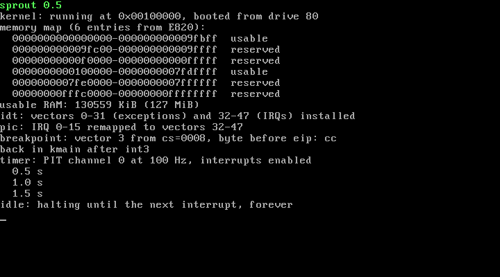
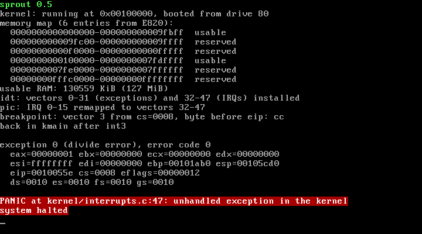

# Chapter 5 — Interrupts

Up to now sprout runs straight through `kmain`, prints its lines and halts. Real kernels are
driven by events: the CPU complains about an instruction (an *exception*), a device needs
attention (a hardware *interrupt*), or a program asks for a service (a *software interrupt*).
This chapter builds the interrupt descriptor table (IDT), 48 small assembly entry stubs, a C
dispatcher that prints every register when something goes wrong, a new setup for the two 8259
interrupt controllers, and the PIT timer at 100 Hz. At the end sprout's idle loop runs `hlt`
with interrupts on: it no longer stops dead, it sleeps until something happens.

Previous: [Chapter 4](04-hello-from-c.md). Next: [Chapter 6](06-keyboard-and-a-shell.md).

## Polling versus interrupts

There are two ways to learn that something happened: keep asking (*polling*) or be told
(*interrupts*). Chapter 4's `serial_putc` polls until the transmitter is empty, which works for
output because the kernel chooses when to send. A key press comes when the user decides, and a
kernel busy asking "anything yet?" does nothing else. With interrupts, the hardware signals the
CPU, which stops at an instruction boundary, calls a handler, and then carries on as if nothing
had happened. x86 has three sources:

| kind | who raises it | example |
|---|---|---|
| exception | the CPU itself, because of the current instruction | divide by zero, bad memory access |
| hardware interrupt (IRQ) | a device, through an interrupt controller | timer tick, key press |
| software interrupt | the program, with `int n` | `int3` (breakpoint), `int 0x80` (Linux system call) |

Each interrupt has a number from 0 to 255, its *vector*. Intel reserves 0–31 for exceptions: 0
divide error, 3 breakpoint, 6 invalid opcode, 8 double fault, 13 general protection, 14 page
fault, and so on (Intel SDM Vol. 3A, table 6-1; 22–31 are reserved). sprout puts the 16
hardware IRQs at 32–47.

Exceptions come in three classes, which decide where execution can resume:

- A **fault** can be corrected: the saved instruction pointer points *at* the faulting
  instruction, so `iret` runs it again. Divide error, general protection and page fault are
  faults; Chapter 7's page fault handler relies on this.
- A **trap** is reported *after* the instruction: `int3` is one, so a debugger can resume
  without running the breakpoint again. IRQs and `int n` behave the same way.
- An **abort** (double fault, machine check) cannot be resumed.

## The interrupt descriptor table

Real mode uses the interrupt vector table at address 0: 256 entries of 4-byte `segment:offset`.
Protected mode uses the IDT, wherever the `IDTR` register points. Each entry is an 8-byte *gate
descriptor*:

```
byte:   7    6        5       4         3    2         1    0
     +---------+---------+--------+---------+---------+---------+
     | offset 31..16     | type   |  zero   | selector| offset 15..0 |
     +---------+---------+--------+---------+---------+---------+
```

The handler's address is split in two halves, like the base in Chapter 3's GDT descriptors.
The selector is 0x08, Chapter 3's kernel code segment. The type byte packs several fields:

| bits | field | sprout's value |
|---|---|---|
| 7 | P, present | 1 |
| 6–5 | DPL, the lowest privilege allowed to use `int n` on this vector | 0 |
| 4 | 0 for gates | 0 |
| 3–0 | gate type: 0xE = 32-bit interrupt gate, 0xF = 32-bit trap gate | 0xE |

That gives 0x8E. An *interrupt gate* clears IF, the interrupt flag, on entry, so no hardware
interrupt arrives until `iret` restores the old EFLAGS; a *trap gate* leaves IF alone. sprout
uses interrupt gates everywhere, the simplest rule to reason about.

`kernel/idt.c` (header comment omitted)
```c
#include "interrupts.h"

#define IDT_ENTRIES     256
#define KERNEL_CODE_SEL 0x08
#define NUM_STUBS       48          /* isr.asm: 32 exceptions + 16 IRQs */

/* Type byte: present (bit 7), DPL 0 (bits 5-6), 32-bit interrupt gate
 * (0xE: the CPU clears IF on entry, so handlers start with interrupts off). */
#define GATE_INT32      0x8E

struct idt_gate {
    uint16_t offset_low;
    uint16_t selector;
    uint8_t zero;
    uint8_t type;
    uint16_t offset_high;
} __attribute__((packed));

/* What lidt loads: the table's size minus one and its address. */
struct idt_ptr {
    uint16_t limit;
    uint32_t base;
} __attribute__((packed));

extern const uint32_t isr_stubs[NUM_STUBS];     /* isr.asm */

static struct idt_gate idt[IDT_ENTRIES];

static void idt_set_gate(int vector, uint32_t handler, uint8_t type)
{
    idt[vector].offset_low = handler & 0xFFFF;
    idt[vector].selector = KERNEL_CODE_SEL;
    idt[vector].zero = 0;
    idt[vector].type = type;
    idt[vector].offset_high = handler >> 16;
}

void idt_init(void)
{
    for (int v = 0; v < NUM_STUBS; v++)
        idt_set_gate(v, isr_stubs[v], GATE_INT32);
    /* Vectors 48-255 stay all zero: "not present". Using one is a #GP. */

    struct idt_ptr ptr = { sizeof idt - 1, (uint32_t)idt };
    __asm__ volatile ("lidt %0" : : "m"(ptr));
}
```

- The table is a `static` array in `.bss`, zeroed by `entry.asm`: 256 entries, 2 KiB, of which
  48 are filled. An all-zero gate has P = 0; using it is a general protection fault (`make
  notpresent` below), not a jump to address 0.
- `lidt` takes the same 6-byte operand as `lgdt`: limit (size − 1) and address. `packed` stops
  gcc from putting a 2-byte hole after `limit`. The CPU copies the operand into IDTR, so the
  local variable may disappear afterwards; the table may not.
- The addresses come from `isr_stubs`, exported by the assembly file, because a C function
  cannot be the entry point of an interrupt, as the next two sections explain.

## What the CPU does on an interrupt

For a present 32-bit interrupt gate, taken while the kernel runs (ring 0; Chapter 9 adds the
user-mode case with a stack switch), the CPU pushes EFLAGS, CS and EIP on the current stack,
for some exceptions also a 32-bit *error code*, clears IF and TF, and jumps to the gate's
CS:EIP. `iret` later pops EIP, CS and EFLAGS, but not the error code: the handler must drop it.
The stack after the CPU's part, higher addresses at the top:

```
         +------------+
 esp+12  | EFLAGS     |
 esp+8   | CS         |
 esp+4   | EIP        |
 esp  -> | error code |   only for vectors 8, 10-14, 17, 21
         +------------+
```

Plain C cannot be the handler: the CPU does not say which vector fired, only some vectors push
an error code, and a C function returns with `ret`, not `iret`, and may change EAX, ECX and
EDX, which the interrupted code expects intact. So every handler starts in assembly.

## Entry stubs in assembly

Nearly every hobby and teaching kernel solves this the same way. Each vector gets a tiny stub
that pushes a dummy error code where the CPU pushed none (so every frame has the same shape),
pushes its vector number and jumps to one common routine.

`kernel/isr.asm` (header comments omitted, the 22 exception lines shortened)
```nasm
bits 32

extern interrupt_dispatch

KERNEL_DATA_SEL equ 0x10

; ISR_NOERR n — a vector where the CPU pushes no error code.
%macro ISR_NOERR 1
isr_%1:
    push dword 0                ; dummy error code
    push dword %1               ; vector number
    jmp isr_common
%endmacro

; ISR_ERR n — a vector where the CPU has already pushed an error code.
%macro ISR_ERR 1
isr_%1:
    push dword %1
    jmp isr_common
%endmacro

section .text

; Exceptions 0-31. The ones with an error code: 8, 10-14, 17, 21 (Intel
; SDM Vol. 3A, table 6-1 "Exceptions and Interrupts").
ISR_NOERR 0
ISR_NOERR 1
...                             ; (one line per vector, 2 to 20)
ISR_ERR   21
%assign v 22
%rep 10
ISR_NOERR v
%assign v v + 1
%endrep

; Hardware interrupts: the PICs deliver IRQ 0-15 as vectors 32-47.
%rep 16
ISR_NOERR v
%assign v v + 1
%endrep

; isr_common — save the interrupted state, call C, restore, iret.
isr_common:
    pusha                       ; eax ecx edx ebx esp(ignored) ebp esi edi
    push ds
    push es
    push fs
    push gs
    mov ax, KERNEL_DATA_SEL
    mov ds, ax
    mov es, ax
    mov fs, ax
    mov gs, ax
    cld                         ; C code assumes DF = 0

    push esp                    ; argument: pointer to the saved registers
    call interrupt_dispatch
    add esp, 4

    pop gs
    pop fs
    pop es
    pop ds
    popa
    add esp, 8                  ; drop vector and error code
    iret

; The stubs' addresses, for idt.c: isr_stubs[v] is vector v's entry point.
section .rodata
global isr_stubs
isr_stubs:
%assign v 0
%rep 48
    dd isr_ %+ v
%assign v v + 1
%endrep
```

The NASM features are from learn-linux-nasm, used a little harder:

- `isr_%1:` pastes the macro argument into a label: `ISR_NOERR 0` defines `isr_0`.
- `%assign v 22` sets a preprocessor number, `%rep 10 … %endrep` repeats a block, and
  `%assign v v + 1` counts, so `%rep 16` then makes `isr_32` to `isr_47`. In the table,
  `isr_ %+ v` glues the token `isr_` to the value of `v`.
- `isr_common` saves the general registers (`pusha`) and the data segment registers, then loads
  the kernel's selector: in Chapter 9 an interrupt can arrive while user code runs with its own.
- `cld`: the System V i386 ABI promises DF = 0 at every call.
- `push esp` passes the address of everything just pushed: the C side's `struct regs *`.
  Afterwards the pops run in reverse, `add esp, 8` drops vector and error code, and `iret`
  returns.

After building, `objdump` shows what the macros produced (an excerpt):

```console
$ objdump -d -M intel --no-show-raw-insn build/kernel/isr.o
00000000 <isr_0>:
   0:	push   0x0
   2:	push   0x0
   4:	jmp    15e <isr_common>

...
00000048 <isr_8>:
  48:	push   0x8
  4a:	jmp    15e <isr_common>
 185:	iret   
```

`isr_0` is 9 bytes (two 2-byte `push imm8`, a 5-byte `jmp`); `isr_8` pushes only its vector.

## `struct regs` and the dispatcher

When `isr_common` reaches `push esp`, the stack holds 17 words in a known order. A C struct can
describe that memory if its fields are listed from the lowest address up, the reverse of the
push order:

```
higher addresses
   eflags  cs  eip          pushed by the CPU
   error_code  vector       pushed by the stub
   eax ecx edx ebx esp ebp esi edi   pusha (eax first)
   ds  es  fs  gs           isr_common
lower addresses  <- esp, the struct regs pointer
```

`kernel/interrupts.h` (excerpt)
```c
#define IRQ_BASE    32          /* the PICs deliver IRQ n as vector 32 + n */
#define IRQ_TIMER   0
#define IRQ_KEYBOARD 1

/* What isr.asm leaves on the stack, lowest address first: the order is
 * the reverse of the pushes. */
struct regs {
    uint32_t gs, fs, es, ds;                            /* isr_common */
    uint32_t edi, esi, ebp, esp_pusha, ebx, edx, ecx, eax; /* pusha */
    uint32_t vector, error_code;                        /* the stub */
    uint32_t eip, cs, eflags;                           /* the CPU */
};

typedef void (*interrupt_handler)(struct regs *r);
```

The pointer goes both ways: `isr_common` pops whatever is in memory, so a handler that writes
`r->eip` changes where the code resumes (exercise 1), and Chapter 8 switches tasks this way.
Every field is a `uint32_t` because `push ds` in 32-bit code pushes a full word.

`kernel/interrupts.c` (includes and the name list shortened)
```c
/* interrupts.c — route each interrupt to its handler; report exceptions. */
#include "interrupts.h"
...                                 /* stddef.h kprintf.h pic.h */

static interrupt_handler handlers[IRQ_BASE + 16];

/* Intel SDM Vol. 3A, table 6-1. */
static const char *const exception_names[32] = {
    "divide error", "debug", "NMI", "breakpoint", "overflow",
    ...                             /* 22 names, up to "control protection" */
};

void interrupt_register(uint8_t vector, interrupt_handler handler)
{
    if (vector < sizeof handlers / sizeof handlers[0])
        handlers[vector] = handler;
}

/* esp_pusha is where esp pointed when pusha ran: at the vector number.
 * The interrupted code's esp was 5 words higher (vector, error code, eip,
 * cs, eflags). That holds for interrupts taken in ring 0 only. */
void regs_dump(const struct regs *r)
{
    kprintf("  eax=%08x ebx=%08x ecx=%08x edx=%08x\n",
            r->eax, r->ebx, r->ecx, r->edx);
    kprintf("  esi=%08x edi=%08x ebp=%08x esp=%08x\n",
            r->esi, r->edi, r->ebp, r->esp_pusha + 20);
    kprintf("  eip=%08x cs=%04x eflags=%08x\n", r->eip, r->cs, r->eflags);
    kprintf("  ds=%04x es=%04x fs=%04x gs=%04x\n", r->ds, r->es, r->fs, r->gs);
}

static void unhandled_exception(struct regs *r)
{
    const char *name = r->vector < 22 ? exception_names[r->vector] : "reserved";
    kprintf("\nexception %u (%s), error code %x\n",
            r->vector, name, r->error_code);
    regs_dump(r);
    panic("unhandled exception in the kernel");
}

void interrupt_dispatch(struct regs *r)
{
    interrupt_handler h = r->vector < sizeof handlers / sizeof handlers[0]
                        ? handlers[r->vector] : NULL;

    if (r->vector < IRQ_BASE) {                 /* an exception */
        if (h)
            h(r);
        else
            unhandled_exception(r);
        return;
    }

    int irq = r->vector - IRQ_BASE;
    if (pic_is_spurious(irq))
        return;                                 /* no EOI for those */
    if (h)
        h(r);
    pic_eoi(irq);
}
```

- `handlers` holds one function pointer per vector, `NULL` at boot; drivers call
  `interrupt_register`.
- An exception without a handler is a kernel bug: print the name, error code and every
  register, then `panic`. That dump is the most useful debugging output in this course.
- `pusha` stores the ESP from *before* `pusha`, pointing at the vector field. The interrupted
  code's ESP was five words higher (vector, error code, EIP, CS, EFLAGS): `esp_pusha + 20`, for
  ring-0 interrupts only.
- IRQs check for a spurious interrupt, call the handler, then send *end of interrupt* (EOI) to
  the interrupt controller, as explained below.

## A first test: `int3`

Before any hardware, `kmain` tests the path with `int3`, the one-byte instruction (0xCC) that
debuggers write over an instruction to set a breakpoint.

`kernel/kmain.c` (excerpt)
```c
/* int3 is a trap: the saved eip already points past it, so returning
 * resumes at the next instruction. Its opcode is the single byte 0xCC. */
static void breakpoint(struct regs *r)
{
    const uint8_t *after = (const uint8_t *)r->eip;
    kprintf("breakpoint: vector %u from cs=%04x, byte before eip: %02x\n",
            r->vector, r->cs, after[-1]);
}
```

`kmain` registers it for vector 3 and runs `__asm__ volatile ("int3")` (the full sequence is
in "Turning interrupts on" below). It prints:

```
breakpoint: vector 3 from cs=0008, byte before eip: cc
back in kmain after int3
```

Stub, `isr_common`, dispatcher and `struct regs` all work: vector 3, CS 0x08, and the byte
before the saved EIP is 0xCC, the `int3` itself, since a trap saves the *next* address. Were the
struct off by one word, the numbers would be nonsense, as in the `noremap` example below.

## The 8259 programmable interrupt controller

The CPU has one maskable interrupt input, INTR. On a PC an *interrupt controller* collects
device requests, raises INTR, and on acknowledge puts the device's vector on the data bus: the
Intel 8259A or a chipset copy of it. Modern machines also have the APIC, but a PC still starts
with the 8259 pair in charge, and it is far simpler. The *master* has lines IRQ 0–7; the
*slave* has IRQ 8–15 and is wired to the master's IRQ 2 (the *cascade*):

| IRQ | device | | IRQ | device |
|---|---|---|---|---|
| 0 | PIT timer (this chapter) | | 8 | real-time clock |
| 1 | PS/2 keyboard (Chapter 6) | | 12 | PS/2 mouse |
| 2 | cascade from the slave | | 14 | primary ATA disk |
| 4 | COM1 (Chapter 6) | | 15 | secondary ATA disk |

Each 8259 has three 8-bit registers, one bit per line:

- **IRR**, the interrupt request register: the line has requested service and is waiting.
- **ISR**, the in-service register: the CPU has taken this request and its handler is running.
- **IMR**, the interrupt mask register: a 1 bit ignores the line completely.

IRQ 0 has the highest priority, IRQ 7 the lowest (the slave's lines rank as IRQ 2). While an ISR
bit is set, requests of the same or lower priority wait for an **EOI** command (see `noeoi`).

### Why we must remap

The BIOS has the master deliver IRQ 0–7 as vectors 8–15 (the slave: 0x70–0x77). In protected
mode those are CPU exceptions: a timer tick would arrive as vector 8, *double fault*. So every
protected-mode PC kernel moves the IRQs above 31 before enabling interrupts, using the full
sequence of four *initialization command words*, ICW1 to ICW4. The master listens on ports 0x20
(command) and 0x21 (data), the slave on 0xA0 and 0xA1.

`kernel/pic.c` (header comment omitted)
```c
#include "pic.h"
#include "io.h"

#define PIC1_CMD    0x20
#define PIC1_DATA   0x21
#define PIC2_CMD    0xA0
#define PIC2_DATA   0xA1

#define ICW1_INIT   0x10    /* start initialization */
#define ICW1_ICW4   0x01    /* ... and ICW4 will follow */
#define ICW4_8086   0x01    /* 8086 mode (not 8080) */
#define CASCADE_IRQ 2       /* the slave hangs off the master's IRQ 2 */
#define OCW3_READ_ISR 0x0B  /* next read of the command port: the ISR */
#define PIC_EOI     0x20    /* non-specific end of interrupt */

/* A write to the unused port 0x80 takes about a microsecond: old PICs
 * need a moment between initialization words. */
static inline void io_wait(void)
{
    outb(0x80, 0);
}

void pic_init(uint8_t base)
{
    outb(PIC1_CMD, ICW1_INIT | ICW1_ICW4);  io_wait();
    outb(PIC2_CMD, ICW1_INIT | ICW1_ICW4);  io_wait();
    outb(PIC1_DATA, base);                  io_wait();  /* ICW2: vector base */
    outb(PIC2_DATA, base + 8);              io_wait();
    outb(PIC1_DATA, 1 << CASCADE_IRQ);      io_wait();  /* ICW3: slave on IRQ 2 */
    outb(PIC2_DATA, CASCADE_IRQ);           io_wait();  /* ICW3: my cascade id */
    outb(PIC1_DATA, ICW4_8086);             io_wait();
    outb(PIC2_DATA, ICW4_8086);             io_wait();

    /* Mask everything except the cascade line; drivers unmask their IRQ. */
    outb(PIC1_DATA, 0xFF & ~(1 << CASCADE_IRQ));
    outb(PIC2_DATA, 0xFF);
}
```

The four words, for each chip:

| word | port | master | slave | meaning |
|---|---|---|---|---|
| ICW1 | command | 0x11 | 0x11 | start initialisation; ICW4 will follow; edge-triggered, cascaded |
| ICW2 | data | 32 | 40 | vector of line 0 (the low 3 bits must be zero in 8086 mode) |
| ICW3 | data | 0x04 | 2 | master: bit mask of lines with a slave; slave: its own line number on the master |
| ICW4 | data | 0x01 | 0x01 | 8086 mode (the chip was designed for the 8080 too) |

Afterwards a write to the data port sets the IMR: all lines but the cascade start masked, and
drivers unmask theirs. `io_wait` writes to port 0x80, the POST diagnostic port, which takes
about a microsecond, the same trick as Linux's `outb_p` ("pause").

The rest of the file:

```c
void pic_eoi(int irq)
{
    if (irq >= 8)
        outb(PIC2_CMD, PIC_EOI);
    outb(PIC1_CMD, PIC_EOI);
}

/* pic_unmask and pic_mask: read the IMR, clear or set bit irq & 7, write it back. */

/* A spurious IRQ 7/15 has no in-service bit: no EOI (see below). */
bool pic_is_spurious(int irq)
{
    if (irq != 7 && irq != 15)
        return false;

    uint16_t cmd = irq == 7 ? PIC1_CMD : PIC2_CMD;
    outb(cmd, OCW3_READ_ISR);
    if (inb(cmd) & 0x80)
        return false;

    if (irq == 15)
        outb(PIC1_CMD, PIC_EOI);
    return true;
}
```

- **EOI** is *operation command word 2* 0x20, a "non-specific" EOI that clears the highest ISR
  bit. A slave IRQ set ISR bits on both chips, so both get one, the slave first.
- **Spurious interrupts.** If a request line drops (noise, say) before the CPU acknowledges
  it, the 8259 reports its lowest line, 7 or 15, without setting the ISR bit. OCW3 0x0B makes
  the next command-port read return the ISR; if bit 7 is clear, an EOI would clear some *other*
  line's bit. A spurious IRQ 15 did pass the master's line 2, so the master still gets its EOI.
  QEMU does not produce spurious IRQs; real hardware does.

## The programmable interval timer

The PIT (Intel 8253, later 8254) has three 16-bit counters. Channel 0 is wired to IRQ 0,
channel 1 once refreshed DRAM, and channel 2 drives the PC speaker. Each counts down from a
*divisor* at 1.193182 MHz and reloads at zero, so channel 0 raises IRQ 0 at `1193182 / divisor`
Hz. The BIOS loads divisor 0, which the chip treats as 65536: 18.2 Hz, the DOS clock tick.
sprout asks for 100 Hz, a 10 ms tick, fast enough for a responsive `sleep` and slow enough to
cost nothing.

`kernel/timer.c` (header comment omitted)
```c
#include "timer.h"
...                                 /* interrupts.h io.h kprintf.h pic.h */
#define PIT_HZ          1193182u
#define PIT_CHANNEL0    0x40
#define PIT_COMMAND     0x43
/* Channel 0, write low byte then high byte, mode 3 (square wave), binary. */
#define PIT_CMD_CH0_SQUARE  0x36

static volatile uint32_t ticks;     /* changed by the interrupt handler */
static uint32_t hz;

static void timer_irq(struct regs *r)
{
    (void)r;
    ticks++;
}

void timer_init(uint32_t freq)
{
    uint32_t divisor = (PIT_HZ + freq / 2) / freq;   /* rounded */

    /* The divisor register has 16 bits: below 19 Hz it would not fit. */
    kassert(divisor >= 2 && divisor <= 0xFFFF);
    hz = freq;
    outb(PIT_COMMAND, PIT_CMD_CH0_SQUARE);
    outb(PIT_CHANNEL0, divisor & 0xFF);
    outb(PIT_CHANNEL0, divisor >> 8);

    interrupt_register(IRQ_BASE + IRQ_TIMER, timer_irq);
    pic_unmask(IRQ_TIMER);
}

/* timer_hz() and timer_ticks() just return hz and ticks. */

void timer_sleep(uint32_t n)
{
    uint32_t start = ticks;
    while (ticks - start < n)       /* correct even when ticks wraps */
        hlt();
}
```

- **The command byte** 0x36 is 00 11 011 0: channel 0, low byte then high byte, mode 3 (a
  self-reloading square wave), binary.
- **The divisor** for 100 Hz is (1193182 + 50) / 100 = 11932, a real 99.998 Hz (exercise 3).
  18 Hz would need 66288, too big for 16 bits; the `kassert` also rejects 0 (read as 65536)
  and 1.
- **`volatile`.** `ticks` changes in an interrupt handler, behind the compiler's back. Without
  `volatile`, gcc may load it once in `timer_sleep` and loop forever.
- **Wrap-around.** At 100 Hz a 32-bit counter wraps after 497 days. `ticks - start < n` is
  unsigned (modulo 2³²) and survives the wrap; `ticks < start + n` would not.
- **`hlt` in the loop** sleeps until the next interrupt, saving power (and host CPU in QEMU).
  If the tick arrives between the test and the `hlt`, the CPU sleeps one extra tick, no more,
  because the timer never stops. Chapter 6 waits for a key press, where the same gap can hang.

## Turning interrupts on

The new part of `kmain` connects the pieces in a careful order:

`kernel/kmain.c` (excerpt)
```c
    idt_init();
    kprintf("idt: vectors 0-31 (exceptions) and 32-47 (IRQs) installed\n");
    pic_init(IRQ_BASE);
    kprintf("pic: IRQ 0-15 remapped to vectors %u-%u\n",
            IRQ_BASE, IRQ_BASE + 15);

    interrupt_register(3, breakpoint);
    __asm__ volatile ("int3");
    kprintf("back in kmain after int3\n");

    timer_init(100);
    sti();
    kprintf("timer: PIT channel 0 at %u Hz, interrupts enabled\n", timer_hz());
    for (uint32_t i = 1; i <= 3; i++) {
        timer_sleep(timer_hz() / 2);
        kprintf("  %u.%u s\n", i / 2, i % 2 * 5);
    }

    kprintf("idle: halting until the next interrupt, forever\n");
    for (;;)
        hlt();
```

The order matters. The IDT comes first, since an exception can happen at any time. The PICs
are remapped while interrupts are still off (stage 2 ran `cli`). `timer_init` programs the PIT,
registers its handler and unmasks IRQ 0, and only then does `sti` set IF. `sti`, `cli` and `hlt`
are inline functions in Chapter 4's `kernel/io.h`.

The final loop is the idle loop: `hlt` with IF = 1 sleeps until the next interrupt, whose
`iret` returns after the `hlt`. With IF = 0, `hlt` stops the machine for good (only an NMI
could wake it): that is how `panic` ends.

`sti` enables interrupts only *after the next instruction*. This *interrupt shadow* makes `sti;
hlt` safe as a pair: no interrupt can slip in between and leave `hlt` waiting for nothing.
Chapter 6 relies on it; `noremap` below shows it in a register dump.

A tick is usually already waiting at `sti` in the master's IRR (exercise 4), so `kmain` prints
"0.5 s" from its loop counter rather than `timer_ticks()`, which may be one ahead.

## Building and running

The Makefile now assembles every `kernel/*.asm` with one pattern rule instead of a rule just
for `entry.asm`:

```diff
 KSRCS := $(wildcard kernel/*.c lib/*.c)
-KOBJS := $(BUILD)/kernel/entry.o $(KSRCS:%.c=$(BUILD)/%.o)
+KASMS := $(wildcard kernel/*.asm)
+# entry.o first: it is not required (the linker script puts .text.entry
+# first), but it keeps the link map readable.
+KOBJS := $(BUILD)/kernel/entry.o \
+         $(filter-out $(BUILD)/kernel/entry.o,$(KASMS:%.asm=$(BUILD)/%.o)) \
+         $(KSRCS:%.c=$(BUILD)/%.o)
...
-$(BUILD)/kernel/entry.o: kernel/entry.asm
+$(BUILD)/kernel/%.o: kernel/%.asm
```

`$(filter-out …)` keeps `entry.o` from appearing twice. The version is now `0.5`. (`sudo apt
install qemu-system-x86` provides `qemu-system-i386`.)

```console
$ cd project/ch05
$ make
...
nasm -f elf32 -g -F dwarf -w+all -w-reloc -MD build/kernel/isr.d -MP -o build/kernel/isr.o kernel/isr.asm
...
ld -m elf_i386 -nostdlib -T kernel/linker.ld -o build/kernel.elf build/kernel/entry.o build/kernel/isr.o ...
kernel.bin: 7393 bytes, 15 sectors
...
$ make test
...
build/unit
unit: 9 passed, 0 failed
sh tools/qemu-test.sh "qemu-system-i386 -m 128M" build/sprout.img tests/boot.expected
PASS: build/sprout.img (27 lines of serial output match tests/boot.expected)
```

`make test` takes about 2.1 seconds here (0.6 s before), since the kernel really sleeps 1.5 s.
Timings are from this machine and vary.

```console
$ make demo
sprout: boot sector, loading stage 2
...
sprout 0.5
...
usable RAM: 130559 KiB (127 MiB)
idt: vectors 0-31 (exceptions) and 32-47 (IRQs) installed
pic: IRQ 0-15 remapped to vectors 32-47
breakpoint: vector 3 from cs=0008, byte before eip: cc
back in kmain after int3
timer: PIT channel 0 at 100 Hz, interrupts enabled
  0.5 s
  1.0 s
  1.5 s
idle: halting until the next interrupt, forever
```

The time lines appear half a second apart. `make run` shows the same in a QEMU window:



The symbol table shows where everything ended up:

```console
$ nm -n build/kernel.elf | grep -E " (isr_(0|8|47|common|stubs)|idt|handlers|ticks)$"
00100030 t isr_0
00100078 t isr_8
00100188 t isr_47
0010018e t isr_common
001015e0 R isr_stubs
00105d00 b idt
00106500 b handlers
001065c4 b ticks
```

The stubs follow `_start` directly because `isr.o` is linked second (`t`: local text, since
NASM labels are local unless `global`). `isr_stubs` is global read-only data (`R`). The IDT
starts at 0x105d00, right after the 16 KiB kernel stack in `.bss`, and its 2048 bytes end where
`handlers` begins.

## What goes wrong

Interrupt bugs look nothing like ordinary bugs: the machine reboots, freezes, or reports an
exception that never happened. `examples/ch05/` reproduces four common ones. Each target copies
`project/ch05` into `build/NAME`, changes one line with `sed`, prints the diff, builds the copy
and boots it headless for three seconds.

`examples/ch05/Makefile`
```make
# Makefile — Chapter 5 examples: interrupts done wrong, on purpose.
#
# Each target copies project/ch05 to build/NAME, changes one thing (the
# diff is printed), builds it and boots it headless for a few seconds.
#
#   make divzero    divide by zero in kmain: the register dump, and addr2line
#   make notpresent int 0x80 with no gate: a general protection fault
#   make noeoi      the IRQ handler never sends EOI: one tick, then silence
#   make noremap    no pic_init: the timer arrives as vector 8, "double fault"
#   make clean

QEMU ?= qemu-system-i386
PROJECT := ../../project/ch05
BOOT = timeout 3 $(QEMU) -m 128M -drive format=raw,file=build/$@/build/sprout.img \
       -display none -no-reboot

# $(call copy,NAME): a fresh copy of the project in build/NAME.
define copy
	rm -rf build/$(1) && mkdir -p build
	cp -r $(PROJECT) build/$(1)
	rm -rf build/$(1)/build
endef

# $(call build,NAME): show what changed, then build quietly.
define build
	diff -ru -x build $(PROJECT) build/$(1) || true
	$(MAKE) -s -C build/$(1)
endef

# The serial output, CRs removed. The kernel never exits: timeout stops it.
SERIAL = -serial stdio -monitor none 2>/dev/null | tr -d '\r' | sed -n '/^sprout 0.5/,$$p'

divzero:
	$(call copy,$@)
	sed -i '/back in kmain after int3/a\    { volatile int zero = 0; kprintf("%d\\n", 1 / zero); }' \
	    build/$@/kernel/kmain.c
	$(call build,$@)
	$(BOOT) $(SERIAL) | tee build/$@.log
	@echo "--- which source line is at the saved eip?"
	addr2line -f -i -s -e build/$@/build/kernel.elf \
	    $$(grep -o 'eip=[0-9a-f]*' build/$@.log | cut -d= -f2)

notpresent:
	$(call copy,$@)
	sed -i '/back in kmain after int3/a\    __asm__ volatile ("int $$0x80");' \
	    build/$@/kernel/kmain.c
	$(call build,$@)
	$(BOOT) $(SERIAL)

# After 3 seconds, ask the QEMU monitor about the PICs and the CPU.
noeoi:
	$(call copy,$@)
	sed -i '/pic_eoi(irq);/d' build/$@/kernel/interrupts.c
	$(call build,$@)
	(sleep 3; printf 'info pic\ninfo registers\nquit\n') | \
	    timeout 6 $(QEMU) -m 128M -drive format=raw,file=build/$@/build/sprout.img \
	    -display none -no-reboot -serial file:build/$@.log -monitor stdio \
	    | grep -E '^(pic[01]|EIP)' | tee build/$@.mon
	@echo "--- COM1:"; tr -d '\r' < build/$@.log | sed -n '/^sprout 0.5/,$$p'
	@echo "--- where is the CPU waiting?"
	addr2line -f -i -s -e build/$@/build/kernel.elf \
	    $$(grep -o 'EIP=[0-9a-f]*' build/$@.mon | cut -d= -f2)

noremap:
	$(call copy,$@)
	sed -i '/pic_init(IRQ_BASE);/,/IRQ_BASE + 15);/d' build/$@/kernel/kmain.c
	$(call build,$@)
	$(BOOT) $(SERIAL) | tee build/$@.log
	@echo "--- the \"error code\" is really an address:"
	addr2line -f -i -s -e build/$@/build/kernel.elf \
	    $$(grep -o 'error code [0-9a-f]*' build/$@.log | cut -d' ' -f3)

clean:
	rm -rf build

.PHONY: divzero notpresent noeoi noremap clean
```

`addr2line -f -i -s -e kernel.elf ADDR` turns an address into a function name (`-f`) and a
`file:line` (`-s`: no directory) using the DWARF information from `-g`; `-i` adds the callers of
inlined code. Memory map lines are shortened to `...` below.

### Divide by zero: reading a register dump

```console
$ cd examples/ch05
$ make divzero
...
+    { volatile int zero = 0; kprintf("%d\n", 1 / zero); }
...
kernel.bin: 7429 bytes, 15 sectors
timeout 3 qemu-system-i386 -m 128M -drive format=raw,file=build/divzero/build/sprout.img ...
sprout 0.5
...
breakpoint: vector 3 from cs=0008, byte before eip: cc
back in kmain after int3

exception 0 (divide error), error code 0
  eax=00000001 ebx=00000000 ecx=00000000 edx=00000000
  esi=ffffffff edi=00000000 ebp=00101ab0 esp=00105cd0
  eip=0010055e cs=0008 eflags=00000012
  ds=0010 es=0010 fs=0010 gs=0010

PANIC at kernel/interrupts.c:47: unhandled exception in the kernel
system halted
--- which source line is at the saved eip?
addr2line -f -i -s -e build/divzero/build/kernel.elf \
    $(grep -o 'eip=[0-9a-f]*' build/divzero.log | cut -d= -f2)
kmain
kmain.c:80
```



Read the dump like a detective:

- `volatile` stops gcc from folding `1 / 0` (undefined behaviour) at compile time.
- Divide error is a fault: `eip` is the faulting `idiv ecx`, which `addr2line` maps to the line
  `sed` inserted. `eax=1` is the dividend, `edx=0` its sign extension (`cdq`), `ecx=0` the
  divisor.
- `eflags=00000012` has IF (bit 9) clear: before `sti`. `esp=00105cd0` is just below 0x105d00,
  the top of the kernel stack.
- `interrupts.c:47` is where `panic` was *called*. The bug is at the saved `eip`.

Without this chapter's code, the same bug produces no message at all. Stage 2 never ran
`lidt`, so IDTR still describes the real-mode vector table at address 0, whose 4-byte entries
make no sense as 8-byte gates. QEMU's `-d int,cpu_reset` option logs every exception to a file.
Here it is for a Chapter 4 kernel with the same division added after the memory map (a
throwaway copy, not one of the examples):

```console
$ timeout 5 qemu-system-i386 -m 128M -drive format=raw,file=build/sprout.img -display none \
    -no-reboot -serial stdio -monitor none -d int,cpu_reset -D int.log 2>/dev/null | tail -1
usable RAM: 130559 KiB (127 MiB)
$ grep -E "check_exception|Triple|CPU Reset" int.log | tail -4
check_exception old: 0xffffffff new 0x0
check_exception old: 0x0 new 0xd
check_exception old: 0x8 new 0xd
Triple fault
```

The divide error (0x0) could not be delivered through a bad gate, which raised #GP (0xd). Those
two in a row make a double fault (8), whose delivery raised another #GP: a *triple fault*. The
CPU shuts down, a PC resets, and `-no-reboot` makes QEMU exit. The terminal just stops.

### A vector with no gate

```console
$ make notpresent
...
+    __asm__ volatile ("int $0x80");
...
back in kmain after int3

exception 13 (general protection), error code 402
  eax=00000019 ebx=00000000 ecx=0000000a edx=000003f8
  esi=ffffffff edi=00000000 ebp=00101a90 esp=00105cb8
  eip=0010054a cs=0008 eflags=00000016

PANIC at kernel/interrupts.c:47: unhandled exception in the kernel
system halted
```

Vector 0x80 has an all-zero gate, so `int $0x80` raises #GP, and the error code says why. It
has the format of a selector: bit 0 (EXT) means an external event, bit 1 (IDT) means the index
refers to the IDT, bits 3–15 are the index. 0x402 = 0x80 << 3 | 0b010: IDT entry 128
(exercise 2 decodes it). Linux on i386 used `int 0x80` for system calls, and Chapter 9 installs
that gate for sprout's.

### Forgetting the EOI

```console
$ make noeoi
...
-    pic_eoi(irq);
...
(sleep 3; printf 'info pic\ninfo registers\nquit\n') | \
...
pic1: irr=00 imr=ff isr=00 hprio=0 irq_base=28 rr_sel=0 elcr=0c fnm=0
pic0: irr=01 imr=fa isr=01 hprio=0 irq_base=20 rr_sel=0 elcr=00 fnm=0
EIP=00100919 EFL=00000202 [-------] CPL=0 II=0 A20=1 SMM=0 HLT=1
--- COM1:
sprout 0.5
...
back in kmain after int3
timer: PIT channel 0 at 100 Hz, interrupts enabled
--- where is the CPU waiting?
addr2line -f -i -s -e build/noeoi/build/kernel.elf \
...
timer_sleep
timer.c:57
```

No crash, no message: COM1 just stops before "0.5 s". The target feeds the QEMU monitor
`info pic` (pic0 is the master) and `info registers`:

- `irq_base=20` and `28` are hex: 32 and 40, so the remap worked. `imr=fa` (11111010) leaves
  only IRQ 0 and the cascade unmasked.
- `isr=01`: IRQ 0 is still in service, waiting for the EOI that never comes. `irr=01`: the next
  tick is waiting, but at the same priority it is never delivered.
- `EFL=00000202` (IF = 1) and `HLT=1`: halted with interrupts on, in `timer_sleep`'s loop.

IRQ 0 has the highest priority, so this missing EOI blocks *every* IRQ. An EOI skipped on one
rare path (an early `return` in a handler) gives a random-looking hang.

### Forgetting to remap the PIC

```console
$ make noremap
...
-    pic_init(IRQ_BASE);
-    kprintf("pic: IRQ 0-15 remapped to vectors %u-%u\n",
-            IRQ_BASE, IRQ_BASE + 15);
...
kernel.bin: 7317 bytes, 15 sectors
...
back in kmain after int3

exception 8 (double fault), error code 1008d0
  eax=000000b8 ebx=00000000 ecx=00000000 edx=00000021
  esi=ffffffff edi=00000000 ebp=00101a34 esp=00105c58
  eip=00000008 cs=0206 eflags=0010053f
  ds=0010 es=0010 fs=0010 gs=0010

PANIC at kernel/interrupts.c:47: unhandled exception in the kernel
system halted
--- the "error code" is really an address:
addr2line -f -i -s -e build/noremap/build/kernel.elf \
...
timer_hz
timer.c:47
```

A "double fault" right after `sti`, but nothing faulted. The master 8259 still uses the BIOS's
base of 8, so the first timer tick arrived as vector 8. `isr_8` is an `ISR_ERR` stub: it
expects the error code that a real double fault pushes. An IRQ pushes none, so every field of
`struct regs` above the vector is shifted by one word:

- "error code" 0x1008d0 is the real **EIP**: the first instruction of `timer_hz`.
- "eip" 8 is the real **CS**, and "cs" 0x206 the real **EFLAGS** (IF 0x200, PF 0x4, bit 1).
- "eflags" 0x10053f is the word *below* the frame: the return address `call timer_hz` pushed.

```console
$ objdump -d -M intel --no-show-raw-insn build/noremap/build/kernel.elf | grep -A3 'call.*<timer_init>'
  100534:	call   100860 <timer_init>
  100539:	sti    
  10053a:	call   1008d0 <timer_hz>
  10053f:	pop    edx
```

This is the interrupt shadow at work. A tick was pending at `sti`; the CPU ran exactly one more
instruction, `call timer_hz`, and then took the interrupt with EIP = 0x1008d0. A real double
fault always pushes error code 0, so a nonzero one is a strong hint of an IRQ on vector 8. The
lessons: remap before `sti`, and when a dump looks impossible, check whether the frame has the
shape the stub expects. A wrong `ISR_ERR`/`ISR_NOERR` choice gives the same confusion. (`make
clean` removes the examples' `build/`.)

## History: vectors, stubs and the PC's 18.2 Hz clock

**The vector clash is IBM's.** Intel reserved vectors 0–31 for the processor from the start,
but the 8086 used only the first five, and IBM's PC BIOS put IRQ 0–7 at vectors 8–15. In
Wikipedia's words, the IBM PC "does not follow the official Intel layout beyond the first five
exception vectors implemented in the original 8086". Once the 286 and 386 used vectors 8–15
for real exceptions, every protected-mode PC system had to remap the PIC; the OSDev wiki's
8259 page calls the original mapping "an IBM design mistake". The PC/XT had one 8259; the
PC/AT added a slave on line 2 and rerouted the old IRQ 2 bus pin to IRQ 9 (Wikipedia, "Intel
8259").

**Where 1.193182 MHz comes from.** The original PC used one 14.31818 MHz crystal, four times the
NTSC colour-burst frequency, so the same clock could drive a colour TV signal. The CPU ran at a
third of it (4.77 MHz), the PIT at a twelfth (Wikipedia, "Programmable interval timer"). With
the largest divisor, 65536, that gave DOS its 18.2 Hz tick.

**xv6 writes the same stubs with Perl.** MIT's teaching kernel xv6 (x86 version) generates its
256 entry stubs with `vectors.pl`, whose comment gives the reason: "There has to be one entry
point per interrupt number since otherwise there's no way for trap() to discover the interrupt
number." Each stub pushes a 0 unless the CPU pushes an error code (its list: 8, 10–14, 17),
then the vector, and jumps to `alltraps` in `trapasm.S`. That pushes the segment registers
*before* `pushal` (sprout: after), then `pushl %esp`, `call trap`, pops everything, `addl $0x8,
%esp`, `iret`. Reading xv6's `struct trapframe` next to `struct regs` is a good exercise.

**Linux 0.01 used a different trick.** Linus Torvalds' first release (1991) handles exceptions
in `kernel/asm.s`, which opens: "asm.s contains the low-level code for most hardware faults.
page_exception is handled by the mm, so that isn't here." Each stub pushes the *address of its
C handler* (for example `pushl $_do_divide_error`) instead of a vector number, together with a
fake error code of 0 where needed. The common code calls through that pointer. The idea is the
same, one small stub per vector feeding one common routine, but it dispatches without a table.

## Summary

- Interrupts come from the CPU (exceptions), devices (IRQs) and `int n`. Vectors 0–31 are
  Intel's exceptions; sprout puts IRQ 0–15 at 32–47.
- A fault saves the faulting instruction's address, a trap or IRQ the next one's.
- IDT gates are 8 bytes: split offset, selector 0x08, type 0x8E (present, DPL 0, 32-bit
  interrupt gate). `lidt` works like `lgdt`. An empty gate gives #GP with the IDT bit set.
- The CPU pushes EFLAGS, CS, EIP and, for 8, 10–14, 17 and 21, an error code. Per-vector stubs
  even out the frame and push the vector; `isr_common` saves everything, calls
  `interrupt_dispatch(struct regs *)` and returns with `iret`.
- `struct regs` lists the saved words lowest address first; handlers may change them.
- Remap the 8259s (ICW1–ICW4) before `sti`. Every IRQ needs an EOI (both chips for 8–15),
  except a spurious IRQ 7/15.
- PIT: 1193182 Hz / 16-bit divisor, 11932 for 100 Hz. `ticks` is `volatile`; `ticks - start <
  n` survives wrap-around.
- `sti` takes effect one instruction late. `hlt` with IF = 1 idles; with IF = 0 it stops.
- Debug with the register dump, `addr2line` and the QEMU monitor (`info pic`, `info
  registers`).

## Exercises

1. **Survive an invalid opcode.** Register a handler for vector 6 that prints the two bytes at
   `r->eip` and skips them. Test it with `ud2` (0F 0B, always invalid) in `kmain`, followed by
   a `kprintf`. What happens if the handler does not change `r->eip`?

   <details><summary>Solution</summary>

   In `kernel/kmain.c`:

   ```c
   static void invalid_opcode(struct regs *r)
   {
       const uint8_t *ip = (const uint8_t *)r->eip;
       kprintf("invalid opcode %02x %02x at %p: skipping it\n",
               ip[0], ip[1], (void *)r->eip);
       r->eip += 2;
   }
   ```

   and after the `int3` test:

   ```c
       interrupt_register(6, invalid_opcode);
       __asm__ volatile ("ud2");
       kprintf("back in kmain after ud2\n");
   ```

   ```console
   $ make
   ...
   kernel.bin: 7529 bytes, 15 sectors
   ...
   $ make demo
   ...
   back in kmain after int3
   invalid opcode 0f 0b at 0x00100588: skipping it
   back in kmain after ud2
   timer: PIT channel 0 at 100 Hz, interrupts enabled
   ...
   ```

   Invalid opcode is a fault: the saved EIP points at `ud2` itself, and since `isr_common`
   restores the registers from memory, `r->eip += 2` moves the return address past it.
   Without that line, `iret` runs `ud2` again, forever: the line was printed 3722 times in two
   seconds here. Real kernels send `SIGILL` or panic instead, but debuggers and emulators of
   missing instructions do edit the saved EIP.

   </details>

2. **Decode selector error codes.** For vectors 10–13 the error code is a selector index
   (Intel SDM Vol. 3A, "Error Code"). Bit 0 = EXT (caused by an external event), bit 1 = IDT,
   bit 2 = TI (when bit 1 is 0: 0 = GDT, 1 = LDT), bits 3–15 = index. Make
   `unhandled_exception` print a line like `selector error: IDT entry 128` and test it with
   `int $0x80`.

   <details><summary>Solution</summary>

   In `kernel/interrupts.c`:

   ```c
   static void print_selector_error(uint32_t code)
   {
       static const char *const table[4] = { "GDT", "IDT", "LDT", "IDT" };
       kprintf("selector error: %s entry %u%s\n", table[(code >> 1) & 3],
               code >> 3, code & 1 ? " (external event)" : "");
   }
   ```

   and in `unhandled_exception`, before `regs_dump(r)`:

   ```c
       if (r->vector >= 10 && r->vector <= 13 && r->error_code != 0)
           print_selector_error(r->error_code);
   ```

   With `__asm__ volatile ("int $0x80");` after the `int3` test:

   ```console
   exception 13 (general protection), error code 402
   selector error: IDT entry 128
     eax=00000019 ebx=00000000 ecx=0000000a edx=000003f8
   ...
   PANIC at kernel/interrupts.c:59: unhandled exception in the kernel
   ```

   Bit patterns 2 and 3 both mean "IDT". The `error_code != 0` test matters: a #GP with code 0
   (say, a privileged instruction in user mode) has no selector, and "GDT entry 0" would
   mislead. The panic line moved to 59 because the file grew.

   </details>

3. **Print the real PIT rate.** Make `timer_init` print the divisor and the rate it really
   programs, with three decimals, without 64-bit division (no libgcc, Chapter 4). Try 100,
   1000 and 18 Hz.

   <details><summary>Solution</summary>

   In `timer_init`, after the `kassert`:

   ```c
       /* PIT_HZ * 1000 = 1193182000 still fits in 32 bits: no 64-bit division. */
       uint32_t millihz = PIT_HZ * 1000u / divisor;
       kprintf("timer: divisor %u, real rate %u.%03u Hz\n",
               divisor, millihz / 1000, millihz % 1000);
   ```

   Three runs, with `timer_init(100)`, `timer_init(1000)` and `timer_init(18)` in `kmain`:

   ```console
   timer: divisor 11932, real rate 99.998 Hz
   timer: divisor 1193, real rate 1000.152 Hz
   PANIC at kernel/timer.c:34: assertion failed: divisor >= 2 && divisor <= 0xFFFF
   ```

   1193182000 < 2³², so the product fits in a `uint32_t`. For 18 Hz the divisor 66288 needs 17
   bits; without the assertion the `outb`s would send 66288 & 0xFFFF = 752, about 1587 Hz
   (arithmetic only, not run). Rounding error grows with the rate: 0.015% at 1000 Hz, 0.002%
   at 100 Hz.

   </details>

4. **Catch the early tick.** Between `timer_init(100)` and `sti()`, spin for well over 10 ms
   with `for (volatile uint32_t i = 0; i < 50000000; i++) ;`. Print `timer_ticks()` just
   before and just after `sti()`. Then comment out `sti()` and use the QEMU monitor (`-monitor
   stdio`, `info pic`) to find the waiting request.

   <details><summary>Solution</summary>

   ```c
       timer_init(100);
       for (volatile uint32_t i = 0; i < 50000000; i++)
           ;                               /* well over 10 ms */
       kprintf("ticks before sti: %u\n", timer_ticks());
       sti();
       kprintf("ticks right after sti: %u\n", timer_ticks());
   ```

   ```console
   ticks before sti: 0
   ticks right after sti: 1
   ```

   The same in three runs. During the loop the PIT expired many times, but with IF = 0 the 8259
   kept *one* request in its IRR (one bit per line: further ticks are lost, not counted) and
   delivered it right after `sti`. With `sti()` commented out, the kernel hangs:

   ```console
   $ (sleep 3; printf 'info pic\ninfo registers\nquit\n') | timeout 6 qemu-system-i386 -m 128M \
       -drive format=raw,file=build/sprout.img -display none -no-reboot \
       -serial file:nosti.log -monitor stdio | grep -E '^(pic[01]|EIP)'
   pic1: irr=00 imr=ff isr=00 hprio=0 irq_base=28 rr_sel=0 elcr=0c fnm=0
   pic0: irr=01 imr=fa isr=00 hprio=0 irq_base=20 rr_sel=0 elcr=00 fnm=0
   EIP=00100979 EFL=00000002 [-------] CPL=0 II=0 A20=1 SMM=0 HLT=1
   ```

   Unlike `noeoi`, nothing is in service (`isr=00`) and a tick waits (`irr=01`), but
   `EFL=00000002` has IF clear: `hlt` with interrupts disabled, and nothing will wake it.

   </details>

Sources for this chapter: [REFERENCES.md](REFERENCES.md#chapter-5--interrupts)
