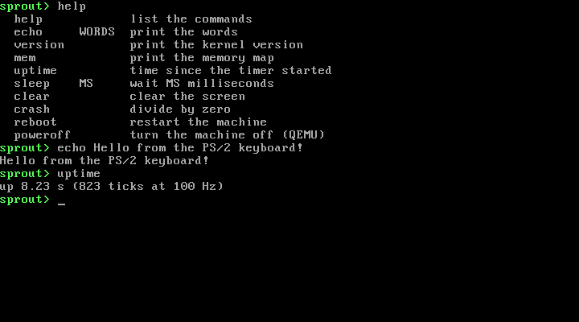

# Chapter 6 — Keyboard and a Shell

sprout can now react to events, but nobody can talk to it. This chapter adds the two input
devices every PC has: the PS/2 keyboard on IRQ 1 and the receive side of COM1 on IRQ 4. Both
feed one ring-buffer queue; a line editor turns characters into lines, and a shell runs them
at a `sprout>` prompt. From now on the headless test *types* commands into COM1, and QEMU
exits by itself at `poweroff`. Later chapters add their own commands to this shell.

Previous: [Chapter 5](05-interrupts.md). Next: [Chapter 7](07-memory-management.md).

## From events to input

A handler runs with IF clear (interrupt gates, Chapter 5), so no other IRQ is delivered: a slow
keyboard handler delays ticks, one waiting for the user freezes the machine. So the work is split:

```
 keyboard IRQ 1 --+                                    +--> line editor --> shell
                  +--> input_put(c) --> [ queue ] --> input_getc()
 COM1 IRQ 4 ------+     (producers,                    (consumer,
                         interrupts off)                normal code)
```

The handlers *produce* characters into a queue and return; the shell *consumes* them at its
own pace and sleeps while the queue is empty. Every kernel handles input this way; Unix calls
the consumer side the *line discipline*.

New in `project/ch06`: `kernel/keyboard.c` (IRQ 1), receiving in `kernel/serial.c` (IRQ 4),
the queue `lib/ringbuf.c` and `kernel/input.c`, the line editor `lib/line.c` and `lib/args.c`,
the shell `kernel/shell.c`, `kernel/power.c` for `reboot` and `poweroff`, and
`kernel/memmap.c` (Chapter 4's memory map printer, moved out of `kmain.c`). The `lib/` files
have no hardware access, so the host unit tests cover them (16 tests now).

## The PS/2 keyboard and the 8042

The keyboard sends bytes over a serial cable to the *keyboard controller* on the motherboard,
an Intel 8042 microcontroller since the PC/AT (or a chipset copy). It has two I/O ports:

| port | read | write |
|---|---|---|
| 0x60 | the next byte from the keyboard | data for the keyboard or for a controller command |
| 0x64 | status: bit 0 = a byte is waiting in 0x60, bit 1 = the controller has not taken our last byte | a controller command |

When a byte arrives, the 8042 sets status bit 0 and raises IRQ 1; reading port 0x60 takes the
byte and clears the bit. The same chip gated A20 in Chapter 3, and `reboot` uses its reset line.

The bytes are *scancodes*: they name keys, not characters. 0x1E is "the key left of S", `a` on
a US keyboard and `q` on a French one; the layout is the kernel's job. Every key sends a *make*
code when pressed and a *break* code when released, so the kernel can track Shift. Of the three
scancode sets, port 0x60 delivers set 1 by default (the history section explains why):

- A press sends the key's code (0x01–0x58), a release the same code with bit 7 set: `a` is
  0x1E down, 0x9E up.
- Keys added after the 83-key XT keyboard, such as the arrows, keypad Enter and right Ctrl, send
  the prefix 0xE0 first: Up is E0 48 down, E0 C8 up. Pause sends a six-byte E1 sequence.
- Holding a key repeats its make code (*typematic* repeat), with no break codes in between.

### Example: watching the scancodes

`examples/ch06/` has three experiments. Like Chapter 5's, each target copies `project/ch06`,
changes it with `sed`, shows the diff, builds and boots the copy headless. QEMU monitor
commands such as `sendkey shift-a` press keys on the emulated PS/2 keyboard as a person would,
and COM1 goes to a log file.

`examples/ch06/Makefile` (excerpt: the header comment and the `nocr` and `clean` targets
omitted)
```make
QEMU ?= qemu-system-i386
PROJECT := ../../project/ch06

# $(call copy,NAME): a fresh copy of the project in build/NAME.
define copy
	rm -rf build/$(1) && mkdir -p build
	cp -r $(PROJECT) build/$(1)
	rm -rf build/$(1)/build
endef

# $(call build,NAME): show what changed, then build quietly.
define build
	diff -ru -x build $(PROJECT) build/$(1) || true
	$(MAKE) -s -C build/$(1)
endef

# Boot, wait for the prompt, press: a, Shift+a, Enter, the up arrow.
KEYS := sendkey a\nsendkey shift-a\nsendkey ret\nsendkey up\n
# $(call press,NAME)
define press
	(sleep 2; printf '$(KEYS)'; sleep 1; printf 'quit\n') | \
	    timeout 8 $(QEMU) -m 128M -drive format=raw,file=build/$(1)/build/sprout.img \
	    -display none -no-reboot -serial file:build/$(1).log -monitor stdio >/dev/null
	@echo "--- COM1 after the prompt:"
	@tr -d '\r' < build/$(1).log | sed -n '/^type help/,$$p'; echo
endef

# Print each scancode in hex, before the driver looks at it.
SHOW_SCANCODE := sed -i -e 's/^\#include "keyboard.h"/&\n\#include "kprintf.h"/' \
    -e '/uint8_t sc = inb(KBD_DATA);/a\    kprintf("[%02x]", sc);'

scancodes:
	$(call copy,$@)
	$(SHOW_SCANCODE) build/$@/kernel/keyboard.c
	$(call build,$@)
	$(call press,$@)

set2:
	$(call copy,$@)
	cp set2.c build/$@/kernel/
	$(SHOW_SCANCODE) build/$@/kernel/keyboard.c
	sed -i -e '/^void keyboard_init(void)/,/^{/s/^{/{\n    kbd_translation_off();/' \
	    -e 's/^void keyboard_init(void)/void kbd_translation_off(void);\n\n&/' \
	    build/$@/kernel/keyboard.c
	$(call build,$@)
	$(call press,$@)
```

`make scancodes` adds one `kprintf("[%02x]", sc)` at the top of the keyboard handler (printing
from an IRQ handler is fine for a quick experiment, not for a real driver). If QEMU is missing,
`sudo apt install qemu-system-x86` provides it.

```console
$ cd examples/ch06
$ make scancodes
...
+    kprintf("[%02x]", sc);
...
kernel.bin: 10249 bytes, 21 sectors
(sleep 2; printf 'sendkey a\nsendkey shift-a\nsendkey ret\nsendkey up\n'; sleep 1; ...
--- COM1 after the prompt:
type help for a list of commands
sprout> [1e]a[9e][2a][1e]A[9e][aa][1c]
aA: unknown command (try help)
sprout> [9c][e0][48][e0][c8]
```

- `[1e]` is `a` pressed (echoed `a`), `[9e]` = 0x1E | 0x80 its release.
- `sendkey shift-a` sends Shift down `[2a]`, `[1e]` (now `A`), `a` up `[9e]`, Shift up `[aa]`.
- `[1c]` is Enter: the shell runs `aA`, prints the error and a new prompt; Enter's release
  `[9c]` arrives after that.
- Up is `[e0][48]` down and `[e0][c8]` up. The shell ignores arrows, so nothing is echoed.

### Example: the keyboard's real language, set 2

The keyboard itself speaks scancode set 2. The 8042 *translates* it to set 1 because its
*configuration byte* (read with controller command 0x20, written with 0x60) has bit 6 set, and
the BIOS leaves it that way. `set2.c` clears that bit:

`examples/ch06/set2.c` (header comment omitted)
```c
#include <stdint.h>

#include "io.h"

#define KBC_DATA        0x60
#define KBC_STATUS      0x64
#define KBC_COMMAND     0x64
#define STATUS_OUT_FULL 0x01
#define STATUS_IN_FULL  0x02
#define CMD_READ_CONFIG 0x20
#define CMD_WRITE_CONFIG 0x60
#define CONFIG_TRANSLATE 0x40

static void wait_writable(void)
{
    while (inb(KBC_STATUS) & STATUS_IN_FULL)
        ;
}

void kbd_translation_off(void)
{
    wait_writable();
    outb(KBC_COMMAND, CMD_READ_CONFIG);
    while (!(inb(KBC_STATUS) & STATUS_OUT_FULL))
        ;
    uint8_t config = inb(KBC_DATA);

    wait_writable();
    outb(KBC_COMMAND, CMD_WRITE_CONFIG);
    wait_writable();
    outb(KBC_DATA, config & ~CONFIG_TRANSLATE);
}
```

Following HelpPC: before writing to 0x60 or 0x64, wait until status bit 1 is clear; before
reading 0x60, wait until bit 0 is set. `make set2` calls `kbd_translation_off()` at the start
of `keyboard_init` and presses the same keys. The driver still decodes set 1, which is the point:

```console
$ make set2
...
+    kbd_translation_off();
...
kernel.bin: 10313 bytes, 21 sectors
...
--- COM1 after the prompt:
type help for a list of commands
sprout> [1c]
sprout> [f0][1c]
sprout> [12]e[1c]
e: unknown command (try help)
sprout> [f0][1c]
sprout> [f0][12]e[5a][f0][5a][e0][75][e0][f0][75]
```

- In set 2, `a` is 0x1C, which is *Enter* in set 1: a new prompt, with nothing typed.
- A set-2 release is F0 and then the make code. F0 has bit 7 set, so the driver ignores it as
  a "release" of 0x70, then reads 0x1C: Enter again.
- Left Shift is 0x12 in set 2, `e` in set 1, so "Shift+a" types `e` and Enter.
- Enter (0x5A in set 2) is beyond the driver's table. In Up's release, E0 F0 75, the driver
  takes F0 as the second byte of an E0 pair, so `[75]` arrives alone and is ignored too.

The translation is why a 1980s set-1 table still works. A driver may switch it off and decode
set 2, with F0 and a different table; sprout keeps the translation.

## `keyboard.c`

`kernel/keyboard.c` (header comment, includes and the body of `shifted` omitted)
```c
#define KBD_DATA        0x60
#define KBD_STATUS      0x64
#define STATUS_OUTPUT_FULL 0x01     /* a byte is waiting in port 0x60 */

#define SC_RELEASE      0x80
#define SC_EXTENDED     0xE0
#define SC_LSHIFT       0x2A
#define SC_RSHIFT       0x36
#define SC_CAPSLOCK     0x3A
#define SC_ENTER        0x1C

/* Set 1 make codes 0x00-0x39 to characters; 0 = no character. */
static const char normal[0x3A] = {
    0,   27,  '1', '2', '3', '4', '5', '6', '7', '8', '9', '0', '-', '=', '\b', '\t',
    'q', 'w', 'e', 'r', 't', 'y', 'u', 'i', 'o', 'p', '[', ']', '\n', 0,  'a', 's',
    'd', 'f', 'g', 'h', 'j', 'k', 'l', ';', '\'', '`', 0,  '\\', 'z', 'x', 'c', 'v',
    'b', 'n', 'm', ',', '.', '/', 0,   '*', 0,   ' ',
};

static const char shifted[0x3A] = {
    /* the same keys with Shift: '!', '@', ... 'Q', 'W', ... '<', '>', '?' */
};

static bool shift_left, shift_right, caps_lock, extended;

static char translate(uint8_t code)
{
    bool shift = shift_left || shift_right;
    char c = shift ? shifted[code] : normal[code];

    /* Caps Lock affects letters only, and Shift undoes it. */
    char lower = normal[code];
    if (caps_lock && lower >= 'a' && lower <= 'z')
        c = shift ? lower : (char)(lower - 'a' + 'A');
    return c;
}

static void keyboard_irq(struct regs *r)
{
    (void)r;
    uint8_t sc = inb(KBD_DATA);

    if (sc == SC_EXTENDED) {
        extended = true;
        return;
    }
    if (extended) {                     /* the second byte of an E0 pair */
        extended = false;
        if (sc == SC_ENTER)             /* keypad Enter */
            input_put('\n');
        return;                         /* arrows, right Ctrl...: ignored */
    }

    bool released = sc & SC_RELEASE;
    uint8_t code = sc & ~SC_RELEASE;

    if (code == SC_LSHIFT) {
        shift_left = !released;
    } else if (code == SC_RSHIFT) {
        shift_right = !released;
    } else if (code == SC_CAPSLOCK) {
        if (!released)
            caps_lock = !caps_lock;
    } else if (!released && code < sizeof normal) {
        char c = translate(code);
        if (c != 0)
            input_put(c);
    }
}

void keyboard_init(void)
{
    /* Throw away anything typed before we were ready. */
    while (inb(KBD_STATUS) & STATUS_OUTPUT_FULL)
        inb(KBD_DATA);

    interrupt_register(IRQ_BASE + IRQ_KEYBOARD, keyboard_irq);
    pic_unmask(IRQ_KEYBOARD);
}
```

- **The tables** cover make codes 0x00–0x39, the 58 keys of the main block (Escape is 27,
  Backspace `'\b'`, Enter `'\n'`). Ctrl, the shifts and Alt map to 0; codes from 0x3A up
  (Caps Lock, F1–F10, the keypad) fail `code < sizeof normal` and are ignored.
- **Modifiers are state.** The handler sees one byte at a time, so it remembers which Shift is
  down; two flags, because releasing one Shift while holding the other must keep shifting.
  Caps Lock toggles on press, affects only letters, and Shift undoes it (Caps Lock + `1` is
  still `1`).
- **The E0 flag** remembers the prefix for the next byte. Keypad Enter (E0 1C) becomes `'\n'`;
  the other E0 keys are dropped. Ignoring the prefix entirely would turn Up (E0 48) into
  keypad 8 (0x48), and that is by design: see the history section.
- **`keyboard_init` drains the 8042.** While a byte from a key pressed during boot sits unread
  in port 0x60, the 8042 sends nothing more and raises no new IRQ: a dead keyboard.
- The handler never sends EOI: Chapter 5's dispatcher does that after every IRQ handler.

## The ring buffer

`lib/ringbuf.h` (excerpt)
```c
#define RINGBUF_SIZE 256                /* a power of two */

struct ringbuf {
    volatile uint32_t head;             /* next slot to write */
    volatile uint32_t tail;             /* next slot to read */
    char data[RINGBUF_SIZE];
};
```
`lib/ringbuf.c` (excerpt: `ringbuf_init` zeroes both counters, `ringbuf_count` returns
`head - tail`)
```c
bool ringbuf_put(struct ringbuf *rb, char c)
{
    if (ringbuf_count(rb) == RINGBUF_SIZE)
        return false;
    rb->data[rb->head % RINGBUF_SIZE] = c;
    rb->head++;                         /* publish only after the write */
    return true;
}

bool ringbuf_get(struct ringbuf *rb, char *c)
{
    if (ringbuf_count(rb) == 0)
        return false;
    *c = rb->data[rb->tail % RINGBUF_SIZE];
    rb->tail++;
    return true;
}
```

- **Free-running counters.** `head` and `tail` count characters ever written and read and are
  never reset. `head - tail` is the number waiting, `% RINGBUF_SIZE` picks the slot. Ring
  buffers that keep both below the size cannot tell "empty" from "full" (`head == tail` in
  both cases) and waste a slot; here all 256 slots are usable.
- **Wrap-around is free.** After 2³² characters `head` wraps to 0, and `head - tail` is still
  right in unsigned arithmetic, as with Chapter 5's `ticks - start`. The slot stays right
  because 256 divides 2³²: slot 255 (0xFFFFFFFF) is followed by slot 0. With a size of 100 it
  would jump. The unit test `ringbuf_counter_wrap` starts both counters at `UINT32_MAX - 1`.
- **One writer per field.** Only the producer writes `head`, only the consumer `tail`. Each
  reads the other's counter, which is `volatile` so every test reads memory.
- **Full means drop.** Old input is never overwritten. Exercise 3 counts the drops.

Is it safe without a lock? On sprout, yes, for a simpler reason: producers and consumer
(`input_getc`, next) both run with interrupts off, so on one CPU they never overlap. "Publish
only after the write" matters on a multiprocessor, where the reader must never see the new
`head` before its byte; `volatile` does not order the non-`volatile` `data` array, so such a
kernel would use C11 `<stdatomic.h>` with release/acquire ordering.

## `input.c` and the lost wake-up

`kernel/input.c` (header comment and includes omitted)
```c
static struct ringbuf queue;

void input_put(char c)
{
    ringbuf_put(&queue, c);
}

char input_getc(void)
{
    char c;

    for (;;) {
        cli();
        if (ringbuf_get(&queue, &c)) {
            sti();
            return c;
        }
        __asm__ volatile ("sti; hlt");  /* wait, with interrupts on */
    }
}
```

`input_put` is what the keyboard and COM1 handlers call. `input_getc` is the consumer: return
the next character, or sleep until there is one. The obvious version has a bug:

```c
    while (!ringbuf_get(&queue, &c))    /* WRONG */
        hlt();
```

Suppose the queue is empty, `ringbuf_get` returns false, and *then*, before `hlt`, a key press
arrives. The handler queues the character, returns, and the CPU sleeps although a character is
waiting: the classic *lost wake-up*, an event between the check and the sleep. In sprout the
next timer tick wakes the loop within 10 ms, but with the timer masked (or in a tickless
kernel) it would hang until the next key.

The fix closes the gap. `cli` first, so no interrupt can arrive during the check. If the queue
is empty, `sti; hlt`: Chapter 5's interrupt shadow delays `sti`'s effect by one instruction,
so a pending interrupt is delivered only once `hlt` has started, and wakes it. `iret` returns
behind `hlt`, and the loop runs `cli` and checks again.

Both instructions are in *one* `asm` statement because that is the only way to make sure they
end up next to each other; exercise 4 shows `sti(); hlt();` failing at `-O0`. The compiled
loop:

```console
$ objdump -d -M intel --no-show-raw-insn build/kernel.elf | sed -n '/<input_getc>:/,/ret/p'
00100250 <input_getc>:
...
  100258:	jmp    100262 <input_getc+0x12>
  10025a:	lea    esi,[esi+0x0]
  100260:	sti    
  100261:	hlt    
  100262:	cli    
  100263:	sub    esp,0x8
  100266:	push   ebx
  100267:	push   0x106fe0
  10026c:	call   101c60 <ringbuf_get>
  100271:	add    esp,0x10
  100274:	test   al,al
  100276:	je     100260 <input_getc+0x10>
  100278:	sti    
...
  100282:	ret    
```

The loop starts at `cli` (0x100262), calls `ringbuf_get` with interrupts off, and on an empty
queue jumps back to `sti` / `hlt` at 0x100260. An interrupt during `hlt` returns to 0x100262:
`cli` again. 0x106fe0 is `queue` in `.bss`. This pattern, "disable interrupts, check, then
atomically enable and sleep", is the uniprocessor form of what Unix kernels do with
`sleep`/`wakeup` and Linux with wait queues.

## Receiving on COM1

The keyboard is one way in. The other, the serial port, matters more for us: a test script can
type into it. Chapter 4's UART driver only sends; receiving needs four changes:

```diff
+#define LSR_DR      0x01        /* data ready: a received byte is waiting */
 #define LSR_THRE    0x20        /* transmit holding register empty */
+#define IER_RX      0x01        /* interrupt when data is received */
+#define MCR_DTR_RTS 0x03
+#define MCR_OUT2    0x08        /* on a PC, connects the UART's IRQ line */
...
-    outb(COM1 + REG_FCR, 0xC7);         /* enable + clear FIFOs, 14-byte threshold */
-    outb(COM1 + REG_MCR, 0x03);         /* DTR + RTS: "we are here" */
+    outb(COM1 + REG_FCR, 0x07);         /* enable + clear FIFOs, interrupt
+                                           after every received byte */
+    outb(COM1 + REG_MCR, MCR_DTR_RTS);  /* "we are here" */
...
+/* Terminals send CR for Enter and often DEL (0x7F) for Backspace; the
+ * rest of the kernel wants '\n' and '\b'. */
+static void serial_irq(struct regs *r)
+{
+    (void)r;
+    while (inb(COM1 + REG_LSR) & LSR_DR) {
+        char c = (char)inb(COM1 + REG_DATA);
+        if (c == '\r')
+            c = '\n';
+        else if (c == 0x7F)
+            c = '\b';
+        input_put(c);
+    }
+}
+
+void serial_enable_input(void)
+{
+    interrupt_register(IRQ_BASE + IRQ_COM1, serial_irq);
+    outb(COM1 + REG_MCR, MCR_DTR_RTS | MCR_OUT2);
+    outb(COM1 + REG_IER, IER_RX);
+    pic_unmask(IRQ_COM1);
+}
```

- **FCR 0x07 instead of 0xC7.** The top two bits of the FIFO control register set the receive
  *trigger level*: 1, 4, 8 or 14 bytes. With 14 the UART interrupts only after 14 bytes or a
  timeout of a few character times; a person typing wants every byte at once: level 1.
- **IER bit 0** asks for an interrupt when received data is available; `interrupts.h` gains
  `IRQ_COM1 4`, COM1's standard line.
- **MCR bit 3, OUT2.** On a PC this general-purpose UART output gates its interrupt line onto
  the bus: without it a real machine never sees IRQ 4. QEMU delivers the interrupt either way
  (the test passes with OUT2 removed), so the bug would show only on hardware.
- **The loop** reads while LSR bit 0 says a byte is waiting, taking a whole burst at once.
- **Translation.** A terminal in raw mode sends CR (0x0D) for Enter and usually DEL (0x7F) for
  Backspace; sprout wants `'\n'` and `'\b'`, as the keyboard produces. Unix's line discipline
  does the same: termios' `ICRNL` flag means "Translate carriage return to newline on input".

### Example: forgetting the CR translation

`make nocr` deletes the CR case and types `version` plus CR into COM1, through `-serial
stdio` instead of the monitor:

```console
$ make nocr
...
-        if (c == '\r')
-            c = '\n';
-        else if (c == 0x7F)
+        if (c == 0x7F)
...
type help for a list of commands
sprout> version
(no reply: the shell is still waiting for '\n')
```

The characters are echoed, but CR is not printable, so the line editor drops it, and the shell
waits for a `'\n'` a terminal never sends. A serial console that "echoes but never answers" is
very often this bug.

## The line editor and arguments

The shell needs whole lines with Backspace working. `lib/line.c` does that one character at a
time and shows everything through a callback, so the same code runs in the kernel (echo =
`console_putc`, VGA plus COM1) and in the unit tests (echo = append to a string).

`struct line` (in `lib/line.h`) holds the buffer `buf` and its capacity `cap` (including the
final NUL), the current length `len`, a `done` flag and the `echo` callback. `line_feed`
processes one character and returns true when it was Enter; `buf` then holds the
NUL-terminated line until the next call.

`lib/line.c` (excerpt: `line_init` just fills the struct)
```c
#define BACKSPACE   '\b'
#define DELETE      0x7F            /* what many terminals send for backspace */

bool line_feed(struct line *l, char c)
{
    if (l->done) {                  /* start a new line */
        l->len = 0;
        l->done = false;
    }

    if (c == '\n') {
        l->buf[l->len] = '\0';
        l->done = true;
        l->echo('\n');
        return true;
    }

    if (c == BACKSPACE || c == DELETE) {
        if (l->len > 0) {
            l->len--;
            l->echo('\b');          /* back, blank it out, back again */
            l->echo(' ');
            l->echo('\b');
        }
        return false;
    }

    /* Printable ASCII only, and keep room for the NUL. */
    if (c >= ' ' && c <= '~' && l->len + 1 < l->cap) {
        l->buf[l->len++] = c;
        l->echo(c);
    }
    return false;
}
```

- **Erasing on screen** takes `'\b'` (cursor left), a space over the old character, and
  `'\b'` again: terminals and Chapter 4's VGA driver move the cursor on `'\b'` without erasing.
  Backspace at the start of the line does nothing, so the prompt is safe.
- **Only printable ASCII** (0x20–0x7E) is stored; Tab, Escape and other control characters are
  dropped. A full line still accepts Backspace and Enter; with the shell's 128-byte buffer a
  line holds at most 127 characters.
- **`done`** keeps the finished line in `buf` until the next character arrives.

The tests feed strings and compare buffer and echo, for example:

```c
    CHECK_INT(feed(&l, "helo\bp"), 0);
    CHECK_STR(echoed, "helo\b \bp");
    CHECK_INT(feed(&l, "\n"), 1);
    CHECK_STR(buf, "help");
```

Then `lib/args.c` splits a line into words, like the `argv` a C program receives.
`args_split(line, argv, max)` writes NULs over spaces and tabs, so each `argv[i]` points into
the line buffer itself (no copying, and sprout has no allocator yet); it returns the word count,
or -1 for more than `max` words. Numbers need more care:

`lib/args.c` (excerpt: `args_split`, `is_space` and `digit_value` omitted)
```c
bool args_parse_u32(const char *s, uint32_t *out)
{
    uint32_t base = 10, value = 0;

    if (s[0] == '0' && (s[1] == 'x' || s[1] == 'X')) {
        base = 16;
        s += 2;
    }
    if (*s == '\0')
        return false;

    for (; *s != '\0'; s++) {
        uint32_t d = (uint32_t)digit_value(*s);
        if (d >= base)
            return false;
        if (value > (UINT32_MAX - d) / base)
            return false;           /* value * base + d would overflow */
        value = value * base + d;
    }
    *out = value;
    return true;
}
```

`args_parse_u32` accepts decimal or `0x` hex and rejects anything else, including an empty
string, `0x` alone, a sign, and values above 4294967295. `digit_value` returns 99 for a
non-digit, which fails `d >= base` in both bases. The overflow test is the usual one:
`value * base + d` fits only if `value <= (UINT32_MAX - d) / base`, checked *before*
multiplying.

## The shell

`kernel/shell.c` (excerpt: includes and the command functions other than `help` omitted)
```c
#define LINE_MAX    128
#define ARGS_MAX    8

struct command {
    const char *name;
    const char *usage;              /* arguments, for help */
    const char *help;
    void (*run)(int argc, char *argv[]);
};

static const struct command commands[] = {
    { "help",     "",       "list the commands",            cmd_help },
    { "echo",     "WORDS",  "print the words",              cmd_echo },
    { "version",  "",       "print the kernel version",     cmd_version },
    { "mem",      "",       "print the memory map",         cmd_mem },
    { "uptime",   "",       "time since the timer started", cmd_uptime },
    { "sleep",    "MS",     "wait MS milliseconds",         cmd_sleep },
    { "clear",    "",       "clear the screen",             cmd_clear },
    { "crash",    "",       "divide by zero",               cmd_crash },
    { "reboot",   "",       "restart the machine",          cmd_reboot },
    { "poweroff", "",       "turn the machine off (QEMU)",  cmd_poweroff },
    { NULL, NULL, NULL, NULL },
};

static void cmd_help(int argc, char *argv[])
{
    (void)argc, (void)argv;
    for (const struct command *c = commands; c->name; c++)
        kprintf("  %-8s %-6s %s\n", c->name, c->usage, c->help);
}

static void run(char *line)
{
    char *argv[ARGS_MAX];
    int argc = args_split(line, argv, ARGS_MAX);

    if (argc < 0) {
        kprintf("too many words (at most %d)\n", ARGS_MAX);
        return;
    }
    if (argc == 0)
        return;
    for (const struct command *c = commands; c->name; c++) {
        if (strcmp(argv[0], c->name) == 0) {
            c->run(argc, argv);
            return;
        }
    }
    kprintf("%s: unknown command (try help)\n", argv[0]);
}

void shell_run(const struct boot_info *bi)
{
    static char buf[LINE_MAX];
    struct line line;

    boot_info = bi;
    line_init(&line, buf, sizeof buf, console_putc);
    for (;;) {
        vga_set_color(VGA_LIGHT_GREEN, VGA_BLACK);
        kprintf(SHELL_PROMPT);
        vga_set_color(VGA_LIGHT_GREY, VGA_BLACK);
        while (!line_feed(&line, input_getc()))
            ;
        run(buf);
    }
}
```

- **A table, not a chain of `if`s.** Each command is a name, a usage string, a help text and a
  function with the familiar `(argc, argv)` signature. `help` is generated from the table
  (`%-8s` pads to 8 columns), so it cannot get out of date. The `NULL` entry ends the table,
  like the `NULL` after a C program's `argv`. A new command is one function and one line.
- **The other commands** are one or two lines each. `echo` joins its words with single
  spaces, `uptime` prints `timer_ticks()` as seconds, `mem` calls `memmap_print`, `clear`
  re-runs `vga_init`, and `crash` divides by a `volatile` zero.
- **`sleep`** converts milliseconds to ticks rounding up, `(ms * timer_hz() + 999) / 1000`,
  so `sleep 1` waits at least one tick; the limit of 60000 keeps the product far from overflow.
- **The prompt** is green on VGA only. `SHELL_PROMPT` is `"sprout> "` in `shell.h`; the test
  script waits for exactly that string.

`crash` shows Chapter 5's dump on demand. EIP is now inside `cmd_crash`, and
`eflags=00000216` has IF set (the shell runs with interrupts on):

```console
sprout> crash

exception 0 (divide error), error code 0
...
  eip=00100afd cs=0008 eflags=00000216
...
PANIC at kernel/interrupts.c:47: unhandled exception in the kernel
system halted
```

## Turning the machine off

`kernel/power.c` (header comment and includes omitted)
```c
#define KBC_STATUS      0x64
#define KBC_COMMAND     0x64
#define KBC_INPUT_FULL  0x02        /* the controller hasn't read the last byte */
#define KBC_PULSE_RESET 0xFE

#define QEMU_PM1A_CNT   0x604
#define PM1_SLP_EN      0x2000      /* bit 13 */

void reboot(void)
{
    cli();
    while (inb(KBC_STATUS) & KBC_INPUT_FULL)
        ;
    outb(KBC_COMMAND, KBC_PULSE_RESET);
    for (;;)
        hlt();                      /* the reset takes a moment */
}

void poweroff(void)
{
    cli();
    outw(QEMU_PM1A_CNT, PM1_SLP_EN);
    /* QEMU exits a moment later (the CPU may run a few more instructions
     * first, so print nothing here). Elsewhere, this is where we stay. */
    for (;;)
        hlt();
}
```

- **Reboot** uses the 8042 once more. Controller commands 0xF0–0xFF pulse bits 0–3 of its
  *output port* low for 6 µs (a 0 bit in the command means "pulse"); bit 0 is wired to the
  CPU's reset line, so 0xFE resets the machine (HelpPC). Bit 1 of that port is Chapter 3's A20
  gate. With `-no-reboot` (used since Chapter 1), QEMU exits instead (status 0 here).
- **Power-off** on a real PC is an ACPI job: find the FADT, evaluate the `\_S5` object (AML
  bytecode) for the "soft off" sleep type, and write it with SLP_EN to the PM1a control
  register. That needs an AML interpreter, far beyond this course. QEMU's PC machine has its
  PM1a control register at port 0x604, and SLP_EN (bit 13) with sleep type 0 turns it off
  (OSDev's Shutdown page: QEMU 2.0 and later; Bochs and older QEMU use 0xB004). Elsewhere
  `poweroff` just halts.
- Both commands print *before* calling these: after the write the CPU may stop at any moment.

## Starting it up

The end of `kmain` changes from Chapter 5's demo to the shell:

```diff
     idt_init();
     pic_init(IRQ_BASE);
-...                                 (the int3 test and the three half-second sleeps)
     timer_init(100);
+    keyboard_init();
+    serial_enable_input();
     sti();
-...
+    kprintf("interrupts on: timer %u Hz, keyboard (IRQ 1), COM1 input (IRQ 4)\n",
+            timer_hz());
+    kprintf("type help for a list of commands\n");
+
+    shell_run(bi);
 }
```

Each driver registers its handler and unmasks its line while IF is clear; one `sti` turns
everything on. The version is `0.6`.

## Testing an interactive kernel

Chapter 5's test only listened. Now `tests/boot.in` holds the commands to type, and
`tools/qemu-test.sh` connects QEMU's COM1 to a named pipe (FIFO) it can write to:

`tools/qemu-test.sh` (excerpt: setup and the final comparison omitted)
```sh
timeout "$TIMEOUT" $QEMU -drive format=raw,file="$IMAGE" \
    -display none -serial stdio -monitor none -no-reboot \
    <"$FIFO" >"$RAW" 2>build/qemu.err &
pid=$!
exec 3>"$FIFO"

prompts() {
    grep -o -F -- "$PROMPT" "$RAW" | wc -l
}

# Type the input, one line per prompt.
if [ -n "$INPUT" ]; then
    n=0
    while IFS= read -r line; do
        n=$((n + 1))
        while [ "$(prompts)" -lt "$n" ]; do
            kill -0 "$pid" 2>/dev/null || break 2
            sleep 0.1
        done
        printf '%s\r' "$line" >&3
    done <"$INPUT"
fi
```

- **A FIFO** (`mkfifo build/serial.in`, done earlier in the script) is a file name for a pipe.
  QEMU reads COM1's input from it, and the script writes into it through file descriptor 3.
  Opening a FIFO blocks until both ends are open, hence the order: QEMU first, then `exec 3>`.
- **One line per prompt.** Line *n* is sent only once the *n*-th `sprout> ` has appeared.
  Typing everything at once would fail: bytes arriving before `serial_init` are thrown away
  when it clears the FIFOs, and later ones wait in the 16-byte UART FIFO until interrupts are
  on. Waiting also makes the log read like a person typing.
- **Each line ends in `\r`**, like Enter on a terminal, so the CR translation is tested.
- The script stops when QEMU exits (at `poweroff`), the last expected line appears, or after
  `TIMEOUT` seconds.

`tests/boot.in` also tests Backspace: line 5 holds two real DEL bytes (`cat -A` shows `^?`):

```console
$ cat -A tests/boot.in
help$
echo hello,   world$
version$
sleep 500$
ecoh^?^?ho typo fixed$
frobnicate$
sleep$
mem$
poweroff$
```

## Building and running

```console
$ cd project/ch06
$ make
...
kernel.bin: 10185 bytes, 20 sectors
...
$ make test
...
build/unit
unit: 16 passed, 0 failed
sh tools/qemu-test.sh "qemu-system-i386 -m 128M" build/sprout.img tests/boot.expected tests/boot.in
PASS: build/sprout.img (53 lines of serial output match tests/boot.expected)
```

The kernel is 10185 bytes; `kernel/` and `lib/` hold 1875 lines. `make test` takes about 1.9
seconds here (timings vary), mostly boot and `sleep 500`. `make demo` prints the session:

```console
$ make demo
...
interrupts on: timer 100 Hz, keyboard (IRQ 1), COM1 input (IRQ 4)
type help for a list of commands
sprout> help
  help            list the commands
  echo     WORDS  print the words
  version         print the kernel version
  mem             print the memory map
  uptime          time since the timer started
  sleep    MS     wait MS milliseconds
  clear           clear the screen
  crash           divide by zero
  reboot          restart the machine
  poweroff        turn the machine off (QEMU)
sprout> echo hello,   world
hello, world
sprout> version
sprout 0.6
sprout> sleep 500
sprout> echo typo fixed
typo fixed
sprout> frobnicate
frobnicate: unknown command (try help)
sprout> sleep
usage: sleep MS (at most 60000)
sprout> mem
memory map (6 entries from E820):
  0000000000000000-000000000009fbff  usable
...
usable RAM: 130559 KiB (127 MiB)
sprout> poweroff
powering off
```

The terminal shows `echo typo fixed`, but `boot.in` typed `ecoh`, two DELs and `ho typo
fixed`. The log holds the echo of every key, and `cat -A` shows it:

```console
$ grep -n typo tests/boot.expected | cat -A
37:sprout> ecoh^H ^H^H ^Hho typo fixed$
38:typo fixed$
```

Each DEL became `'\b'` in `serial_irq` and was echoed as `\b \b`. The terminal plays that back:
back over `h`, a space hides it, back again, the same for `o`, and the following `ho`
completes `echo`. A viewer that drops the `^H` bytes would show `ecoh  ho` instead. `echo`
collapses the three spaces, `sleep` without an argument prints its usage, and `poweroff` ends
QEMU, so the test needs no timeout.

`make run` opens a window: click into it and type. `uptime` there shows the real time since
boot:



## History: scancodes, xv6's console and the Unix line discipline

**Three scancode sets.** Wikipedia's Scancode article: set 1 comes from the IBM PC XT keyboard,
where "the low 7 bits identify the key, and the most significant bit is clear for a key press
(make scancode) or set for a key release". The PC AT keyboard brought set 2 (release = F0 +
make code); set 3 came from the IBM 3270 PC. To keep XT software working, "for computers since
the IBM PC AT, the keyboard controller on the motherboard translates AT (set 2) scancodes into
XT (set 1) scancodes in so called translation mode", which `make set2` turned off. The E0
prefixes "were initially assigned so that ignoring the E0 prefix … would produce reasonable
results. For example the numeric keypad's Enter key produces a scancode of E0 1C". Before the
AT there was no 8042: HelpPC notes that earlier PCs used the 8255 PPI as keyboard interface.

**xv6 does the same job.** MIT's xv6 reads ports 0x64 and 0x60 in `kbd.c`'s `kbdgetc`,
remembers E0 in an `E0ESC` flag, detects a release with `data & 0x80`, and picks one of four
tables (`charcode[4]`: normal, shift, Ctrl, Ctrl again for Ctrl+Shift). Unlike sprout it keeps
the extended keys, setting bit 7 on the code after an E0 so they get their own table entries.
`kbd.h` defines `#define C(x) (x - '@')` for control codes (exercise 2's `& 0x1F` gives the
same values). `console.c` keeps a 128-byte `input.buf` with free-running indices
(`input.buf[input.e++ % INPUT_BUF] = c`), treats `C('H')` and `'\x7f'` as Backspace, `C('U')`
as "kill line" and `C('P')` as a process listing, and turns `'\r'` into `'\n'`. When the
buffer is full xv6 ends the line; sprout ignores the extra input, and exercise 3 shows the cost.

**sprout's line editor is a tiny canonical mode.** In Unix's *canonical mode* (`ICANON`) the
terminal driver edits, and input is "made available line by line". termios(3) lists `ICRNL`,
the erase character `VERASE` "(0177, DEL, rubout, or 010, BS, Ctrl-H…)", and `VINTR` "(003,
ETX, Ctrl-C…)", which sends `SIGINT`. sprout hard-wires `ICRNL` and both `VERASE` characters;
exercise 2 adds `VINTR`, without signals.

## Summary

- IRQ handlers run with interrupts off and must be short: they produce, the shell consumes.
- 8042: data 0x60, status/command 0x64 (bit 0 data waiting, bit 1 busy), IRQ 1. Set 1: make =
  code, break = code | 0x80, E0 prefixes. The 8042 translates set 2 to set 1 (config bit 6).
- `ringbuf`: 256 bytes, free-running counters, `count = head - tail`, slot = `% 256`; full drops.
- `input_getc`: `cli`, check, `"sti; hlt"` in one `asm` statement, closing the lost wake-up.
- COM1 input: FCR 0x07, IER bit 0, MCR OUT2, IRQ 4, CR → `'\n'`, DEL → `'\b'`.
- Line editor: printable ASCII, `\b \b`, echo through a callback; a `NULL`-terminated
  command table. `reboot`: 8042 command 0xFE. `poweroff`: `outw(0x604, 0x2000)`, QEMU only.
- The test types `tests/boot.in` into a FIFO, one line per prompt, and ends at `poweroff`.

## Exercises

1. **A `peek` command.** Add `peek ADDR`, which prints 16 bytes of memory in hex, with
   `args_parse_u32` for the address. Look at 0x7C00, 0x7DFE and 0xB8000. What do you find?

   <details><summary>Solution</summary>

   In `kernel/shell.c`, before `cmd_clear`:

   ```c
   static void cmd_peek(int argc, char *argv[])
   {
       uint32_t addr;
       if (argc != 2 || !args_parse_u32(argv[1], &addr)) {
           kprintf("usage: peek ADDR (decimal or 0x hex)\n");
           return;
       }
       const volatile uint8_t *p = (const volatile uint8_t *)(uintptr_t)addr;
       kprintf("%08x:", addr);
       for (int i = 0; i < 16; i++)
           kprintf(" %02x", p[i]);
       kprintf("\n");
   }
   ```

   and in the table, before `clear`:

   ```c
       { "peek",     "ADDR",   "dump 16 bytes of memory",      cmd_peek },
   ```

   Put `peek 0x7c00`, `peek 0x7dfe`, `peek 0xb8000`, `peek 12x` and `poweroff` in `peek.in`
   and run the test script with it (it reports FAIL, but `build/serial.log` holds the session):

   ```console
   $ sh tools/qemu-test.sh "qemu-system-i386 -m 128M" build/sprout.img tests/boot.expected \
       peek.in >/dev/null; tail -9 build/serial.log
   sprout> peek 0x7c00
   00007c00: ea 05 7c 00 00 fa 31 c0 8e d8 8e c0 8e d0 bc 00
   sprout> peek 0x7dfe
   00007dfe: 55 aa 00 00 00 00 00 00 00 00 00 00 00 00 00 00
   sprout> peek 0xb8000
   000b8000: 73 0a 70 0a 72 0a 6f 0a 75 0a 74 0a 20 0a 30 0a
   sprout> peek 12x
   usage: peek ADDR (decimal or 0x hex)
   sprout> poweroff
   powering off
   ```

   The boot sector from Chapter 2 is still at 0x7C00: `ea 05 7c 00 00` is `jmp 0:0x7c05`, then
   `fa` (`cli`) and `31 c0` (`xor ax, ax`). At 0x7DFE sits its `55 aa` signature. At 0xB8000
   the VGA text buffer alternates characters and attributes: `sprout 0`, light green on black
   (0x0A), is the version banner in the top line. sprout has no memory protection yet, so any
   address can be read; Chapter 7 starts changing that.

   </details>

2. **Ctrl+C cancels the line.** Track the left Ctrl key (set 1 code 0x1D) in the keyboard
   driver and turn Ctrl+letter into the control code `letter & 0x1F` (Ctrl+C = 3). Make
   `line_feed` treat 3 as "echo `^C`, a newline, and return an empty line". Add a unit test.

   <details><summary>Solution</summary>

   In `kernel/keyboard.c`, add `#define SC_LCTRL 0x1D` and a `ctrl` flag next to the shift
   flags. In `translate`, after `char lower = normal[code];`:

   ```c
       if (ctrl && lower >= 'a' && lower <= 'z')
           return (char)(lower & 0x1F);    /* Ctrl+A = 1 ... Ctrl+C = 3 */
   ```

   and in `keyboard_irq`, the first modifier test becomes:

   ```c
       if (code == SC_LCTRL) {
           ctrl = !released;
       } else if (code == SC_LSHIFT) {
   ```

   In `lib/line.c`, add `#define CTRL_C 0x03` and, before the backspace test:

   ```c
       if (c == CTRL_C) {              /* cancel: an empty line */
           l->echo('^');
           l->echo('C');
           l->echo('\n');
           l->len = 0;
           l->buf[0] = '\0';
           l->done = true;
           return true;
       }
   ```

   The test in `tests/unit/test_input.c`, plus `X(line_ctrl_c)` in `tests/unit/tests.h`:

   ```c
   void test_line_ctrl_c(void)
   {
       char buf[16];
       struct line l;

       n_echoed = 0;
       line_init(&l, buf, sizeof buf, echo);
       CHECK_INT(feed(&l, "rm -rf\x03"), 1);
       CHECK_STR(buf, "");
       CHECK_STR(echoed, "rm -rf^C\n");
   }
   ```

   ```console
   $ make unit
   ...
   unit: 17 passed, 0 failed
   $ make >/dev/null
   $ (sleep 2; for k in e c h ctrl-c v e r s i o n ret; do echo "sendkey $k"; done; \
       sleep 1; printf 'quit\n') | timeout 8 qemu-system-i386 -m 128M \
       -drive format=raw,file=build/sprout.img -display none -no-reboot \
       -serial file:cc.log -monitor stdio >/dev/null
   $ tr -d '\r' < cc.log | sed -n '/^type help/,$p'
   type help for a list of commands
   sprout> ech^C
   sprout> version
   sprout 0.6
   sprout> 
   ```

   The empty line reuses the shell's "no words" case. COM1 works too: a terminal sends byte 3
   for Ctrl+C (`echo never` plus 3 gave `sprout> echo never^C`). Right Ctrl, E0 1D, is dropped.

   </details>

3. **Count dropped input.** Make `input_put` count the characters it has to drop and let
   `uptime` print the count. Then, while the shell runs `sleep 2000`, send 600 `x` and a CR in
   one burst over COM1. How many are dropped, and what happens to the next command?

   <details><summary>Solution</summary>

   In `kernel/input.c`:

   ```c
   static volatile uint32_t dropped;   /* changed by interrupt handlers */

   void input_put(char c)
   {
       if (!ringbuf_put(&queue, c))
           dropped++;
   }

   uint32_t input_dropped(void)
   {
       return dropped;
   }
   ```

   plus `#include <stdint.h>` and the prototype in `input.h`, and in `cmd_uptime`:

   ```c
       kprintf("input: %u characters dropped\n", input_dropped());
   ```

   The burst, then `uptime` twice (the x lines are shortened here):

   ```console
   $ (sleep 2; printf 'sleep 2000\r'; sleep 0.5; head -c 600 /dev/zero | tr '\0' x; \
       printf '\r'; sleep 3; printf 'uptime\r'; sleep 0.5; printf 'uptime\r'; sleep 0.5; \
       printf 'poweroff\r') | timeout 12 qemu-system-i386 -m 128M \
       -drive format=raw,file=build/sprout.img -display none -no-reboot -serial stdio \
       -monitor none 2>/dev/null | tr -d '\r' | sed -n '/^sprout> sleep/,$p'
   sprout> sleep 2000
   sprout> xxxxxxxxxxxxxxxxxxxxxxxx...xxxxxxxx
   xxxxxxxxxxxxxxxxxxxxxxxx...xxxxxxxx: unknown command (try help)
   sprout> uptime
   up 5.89 s (589 ticks at 100 Hz)
   input: 345 characters dropped
   sprout> poweroff
   powering off
   ```

   During `sleep` nobody reads the queue, so its 256 slots fill and the other 601 − 256 = 345
   characters, the final CR among them, are dropped (QEMU's UART itself loses nothing: QEMU
   feeds it only when it has room). The shell keeps 127 of the 256 `x`. With the CR gone the
   line is still open when the first `uptime` arrives; its letters are ignored (the line is
   full) and its CR ends the line, so that `uptime` vanished. Real line disciplines keep room
   for the newline or, like xv6, end a full line.

   </details>

4. **Why one `asm` statement?** Compile `sti(); hlt();` and `__asm__ volatile ("sti; hlt")`
   in two small functions with the kernel's flags at `-O2` and at `-O0`, and compare the
   disassembly. Is `sti(); hlt();` safe in `input_getc`?

   <details><summary>Solution</summary>

   `wait.c`, compiled from `project/ch06` with the kernel's `gcc` flags plus `-O2` or `-O0`:

   ```c
   #include "io.h"

   void wait_separate(void)
   {
       sti();
       hlt();
   }

   void wait_together(void)
   {
       __asm__ volatile ("sti; hlt");
   }
   ```

   At `-O2` both functions are `sti`, `hlt`, `ret`. At `-O0` the inline functions are not
   inlined:

   ```console
   $ objdump -d -M intel --no-show-raw-insn wait-O0.o
   00000000 <sti>:
      0:	push   ebp
      1:	mov    ebp,esp
      3:	sti    
      4:	nop
      5:	pop    ebp
      6:	ret    
   ...
   0000000e <wait_separate>:
   ...
     11:	call   0 <sti>
     16:	call   7 <hlt>
   ...
   0000001e <wait_together>:
   ...
     21:	sti    
     22:	hlt    
   ```

   In `wait_separate` the shadow of `sti` covers only the `nop`. An interrupt taken during
   `pop ebp`, `ret` or `call hlt` is the lost wake-up. `-O2` happens to work, but two `asm`
   statements promise nothing about what lies between them; one statement does.

   </details>

Sources for this chapter: [REFERENCES.md](REFERENCES.md#chapter-6--keyboard-and-a-shell)
