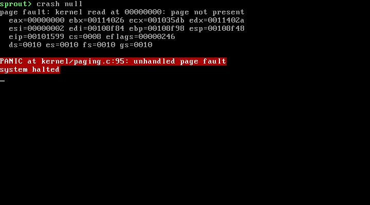
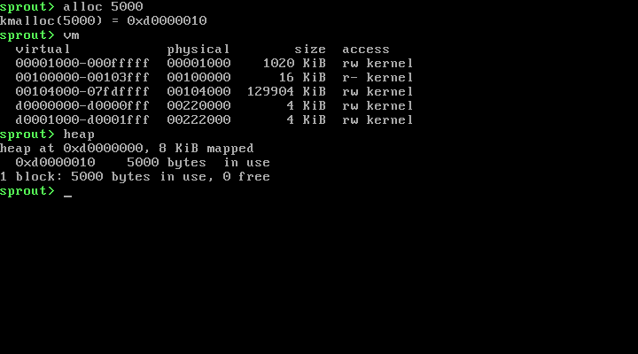

# Chapter 7 — Memory Management

sprout runs on a machine with 127 MiB of RAM and uses about 100 KiB of it. Every address it
uses is a physical address, and nothing stops a stray pointer from writing over the kernel's
own code. This chapter adds the three layers that every real kernel has. A **physical frame
allocator** keeps track of which 4 KiB pieces of RAM are free. **Paging** decides what each
virtual address means: NULL faults, kernel code becomes read-only, and a page fault reports the
exact address that went wrong. A **kernel heap** provides `kmalloc` and `kfree` at virtual
address 0xD0000000, backed by frames that are mapped on demand. New shell commands (`vm`,
`heap`, `alloc`, `free` and `crash null|code`) make each layer visible.

Previous: [Chapter 6](06-keyboard-and-a-shell.md). Next: [Chapter 8](08-tasks.md).

## Why paging

Up to Chapter 6, an address in sprout is a physical address. The GDT from Chapter 3 has
segments with base 0 and limit 4 GiB, so `*(char *)0xB8000` really is the VGA buffer, and
`*(char *)0x100000` really is the first byte of the kernel. That is simple, but there is no
protection at all. A bug that writes through a wild pointer can overwrite `kmain` itself, and
reading address 0 just returns whatever is there.

The 80386 added **paging**: every address the CPU uses (a *virtual* address) goes through a
translation by the memory management unit (MMU), which the 386 put on the same chip as the CPU
([Wikipedia: i386](https://en.wikipedia.org/wiki/I386)). The translation uses tables in memory
that the kernel writes. For each 4 KiB **page** of virtual addresses the tables say:

- whether it is mapped at all (if not, any access is a *page fault*);
- which 4 KiB **frame** of physical memory backs it;
- whether it may be written, and whether ring 3 code may use it (Chapter 9).

Pages are virtual and frames are physical. Both are 4 KiB, and the low 12 bits of an address
(the offset in the page) pass through unchanged.

Paging needs memory for its own tables, and the heap needs memory for its blocks. So the order
in this chapter is fixed: first find out which RAM exists, then hand it out in frames, then
build the page tables, and only then build a heap on top.

## Knowing what RAM exists

Chapter 2's loader asked the BIOS for the E820 memory map and left it at 0x600, with the boot
information block (boot drive, map address, entry count) at 0x500. Chapter 4's kernel only
printed the map. Now the kernel needs it to know which frames it can hand out.

There is a catch. Both 0x500 and 0x600 are in **page 0** (0x0000–0x0FFF), and page 0 is about
to become unmapped so that NULL pointers fault. Anything the kernel needs from there must be
copied first. `kernel/memmap.c` does this:

```c
void memmap_init(const struct boot_info *bi)
{
    const struct e820_entry *src =
        (const struct e820_entry *)(uintptr_t)bi->e820_map;

    count = bi->e820_count <= MEMMAP_MAX ? bi->e820_count : MEMMAP_MAX;
    for (uint32_t i = 0; i < count; i++)
        map[i] = src[i];
    boot_drive = bi->boot_drive;
}
```

`kmain` calls it before anything touches paging, and every later user goes through
`memmap_entry(i)`, `memmap_usable()` and `memmap_boot_drive()`:

```c
    memmap_init(bi);                /* copy it before paging hides page 0 */
    memmap_print();

    idt_init();                     /* so mistakes below are reported */
    pmm_init();
    paging_init();
```

The example `make bootinfo` below shows what happens to code that reads `bi` too late.

## The frame allocator

`kernel/pmm.c` (physical memory manager) keeps **one bit per frame**: 1 means "not available"
(in use, or not RAM at all) and 0 means free. sprout manages the first 1 GiB (`PMM_LIMIT`), and
1 GiB / 4 KiB = 262144 frames, so the bitmap is 262144 bits = 32 KiB in `.bss`. The bit
operations live in `lib/bitmap.c`, which is plain C and is unit-tested on the host like
Chapter 6's ring buffer.

`pmm_init` starts with every bit set and then frees only the frames that lie *entirely* inside
a usable E820 range:

```c
        /* Whole frames only: round the start up and the end down. */
        uint64_t start = (e->base + FRAME_SIZE - 1) & ~(uint64_t)(FRAME_SIZE - 1);
        uint64_t end = (e->base + e->length) & ~(uint64_t)(FRAME_SIZE - 1);
        if (start < PMM_FIRST)
            start = PMM_FIRST;
        if (end > PMM_LIMIT)
            end = PMM_LIMIT;

        for (uint64_t a = start; a < end; a += FRAME_SIZE) {
            bitmap_clear(bitmap, (uint32_t)(a / FRAME_SIZE));
            total++;
        }
```

Everything below `PMM_FIRST` = 2 MiB is reserved outright. The first MiB holds the BIOS data,
VGA memory and the loader. The second holds the kernel, its `.bss` (including this bitmap) and
its stack. Reserving both means the frame count doesn't change whenever the kernel grows by a
few bytes. A `kassert((uint32_t)__kernel_end <= PMM_FIRST)` makes sure the kernel never grows
into frames that are handed out.

Allocation is first fit, starting at `PMM_FIRST`:

```c
uint32_t pmm_alloc(void)
{
    uint32_t i = bitmap_find_clear(bitmap, NFRAMES, PMM_FIRST / FRAME_SIZE);
    if (i == NFRAMES)
        return 0;
    bitmap_set(bitmap, i);
    free_count--;
    return i * FRAME_SIZE;
}
```

`bitmap_find_clear` skips a whole 32-bit word when it is 0xFFFFFFFF, so a mostly full bitmap
costs one comparison per 32 frames. Returning 0 for "no memory" is safe because frame 0 is
never handed out. `pmm_free` panics on a frame that isn't currently allocated, since freeing a
frame twice would later hand the same memory to two owners.

At boot sprout prints:

```console
frames: 32192 of 32224 free (128768 KiB), 4 KiB each, 00200000-07fe0000
```

The usable range 0x100000–0x7FE0000 minus the reserved first 2 MiB is 0x7DE0000 bytes, which is
32224 frames. 32 of them are already gone by the time the line is printed: they hold the page
tables built in the next sections.

A bitmap is the simplest frame allocator, but not the only one. xv6 threads a linked list
through the free frames themselves (see In the wild), some kernels keep a stack of free frame
numbers, and Linux uses a buddy allocator that can hand out runs of 2^n contiguous frames. The
OSDev wiki compares them ([Page Frame Allocation](https://wiki.osdev.org/Page_Frame_Allocation)).

## Two-level paging

On i386 without PAE, the translation uses two levels of tables. CR3 holds the physical address
of the **page directory**: 1024 four-byte entries (PDEs), one per 4 MiB of address space. A
present PDE points to a **page table**: 1024 entries (PTEs), one per 4 KiB page. A present PTE
holds the frame. So a virtual address splits 10 + 10 + 12:

```text
virtual address d0001234 = 1101000000 0000000001 001000110100
                           directory  table      offset
                           832        1          0x234

CR3 --> page_dir (4 KiB, 1024 PDEs)
          [832] = 00221023 --> page table at 00221000 (1024 PTEs)
                                 [1] = 00222063 --> frame 00222000
                                                    + offset 0x234
                                                    = physical 00222234
```

The numbers are real. They come from exercise 1, which walks the tables by hand on a running
sprout. Both kinds of entry have the same layout: the top 20 bits hold the physical address of
a 4 KiB-aligned frame (or table), and the low 12 bits are flags. `kernel/paging.h` names the
ones sprout uses ([OSDev: Paging](https://wiki.osdev.org/X86_Paging), Intel SDM Vol. 3A §4.3):

| bit | mask | name | meaning |
|---|---|---|---|
| 0 | 0x001 | P (present) | 0: the entry is unused, and any access faults |
| 1 | 0x002 | W (writable) | 0: read-only |
| 2 | 0x004 | U (user) | 0: ring 0 only (Chapter 9) |
| 5 | 0x020 | A (accessed) | set by the CPU when the page is used |
| 6 | 0x040 | D (dirty) | set by the CPU when the page is written (PTE only) |
| 7 | 0x080 | PS (page size) | in a PDE: a 4 MiB page, no table (exercise 3) |

So 0x23 in the PDE above means P|W|A, and 0x63 in the PTE also has D. sprout never sets A or D
itself; the CPU does. When a PDE and a PTE disagree, the CPU applies the stricter of the two.
That is why sprout makes every PDE present and writable and lets each PTE decide:

```c
/* The page table that covers va; with create, make one if there is none. */
static uint32_t *table_for(uint32_t va, bool create)
{
    uint32_t *pde = &page_dir[DIR_INDEX(va)];

    if (!(*pde & PAGE_PRESENT)) {
        if (!create)
            return 0;
        uint32_t frame = pmm_alloc();
        if (frame == 0)
            panic("paging: out of memory for a page table");
        memset((void *)frame, 0, PAGE_SIZE);    /* identity-mapped */
        /* The directory entry allows everything; each page's own entry
         * decides (the CPU uses the stricter of the two). */
        *pde = frame | PAGE_PRESENT | PAGE_WRITE;
    }
    return (uint32_t *)(*pde & PAGE_FRAME);
}

void paging_map(uint32_t virt, uint32_t phys, uint32_t flags)
{
    kassert(virt % PAGE_SIZE == 0 && phys % PAGE_SIZE == 0);
    table_for(virt, true)[TABLE_INDEX(virt)] = phys | flags | PAGE_PRESENT;
    if (enabled)
        invlpg(virt);
}
```

`DIR_INDEX(va)` is `va >> 22` and `TABLE_INDEX(va)` is `(va >> 12) & 0x3FF`. The page
directory is a static, 4096-aligned array in `.bss`. Page tables come from `pmm_alloc()` when
they are first needed, and a new table must be zeroed: random bits would be random mappings.

## The identity map

`table_for` writes to `(void *)frame`, a *physical* address it just got from the allocator. That
only works if the frame's physical address is also a usable virtual address. sprout makes sure
of that with an **identity map**: for every page from 0x1000 up to `pmm_top()` (0x7FE0000),
virtual address X maps to physical address X. The BIOS area, VGA memory at 0xB8000, the kernel
and all usable RAM keep the addresses they had before paging, so no pointer in the kernel needs
to change.

```c
void paging_init(void)
{
    uint32_t ro_start = (uint32_t)__kernel_start;
    uint32_t ro_end = (uint32_t)__data_start;

    /* Page 0 stays unmapped, so a NULL pointer faults. */
    for (uint32_t va = PAGE_SIZE; va < pmm_top(); va += PAGE_SIZE) {
        bool code = va >= ro_start && va < ro_end;  /* .text, .rodata */
        paging_map(va, va, code ? 0 : PAGE_WRITE);
    }
    interrupt_register(VECTOR_PAGE_FAULT, page_fault);

    write_cr3((uint32_t)page_dir);
    write_cr0(read_cr0() | CR0_PG | CR0_WP);
    enabled = true;
}
```

The map costs one page table per 4 MiB: 128 MiB / 4 MiB = 32 tables = 128 KiB. Those are the
32 frames missing from the boot line. Exercise 3 brings it down to 2 tables with 4 MiB pages.
32-bit Linux does something similar: it maps low physical memory at a fixed offset in the
kernel's part of every address space (see In the wild).

## Turning it on

Two control registers do the work. CR3 gets the physical address of the page directory, and
setting bit 31 of CR0 (PG) turns paging on. The very next instruction fetch is already
translated. That works only because the code doing it is identity-mapped, so its addresses mean
the same thing before and after. Bit 16 of CR0 (WP, write protect) makes read-only pages
read-only for ring 0 as well. Without it, the kernel can write anywhere (example `nowp`).

`kernel/io.h` gets small wrappers. A `"memory"` clobber on the writes tells GCC not to move
loads and stores across a change of address space:

```c
static inline void write_cr3(uint32_t value)
{
    __asm__ volatile ("mov %0, %%cr3" : : "r"(value) : "memory");
}

/* Forget the TLB's cached translation for the page holding addr. */
static inline void invlpg(uint32_t addr)
{
    __asm__ volatile ("invlpg (%0)" : : "r"(addr) : "memory");
}
```

`read_cr0`, `write_cr0`, `read_cr2` and `read_cr3` look the same.

## The TLB

Walking two tables in memory for every load and store would be slow, so the CPU caches recent
translations in the **translation lookaside buffer** (TLB). The cache is not kept coherent with
the tables: if the kernel changes a PTE that the TLB may still hold, the CPU can go on using
the old translation. `invlpg addr` drops the cached entry for one page, and writing CR3 drops
all of them (except global pages, which sprout doesn't use). That is why `paging_map` and
`paging_unmap` end with `invlpg` once paging is on. The `noinvlpg` example shows that QEMU
really models the stale entry.

## Page faults

An access the tables don't allow raises exception 14, **page fault**. The CPU pushes an error
code and puts the faulting *address* in CR2. The error code bits say why:

| bit | set | clear |
|---|---|---|
| 0 (P) | the page was present: a protection violation | the page was not present |
| 1 (W) | the access was a write | a read |
| 2 (U) | the CPU was in ring 3 | ring 0 |

sprout's handler turns that into one readable line and then panics, since nothing can be fixed
yet:

```c
static void page_fault(struct regs *r)
{
    uint32_t addr = read_cr2();     /* the address we tried to use */
    uint32_t e = r->error_code;

    kprintf("page fault: %s %s at %08x: %s\n",
            e & PF_USER ? "user" : "kernel",
            e & PF_WRITE ? "write" : "read",
            (unsigned)addr,
            e & PF_PRESENT ? "page is read-only" : "page not present");
    regs_dump(r);
    panic("unhandled page fault");
}
```

An instruction fetch from an unmapped page also shows up as "read". The CPU only reports
fetches separately (bit 4, I/D) when no-execute pages (PAE with NX) or SMEP are enabled, and
sprout uses neither.

## NULL is a page, not a value

Page 0 is the one page below `pmm_top()` that `paging_init` skips. So `*(int *)0` now faults
instead of quietly reading memory. Before this chapter, address 0 was the real-mode interrupt
vector table, and reading it returned a BIOS address (example `null06`). The new `crash null`
command shows the difference:

```console
sprout> crash null
page fault: kernel read at 00000000: page not present
  eax=00000000 ebx=00114026 ecx=001035db edx=0011402a
  esi=00000002 edi=00108f84 ebp=00108f98 esp=00108f48
  eip=00101599 cs=0008 eflags=00000246
  ds=0010 es=0010 fs=0010 gs=0010

PANIC at kernel/paging.c:95: unhandled page fault
system halted
$ addr2line -f -i -s -e build/kernel.elf 0x101599
cmd_crash
shell.c:123
```



The address, the kind of access and the line of C are all there, which is what makes paging
such a good debugging tool even before there are any user programs.

> **Gotcha: GCC knows NULL is special.** The obvious test, `volatile int *p = 0; kprintf("%d",
> *p);`, may never reach the page fault. Dereferencing NULL is undefined behaviour in C, and at
> `-O2` GCC enables `-fisolate-erroneous-paths-dereference`, which turns a NULL dereference it
> can *prove* into a trap. The end of the `null06` transcript shows the result: `mov 0x0,%eax`
> followed by `ud2`. At that point in Chapter 6's `kmain` the IDT isn't loaded yet, so `ud2`
> meant a triple fault and a silent stop. `volatile int *p` makes the *pointee* volatile, but GCC still knows `p` is NULL.
> `int *volatile p` makes the *pointer* volatile, so GCC has to load it and can't know its
> value. That is what `cmd_crash` uses. The Linux kernel goes further and builds with
> `-fno-delete-null-pointer-checks` (In the wild).

## Read-only kernel code

The linker script now starts the data at a page boundary:

```ld
    . = ALIGN(4096);
    __data_start = .;
```

So `.text` and `.rodata` end at a page boundary, and `paging_init` maps the pages from
`__kernel_start` up to `__data_start` without `PAGE_WRITE`. With CR0.WP set, writing to the
kernel's own code faults:

```console
sprout> crash code
page fault: kernel write at 00100760: page is read-only
  eax=00000000 ebx=00114026 ecx=001037ab edx=0011402a
  esi=00000002 edi=00108f84 ebp=00108f98 esp=00108f48
  eip=001015b5 cs=0008 eflags=00000246
  ds=0010 es=0010 fs=0010 gs=0010

PANIC at kernel/paging.c:95: unhandled page fault
system halted
$ nm build/kernel.elf | grep -w kmain
00100760 T kmain
```

`crash code` does `*(volatile char *)kmain = 0`, and 0x100760 is `kmain`. A bug that used to
corrupt code silently, perhaps to crash much later somewhere else, now stops at the exact
instruction. Your addresses may differ slightly with another GCC version.

## Looking at the mappings: `vm`

The `vm` command prints every mapped range by walking all 2^20 pages through
`paging_lookup(va)`, which returns the PTE (or 0). It merges neighbouring pages into one run
while the flags are equal *and* the frames are consecutive, so it shows where pages really live
in physical memory:

```console
sprout> alloc 5000
kmalloc(5000) = 0xd0000010
sprout> vm
  virtual            physical        size  access
  00001000-000fffff  00001000    1020 KiB  rw kernel
  00100000-00103fff  00100000      16 KiB  r- kernel
  00104000-07fdffff  00104000  129904 KiB  rw kernel
  d0000000-d0000fff  00220000       4 KiB  rw kernel
  d0001000-d0001fff  00222000       4 KiB  rw kernel
```

The first line is the BIOS area and VGA memory, the second is the read-only kernel code, the
third is everything else up to `pmm_top()`, and the last two are the heap. QEMU's monitor has
the same view built in: `info mem` (see Chapter 5 for opening the monitor) printed

```console
(qemu) info mem
0000000000001000-0000000000100000 00000000000ff000 -rw
0000000000100000-0000000000104000 0000000000004000 -r-
0000000000104000-0000000007fe0000 0000000007edc000 -rw
00000000d0000000-00000000d0002000 0000000000002000 -rw
```

QEMU merges by flags only, so the two heap pages are one line there and two in `vm`. The gap
in physical addresses (0x220000, then 0x222000) is explained in the heap section.

## A heap allocator

Page-sized pieces are too coarse for most kernel data: a task structure (Chapter 8) is under
100 bytes. A heap hands out blocks of any size from a larger region. `lib/heap.c` is the
classic **implicit free list with boundary tags** from Bryant and O'Hallaron's *Computer
Systems: A Programmer's Perspective*, §9.9:

- Every block has a 4-byte **header** and a 4-byte **footer**, both holding `size | USED`. Sizes
  are multiples of 8, so bit 0 is free for the flag. Payloads are 8-byte aligned, and the
  smallest block is 16 bytes.
- The heap starts with a **prologue** (a used 8-byte block) and ends with an **epilogue** (a
  used header of size 0). Every real block therefore has a neighbour on each side, and the
  code never needs to check for the edges.
- `heap_alloc` is first fit: walk the blocks from the start, take the first free one that is
  big enough, and split off the rest if that is at least 16 bytes.
- `heap_free` marks the block free and **coalesces** it with free neighbours. The next block is
  at `bp + size`, and the previous block's size is in the footer just before our header. That
  is the whole reason for footers.

```text
  | pad | 8/1 | 8/1 | hdr | payload ... | ftr | ... | 0/1 |
              ^ prologue  ^ h->first                  ^ epilogue
```

The heap doesn't know where its memory comes from. It gets more through a callback, like Unix
`sbrk`:

```c
bool heap_init(struct heap *h, void *(*more)(size_t n));
void *heap_alloc(struct heap *h, size_t n);
bool heap_free(struct heap *h, void *p);
```

On the host, the unit tests pass a `more` that hands out a static array. In the kernel,
`kheap.c` passes one that maps pages. So the same code is tested with 22 host unit tests (the
heap and bitmap tests are new in `tests/unit/test_memory.c`) and then runs in the kernel
unchanged.

`heap_free` returns `false` for a pointer that isn't the start of a block in use. To know that,
it walks the heap from the start, which is O(number of blocks). Real allocators don't do this:
they trust the pointer or check a magic number in the header. sprout pays the cost so that a
double free gives a clear message instead of a corrupted heap.

## The kernel heap

`kernel/kheap.c` puts the heap at virtual 0xD0000000 (at most 64 MiB). Nothing else lives
there, so every address in that range is unmistakably a heap address. Its `more` callback maps
new pages as the heap grows:

```c
/* lib/heap.c's more(): extend the heap by n bytes, mapping pages as needed. */
static void *kheap_more(size_t n)
{
    if (n > KHEAP_START + KHEAP_MAX - brk)
        return NULL;
    while (mapped < brk + n) {
        uint32_t frame = pmm_alloc();
        if (frame == 0)
            return NULL;
        paging_map(mapped, frame, PAGE_WRITE);
        mapped += PAGE_SIZE;
    }
    uint32_t old = brk;
    brk += n;
    return (void *)old;
}
```

On top of that, `kmalloc(n)`, `kfree(p)` (which panics on a bad pointer) and `kheap_free(p)`
(which returns `false` instead, for the shell's `free` command).

This is the point of paging. The heap is **contiguous in virtual memory but scattered in
physical memory**. In the `vm` output above, page 0xd0000000 got frame 0x220000. Mapping it
needed a new page table (directory entry 832 had none), and that table took the next frame,
0x221000. Page 0xd0001000 then got 0x222000. The heap code sees one smooth range and never
knows. Chapter 8's task stacks and Chapter 9's user programs come from the same machinery.

Why not just carve the heap out of the identity-mapped RAM? It would work, but sprout would
learn nothing about mapping memory, and both of the next chapters need exactly that.

## Building and running

```console
$ cd project/ch07
$ make
...
kernel.bin: 16393 bytes, 33 sectors
...
$ make test
...
unit: 22 passed, 0 failed
sh tools/qemu-test.sh "qemu-system-i386 -m 128M" build/sprout.img tests/boot.expected tests/boot.in
PASS: build/sprout.img (65 lines of serial output match tests/boot.expected)
```

The new memory code is about 600 lines: pmm 99, paging 152, kheap 87, memmap 67, bitmap 34 and
heap 163. `make demo` boots with three new lines:

```console
$ make demo
...
sprout 0.7
...
usable RAM: 130559 KiB (127 MiB)
frames: 32192 of 32224 free (128768 KiB), 4 KiB each, 00200000-07fe0000
paging: on; RAM identity-mapped up to 07fe0000 except page 0, kernel code read-only
heap: kmalloc from 0xd0000000
interrupts on: timer 100 Hz, keyboard (IRQ 1), COM1 input (IRQ 4)
type help for a list of commands
```

This session from `tests/boot.in` exercises the heap:

```console
sprout> mem
...
frames: 32190 of 32224 free (128760 KiB), 4 KiB each, 00200000-07fe0000
sprout> heap
heap at 0xd0000000, 4 KiB mapped
0 blocks: 0 bytes in use, 0 free
sprout> alloc 100
kmalloc(100) = 0xd0000010
sprout> alloc 5000
kmalloc(5000) = 0xd0000080
sprout> alloc 24
kmalloc(24) = 0xd0001410
sprout> heap
heap at 0xd0000000, 12 KiB mapped
  0xd0000010     104 bytes  in use
  0xd0000080    5000 bytes  in use
  0xd0001410      24 bytes  in use
  0xd0001430    3944 bytes  free
4 blocks: 5128 bytes in use, 3944 free
sprout> free 0xd0000010
sprout> free 0xd0000010
free: d0000010 is not a block from kmalloc
sprout> free 0xd0000080
sprout> heap
heap at 0xd0000000, 12 KiB mapped
  0xd0000010    5112 bytes  free
  0xd0001410      24 bytes  in use
  0xd0001430    3944 bytes  free
3 blocks: 24 bytes in use, 9056 free
sprout> alloc 64
kmalloc(64) = 0xd0000010
sprout> free 0x1234
free: 00001234 is not a block from kmalloc
```

Every number can be checked by hand:

- `mem` shows two frames fewer than the boot line. `heap_init` asked for 16 bytes, which mapped
  the first heap page, and that page needed a page table.
- `alloc 100` gets a 104-byte payload (100 rounded up to 8). The next block starts at 0x80, and
  0x80 − 0x10 = 112 = 104 + 4-byte header + 4-byte footer.
- `alloc 5000` didn't fit in the free rest of the second page, so the heap grew by 5008 bytes
  and now spans parts of three pages: 12 KiB mapped.
- The second `free 0xd0000010` is a double free, and the walk catches it.
- Freeing the 5000-byte block coalesces it with the free 104-byte block before it:
  104 + 8 + 5000 = 5112.
- `alloc 64` is first fit, so it reuses the start of that big free block.



`vm` is not part of `tests/boot.in`, because the end of the `r-` range moves whenever `.text`
grows, and the test should not break on every edit.

## What goes wrong

`examples/ch07/` has four experiments. Each copies a project snapshot, changes one thing,
prints the diff, builds it and boots it headless.

`examples/ch07/Makefile`

```make
# Makefile — Chapter 7 examples: memory, before and after paging.
#
# Each target copies a project snapshot to build/NAME, changes one thing
# (the diff is printed), builds it and boots it headless.
#
#   make null06     Chapter 6's kernel reads address 0: no fault, just data
#   make bootinfo   using boot_info after paging: a page fault at 0x500
#   make nowp       no CR0.WP: the kernel writes to its read-only code
#   make noinvlpg   remap a page without invlpg: the TLB remembers
#   make clean

QEMU ?= qemu-system-i386
PROJECT := ../../project/ch07
IMG = -drive format=raw,file=build/$@/build/sprout.img

# $(call copy,NAME[,SNAPSHOT]): a fresh copy of a snapshot in build/NAME.
define copy
	rm -rf build/$(1) && mkdir -p build
	cp -r $(or $(2),$(PROJECT)) build/$(1)
	rm -rf build/$(1)/build
endef

# $(call build,NAME[,SNAPSHOT]): show what changed, then build quietly.
define build
	diff -ru -x build $(or $(2),$(PROJECT)) build/$(1) || true
	$(MAKE) -s -C build/$(1)
endef

# $(call type,TEXT): boot, type TEXT into COM1 once the shell is up, and
# show COM1 from the version line on.
define type
	(sleep 2; printf '$(1)'; sleep 1) | timeout 5 $(QEMU) -m 128M $(IMG) \
	    -display none -no-reboot -serial stdio -monitor none 2>/dev/null \
	    | tr -d '\r' | sed -n '/^sprout 0/,$$p'
endef

null06:
	$(call copy,$@,../../project/ch06)
	sed -i '/^    memmap_print(bi);/a\    {\n        uint32_t *volatile p = 0;\n        kprintf("*(uint32_t *)0 = %08x\\n", (unsigned)*p);\n    }' \
	    build/$@/kernel/kmain.c
	$(call build,$@,../../project/ch06)
	timeout 3 $(QEMU) -m 128M $(IMG) -display none -no-reboot \
	    -serial stdio -monitor none 2>/dev/null | tr -d '\r' | grep -A1 '^usable RAM'
	@echo "--- real-mode IVT entry 0 (divide error): f000:ff53, a lone iret in the BIOS"

bootinfo:
	$(call copy,$@)
	sed -i '/^    kheap_init();/i\    kprintf("boot drive: %x\\n", (unsigned)bi->boot_drive);' \
	    build/$@/kernel/kmain.c
	$(call build,$@)
	timeout 3 $(QEMU) -m 128M $(IMG) -display none -no-reboot \
	    -serial stdio -monitor none 2>/dev/null | tr -d '\r' | sed -n '/^paging/,$$p'

nowp:
	$(call copy,$@)
	sed -i 's/ | CR0_PG | CR0_WP);/ | CR0_PG);/' build/$@/kernel/paging.c
	$(call build,$@)
	$(call type,crash code\rvm\r) | sed -n '/^sprout> crash/,$$p'

noinvlpg:
	$(call copy,$@)
	sed -i '/^    if (enabled)$$/{N;/invlpg(virt);/d}' build/$@/kernel/paging.c
	sed -i '/^    kheap_init();/i\    {\n        uint32_t a = pmm_alloc(), b = pmm_alloc();\n        *(uint32_t *)a = 0xAAAAAAAA;\n        *(uint32_t *)b = 0xBBBBBBBB;\n        paging_map(0xE0000000, a, PAGE_WRITE);\n        kprintf("e0000000 -> %08x: %08x\\n", (unsigned)a, *(volatile uint32_t *)0xE0000000);\n        paging_map(0xE0000000, b, PAGE_WRITE);\n        kprintf("e0000000 -> %08x: %08x\\n", (unsigned)b, *(volatile uint32_t *)0xE0000000);\n    }' \
	    build/$@/kernel/kmain.c
	$(call build,$@)
	timeout 3 $(QEMU) -m 128M $(IMG) -display none -no-reboot \
	    -serial stdio -monitor none 2>/dev/null | tr -d '\r' | grep '^e0000000'

clean:
	rm -rf build

.PHONY: null06 bootinfo nowp noinvlpg clean
```

### Reading address 0 without paging

`null06` starts from Chapter 6's kernel and reads a 32-bit word at address 0 right after the
memory map:

```console
$ make null06
...
+    {
+        uint32_t *volatile p = 0;
+        kprintf("*(uint32_t *)0 = %08x\n", (unsigned)*p);
+    }
...
kernel.bin: 10249 bytes, 21 sectors
...
usable RAM: 130559 KiB (127 MiB)
*(uint32_t *)0 = f000ff53
--- real-mode IVT entry 0 (divide error): f000:ff53, a lone iret in the BIOS
```

No fault, just data. Address 0 holds entry 0 of the real-mode interrupt vector table, which the
BIOS filled in as segment 0xF000, offset 0xFF53. The QEMU monitor confirms what is there:

```console
(qemu) xp /1wx 0
0000000000000000: 0xf000ff53
(qemu) xp /1i 0xfff53
0x000fff53:  iret
```

A NULL pointer bug in Chapter 6 would have read BIOS data and carried on. With this chapter's
kernel, the same read is the `crash null` page fault above.

### Reading boot_info too late

`bootinfo` reads `bi->boot_drive` after `paging_init`, which is a perfectly reasonable thing
to write if you forget that `bi` points into page 0:

```console
$ make bootinfo
...
+    kprintf("boot drive: %x\n", (unsigned)bi->boot_drive);
     kheap_init();
...
paging: on; RAM identity-mapped up to 07fe0000 except page 0, kernel code read-only
page fault: kernel read at 00000500: page not present
  eax=07fe0000 ebx=00103258 ecx=0000000a edx=000003f8
  esi=00000500 edi=001140b0 ebp=00000000 esp=00108fe0
  eip=00100806 cs=0008 eflags=00000016
  ds=0010 es=0010 fs=0010 gs=0010

PANIC at kernel/paging.c:95: unhandled page fault
system halted
```

The fault address is 0x500, the boot info block, and `esi` holds the pointer. That is why
`memmap_init` copies the map and the boot drive *before* paging starts, and why everything
later calls `memmap_boot_drive()` instead.

### No write protection

`nowp` drops `CR0_WP` from `paging_init`:

```console
$ make nowp
...
-    write_cr0(read_cr0() | CR0_PG | CR0_WP);
+    write_cr0(read_cr0() | CR0_PG);
...
sprout> crash code
sprout> vm
  virtual            physical        size  access
  00001000-000fffff  00001000    1020 KiB  rw kernel
  00100000-00103fff  00100000      16 KiB  r- kernel
  00104000-07fdffff  00104000  129904 KiB  rw kernel
  d0000000-d0000fff  00220000       4 KiB  rw kernel
sprout>
```

`crash code` returns to the prompt: the write went through, into `kmain`'s first byte. `vm`
still says `r-`, because the page tables haven't changed. Without CR0.WP, the CPU ignores the
read-only bit for ring 0 code and only enforces it for ring 3. The 386 always behaved that
way; the WP bit arrived with the 486.

### A stale TLB entry

`noinvlpg` removes the `invlpg` from `paging_map`, then maps 0xE0000000 to frame A (which holds
0xAAAAAAAA), reads it, remaps it to frame B (0xBBBBBBBB) and reads again:

```console
$ make noinvlpg
...
e0000000 -> 00220000: aaaaaaaa
e0000000 -> 00221000: aaaaaaaa
```

The page table says frame B, but the CPU still uses the translation it cached on the first
read. With the `invlpg` back in place, the second line reads `bbbbbbbb`. This bug is nasty on
real hardware because the TLB is small: whether an entry is still cached depends on everything
else the CPU did in between. QEMU's software TLB keeps it reliably, which makes the bug easy to
see here.

`make clean` removes `build/` in the examples directory.

## In the wild: xv6 and 32-bit Linux

**xv6 does almost the same.** MIT's teaching kernel xv6 (x86 version,
[mit-pdos/xv6-public](https://github.com/mit-pdos/xv6-public)) has the same three layers, made
slightly differently:

- `kalloc.c` keeps free frames in a linked list stored *inside* the free frames
  (`struct run { struct run *next; }`). Its `kfree` panics on a misaligned or out-of-range
  frame and then fills the frame with junk, with the comment "Fill with junk to catch dangling
  refs."
- `vm.c`'s `walkpgdir(pgdir, va, alloc)` is sprout's `table_for(va, create)`. It allocates and
  zeroes a missing table ("Make sure all those PTE_P bits are zero.") and installs it with
  present, writable and user bits, letting the PTE decide.
- Its `kmap[]` table maps the kernel's text and read-only data without write permission, up to
  the linker symbol `data`, with the comment "kern text+rodata". That is the `__data_start`
  trick.
- `mmu.h` defines `PDX(va)` and `PTX(va)` with shifts of 22 and 12, and the same flag values:
  `PTE_P 0x001`, `PTE_W 0x002`, `PTE_U 0x004`, `PTE_PS 0x080`.
- The big difference is the layout. xv6 maps the kernel high, at `KERNBASE` = 0x80000000
  (`memlayout.h`), and leaves the low half of every address space to user programs. sprout
  identity-maps, which is simpler while there are no user programs.

**32-bit Linux maps low memory directly.** Linux on 32-bit x86 traditionally splits each
address space 3:1, "3GiB for userspace and the top 1GiB for kernel space", and in that 1 GiB
it maps physical RAM at a fixed offset. That is sprout's identity map, plus an offset. The
kernel documentation notes that "the actual direct map will typically be less (usually around
~896MiB)", because part of the 1 GiB is needed for other mappings. RAM above that is *high
memory*, which the kernel must map temporarily before touching it
([docs.kernel.org: High Memory Handling](https://docs.kernel.org/mm/highmem.html)). sprout's
`PMM_LIMIT` of 1 GiB is the same kind of limit: the frame allocator only hands out frames the
kernel can reach.

**Linux keeps NULL checks.** GCC's manual says `-fdelete-null-pointer-checks` lets it "Assume
that programs cannot safely dereference null pointers, and that no code or data element
resides at address zero", and that `-fisolate-erroneous-paths-dereference` will "turn the
statement with erroneous or undefined behavior into a trap", "enabled by default at -O2 and
higher" ([GCC Optimize Options](https://gcc.gnu.org/onlinedocs/gcc/Optimize-Options.html)). A
kernel can't make that assumption, because address 0 can be mapped. The Linux top-level
[Makefile](https://github.com/torvalds/linux/blob/master/Makefile) contains
`KBUILD_CFLAGS += -fno-delete-null-pointer-checks`.

**Mapping the kernel everywhere has a price.** For years Linux mapped the kernel into every
process and relied on the U bit to keep user code out. The Meltdown attack (2018) showed that a
CPU could leak data from such pages through speculative execution anyway. Page table isolation
(PTI, "previously known as KAISER") now unmaps most of the kernel while user code runs
([docs.kernel.org: Page Table Isolation](https://docs.kernel.org/arch/x86/pti.html),
[LWN on kernel page-table isolation](https://lwn.net/Articles/738975/)).

## Summary

- Paging translates virtual pages to physical frames, 4 KiB each, through a page directory (CR3)
  and page tables: 10 + 10 + 12 bits. Entries hold a frame address and flags P, W, U, A, D
  (and PS for 4 MiB pages). The stricter of PDE and PTE wins.
- Copy what you need out of page 0 (the E820 map, the boot drive) before unmapping it.
- The frame allocator is a bitmap over the first 1 GiB. Frames below 2 MiB are reserved.
  `pmm_alloc` is first fit and returns 0 for "none". `pmm_free` panics on double frees.
- sprout identity-maps RAM so physical addresses stay usable as pointers. 128 MiB costs 32 page
  tables.
- CR3 = directory, CR0.PG on, CR0.WP so read-only applies to ring 0. After changing a PTE, use
  `invlpg` or the TLB may keep the old translation.
- A page fault (vector 14) gives an error code (present / write / user) and the address in CR2.
  With page 0 unmapped, NULL dereferences fault. Use `int *volatile p` to keep GCC from turning
  a visible NULL dereference into `ud2`.
- The heap is an implicit free list with boundary tags: headers and footers, first fit,
  splitting and coalescing. It grows through a `more` callback, so it is unit-tested on the host.
- The kernel heap at 0xD0000000 is virtually contiguous and physically scattered, because
  `kheap_more` maps whatever frames `pmm_alloc` returns.

## Exercises

1. **Walk the tables by hand.** Add a `v2p ADDR` command that reads CR3 and translates ADDR the
   way the MMU does. Print the three indexes, the PDE, the PTE and the physical address. Try it
   on a heap address, on VGA memory, on kernel code, on 0 and on 0xE0000000, and compare with
   the QEMU monitor's `gva2gpa`.

   <details><summary>Solution</summary>

   In `kernel/shell.c`, add `#include "io.h"` and:

   ```c
   /* Translate an address by hand, the way the MMU does. */
   static void cmd_v2p(int argc, char *argv[])
   {
       uint32_t va;
       if (argc != 2 || !args_parse_u32(argv[1], &va)) {
           kprintf("usage: v2p ADDR\n");
           return;
       }
       uint32_t d = va >> 22, t = (va >> 12) & 0x3FF, offset = va & 0xFFF;
       kprintf("directory[%u] table[%u] offset %x\n", (unsigned)d, (unsigned)t,
               (unsigned)offset);

       const uint32_t *dir = (const uint32_t *)read_cr3();   /* identity-mapped */
       uint32_t pde = dir[d];
       if (!(pde & PAGE_PRESENT)) {
           kprintf("pde %08x: no page table\n", (unsigned)pde);
           return;
       }
       const uint32_t *table = (const uint32_t *)(pde & PAGE_FRAME);
       kprintf("pde %08x -> table at %08x\n", (unsigned)pde, (unsigned)table);
       uint32_t pte = table[t];
       if (!(pte & PAGE_PRESENT)) {
           kprintf("pte %08x: not present\n", (unsigned)pte);
           return;
       }
       kprintf("pte %08x -> physical %08x\n", (unsigned)pte,
               (unsigned)((pte & PAGE_FRAME) | offset));
   }
   ```

   and the table entry `{ "v2p", "ADDR", "translate ADDR by hand", cmd_v2p },`. After a fresh
   boot:

   ```console
   sprout> alloc 5000
   kmalloc(5000) = 0xd0000010
   sprout> v2p 0xd0001234
   directory[832] table[1] offset 234
   pde 00221023 -> table at 00221000
   pte 00222063 -> physical 00222234
   sprout> v2p 0xb8000
   directory[0] table[184] offset 0
   pde 00200023 -> table at 00200000
   pte 000b8063 -> physical 000b8000
   sprout> v2p 0x100000
   directory[0] table[256] offset 0
   pde 00200023 -> table at 00200000
   pte 00100021 -> physical 00100000
   sprout> v2p 0
   directory[0] table[0] offset 0
   pde 00200023 -> table at 00200000
   pte 00000000: not present
   sprout> v2p 0xe0000000
   directory[896] table[0] offset 0
   pde 00000000: no page table
   ```

   The QEMU monitor agrees: `gva2gpa 0xd0001234` prints `gpa: 0x222234` and `gva2gpa 0` prints
   `Unmapped`. Reading the flags: 0x23 is P|W|A and 0x63 adds D, both set by the CPU, not by
   sprout. VGA memory has been written, so it is dirty. Kernel code has 0x21: present and
   accessed, but not writable. The first page table sits at 0x200000, the first frame the
   allocator handed out. Reading the tables through their physical addresses only works
   because of the identity map.

   </details>

2. **`heap_realloc`.** Add `void *heap_realloc(struct heap *h, void *p, size_t n)` to
   `lib/heap.c`. Keep the block if it is already big enough. Otherwise grow it in place when
   the next block is free and big enough, or else allocate, copy and free. `p == NULL` means
   allocate and `n == 0` means free. Add a unit test.

   <details><summary>Solution</summary>

   Move the size calculation out of `heap_alloc` so both functions share it, and add
   `#include "string.h"` for `memcpy`:

   ```c
   /* The block size for an n-byte payload, or 0 if n is 0 or too big. */
   static uint32_t adjusted_size(size_t n)
   {
       if (n == 0 || n > 0x7FFFFFF0u - OVERHEAD)
           return 0;
       uint32_t asize = (uint32_t)(n + OVERHEAD + HEAP_ALIGN - 1) & ~(HEAP_ALIGN - 1u);
       return asize < MIN_BLOCK ? MIN_BLOCK : asize;
   }

   void *heap_realloc(struct heap *h, void *p, size_t n)
   {
       uint8_t *bp = p;

       if (bp == NULL)
           return heap_alloc(h, n);
       if (n == 0) {
           heap_free(h, bp);
           return NULL;
       }
       uint32_t asize = adjusted_size(n);
       if (asize == 0 || !is_used_block(h, bp))
           return NULL;

       uint32_t size = block_size(bp);
       if (size >= asize)
           return bp;                              /* it already fits */

       uint8_t *next = next_block(bp);
       if (!block_used(next) && size + block_size(next) >= asize) {
           set_block(bp, size + block_size(next), 0);  /* absorb the next block */
           place(bp, asize);
           return bp;
       }

       uint8_t *q = heap_alloc(h, n);              /* move it */
       if (q == NULL)
           return NULL;                            /* p is still valid */
       memcpy(q, bp, size - OVERHEAD);
       heap_free(h, bp);
       return q;
   }
   ```

   `heap_alloc` now starts with `uint32_t asize = adjusted_size(n); if (asize == 0) return
   NULL;`. Declare `heap_realloc` in `heap.h`, add `X(heap_realloc)` to the list in
   `tests/unit/tests.h`, and in `tests/unit/test_memory.c`:

   ```c
   void test_heap_realloc(void)
   {
       struct heap h;
       heap_setup(&h, sizeof arena);

       char *a = heap_realloc(&h, NULL, 10);       /* NULL: just alloc */
       CHECK(a != NULL);
       memcpy(a, "sprout", 7);
       CHECK(heap_realloc(&h, a, 12) == a);        /* 16 bytes fit already */
       CHECK(heap_realloc(&h, a, 200) == a);       /* grows into the free tail */
       char *b = heap_alloc(&h, 16);               /* a neighbour: no room now */
       char *c = heap_realloc(&h, a, 500);
       CHECK(c != NULL && c != a && b != NULL);
       CHECK_STR(c, "sprout");                     /* the contents moved along */
       CHECK(!heap_free(&h, a));                   /* the old block is gone */
       CHECK(heap_realloc(&h, c, 0) == NULL);      /* n == 0: free */
       CHECK(heap_free(&h, b));
       CHECK_INT(blocks(&h), 1);
       CHECK(heap_check(&h));
   }
   ```

   ```console
   $ make test
   ...
   unit: 23 passed, 0 failed
   PASS: build/sprout.img (65 lines of serial output match tests/boot.expected)
   ```

   The `set_block` before `place` turns the two blocks into one, so `place` sees the combined
   size and splits off whatever is left over as a new free block. When the move fails, `p`
   stays valid, which is what C's `realloc` promises too.

   </details>

3. **4 MiB pages.** Set CR4.PSE (bit 4) and map every complete 4 MiB of RAM above 4 MiB with a
   single PDE that has PS (bit 7) set, instead of a page table. Keep 4 KiB pages for the first
   4 MiB (page 0 and the read-only code need them) and for the ragged end of RAM. Make
   `paging_lookup` work for big pages so `vm` still does. How many frames do you save, and what
   does QEMU's `info tlb` say?

   <details><summary>Solution</summary>

   In `kernel/io.h`, add `read_cr4` and `write_cr4` like the CR3 pair. In `kernel/paging.c`:

   ```c
   #define CR4_PSE (1u << 4)       /* page size extension: 4 MiB pages */
   #define PAGE_BIG 0x080u         /* PS bit in a directory entry */
   #define BIG_SIZE 0x400000u

   uint32_t paging_lookup(uint32_t virt)
   {
       uint32_t pde = page_dir[DIR_INDEX(virt)];
       if ((pde & (PAGE_PRESENT | PAGE_BIG)) == (PAGE_PRESENT | PAGE_BIG))
           /* A 4 MiB page: make up the 4 KiB entry it stands for. */
           return (pde & 0xFFC00000u) + (virt & 0x003FF000u) + (pde & 0xFFF & ~PAGE_BIG);
       uint32_t *table = table_for(virt, false);
       return table ? table[TABLE_INDEX(virt)] : 0;
   }
   ```

   In `paging_init`, at the top of the loop body:

   ```c
           /* A whole 4 MiB of RAM above the first: one directory entry. */
           if (va >= BIG_SIZE && va % BIG_SIZE == 0 && va + BIG_SIZE <= pmm_top()) {
               page_dir[DIR_INDEX(va)] = va | PAGE_BIG | PAGE_WRITE | PAGE_PRESENT;
               va += BIG_SIZE - PAGE_SIZE;
               continue;
           }
   ```

   and `write_cr4(read_cr4() | CR4_PSE);` before `write_cr3`. The boot line changes:

   ```console
   frames: 32222 of 32224 free (128888 KiB), 4 KiB each, 00200000-07fe0000
   ```

   Two page tables are left: the first 4 MiB, and 0x7C00000–0x7FE0000 at the end. The 30 big
   pages in between saved 30 tables, 120 KiB. `vm` and `info mem` print exactly the same as
   before. `info tlb` lists one line per mapping. After `alloc 5000` it printed 32737 lines with
   4 KiB pages and 2047 lines with big pages, including:

   ```console
   0000000000400000: 0000000000400000 --P-----W
   ```

   where `P` is QEMU's flag for PS. A real TLB benefits in the same way: one entry covers 4 MiB.
   xv6 boots with a single 4 MiB page (`entrypgdir` with `PTE_PS` in `main.c`).

   </details>

4. **A guard page under the stack.** Put one unmapped page just below the kernel stack, so an
   overflow faults instead of silently overwriting whatever lies below. Add a `recurse N`
   command that recurses N levels deep with a 64-byte local array per level. What happens for
   N = 100 and N = 1000? Run QEMU with `-d int,cpu_reset -D int.log` and explain the log.

   <details><summary>Solution</summary>

   In `kernel/entry.asm`, reserve a page-aligned guard page in front of the stack:

   ```nasm
   global stack_guard

   section .bss
   align 4096
   stack_guard:                    ; one unmapped page: an overflow faults
       resb 4096
   stack_bottom:
       resb KERNEL_STACK_SIZE
   stack_top:
   ```

   In `kernel/paging.c`, declare `extern char stack_guard[];` and unmap it after the loop in
   `paging_init`:

   ```c
       paging_unmap((uint32_t)stack_guard);           /* just below the stack */
   ```

   In `kernel/shell.c`:

   ```c
   /* 1 + 2 + ... + n, one stack frame (64 bytes and more) per step. */
   __attribute__((noinline)) static uint32_t recurse(uint32_t n)
   {
       volatile char pad[64];
       pad[0] = (char)n;
       if (n == 0)
           return 0;
       uint32_t sum = n + recurse(n - 1);
       return sum + (pad[0] != (char)n);   /* pad must survive the call */
   }

   static void cmd_recurse(int argc, char *argv[])
   {
       uint32_t n;
       if (argc != 2 || !args_parse_u32(argv[1], &n)) {
           kprintf("usage: recurse N\n");
           return;
       }
       kprintf("recurse(%u) = %u\n", (unsigned)n, (unsigned)recurse(n));
   }
   ```

   plus a table entry. `nm` puts `stack_guard` at 0x105000 and `stack_bottom` at 0x106000.

   ```console
   sprout> recurse 100
   recurse(100) = 5050
   sprout> recurse 1000
   ```

   After `recurse 1000` nothing more is printed, and QEMU exits (`-no-reboot`). The log
   explains why:

   ```console
   $ grep -E "check_exception|Triple|v=0e|v=08" int.log | tail -6
   check_exception old: 0xffffffff new 0xe
      172: v=0e e=0002 i=0 cpl=0 IP=0008:001014d6 pc=001014d6 SP=0010:00105fd8 CR2=00105fd8
   check_exception old: 0xe new 0xe
      173: v=08 e=0000 i=0 cpl=0 IP=0008:001014d6 pc=001014d6 SP=0010:00105fd8 env->regs[R_EAX]=0000031e
   check_exception old: 0x8 new 0xe
   Triple fault
   ```

   Each level uses 80 bytes (0x48 of locals, saved `ebx`, return address). GCC passes `n` in
   `eax` because `recurse` is static, and `eax` = 0x31e = 798 shows the fault came 202 levels
   deep: 202 × 80 bytes is about the 16 KiB stack. The faulting instruction at 0x1014d6 is the
   write to `pad[0]`, and CR2 = 0x105fd8 is in the guard page, so the guard page did its job (a
   write, `e=0002`). But to deliver the page fault, the CPU must push EFLAGS, CS, EIP and the
   error code onto the same stack, which is still in the guard page. That fault during fault
   delivery becomes a **double fault** (vector 8). Pushing *its* frame faults a third time:
   a triple fault, and the CPU resets.

   A guard page detects the overflow, but the handler needs a stack that works. On 32-bit x86
   the answer is a task gate for the double fault, which switches to a separate TSS with its
   own stack. Linux's `arch/x86/kernel/doublefault_32.c` does that, with the comment "The CPU
   thinks we're running the doublefault task. Cannot return." x86-64 has the Interrupt Stack
   Table (IST) instead, which switches stacks automatically "for designated events such as
   double fault or NMI"
   ([docs.kernel.org: Kernel Stacks](https://docs.kernel.org/arch/x86/kernel-stacks.html)).
   Chapter 9 introduces the TSS.

   </details>

Sources for this chapter: [REFERENCES.md](REFERENCES.md#chapter-7--memory-management)
