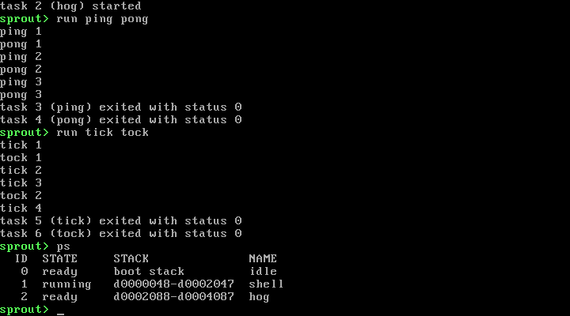

# Chapter 8 — Tasks

sprout can do only one thing at a time. `sleep 2000` freezes the shell, and every wait is a
busy loop or a bare `hlt`. This chapter turns the kernel into several **kernel threads**, which
sprout calls **tasks**, that share the CPU. The core is `switch_to`, 13 instructions that save
four registers, swap `esp` and return on another task's stack. Around it we build a round-robin
scheduler, sleeping on the timer, blocking on input, preemption from the timer interrupt, and
exit, wait and kill with zombies. The shell becomes task 1 and gets `ps`, `spawn`, `run`, `wait`
and `kill`. The price is shared data. The first race condition appears in this chapter, with
its fix, and with an honest look at a race that QEMU hides.

Previous: [Chapter 7](07-memory-management.md). Next: [Chapter 9](09-user-mode.md).

## What a task is

A running program on a CPU is its registers plus a stack. The registers say where it is
(`eip`), what it is working on (`eax` … `edi`) and where its stack is (`esp`). The stack holds
the chain of calls that got it there and their local variables. Save those and you can stop the
program, run something else, and later continue exactly where it stopped. That is all a task
is. Everything else (the code, the heap, the console, the page tables) is shared, because all
of sprout's tasks run inside the kernel, in ring 0, in one address space. Chapter 9 adds tasks
that run in ring 3 with memory of their own.

`kernel/task.h` describes a task:

```c
enum task_state {
    TASK_READY,                 /* waiting for the CPU */
    TASK_RUNNING,               /* has the CPU (exactly one task) */
    TASK_SLEEPING,              /* until the timer reaches wake_at */
    TASK_BLOCKED,               /* until someone calls task_wake */
    TASK_ZOMBIE,                /* finished; waiting for task_wait */
};

struct task {
    int id;
    char name[12];
    enum task_state state;
    uint32_t esp;               /* saved by switch_to while not running */
    uint8_t *stack;             /* from kmalloc; NULL for idle */
    int (*entry)(void);
    uint32_t wake_at;           /* SLEEPING: timer tick to wake up at */
    int status;                 /* ZOMBIE: exit status */
    struct task *waiter;        /* the task blocked in task_wait for us */
};
```

The only register in the struct is `esp`. The others are on the task's stack, as the next
section shows. Each task gets an 8 KiB stack (`TASK_STACK_SIZE`) from `kmalloc`, which is why
Chapter 7 built the heap first. IDs count up from 0 and are never reused, and the table
`tasks[16]` holds at most 16 tasks.

Task 0 is special. It is the boot thread itself: the code that has been running since
`entry.asm` called `kmain`. `task_init()` gives it a struct, calls it **idle** and lets it keep
the boot stack. Its job is to run when nobody else can.

The states and the moves between them, from the comment in `task.h`:

```text
  READY ---- schedule() ---> RUNNING ---- returns or exits ---> ZOMBIE
    ^                         |    |                               |
    |   task_wake()           |    | time slice used up,           | task_wait()
    +--- SLEEPING/BLOCKED <---+    | task_yield()                  v
    +------------------------------+                             (gone)
```

## The context switch

`kernel/switch.asm` is the heart of the chapter:

```nasm
; void switch_to(uint32_t *save_esp, uint32_t new_esp);
global switch_to
switch_to:
    mov eax, [esp + 4]          ; save_esp
    mov edx, [esp + 8]          ; new_esp

    push ebp
    push ebx
    push esi
    push edi
    mov [eax], esp              ; this task's stack, as it is now

    mov esp, edx                ; from here on: the other task's stack
    pop edi
    pop esi
    pop ebx
    pop ebp
    ret
```

It pushes four registers, stores `esp` in `*save_esp`, loads the other task's saved `esp`,
pops four registers from *that* stack and returns. The trick is the `ret`. The return address
on the other stack was pushed when the *other* task called `switch_to`, some time ago. So `ret`
returns into the other task, after its own call to `switch_to`. A task switch is a function
call that comes back on a different stack.

Here are the two stacks at the moment of `mov esp, edx`, when the shell (task 1) switches to
hog (task 2), which was preempted earlier:

```text
   shell's stack                              hog's stack
   (just pushed its registers)                (as switch_to left it last time)

   higher addresses                           higher addresses
   | ... shell's calls ...       |            | interrupt frame: eflags cs eip |
   | new_esp                     |            | ... irq_handler, task_preempt  |
   | save_esp = &shell->esp      |            | return address into schedule() |
   | return address into         |            | ebp                            |
   |   schedule()                |            | ebx                            |
   | ebp                         |            | esi                            |
   | ebx                         |            | edi    <-- hog->esp            |
   | esi                         |
   | edi  <-- esp, now stored in shell->esp
                                   esp = hog->esp; pop edi, esi, ebx, ebp; ret
```

After the `ret`, hog is back inside `schedule()`, which returns through `task_preempt` and the
interrupt handler to an `iret` into hog's loop. Nothing in hog notices.

Why only `ebp`, `ebx`, `esi` and `edi`? `switch_to` is called from C, and the i386 System V
calling convention makes `eax`, `ecx` and `edx` *caller-saved*: the compiler assumes any call
may destroy them. `ebx`, `esi`, `edi`, `ebp` and `esp` are *callee-saved*: a function must
return with them unchanged. The swap handles `esp`, and `eip` is the return address the `call`
pushed. EFLAGS needs no saving because interrupts are always off when `switch_to` runs. The
example `nosave` shows what happens when the callee-saved registers are skipped.

## A new task's first switch

`switch_to` can only switch *to* a task that once called `switch_to`, because it pops four
registers and a return address off its stack. A brand new task never did. So `task_spawn`
builds a stack that looks as if it had:

```c
    /* Make the stack look as if the task had called switch_to itself:
     * four saved registers, then a return address. */
    uint32_t *sp = (uint32_t *)(stack + TASK_STACK_SIZE);
    *--sp = 0;                          /* task_start's return address */
    *--sp = (uint32_t)task_start;       /* where switch_to's ret goes */
    *--sp = 0;                          /* ebp = 0 ends backtraces */
    *--sp = 0;                          /* ebx */
    *--sp = 0;                          /* esi */
    *--sp = 0;                          /* edi */
    t->esp = (uint32_t)sp;
```

The first `switch_to` to this task pops four zeros (`edi`, `esi`, `ebx`, `ebp`) and "returns"
into `task_start`:

```c
/* A new task's first switch_to "returns" here, with interrupts still
 * disabled by whoever called schedule(). */
static void task_start(void)
{
    sti();
    task_exit(current->entry());
}
```

The task function's return value becomes its exit status. The `ebp` of 0 ends the
frame-pointer chain, so a backtrace (Chapter 10) knows where to stop.

## The scheduler

`schedule()` picks the next task and switches to it:

```c
/* Round robin: the first runnable task after the current one in the
 * table, wrapping around; the current task itself comes last. Idle only
 * if there is nothing else. */
static struct task *pick_next(void)
{
    int start = slot_of(current);

    for (int i = 1; i <= TASK_MAX; i++) {
        struct task *t = tasks[(start + i) % TASK_MAX];
        if (t && t != &idle_task
            && (t->state == TASK_READY || t->state == TASK_RUNNING))
            return t;
    }
    return &idle_task;
}

/* Run the next task. Interrupts must be off: an interrupt handler that
 * switched tasks in the middle of this would make a mess of current. */
static void schedule(void)
{
    struct task *prev = current;
    struct task *next = pick_next();

    need_resched = false;
    slice = 0;
    if (next == prev)
        return;
    if (prev->state == TASK_RUNNING)
        prev->state = TASK_READY;
    next->state = TASK_RUNNING;
    current = next;
    switch_to(&prev->esp, next->esp);
    /* Back again: some other task has switched to us. */
}
```

This is **round robin**: each runnable task gets a turn in table order. `prev` is only made
READY if it was RUNNING; a task that sleeps or blocks has already set its new state. The line
after `switch_to` runs when *another* task switches back to `prev`, possibly much later.

Every caller disables interrupts first. Otherwise a timer interrupt between `current = next`
and `switch_to` could call `schedule()` again with `current` naming an unsaved task.

## Cooperative multitasking: yield

The simplest way to share the CPU is to give it away on purpose:

```c
void task_yield(void)
{
    uint32_t flags = irq_save();
    schedule();
    irq_restore(flags);
}
```

`kernel/programs.c` holds a few small tasks to try it with. `ping` and `pong` each loop three
times: `kprintf("ping %d\n", i)`, then `task_yield()`. The shell's `run ping pong` spawns both
and waits for each, and the output alternates exactly: ping 1, pong 1, ping 2, … (see Building
and running). Each yield hands over to the next ready task in the table.

## Sleeping

Chapter 5's `timer_sleep` was a busy loop that kept the CPU for itself. Now a task that wants
to wait gives up the CPU until a given timer tick:

```c
void task_sleep(uint32_t n)
{
    uint32_t flags = irq_save();
    current->wake_at = timer_ticks() + n;
    current->state = TASK_SLEEPING;
    schedule();
    irq_restore(flags);
}
```

The timer interrupt handler now calls `task_tick(ticks)` 100 times a second, and that wakes the
sleepers whose time has come:

```c
void task_tick(uint32_t now)
{
    if (!current)
        return;                 /* the timer runs before task_init */
    for (int i = 0; i < TASK_MAX; i++) {
        struct task *t = tasks[i];
        if (t && t->state == TASK_SLEEPING && (int32_t)(now - t->wake_at) >= 0)
            task_wake(t);
    }
    if (++slice >= TASK_SLICE)
        need_resched = true;
}
```

`(int32_t)(now - wake_at) >= 0` is the wrap-safe form of `now >= wake_at` (compare Chapter 5's
`ticks - start < n`). `timer_ms_to_ticks(ms)` rounds up, so a task sleeps *at least* as long as
asked. The shell's `sleep` command now uses `task_sleep`.

`tick` sleeps 100 ms four times and `tock` sleeps 170 ms twice. `run tick tock` prints tick 1,
tock 1, tick 2, tick 3, tock 2, tick 4: wake-ups at 100, 170, 200, 300, 340 and 400 ms. The
order comes from the timer, not from the order in the table.

## Blocking on input

Chapter 6's `input_getc` waited for a key with `hlt` in a loop, so the shell held the CPU while
it waited. Now it **blocks**: it marks itself BLOCKED, records who is waiting, and lets the
scheduler run something else. The keyboard and COM1 interrupt handlers call `input_put`, which
wakes it:

```c
static struct task *waiting;        /* the task blocked in input_getc */

void input_put(char c)
{
    ringbuf_put(&queue, c);
    if (waiting) {
        task_wake(waiting);
        waiting = NULL;
    }
}

char input_getc(void)
{
    char c;
    uint32_t flags = irq_save();

    while (!ringbuf_get(&queue, &c)) {
        waiting = task_current();
        task_block();
    }
    irq_restore(flags);
    return c;
}
```

`task_block()` sets the state to BLOCKED and calls `schedule()`. `task_wake(t)` makes a
blocked or sleeping task READY and sets `need_resched`, so it runs soon instead of after a whole
time slice.

The `irq_save()` around the check and the block is essential. Without it, this can happen:

1. The shell finds the ring buffer empty.
2. A key arrives. `input_put` stores it, finds `waiting` still NULL (or pointing at the shell
   while it is still RUNNING), and wakes nobody.
3. The shell sets `waiting` and blocks.

Now the shell sleeps with a key in the buffer until the *next* key. This is the **lost
wakeup**, the race Chapter 6 avoided around `hlt`. The rule: check the condition and go to
sleep as one step, with interrupts off. `schedule()` switches with interrupts still off, and
each task turns them back on when it leaves its own `irq_save` section (or in `task_start`).

## Preemption

Yielding, sleeping and blocking all depend on tasks behaving well. A task that loops forever
without calling any of them keeps the CPU forever. `hog` does exactly that:

```c
/* hog never yields or sleeps: only preemption gets the CPU back. */
static volatile uint32_t hog_loops;

__attribute__((noreturn)) static int hog(void)
{
    for (;;)
        hog_loops++;
}
```

**Preemption** takes the CPU away. Every timer tick increments `slice`, and after
`TASK_SLICE` = 5 ticks (50 ms) `task_tick` sets `need_resched`. The common IRQ handler ends
with:

```c
    if (h)
        h(r);
    pic_eoi(irq);
    /* Only after the EOI: if we switch tasks here, this handler finishes
     * when this task next runs, and until then the PIC would block IRQs. */
    task_preempt();
}
```

`task_preempt()` calls `schedule()` if `need_resched` is set. The interrupted task's state is
its interrupt frame plus the `switch_to` frame on its stack; when it gets the CPU back, `iret`
resumes the loop. The comment
explains the order. If the switch happened *before* `pic_eoi`, this handler would only finish
when this task runs again, and until then the PIC would treat the IRQ as still in service and
hold back that line and every lower-priority one. Preemption usually happens in the timer's
own handler, so the first line held back would be the timer, which drives the scheduler.

ping, pong, tick and tock give up the CPU long before 5 ticks, so they are never preempted
and their output is identical on every run, which lets `tests/boot.expected` include them.

The example `nopreempt` shows what is left without `task_preempt()`.

## The idle task

When every task is sleeping or blocked, `pick_next` returns idle, and idle is the end of
`kmain`:

```c
    task_init();
    if (task_spawn("shell", shell_main) < 0)
        panic("cannot start the shell");
    ...
    for (;;) {
        task_yield();
        hlt();                  /* until an interrupt; it may wake a task */
    }
```

An interrupt that wakes a task sets `need_resched`, so `task_preempt` switches to that task at
the end of the handler. The `task_yield()` catches anything else that became ready. Idle never
sleeps or blocks, so `pick_next` can always fall back on it.

## Exit, wait, kill and zombies

A task ends with `task_exit(status)`, or by returning from its function (which calls it):

```c
void task_exit(int status)
{
    irq_save();
    current->state = TASK_ZOMBIE;
    current->status = status;
    if (current->waiter)
        task_wake(current->waiter);
    schedule();
    panic("a zombie ran");      /* nobody switches to a zombie */
}
```

The task can't free its own stack while running on it. So it becomes a **zombie**: its struct
(with the status) and stack stay until another task calls `task_wait(id)`, which blocks until
the task is a zombie, takes the status and calls `reap` to remove it from the table and `kfree`
the stack and struct. (`task_exit` never returns, so it never calls `irq_restore`.)

This is the Unix design. The Linux `wait(2)` man page: "A child that terminates, but has not
been waited for becomes a "zombie". The kernel maintains a minimal set of information about the
zombie process (PID, termination status, resource usage information) in order to allow the
parent to later perform a wait to obtain information about the child."
([man7.org: wait(2)](https://man7.org/linux/man-pages/man2/wait.2.html))

`task_kill(id)` turns *another* task into a zombie with status `TASK_KILLED` (-1). It refuses
idle, the caller and tasks that have already ended. On one CPU the victim is stopped inside
`schedule()`, and the scheduler just never picks it again. That is only safe because sprout's
tasks own nothing but their stack. A task killed while holding a lock, or while listed as
`waiting` in `input.c`, would leave things broken (only the shell reads input, and it can't
kill itself). Real kernels send a signal, which the victim handles itself when it next runs.

## Shared data and the first lock

Before this chapter, the only code that could run "in the middle" of other code was an
interrupt handler, and Chapter 6 kept that small. Now any task can be preempted at any
instruction, and another task can run the same code on the same data. The console cursor, the
heap's free list and the task table are all shared.

On a single CPU, "nobody else runs in here" is easy to get: disable interrupts. No interrupt
means no preemption. `kernel/io.h` gets a pair that nests correctly:

```c
/* Disable interrupts and return the old EFLAGS, for irq_restore. Pairs
 * nest: an inner pair leaves interrupts the way the outer one found them. */
static inline uint32_t irq_save(void)
{
    uint32_t flags;
    __asm__ volatile ("pushf; pop %0; cli" : "=r"(flags) :: "memory");
    return flags;
}

static inline void irq_restore(uint32_t flags)
{
    if (flags & EFLAGS_IF)
        sti();
}
```

Plain `cli` … `sti` would be wrong when nested. If `kmalloc` used them and was called from code
that had already disabled interrupts, its `sti` would turn them back on in the middle of the
caller's critical section. `irq_restore` only turns interrupts back on if they were on before
(IF is bit 9 of EFLAGS, 0x200). The `"memory"` clobber, also added to `cli`, `sti` and `hlt`,
stops GCC from moving loads and stores across these instructions.

The pair now protects `kprintf` and `console_putc` (so lines don't mix and the VGA cursor stays
consistent), `kmalloc`, `kheap_free` and `kheap_print` (so nobody walks a half-updated free
list), and every task table operation in `task.c`.

On a multiprocessor this isn't enough, because another CPU can run the same code with
interrupts on. Real kernels add spinlocks there.

## Building and running

```console
$ cd project/ch08
$ make
...
kernel.bin: 20489 bytes, 41 sectors
...
$ make test
...
unit: 22 passed, 0 failed
PASS: build/sprout.img (76 lines of serial output match tests/boot.expected)
```

About 680 new lines: `task.c` 292, `task.h` 92, `switch.asm` 35 and `programs.c` 80, plus the
shell commands. `shell_run` became `int shell_main(void)`, the body of task 1. The session from
`tests/boot.in`:

```console
$ make demo
...
interrupts on: timer 100 Hz, keyboard (IRQ 1), COM1 input (IRQ 4)
tasks: round robin, 50 ms time slice; the shell is task 1
type help for a list of commands
sprout> ps
  ID  STATE     STACK              NAME
   0  ready     boot stack         idle
   1  running   d0000048-d0002047  shell
sprout> run ping pong
ping 1
pong 1
ping 2
pong 2
ping 3
pong 3
task 2 (ping) exited with status 0
task 3 (pong) exited with status 0
sprout> run tick tock
tick 1
tock 1
tick 2
tick 3
tock 2
tick 4
task 4 (tick) exited with status 0
task 5 (tock) exited with status 0
sprout> spawn hog
task 6 (hog) started
sprout> ps
  ID  STATE     STACK              NAME
   0  ready     boot stack         idle
   1  running   d0000048-d0002047  shell
   6  ready     d0002088-d0004087  hog
sprout> sleep 200
sprout> echo the shell still answers
the shell still answers
sprout> kill 6
sprout> ps
  ID  STATE     STACK              NAME
   0  ready     boot stack         idle
   1  running   d0000048-d0002047  shell
   6  zombie    d0002088-d0004087  hog
sprout> wait 6
task 6 (hog) was killed
sprout> ps
  ID  STATE     STACK              NAME
   0  ready     boot stack         idle
   1  running   d0000048-d0002047  shell
sprout> kill 0
kill: cannot kill task 0
sprout> wait 1
wait: cannot wait for task 1
sprout> run nosuch
nosuch: no such program (programs: ping pong tick tock hog)
sprout> poweroff
powering off
```

Things to notice:

- The shell's stack starts at 0xd0000048, not 0xd0000010: `task_spawn` allocates the task
  struct first, and the stack comes right after it.
- `ps` always shows the shell as `running`, because the shell is running `ps`. hog was
  preempted, so it is `ready`.
- With hog spinning, `sleep 200` and `echo` still work, and `kill 6` leaves a zombie until
  `wait 6` collects it.



In the screenshot, hog was started first (task 2) and kept spinning through both `run`
commands. The output is the same as without it. ping and pong still alternate, with a slice
of hog in between. tick and tock still wake on time, because `task_wake` sets `need_resched`
and the timer interrupt that woke them switches to them right away.

## What goes wrong

`examples/ch08/` takes parts of the scheduler away, one at a time. As in Chapter 7, each target
copies the snapshot, changes it, prints the diff, builds it and boots it headless. The `type`
macro feeds COM1 with pauses, so the shell really blocks between commands.

`examples/ch08/Makefile`

```make
# Makefile — Chapter 8 examples: what the scheduler needs, by taking it away.
#
# Each target copies the Chapter 8 snapshot to build/NAME, changes one
# thing (the diff is printed), builds it and boots it headless.
#
#   make nopreempt  no task switch from interrupt handlers: cooperative only
#   make race       two tasks add to one counter without disabling interrupts
#   make racehidden the same race inside one basic block: QEMU never shows it
#   make nosave     switch_to forgets to save ebx, esi and edi
#   make clean

QEMU ?= qemu-system-i386
PROJECT := ../../project/ch08
IMG = -drive format=raw,file=build/$@/build/sprout.img

# $(call copy,NAME): a fresh copy of the snapshot in build/NAME.
define copy
	rm -rf build/$(1) && mkdir -p build
	cp -r $(PROJECT) build/$(1)
	rm -rf build/$(1)/build
endef

# $(call build,NAME): show what changed, then build quietly.
define build
	diff -ru -x build $(PROJECT) build/$(1) || true
	$(MAKE) -s -C build/$(1)
endef

# $(call type,TEXT,SECONDS): boot, type TEXT into COM1 once the shell is
# up, wait SECONDS, and show COM1 from the first prompt on.
define type
	(sleep 2; printf '$(1)'; sleep $(2)) | timeout $$((3 + $(2))) $(QEMU) -m 128M $(IMG) \
	    -display none -no-reboot -serial stdio -monitor none 2>/dev/null \
	    | tr -d '\r' | sed -n '/^sprout> /,$$p'
endef

nopreempt:
	$(call copy,$@)
	sed -i '/^    task_preempt();$$/d' build/$@/kernel/interrupts.c
	$(call build,$@)
	(sleep 2; printf 'run ping pong\rrun tick tock\rspawn hog\r'; sleep 1; \
	 printf 'echo hello?\r'; sleep 1; printf 'ps\r'; sleep 1) \
	    | timeout 6 $(QEMU) -m 128M $(IMG) -display none -no-reboot \
	    -serial stdio -monitor none 2>/dev/null | tr -d '\r' | sed -n '/^sprout> /,$$p'
	@echo
	@echo "--- (no answer: the shell is ready, but hog never gives up the CPU)"

race:
	$(call copy,$@)
	sed -i 's|^static const struct program programs\[\] = {|static int count(void);\n\n&\n    { "count", count },|' \
	    build/$@/kernel/programs.c
	cat count.c >>build/$@/kernel/programs.c
	$(call build,$@)
	$(call type,run count count\r,3)

racehidden:
	$(call copy,$@)
	sed -i 's|^static const struct program programs\[\] = {|static int count(void);\n\n&\n    { "count", count },|' \
	    build/$@/kernel/programs.c
	sed -e '/^__attribute__((noinline))/,/^}/d' \
	    -e 's|counter = plus_one(counter);    /\* load, call, store \*/|counter = counter + 1;              /* load, add, store */|' \
	    count.c >>build/$@/kernel/programs.c
	$(call build,$@)
	objdump -d --no-show-raw-insn build/$@/build/kernel.elf | sed -n '/<count>:/,/ret/p'
	$(call type,run count count\r,3)

nosave:
	$(call copy,$@)
	sed -i -e '/^    push ebx$$/,/^    push edi$$/c\    sub esp, 12                 ; room for them, but nothing saved' \
	    -e '/^    pop edi$$/,/^    pop ebx$$/c\    add esp, 12' build/$@/kernel/switch.asm
	$(call build,$@)
	$(call type,run ping pong\rrun tick tock\rps\r,3)

clean:
	rm -rf build

.PHONY: nopreempt race racehidden nosave clean
```

`examples/ch08/count.c`

```c
/* count (examples/ch08/count.c): add 1 to a shared counter, ten million
 * times, without disabling interrupts. plus_one() is a real call, like the
 * work real code does between reading shared data and writing it back. */
static volatile uint32_t counter;

__attribute__((noinline)) static uint32_t plus_one(uint32_t v)
{
    return v + 1;
}

static int count(void)
{
    for (uint32_t i = 0; i < 10000000; i++)
        counter = plus_one(counter);    /* load, call, store */
    kprintf("counter = %u\n", (unsigned)counter);
    return 0;
}
```

### No preemption

```console
$ make nopreempt
...
-    task_preempt();
...
sprout> run ping pong
...
task 5 (tock) exited with status 0
sprout> spawn hog
task 6 (hog) started
sprout>

--- (no answer: the shell is ready, but hog never gives up the CPU)
```

Cooperative tasks still work: `run ping pong` and `run tick tock` print what they print in the
normal build. Sleepers wake up, because idle calls `task_yield()` after every interrupt. Then hog starts, and `echo hello?` and `ps` are never even echoed. The keys
arrive, `input_put` wakes the shell and the shell becomes READY, but without `task_preempt()`
nothing takes the CPU away from hog. Cooperative multitasking (classic Mac OS, Windows 3.x)
works exactly as long as every program cooperates.

### A lost update

`race` adds `count`, which adds 1 to a shared counter ten million times, and runs two copies.
If no updates were lost, the second task to finish would print 20000000:

```console
$ make race
...
kernel.bin: 20489 bytes, 41 sectors
...
sprout> run count count
counter = 14272406
counter = 10000000
task 2 (count) exited with status 0
task 3 (count) exited with status 0
```

Millions of increments vanished. The loop compiles to:

```text
  1014f0:	mov    0x115020,%eax          ; load counter
  1014f5:	call   101440 <plus_one>      ; add 1 (plus_one: add $0x1,%eax; ret)
  1014fa:	mov    %eax,0x115020          ; store counter
  1014ff:	sub    $0x1,%edx
  101502:	jne    1014f0 <count+0x10>
```

Suppose task A is preempted after the load, holding the value v in `eax` (saved on its stack).
Task B runs for a whole slice and adds, say, a million. When A resumes, it stores v + 1 and
wipes out all of B's work. A only "sees" its own progress.

The results vary from run to run. In twelve runs on this machine, the larger of the two lines
ranged from 10959066 to 15498427. In eight runs one line was exactly 10000000 (pairs like
10000000 and 14230066). In the other four neither was (pairs like 10809343 and 10959066).
That exact 10000000 is the clue to the mechanism. A task whose every
switch landed inside the load-to-store window only ever stores its own stale value + 1, so it
ends at exactly its own 10000000. A switch that lands *before* the load lets the task pick up
the other's progress on its next load. QEMU's `-d int` log shows where the timer interrupts hit
(one logged run, counting only the interrupts that landed in `count`):

```console
$ (sleep 2; printf 'run count count\r'; sleep 3) | timeout 6 qemu-system-i386 -m 128M \
    -drive format=raw,file=build/race/build/sprout.img -display none -no-reboot \
    -serial stdio -monitor none -d int -D int.log
...
$ grep "v=20" int.log | grep -o "pc=0010144[0-9a-f]\|pc=001014f[0-9a-f]" | sort | uniq -c
      5 pc=00101440
      8 pc=001014f0
     18 pc=001014fa
```

(`v=20` is IRQ 0, the timer, at vector 32.) 23 of 31 landed inside the window (at `plus_one`
or at the store) and 8 at the top of the loop. But no other addresses appear, not even the
`sub` and `jne`, and that leads to the next example.

### A race QEMU hides

`racehidden` makes one change: `counter = counter + 1` instead of calling `plus_one`. On real
hardware, that is still a load, an add and a store, and an interrupt can come between any two
of them. In QEMU:

```console
$ make racehidden
...
001014d0 <count>:
...
  1014e0:	mov    0x115020,%eax
  1014e5:	add    $0x1,%eax
  1014e8:	mov    %eax,0x115020
  1014ed:	sub    $0x1,%edx
  1014f0:	jne    1014e0 <count+0x10>
...
sprout> run count count
counter = 10000000
counter = 20000000
task 2 (count) exited with status 0
task 3 (count) exited with status 0
```

The final count was exactly 20000000 here and in six more runs (where the first line varied,
from 15953921 to 18191952). Not a single update was lost. The `-d int` log explains why: all
15 timer interrupts that hit `count` landed at 0x1014e0, the top of the loop.

> **Gotcha: an emulator that passes is not proof.** QEMU's TCG translates guest code into
> *translation blocks*, straight-line runs of guest instructions that end at a jump, a call or
> a return. It only checks for pending interrupts *between* blocks. In QEMU's documentation,
> exiting a block "will cause the cpu_exec_interrupt() callback to be re-evaluated before
> executing additional instructions"
> ([QEMU: Translator Internals](https://www.qemu.org/docs/master/devel/tcg.html)). The loop
> above is one block, from 0x1014e0 to the `jne`, so an interrupt never arrives between the
> load and the store. In `race`, the `call` ends a block, which is exactly why interrupts
> landed at 0x101440 and 0x1014fa. A real x86 CPU recognises interrupts at any instruction
> boundary, so there `racehidden` should lose updates too, probably less often than `race`
> because its window is shorter. We didn't run sprout on real hardware, so that is reasoning,
> not output. The lesson: an unprotected read-modify-write of shared data is a bug, even when
> every emulator test passes. Exercise 2 fixes it properly.

### Forgetting the callee-saved registers

`nosave` replaces the pushes and pops of `ebx`, `esi` and `edi` with `sub esp, 12` and
`add esp, 12`, so the stack layout stays the same but the registers are not saved:

```console
$ make nosave
...
-    push ebx
-    push esi
-    push edi
+    sub esp, 12                 ; room for them, but nothing saved
...
sprout> run ping pong
...
task 3 (pong) exited with status 0
sprout> run tick tock
tick 1
tock 1
tick 2
tick 3
tock 2
tick 4
task -805298204 (tick) exited with status 0
task 5 (tock) exited with status 0
sprout> ps
```

ping and pong print their usual eight lines. Then a task with id -805298204 exits. That number
is 0xd0001fe4, an address near the top of the shell's own stack (d0000048-d0002047). The real
id came from `cmd_run`, which keeps it in `edi` across the call to `task_wait`:

```text
  101cd7:	mov    0x10(%esp,%ebx,4),%edi   ; edi = ids[i]
  101cdf:	push   %edi
  101ce0:	call   102290 <task_wait>       ; blocks: other tasks run
  ...
  101cfe:	push   %edi                     ; the id for report()'s kprintf
```

`task_wait` blocked, other tasks ran and changed `edi`, and the shell got the CPU back with
their value. The compiler was entitled to assume `edi` survives a call. The `ps` output is cut
off by the example's timeout; a longer run shows a normal table, because `task_wait` got the
right id before `edi` was clobbered. The bug shows up in a place that has nothing to do with
its cause, which is typical for broken context switches.

`make clean` removes `build/` in the examples directory.

## In the wild: xv6, Linux 0.01 and "You are not expected to understand this"

**xv6's `swtch` is the same 13 instructions.** xv6's `swtch.S`
([mit-pdos/xv6-public](https://github.com/mit-pdos/xv6-public)) starts with the comment "Save the
current registers on the stack, creating a struct context, and save its address in *old.
Switch stacks to new and pop previously-saved registers." The body pushes `ebp`, `ebx`, `esi`
and `edi`, stores `esp` through the first argument, loads the second into `esp`, pops the four
registers and returns. sprout's `switch_to` was not copied from it. There is simply no shorter
way to do it, given the calling convention.

xv6's `proc.c` has the other pieces. `allocproc` builds a fake first frame ("Set up new
context to start executing at forkret, which returns to trapret"). `sleep()` prevents the lost
wakeup with a lock where sprout disables interrupts: "Once we hold ptable.lock, we can be
guaranteed that we won't miss any wakeup (wakeup runs with ptable.lock locked)". The xv6 book's
scheduling chapter ([xv6 book, rev 11](https://pdos.csail.mit.edu/6.828/2018/xv6/book-rev11.pdf))
explains them, including what changes with several CPUs.

**Linux 0.01 let the CPU switch tasks.** The 386 can switch tasks in hardware: each task has a
*task state segment* (TSS) holding all its registers, and a far jump to a TSS selector saves
the current registers in one TSS and loads them from another. Linus Torvalds' first release
used this. Its `switch_to(n)` macro in `include/linux/sched.h`
([sched.h](https://raw.githubusercontent.com/zavg/linux-0.01/master/include/linux/sched.h))
exchanges the `current` pointer and does
`ljmp` to the new task's TSS. By version 2.6.12, `include/asm-i386/system.h`
([system.h](https://raw.githubusercontent.com/torvalds/linux/v2.6.12/include/asm-i386/system.h))
switched in
software, the way sprout does: push the flags and `ebp`, save `esp`, load the new `esp`, push the
new task's resume address and jump to `__switch_to`. Chapter 9 still needs one TSS, for a
different reason: it tells the CPU which stack to use when ring 3 code is interrupted
([OSDev: Task State Segment](https://wiki.osdev.org/Task_State_Segment)).

**"You are not expected to understand this."** The 6th Edition Unix kernel's `swtch()`, its
context switch, carries this famous comment. Dennis Ritchie's page "Odd Comments and Strange
Doings in Unix" ([Bell Labs](https://www.nokia.com/bell-labs/about/dennis-m-ritchie/odd.html))
is quoted as calling it "in the spirit of 'This won't be on the exam'", adding that "the real
problem is that we didn't understand what was going on either". (The page wasn't reachable
when we checked, so treat the wording as attributed.) John Lions' *Commentary on UNIX 6th
Edition*, which walked students through that code, is the book xv6 names as its inspiration.

## Summary

- A task is a stack plus saved registers. sprout's tasks share one address space in ring 0.
  Task 0 (idle) is the boot thread; the others get 8 KiB `kmalloc` stacks.
- `switch_to` pushes the callee-saved `ebp`, `ebx`, `esi` and `edi`, swaps `esp`, pops the
  other task's and returns into it. Forgetting a callee-saved register breaks code far away.
- A new task gets a fake frame that "returns" into `task_start`.
- `schedule()` runs with interrupts off and picks round robin, with idle as the fallback.
  Yield, sleep and block all go through it. Check-and-block must be one step, or a wakeup is
  lost.
- Every 50 ms the timer sets `need_resched`, and `task_preempt()` switches at the end of the
  IRQ handler, *after* the EOI.
- Ended tasks are zombies until `task_wait` collects them.
- Shared data needs protection: on one CPU, the nesting `irq_save`/`irq_restore`. QEMU can
  hide an unprotected read-modify-write, because it only takes interrupts between translation
  blocks.

## Exercises

1. **CPU time per task.** Count, for each task, the timer ticks that found it running, and add a
   `CPU (ms)` column to `ps`. Start two hogs 500 ms apart, sleep 2 s and look at `ps`. Then kill
   one, sleep 1 s and look again.

   <details><summary>Solution</summary>

   In `kernel/task.h`, add a field to `struct task`:

   ```c
       uint32_t cpu_ticks;         /* timer ticks that found this task running */
   ```

   In `task_tick`, right after the `if (!current) return;`:

   ```c
       current->cpu_ticks++;
   ```

   In `task_print`, extend the header with `CPU (ms)  ` before `NAME`, and print the column
   before the name:

   ```c
           kprintf("  %8u  %s\n", (unsigned)(t->cpu_ticks * 1000 / timer_hz()), t->name);
   ```

   ```console
   sprout> spawn hog
   task 2 (hog) started
   sprout> sleep 500
   sprout> spawn hog
   task 3 (hog) started
   sprout> sleep 2000
   sprout> ps
     ID  STATE     STACK              CPU (ms)  NAME
      0  ready     boot stack             1350  idle
      1  running   d0000048-d0002047         0  shell
      2  ready     d0002088-d0004087      1500  hog
      3  ready     d00040c8-d00060c7      1000  hog
   sprout> kill 2
   sprout> sleep 1000
   sprout> ps
     ID  STATE     STACK              CPU (ms)  NAME
      0  ready     boot stack             1350  idle
      1  running   d0000048-d0002047         0  shell
      2  zombie    d0002088-d0004087      1500  hog
      3  ready     d00040c8-d00060c7      2000  hog
   ```

   Idle's 1350 ms is the time before the first command. After that a hog is always ready.
   Task 2 had 500 ms alone, then the hogs split 2 seconds evenly. After the kill, the zombie's
   count is frozen and the survivor gets the whole second. The shell shows 0: it runs briefly
   after each key and almost never holds the CPU when a tick arrives. That is the weakness of
   counting by sampling.

   </details>

2. **Fix the race.** Make `count` from `examples/ch08/count.c` correct, so that `run count
   count` always ends at 20000000. Look at the code GCC generates. What does the fix cost?

   <details><summary>Solution</summary>

   Make the load, call and store one critical section (`programs.c` needs `#include "io.h"`):

   ```c
   static int count(void)
   {
       for (uint32_t i = 0; i < 10000000; i++) {
           uint32_t flags = irq_save();    /* no task switch in here */
           counter = plus_one(counter);
           irq_restore(flags);
       }
       kprintf("counter = %u\n", (unsigned)counter);
       return 0;
   }
   ```

   ```console
   sprout> run count count
   counter = 19670221
   counter = 20000000
   task 2 (count) exited with status 0
   task 3 (count) exited with status 0
   ```

   Two more runs gave 19102065 and 19156664 for the first line, and 20000000 for the second.
   The first line is lower because the other task hadn't finished yet. The loop is now:

   ```text
     1014f0:	pushf
     1014f1:	pop    %ecx
     1014f2:	cli
     1014f3:	mov    0x115020,%eax
     1014f8:	call   101440 <plus_one>
     1014fd:	mov    %eax,0x115020
     101502:	and    $0x2,%ch
     101505:	je     101508 <count+0x28>
     101507:	sti
     101508:	sub    $0x1,%edx
     10150b:	jne    1014f0 <count+0x10>
   ```

   `and $0x2,%ch` tests bit 9 of the saved flags (IF). The cost is six extra instructions per
   iteration. Interrupts are off for only a few instructions at a time, so the timer is
   barely delayed. Disabling them around
   the *whole* loop would also be correct, but would stop preemption for the whole count.

   </details>

3. **How much stack does a task use?** Fill each new stack with 0xA5 in `task_spawn`, and add a
   `USED` column to `ps` that counts the bytes that are no longer 0xA5, from the bottom of the
   stack. Is 8 KiB too much?

   <details><summary>Solution</summary>

   In `kernel/task.c`:

   ```c
   #define STACK_FILL 0xA5

   /* Bytes of t's stack that have ever been written: the stack grows down, so
    * count the untouched fill bytes from the bottom up. */
   static uint32_t stack_used(const struct task *t)
   {
       uint32_t untouched = 0;
       while (untouched < TASK_STACK_SIZE && t->stack[untouched] == STACK_FILL)
           untouched++;
       return TASK_STACK_SIZE - untouched;
   }
   ```

   In `task_spawn`, before building the fake frame:

   ```c
       memset(stack, STACK_FILL, TASK_STACK_SIZE);  /* for stack_used */
   ```

   and in `task_print`, a `USED` column after the stack range (`-` for idle, which runs on the
   boot stack):

   ```c
           if (t->stack)
               kprintf("%08x-%08x  %4u", (unsigned)t->stack,
                       (unsigned)(t->stack + TASK_STACK_SIZE - 1),
                       (unsigned)stack_used(t));
           else
               kprintf("%-17s  %4s", "boot stack", "-");
   ```

   ```console
   sprout> spawn hog
   task 2 (hog) started
   sprout> spawn ping
   task 3 (ping) started
   sprout> spawn tick
   task 4 (tick) started
   sprout> sleep 600
   ping 1
   ...
   tick 4
   sprout> ps
     ID  STATE     STACK              USED  NAME
      0  ready     boot stack            -  idle
      1  running   d0000048-d0002047   460  shell
      2  ready     d0002088-d0004087   144  hog
      3  zombie    d00040c8-d00060c7   332  ping
      4  zombie    d0006108-d0008107   332  tick
   ```

   hog showed 144 in this run and 196 in another: it depends on which interrupt handlers ran
   on its stack. sprout has no separate interrupt stack, so every stack needs room for the
   deepest handler on top of its own use. 8 KiB is generous for these tasks.
   Linux on x86-64 gives each thread a 16 KiB stack ("THREAD_SIZE (4*PAGE_SIZE)") and moves
   interrupts to separate per-CPU stacks, "Like the split thread and interrupt stacks on i386"
   ([docs.kernel.org: Kernel Stacks](https://docs.kernel.org/arch/x86/kernel-stacks.html)). A
   high-water mark only shows what happened in the runs you tried. To *catch* an overflow, put
   an unmapped guard page below each stack, as in Chapter 7's exercise 4.

   </details>

4. **Semaphores.** Write `kernel/sem.[ch]` with a counting semaphore: `sem_down` takes a unit
   or blocks until there is one, and `sem_up` returns a unit, waking the oldest waiter. Use two
   semaphores to connect a `producer` that puts 1, 4, 9, 16 and 25 into a two-slot ring with a
   slow `consumer` that sleeps 50 ms after each item. Try both `run producer consumer` and
   `run consumer producer`.

   <details><summary>Solution</summary>

   `kernel/sem.h`:

   ```c
   #include "task.h"

   struct semaphore {
       int count;                          /* units available */
       struct task *waiters[TASK_MAX];     /* blocked in sem_down, oldest first */
       unsigned head, len;
   };

   #define SEMAPHORE(n) { .count = (n) }

   void sem_down(struct semaphore *s);     /* take a unit; block until there is one */
   void sem_up(struct semaphore *s);       /* give one back: to the oldest waiter */
   ```

   `kernel/sem.c`:

   ```c
   #include "sem.h"

   #include "io.h"

   void sem_down(struct semaphore *s)
   {
       uint32_t flags = irq_save();
       if (s->count > 0) {
           s->count--;
       } else {
           /* sem_up hands its unit straight to us; we never see count. */
           s->waiters[(s->head + s->len++) % TASK_MAX] = task_current();
           task_block();
       }
       irq_restore(flags);
   }

   void sem_up(struct semaphore *s)
   {
       uint32_t flags = irq_save();
       if (s->len > 0) {
           struct task *t = s->waiters[s->head];
           s->head = (s->head + 1) % TASK_MAX;
           s->len--;
           task_wake(t);
       } else {
           s->count++;
       }
       irq_restore(flags);
   }
   ```

   In `kernel/programs.c` (with `#include "sem.h"`), two programs and their table entries:

   ```c
   /* producer and consumer share a ring of two slots. empty counts the free
    * slots, full the filled ones: the producer can get at most two ahead. */
   #define RING 2
   static uint32_t ring[RING];
   static struct semaphore empty = SEMAPHORE(RING);
   static struct semaphore full = SEMAPHORE(0);

   static int producer(void)
   {
       for (uint32_t i = 1; i <= 5; i++) {
           sem_down(&empty);
           ring[i % RING] = i * i;
           kprintf("put %u\n", (unsigned)(i * i));
           sem_up(&full);
       }
       kprintf("producer: done\n");
       return 0;
   }

   static int consumer(void)
   {
       for (uint32_t i = 1; i <= 5; i++) {
           sem_down(&full);
           kprintf("got %u\n", (unsigned)ring[i % RING]);
           sem_up(&empty);
           task_sleep(timer_ms_to_ticks(50));   /* a slow consumer */
       }
       kprintf("consumer: done\n");
       return 0;
   }
   ```

   ```console
   sprout> run producer consumer
   put 1
   put 4
   got 1
   put 9
   got 4
   put 16
   got 9
   put 25
   producer: done
   task 2 (producer) exited with status 0
   got 16
   got 25
   consumer: done
   task 3 (consumer) exited with status 0
   sprout> run consumer producer
   put 1
   ...
   consumer: done
   task 4 (consumer) exited with status 0
   task 5 (producer) exited with status 0
   ```

   The second run prints the same twelve lines from `put 1` to `consumer: done` (elided here),
   with both exit lines at the end, because `run` waits for the consumer first. The order was
   the same in every run. The producer fills both slots, then blocks in `sem_down(&empty)`;
   each `got` frees a slot and wakes it. In the second run the consumer blocks on `full`
   straight away, so the producer's first `sem_up(&full)` hands the unit directly to it. That
   matters: if `sem_up` only incremented `count`, a third task could take the unit before the
   waiter ran.

   One limitation: a task killed in `sem_down` stays in `waiters`, so a later `sem_up` hands
   the unit to a zombie, or to freed memory after `wait`. Real kernels avoid this by killing
   with signals.

   </details>

Sources for this chapter: [REFERENCES.md](REFERENCES.md#chapter-8--tasks)
