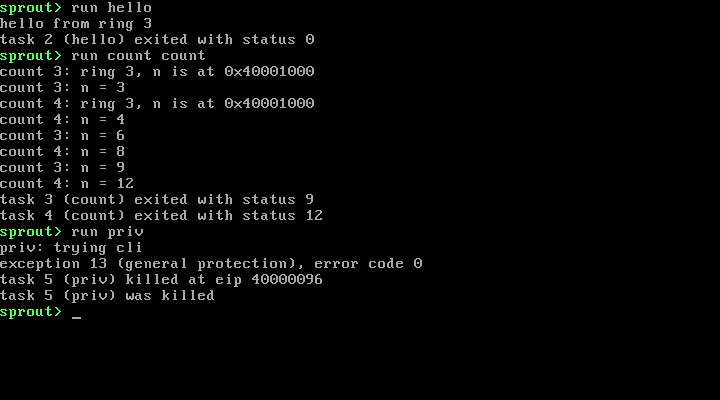

# Chapter 9 — User Mode

Every task sprout has run so far is kernel code: it runs in ring 0, can write all of memory, and
can execute `cli` and spin forever. One bad pointer takes the machine down, and Chapter 8's
scheduler can't stop a task that has switched interrupts off. This chapter builds the wall that
turns a kernel into an operating system. Programs run in **ring 3**, each in **its own address
space** at 0x40000000, and reach the kernel only through **system calls** (`int 0x80`), which
check every pointer. A program that faults is killed; the kernel carries on. The programs are
real ELF executables linked into the kernel image (there is no file system yet), and they use
Linux's 32-bit system call ABI, so two of them also run unchanged on Linux. sprout becomes 0.9.

Previous: [Chapter 8](08-tasks.md). Next: [Chapter 10](10-debugging-and-next-steps.md).

## Rings, and what ring 3 can't do

The CPU always runs at a **current privilege level** (CPL) from 0 to 3: the low two bits of CS.
CS has been 0x08 since Chapter 3, so the CPL has been 0. Code at CPL 3 is restricted four ways:

- **No privileged instructions.** `cli`, `sti`, `hlt`, `lgdt`, `lidt`, `ltr` and `mov` to a
  control register raise a general protection fault (#GP, exception 13). `cli` and `sti` are
  allowed only if EFLAGS's IOPL field is at least the CPL; sprout sets IOPL 0.
- **No I/O ports.** `in` and `out` also need CPL ≤ IOPL, unless the TSS's I/O permission bitmap
  allows that particular port (exercise 4 adds one).
- **No kernel pages.** A page is usable from ring 3 only if its page directory entry *and* its
  page table entry both have the U/S bit (`PAGE_USER`, Chapter 7). Every page sprout has mapped
  so far is kernel-only.
- **No jumping into the kernel**, except through a gate that allows it. An `int n` from ring 3
  works only if the IDT gate for vector n has a descriptor privilege level (DPL) of 3.

Rings 1 and 2 exist but, in Wikipedia's words, "are rarely used": "most general-purpose systems
use only two rings". Paging protects the kernel only if the program can't rewrite CR3, and
preemption works only if it can't switch the timer off. Ring 3 provides both.

## A GDT of our own, and the TSS

Stage 2's GDT (Chapter 3) has only ring 0 code and data. Ring 3 needs two descriptors with DPL
3, and the CPU needs a **task state segment** (TSS) to know which stack to use when an interrupt
pulls it from ring 3 back to ring 0. So the kernel builds its own GDT (`kernel/gdt.c`):

```
index  selector  base  limit    access  what
  0    0x00      0     0        0x00    null descriptor
  1    0x08      0     4 GiB    0x9A    kernel code (DPL 0)
  2    0x10      0     4 GiB    0x92    kernel data (DPL 0)
  3    0x18|3    0     4 GiB    0xFA    user code   (DPL 3)  -> CS = 0x1B
  4    0x20|3    0     4 GiB    0xF2    user data   (DPL 3)  -> DS = SS = 0x23
  5    0x28      &tss  103      0x89    32-bit TSS, not busy

selector 0x1B = 0000000000011 0 11
                index 3      TI RPL 3   (TI 0: the GDT, not an LDT)
```

The access bytes differ from the kernel's only in bits 5–6, the DPL: 0x9A | 0x60 = 0xFA. All
segments cover 4 GiB; paging, not segmentation, decides what ring 3 may touch. A selector's low
two bits are the **requested privilege level** (RPL): 0x23 asks for ring 3 access.

The TSS (104 bytes, in Intel SDM Vol. 3A) was made for the 80386's hardware task switching,
which sprout doesn't use. Only two fields matter. **ss0:esp0** is the stack the CPU switches to
when an interrupt arrives in ring 3. **iomap_base** is the offset of the I/O permission bitmap;
`gdt_init` sets it to `sizeof tss`, past the end, so there is no bitmap and no port for ring 3.
After filling the six descriptors and setting `ss0 = KERNEL_DS`, it switches:

```c
    __asm__ volatile (
        "lgdt %0\n\t"
        "ljmp %1, $1f\n"
        "1:\n\t"
        "mov %2, %%ds\n\t"
        "mov %2, %%es\n\t"
        "mov %2, %%fs\n\t"
        "mov %2, %%gs\n\t"
        "mov %2, %%ss\n\t"
        "ltr %3"
        : : "m"(ptr), "i"(KERNEL_CS), "r"((uint16_t)KERNEL_DS),
            "r"((uint16_t)TSS_SEL)
        : "memory");
```

The far jump and the reloads make the CPU read the descriptors from the new table (segment
registers cache them, Chapter 3). `ltr` loads the task register: now the CPU knows where esp0
is. `kmain` calls `gdt_init()` just before `idt_init()`.

## Going down: an `iret` into ring 3

No instruction just lowers the privilege level, but `iret` does it as a side effect: if the CS
it pops has RPL 3, it takes the path the Intel pseudocode calls
RETURN-TO-OUTER-PRIVILEGE-LEVEL and pops ESP and SS too. So the kernel builds the frame an
interrupt from ring 3 would have left, and returns from an interrupt that never happened.

`kernel/usermode.asm`

```nasm
; usermode.asm — the way down to ring 3 (Chapter 9).
;
; void enter_user_mode(uint32_t eip, uint32_t esp);
...
USER_CS     equ 0x18 | 3        ; kernel/gdt.h
USER_DS     equ 0x20 | 3
EFLAGS_IF   equ 0x200           ; interrupts on in user mode
EFLAGS_1    equ 0x002           ; bit 1 is always 1

section .text

global enter_user_mode
enter_user_mode:
    mov ecx, [esp + 4]          ; eip
    mov edx, [esp + 8]          ; esp

    mov ax, USER_DS             ; the data segments the program will use
    mov ds, ax
    mov es, ax
    mov fs, ax
    mov gs, ax

    push USER_DS                ; ss
    push edx                    ; esp
    push EFLAGS_IF | EFLAGS_1   ; eflags (IOPL 0: no I/O ports, no cli)
    push USER_CS                ; cs
    push ecx                    ; eip

    ; Don't hand kernel values to the program.
    xor eax, eax
    ...
    xor ebp, ebp
    iret
```

The frame it builds, on the kernel stack, just before `iret`:

```
            +-------------+
  esp+16    | 0x23        |  ss      the user stack segment (RPL 3)
  esp+12    | 0x80000000  |  esp     USER_TOP: the stack is empty
  esp+8     | 0x00000202  |  eflags  IF on, IOPL 0
  esp+4     | 0x1B        |  cs      user code, RPL 3 -> ring 3
  esp  ---> | entry       |  eip     the ELF entry point
            +-------------+
```

- Ring 0 may load a less privileged data segment, and nothing uses DS before `iret`, so loading
  0x23 early is safe. EFLAGS 0x202 sets IF (the timer still preempts) with IOPL 0. Zeroing the
  registers keeps the kernel's values out of the program's hands.

## Coming back up: esp0 and the kernel stack

The way back is an interrupt: the timer, a fault, or `int 0x80`. From CPL 3 the CPU won't push
onto the user's stack (it might not be mapped): it loads SS:ESP from the TSS's ss0:esp0, pushes
the user's SS and ESP, then EFLAGS, CS, EIP and any error code. The stubs push the rest:

```
  esp0 (TSS) -->+----------------+ high addresses
                | user ss  0x23  |  \
                | user esp       |   |  only when the interrupt came
                | eflags         |   |  from ring 3: the CPU pushes
                | cs       0x1B  |   |  ss and esp too
                | eip            |  /
                | error code / 0 |  the CPU, or the stub's dummy 0
                | vector         |  the stub
                | eax ... edi    |  pusha
                | ds es fs gs    |  isr_common
  esp ------->  +----------------+ = struct regs *r
```

`struct regs` (`kernel/interrupts.h`) gains `user_esp, user_ss` at its end, valid only for
interrupts from ring 3, and a macro tells which ring was interrupted:

```c
#define FROM_USER(r) (((r)->cs & 3) == 3)
```

`isr_common` already switches to the kernel's data selector (Chapter 5), so C handlers see
kernel segments whichever ring was interrupted.

**esp0 must be the top of the current task's kernel stack** (Chapter 8's 8 KiB). While a task
runs user code its kernel half is in the middle of nothing, so that stack is empty.
`schedule()` updates esp0 on every switch:

```c
    current = next;
    if (next->stack)
        tss_set_kernel_stack((uint32_t)next->stack + TASK_STACK_SIZE);
    paging_switch(next->space);
    switch_to(&prev->esp, next->esp);
```

For kernel tasks it is harmless; idle (on the boot stack, `stack` NULL) is skipped. The
`esp0once` example shows what goes wrong if esp0 is set only once.

## One address space per program

User programs live between **USER_BASE 0x40000000 and USER_TOP 0x80000000**, outside
everything the kernel uses (the identity map below 128 MiB, the heap at 0xD0000000). Each
program gets its own page directory:

```
           count 3's page directory            count 4's page directory
           +----------------------+            +----------------------+
 d0000000  | heap   (PDEs 832..)  |---+    +---| heap   (PDEs 832..)  |
           |                      |   |    |   |                      |
 7fffc000  | stack -> frame A     |   +----+   | stack -> frame C     |
 40001000  | n     -> frame B     |   | same   | n     -> frame D     |
 40000000  | code  -> frame E     |   | page   | code  -> frame F     |
           |                      |   | tables |                      |
 00100000  | kernel, identity map |---+    +---| kernel, identity map |
           +----------------------+            +----------------------+
             user part: its own tables           user part: its own tables
             kernel part: copied PDEs            kernel part: copied PDEs
```

`paging_new_space()` (`kernel/paging.c`) copies all of `kernel_dir` into a new directory. The
copied entries point at the kernel's own page tables, so every space sees the same kernel, and
interrupts and system calls run without switching CR3: the kernel is mapped, just not
`PAGE_USER`.

The catch: a kernel page *table* created later would exist only in `kernel_dir`, not in the
copies. The heap (Chapter 7) grows on demand and could need one, so `paging_init` now creates
all 16 of the heap's page tables up front. The `frames:` boot line drops from 32192 (sprout 0.8)
to 32176 free. The rest of the new paging code:

- A new user page table gets `PAGE_USER` in its directory entry too: the CPU checks both levels.
- `paging_map_user(dir, va, pa, flags)` maps one user page; `paging_map` now asserts its address
  is *not* user. `paging_free_space(dir)` frees the user frames, tables and directory.
- `paging_switch(dir)` loads CR3; `paging_print(dir)` lets `vm 7` print task 7's mappings.

## Executables: just enough ELF

The programs are ELF files, as on Linux. The ELF header says where the **program headers** are,
and each one of type `PT_LOAD` is a *segment*: copy `filesz` bytes from `offset` in the file to
address `vaddr`, then zero-fill up to `memsz` (the `.bss`). That is all a loader needs:

```console
$ readelf -l build/user/count | head -9

Elf file type is EXEC (Executable file)
Entry point 0x40000080
There are 2 program headers, starting at offset 52

Program Headers:
  Type           Offset   VirtAddr   PhysAddr   FileSiz MemSiz  Flg Align
  LOAD           0x000000 0x40000000 0x40000000 0x00dac 0x00dac R E 0x1000
  LOAD           0x000000 0x40001000 0x40001000 0x00000 0x00004 RW  0x1000
```

Code and constants (R E), then count's 4-byte `.bss` (RW), none of it from the file. The heart of
`kernel/elf.c` (127 lines) is `elf_load`'s loop over the program headers:

```c
    /* ... the header checks: "not an ELF file", "not an i386 executable" ... */
    const struct elf_phdr *ph = (const struct elf_phdr *)(file + h->phoff);
    for (int i = 0; i < h->phnum; i++, ph++) {
        if (ph->type != PT_LOAD || ph->memsz == 0)
            continue;
        /* Everything comes from the file, so check everything: a bad
         * segment must not make the kernel read or map the wrong thing. */
        if (ph->offset > size || ph->filesz > size - ph->offset
            || ph->filesz > ph->memsz)
            return "segment outside the file";
        if (ph->vaddr < USER_BASE || ph->vaddr >= USER_TOP
            || ph->memsz > USER_TOP - ph->vaddr)
            return "segment outside user memory";
        if (!map_pages(space, ph->vaddr, ph->memsz, ph->flags & PF_W))
            return "out of memory";
        copy_to_space(space, ph->vaddr, file + ph->offset, ph->filesz);
    }
    /* ... and the entry point must be in a mapped page */
```

- **Every field is untrusted input**: a file could claim a segment on the kernel's code, or an
  offset past its end. Note `ph->filesz > size - ph->offset`, never `ph->offset + ph->filesz >
  size`, which can wrap around.
- `map_pages` maps fresh, zeroed frames: `.bss` gets its zeros, and no program reads what a
  frame's previous owner left. `copy_to_space` writes through the **identity map**, since the
  new space isn't in CR3 yet.

## Building user programs

Each `user/NAME.c` or `.asm` becomes `build/user/NAME.elf`, linked by `user/lib/user.ld`:

```
ENTRY(_start)

PHDRS
{
    text PT_LOAD FILEHDR PHDRS FLAGS(5);    /* PF_R | PF_X */
    data PT_LOAD FLAGS(6);                  /* PF_R | PF_W */
}

SECTIONS
{
    . = 0x40000000 + SIZEOF_HEADERS;

    .text : { *(.text .text.*) } :text
    .rodata : { *(.rodata .rodata.*) } :text

    . = ALIGN(4096);
    .data : { *(.data .data.*) } :data
    .bss : { *(.bss .bss.*) *(COMMON) } :data

    /DISCARD/ : { ... .comment, .note, .eh_frame ... }
}
```

- `FILEHDR PHDRS` puts the ELF and program headers *inside* the text segment, at 0x40000000, so
  the code and the entry point start at 0x40000080 (52 + 2 × 32 bytes of headers, rounded up).
- The data segment starts on a fresh page, so sprout can map the code read-only, and count's `n`
  is at 0x40001000 whatever size your gcc makes the code (the boot test prints it).

> **The mistake: a compact file that Linux can't run.** Why not link the code at exactly
> 0x40000000 with `ld -n`? sprout would run it, because `elf_load` copies segments. Linux maps
> file pages straight into memory instead, and man 5 elf says: "Loadable process segments must
> have congruent values for p_vaddr and p_offset, modulo the page size." Watch:
>
> ```console
> $ nasm -f elf32 -o build/hello-n.o user/hello.asm
> $ ld -m elf_i386 -n -Ttext=0x40000000 -o build/hello-n build/hello-n.o
> $ readelf -l build/hello-n | grep -A1 "Type  \|LOAD"
>   Type           Offset   VirtAddr   PhysAddr   FileSiz MemSiz  Flg Align
>   LOAD           0x000060 0x40000000 0x40000000 0x00032 0x00032 R E 0x10
> $ ./build/hello-n
> Segmentation fault
> [exit status 139]
> ```
>
> Offset 0x60 and address 0x40000000 are not congruent mod 4096. `user.ld` starts the code
> after the headers instead, so offset 0x80 sits at 0x40000080, valid for both kernels.

C programs need a little runtime: `user/lib/crt0.asm`'s `_start` does `call main`, `push eax`,
`call exit`. The stack starts empty (no argc, no argv, no return address), so it must never `ret`.

`user/lib/ulib.c` (74 lines) has the system call wrappers and a `printf`, all built on:

```c
static int syscall3(int n, uint32_t a, uint32_t b, uint32_t c)
{
    int result;
    __asm__ volatile ("int $0x80"
                      : "=a"(result)
                      : "a"(n), "b"(a), "c"(b), "d"(c)
                      : "memory");
    return result;
}
```

`"memory"` tells gcc the kernel may touch memory the program pointed at. `printf` formats into a
256-byte buffer with the kernel's `lib/fmt.c` and makes **one** `write`, so lines never interleave.

The Makefile compiles programs with the kernel's flags *minus* `-Ikernel`:

```make
UCFLAGS  := $(filter-out -Ikernel,$(KCFLAGS)) -Iuser/lib
ULDFLAGS := -m elf_i386 -nostdlib -T user/lib/user.ld
ULIBS := $(BUILD)/user/lib/crt0.o $(BUILD)/user/lib/ulib.o \
         $(BUILD)/lib/fmt.o $(BUILD)/lib/string.o
...
$(BUILD)/user/%: $(BUILD)/user/%.elf
	$(OBJCOPY) --strip-all $< $@
```

`NAME.elf` keeps symbols for gdb (Chapter 10); the stripped `NAME` goes into the kernel: hello
364 bytes, priv 360, snoop 604 (NASM), count 3732 and spin 3528 (C: `ld` links all of ulib).

## Programs inside the kernel

With no file system, the programs travel inside the kernel image: NASM's `incbin` copies a
file's bytes, and a macro builds a table entry for each program:

`kernel/userbins.asm`

```nasm
; PROGRAM "name" — a table entry, and the file build/user/name.
%macro PROGRAM 1
section .rodata.user_programs
    dd %%name, 0, %%file, %%end - %%file
section .rodata
%%name: db %1, 0
    align 4
%%file: incbin %strcat("build/user/", %1)
%%end:
%endmacro

section .rodata.user_programs
global user_programs
user_programs:

PROGRAM "hello"
PROGRAM "count"
...                             ; and a zero entry to end the table
```

Each entry is a `struct program` with two new fields, `elf` and `size`; the rule
`$(BUILD)/kernel/userbins.o: $(UBINS)` builds the programs first. `program_start` calls
`user_spawn` if `p->elf` is set, `task_spawn` otherwise, so `run hello` and `run ping` both work.

## Starting a program: `user_spawn`

`kernel/user.c` (69 lines) puts the pieces together:

```c
static int user_main(void)
{
    enter_user_mode(task_current()->arg, USER_TOP);
}

int user_spawn(const char *name, const uint8_t *file, uint32_t size)
{
    uint32_t *space = paging_new_space();
    ...
    uint32_t entry;
    const char *error = elf_load(space, file, size, &entry);
    for (uint32_t va = USER_TOP - USER_STACK_SIZE; !error && va < USER_TOP;
         va += PAGE_SIZE) {
        uint32_t frame = pmm_alloc();
        if (frame)
            memset((void *)frame, 0, PAGE_SIZE);    /* no old secrets */
        if (!frame || !paging_map_user(space, va, frame, PAGE_WRITE)) {
            if (frame)
                pmm_free(frame);
            error = "out of memory";
        }
    }
    int id = error ? -1 : task_spawn_in(name, user_main, space, entry);
    if (id < 0) {
        kprintf("%s: %s\n", name, error ? error : "too many tasks");
        paging_free_space(space);
    }
    return id;
}
```

- A user task is a Chapter 8 task with two new fields, `space` (its page directory) and `arg`
  (the entry point), made by `task_spawn_in(name, entry, space, arg)`.
- `user_main` runs first, in ring 0 on the task's kernel stack with its CR3 loaded, and drops to
  ring 3 for good. `reap` frees the space, so `mem` stays level. `ps` gets a RING column.

## System calls

A program asks the kernel for something with `int 0x80`. Vector 0x80 gets a gate of its own in
`kernel/idt.c` (0xEF: present, DPL 3, 32-bit trap gate):

```c
#define GATE_TRAP32_USER 0xEF
...
    idt_set_gate(VECTOR_SYSCALL, (uint32_t)isr_syscall, GATE_TRAP32_USER);
```

- **DPL 3** lets ring 3 use the gate: INT n raises #GP "if the CPL is greater than the DPL
  value in the selected gate descriptor" (the `dpl0` example).
- A **trap gate** leaves IF on, so a long system call can be preempted like user code.
- `isr.asm` gets a stub `isr_syscall`; the handler table grows to 256 entries, and vectors 48
  and up get no EOI.

The calling convention is Linux's for i386 (man syscall(2)): the number in EAX, arguments in
EBX, ECX, EDX (then ESI, EDI, EBP), the result in EAX, negative for an error. The numbers are
Linux's too:

| call | number | what sprout does |
|---|---|---|
| `exit(status)` | 1 | `task_exit(status)` |
| `write(fd, buf, count)` | 4 | fd 1 or 2: print to the console |
| `getpid()` | 20 | the task id |
| `sched_yield()` | 158 | `task_yield()` |
| `nanosleep(req, rem)` | 162 | `task_sleep`; `rem` ignored |
| anything else | | `-ENOSYS` (38) |

`kernel/syscall.c` (72 lines) has the handler:

```c
static void syscall_handler(struct regs *r)
{
    int32_t result;

    switch (r->eax) {
    case SYS_EXIT:        result = sys_exit(r->ebx); break;
    case SYS_WRITE:       result = sys_write(r->ebx, r->ecx, r->edx); break;
    case SYS_GETPID:      result = task_current()->id; break;
    case SYS_SCHED_YIELD: task_yield(); result = 0; break;
    case SYS_NANOSLEEP:   result = sys_nanosleep(r->ebx); break;
    default:              result = -ENOSYS; break;
    }
    r->eax = (uint32_t)result;
}
```

The arguments are the saved registers, and so is the result: `popa` restores the EAX that
`r->eax` now holds. `sys_write` checks the pointer (next section) and prints with interrupts
off, so one write comes out in one piece. A call may block: `nanosleep` sleeps mid-handler, and
the task's kernel stack keeps the `int 0x80` frame until the timer wakes it.

The smallest program, `user/hello.asm` (header comment left out):

```nasm
bits 32

SYS_EXIT    equ 1
SYS_WRITE   equ 4
STDOUT      equ 1

section .rodata
msg:    db "hello from ring 3", 10
len     equ $ - msg

section .text
global _start
_start:
    mov eax, SYS_WRITE          ; write(STDOUT, msg, len)
    mov ebx, STDOUT
    mov ecx, msg
    mov edx, len
    int 0x80

    mov eax, SYS_EXIT           ; exit(0)
    xor ebx, ebx
    int 0x80
```

The NASM course did the same on x86-64 with `syscall`, write = 1 and exit = 60: the same idea
with a newer instruction, other registers and another table of numbers.

## Never trust a user pointer

`write(1, buf, 16)` hands the kernel an address, and in ring 0 the MMU lets the kernel read
anything mapped. So the kernel must check that the program could have read `buf` itself:

```c
bool user_access_ok(const void *p, uint32_t n, bool write)
{
    uint32_t start = (uint32_t)p;
    if (start < USER_BASE || start >= USER_TOP || n > USER_TOP - start)
        return false;
    uint32_t need = PAGE_PRESENT | PAGE_USER | (write ? PAGE_WRITE : 0);
    for (uint32_t page = start & ~(PAGE_SIZE - 1); page < start + n;
         page += PAGE_SIZE)
        if ((paging_lookup_in(task_current()->space, page) & need) != need)
            return false;
    return true;
}
```

The range must lie inside user space without wrapping, and every page must be present and
user-accessible (and writable, if the kernel writes) in the *current task's* directory.
`user/snoop.asm` (56 lines) tries two bad pointers, then reads kernel memory itself:

```nasm
_start:
    WRITE NOWHERE, 16
    cmp eax, -EFAULT
    jne .exit
    SAY "snoop: write(1, 0x50000000, 16) = -EFAULT"

    ...
    SAY "snoop: reading 0x00100000 myself"
    mov eax, [KERNEL]           ; page fault: the kernel kills us here
    SAY "snoop: got it!"        ; not reached
```

- An **unmapped** user address would make the kernel fault in ring 0: a panic any program
  could trigger (the `nocheck` example).
- A **kernel** address is mapped in every address space. Without the check, `write` would
  print the kernel's code, or its heap, or whatever another program left in it.

Check-then-use is safe here only because a task's mappings can't change in between (one CPU,
no threads, no `munmap`). With threads, another could unmap the page after the check, which is
why Linux's `copy_from_user` handles faults *inside* the copy.

## Faults kill the program, not the kernel

`snoop`'s last instruction reads 0x100000: a page fault with error code 5 (present, read, user).
`page_fault` (`kernel/paging.c`) now works out a reason and, for ring 3, kills only the program:

```c
    const char *why = "page not present";
    if (e & PF_PRESENT)
        why = (e & PF_USER) && !(paging_lookup_in((uint32_t *)read_cr3(), addr)
                                 & PAGE_USER)
            ? "page is kernel-only" : "page is read-only";

    kprintf("page fault: %s %s at %08x: %s\n",
            e & PF_USER ? "user" : "kernel",
            e & PF_WRITE ? "write" : "read",
            (unsigned)addr, why);
    if (e & PF_USER)
        user_kill(r);   /* only the program dies */
    regs_dump(r);
    panic("unhandled page fault");
```

`unhandled_exception` does the same for other exceptions from ring 3. `user_kill` prints `task N
(NAME) killed at eip EIP` and calls `task_exit(TASK_KILLED)`, abandoning the frame on the kernel
stack; `reap` frees the space.

`user/priv.asm` prints a line, then runs `cli`: a #GP with error code 0. The faulting programs are
NASM, so their fault addresses (40000096, 400000f8) match `objdump` whatever gcc you have:

```console
$ objdump -d -M intel --no-show-raw-insn build/user/priv.elf | grep "^ *4"
40000080 <_start>:
40000080:	mov    eax,0x4
40000085:	mov    ebx,0x1
4000008a:	mov    ecx,0x4000009c
4000008f:	mov    edx,0x11
40000094:	int    0x80
40000096:	cli    
40000097:	jmp    40000097 <_start+0x17>
```

And a program that never faults and never makes a system call (`spin.c`, `for (;;) ;`) is still
preempted by the timer.

## Examples: taking the wall away

`examples/ch09/` removes one piece of the protection at a time. Each target copies the snapshot,
changes one line with `sed`, builds it and boots it headless, typing into COM1.

`examples/ch09/Makefile`

```make
# Makefile — Chapter 9 examples: what keeps ring 3 in its place, by
# taking it away.
#
# Each target copies the Chapter 9 snapshot to build/NAME, changes one
# thing (the diff is printed), builds it and boots it headless.
#
#   make dpl0       the int 0x80 gate has DPL 0: ring 3 may not use it
#   make nouser     user pages are mapped without the U/S bit
#   make esp0once   the TSS's esp0 is set when a program starts, not on
#                   every task switch
#   make nocheck    write() trusts the pointer it is given
#   make clean

QEMU ?= qemu-system-i386
PROJECT := ../../project/ch09
IMG = -drive format=raw,file=build/$@/build/sprout.img

# $(call copy,NAME): a fresh copy of the snapshot in build/NAME.
define copy
	rm -rf build/$(1) && mkdir -p build
	cp -r $(PROJECT) build/$(1)
	rm -rf build/$(1)/build
endef

# $(call build,NAME): show what changed, then build quietly.
define build
	diff -ru -x build $(PROJECT) build/$(1) || true
	$(MAKE) -s -C build/$(1)
endef

# $(call type,TEXT,SECONDS): boot, type TEXT into COM1 once the shell is
# up, wait SECONDS, and show COM1 from the first prompt on.
define type
	(sleep 2; printf '$(1)'; sleep $(2)) | timeout $$((3 + $(2))) $(QEMU) -m 128M $(IMG) \
	    -display none -no-reboot -serial stdio -monitor none 2>/dev/null \
	    | tr -d '\r' | sed -n '/^sprout> /,$$p'
endef

dpl0:
	$(call copy,$@)
	sed -i 's/^#define GATE_TRAP32_USER 0xEF/#define GATE_TRAP32_USER 0x8F/' \
	    build/$@/kernel/idt.c
	$(call build,$@)
	$(call type,run hello\r,1)

nouser:
	$(call copy,$@)
	sed -i 's/table\[TABLE_INDEX(virt)\] = phys | flags | PAGE_USER | PAGE_PRESENT;/table[TABLE_INDEX(virt)] = phys | flags | PAGE_PRESENT;/' \
	    build/$@/kernel/paging.c
	$(call build,$@)
	$(call type,run hello\r,1)

esp0once:
	$(call copy,$@)
	sed -i '/^    if (next->stack)$$/,/^        tss_set_kernel_stack/d' build/$@/kernel/task.c
	sed -i -e 's/^#include "elf.h"$$/&\n#include "gdt.h"/' \
	    -e 's/^    enter_user_mode(task_current()->arg, USER_TOP);/    struct task *me = task_current();\n    tss_set_kernel_stack((uint32_t)me->stack + TASK_STACK_SIZE);\n    enter_user_mode(me->arg, USER_TOP);/' \
	    build/$@/kernel/user.c
	$(call build,$@)
	$(call type,run hello\rrun count count\r,3)
	@echo
	@echo "--- (esp0 is count 4's stack for both programs: count 3's interrupts and"
	@echo "---  system calls land on top of what count 4 left there while it sleeps)"

nocheck:
	$(call copy,$@)
	sed -i '/^    if (!user_access_ok((const void \*)buf, count, false))$$/,/^        return -EFAULT;$$/d' \
	    build/$@/kernel/syscall.c
	$(call build,$@)
	$(call type,run snoop\r,1)

clean:
	rm -rf build

.PHONY: dpl0 nouser esp0once nocheck clean
```

### `make dpl0`: a gate ring 3 may not use

Each output below is trimmed to the COM1 transcript.

```console
$ make dpl0
...
sprout> run hello
exception 13 (general protection), error code 402
task 2 (hello) killed at eip 40000094
task 2 (hello) was killed
```

- 0x8F is the same trap gate with DPL 0. `hello`'s first `int 0x80` is refused with a #GP. The
  saved EIP, 40000094, points *at* the `int`: a fault reports the instruction that failed.
- 0x402 is index 0x80 shifted left by 3, plus 2 (an IDT entry): `#GP(error_code(vector_number,
  1,0))` in the pseudocode. Chapter 5's `notpresent` got the same code with no gate at all.

### `make nouser`: pages without the U/S bit

```console
$ make nouser
...
sprout> run hello
page fault: user read at 40000080: page is kernel-only
task 2 (hello) killed at eip 40000080
task 2 (hello) was killed
```

- The directory entry still has `PAGE_USER`; the table entry doesn't, and the stricter level wins.
  The very first instruction fetch faults. Without PAE there is no execute permission bit, so a
  fetch is reported as a read.

### `make esp0once`: a plausible shortcut

Set the kernel stack once, in `user_main`, instead of on every task switch:

```console
$ make esp0once
...
sprout> run hello
hello from ring 3
task 2 (hello) exited with status 0
sprout> run count count
count 3: ring 3, n is at 0x40001000
count 3: n = 3
count 4: ring 3, n is at 0x40001000
count 4: n = 4
count 3: n = 6
count 3: n = 7
count 3: n = 9
count 3: n = 10

PANIC at kernel/task.c:202: a zombie ran
system halted

--- (esp0 is count 4's stack for both programs: count 3's interrupts and
---  system calls land on top of what count 4 left there while it sleeps)
```

One program at a time works, so the bug survives a quick test. With two, esp0 is count 4's
kernel stack for both. count 4 sleeps deep in that stack; count 3's next interrupt lands at
esp0, on top of count 4's frames, and the two return through each other's frames: count 3 prints
`n = 7` (it only adds 3), count 4's lines vanish, and an exited task runs again. As with Chapter
8's `nosave`, the damage shows in a different task. Chapter 10's exercise 4 catches it with gdb.

### `make nocheck`: trusting a pointer

```console
$ make nocheck
...
sprout> run snoop
page fault: kernel read at 50000000: page not present
  eax=00000297 ebx=d000404c ecx=50000000 edx=00000000
  esi=00000010 edi=50000010 ebp=50000000 esp=d0004018
  eip=001028a0 cs=0008 eflags=00000002
  ds=0010 es=0010 fs=0010 gs=0010

PANIC at kernel/paging.c:175: unhandled page fault
system halted
```

`write(1, 0x50000000, 16)` makes the kernel's copy loop read an unmapped address (ECX) with
`cs=0008`: a kernel fault, so a panic. **A user program has crashed the machine.**

## The project: sprout 0.9

New: `kernel/gdt.[ch]`, `usermode.asm`, `elf.[ch]`, `user.[ch]`, `syscall.[ch]`,
`userbins.asm`, and `user/` with five programs and `lib/`. Changed: `idt.c`, `isr.asm`,
`interrupts.[ch]`, `paging.[ch]`, `task.[ch]`, `programs.[ch]`, `shell.c` (`vm [ID]`), `kmain.c`,
the Makefile and the tests.

```console
$ make
...
kernel.bin: 32777 bytes, 65 sectors
...
$ make test
...
unit: 22 passed, 0 failed
sh tools/qemu-test.sh "qemu-system-i386 -m 128M" build/sprout.img tests/boot.expected tests/boot.in
PASS: build/sprout.img (90 lines of serial output match tests/boot.expected)
```

The five programs are 8588 bytes of `kernel.bin`. `make demo` types `tests/boot.in` into COM1
(the loader and memory map lines are as before):

```console
$ make demo
...
sprout 0.9
...
frames: 32176 of 32224 free (128704 KiB), 4 KiB each, 00200000-07fe0000
paging: on; RAM identity-mapped up to 07fe0000 except page 0, kernel code read-only
heap: kmalloc from 0xd0000000
interrupts on: timer 100 Hz, keyboard (IRQ 1), COM1 input (IRQ 4)
tasks: round robin, 50 ms time slice; the shell is task 1
user mode: programs run in ring 3 at 0x40000000, system calls via int 0x80
type help for a list of commands
sprout> run hello
hello from ring 3
task 2 (hello) exited with status 0
sprout> run count count
count 3: ring 3, n is at 0x40001000
count 3: n = 3
count 4: ring 3, n is at 0x40001000
count 4: n = 4
count 3: n = 6
count 4: n = 8
count 3: n = 9
count 4: n = 12
task 3 (count) exited with status 9
task 4 (count) exited with status 12
sprout> run snoop
snoop: write(1, 0x50000000, 16) = -EFAULT
snoop: write(1, 0x00100000, 16) = -EFAULT
snoop: reading 0x00100000 myself
page fault: user read at 00100000: page is kernel-only
task 5 (snoop) killed at eip 400000f8
task 5 (snoop) was killed
sprout> run priv
priv: trying cli
exception 13 (general protection), error code 0
task 6 (priv) killed at eip 40000096
task 6 (priv) was killed
sprout> spawn spin
task 7 (spin) started
sprout> ps
  ID  STATE     RING  KERNEL STACK       NAME
   0  ready        0  boot stack         idle
   1  running      0  d0000050-d000204f  shell
   7  ready        3  d0002098-d0004097  spin
sprout> vm 7
  virtual            physical        size  access
  00001000-000fffff  00001000    1020 KiB  rw kernel
  00100000-00107fff  00100000      32 KiB  r- kernel
  00108000-07fdffff  00108000  129888 KiB  rw kernel
  40000000-40000fff  00235000       4 KiB  r- user
  7fffc000-7fffcfff  00237000       4 KiB  rw user
  7fffd000-7fffffff  00239000      12 KiB  rw user
  d0000000-d0003fff  00230000      16 KiB  rw kernel
  d0004000-d0005fff  0023c000       8 KiB  rw kernel
  d0006000-d0007fff  00248000       8 KiB  rw kernel
...
sprout> kill 7
sprout> wait 7
task 7 (spin) was killed
...
sprout> run nosuch
nosuch: no such program (programs: ping pong tick tock hog hello count snoop priv spin)
```

Read it from the top:

- **Two programs, one address.** Both copies of `count` print `n is at 0x40001000`, yet each
  adds its own pid: 3, 6, 9 and 4, 8, 12. The same virtual address maps to different frames.
  `ring 3` comes from the program: it reads CS with inline assembly and prints `cs & 3`.
- **snoop** and **priv** are killed; the kernel carries on. **spin** is preempted: the shell
  answers `ps`, `vm` and `kill 7`.
- `vm 7` is the earlier picture in text. The kernel lines are the shared part. spin's code is
  mapped read-only. The 16 KiB stack is two lines because the user page table for 0x7fc00000
  took the frame at 00238000, between the stack's first and second pages.



### The same files on Linux

`hello` and `count` use only Linux i386 system calls, so the very same files run on a Linux
x86-64 host whose kernel has 32-bit (IA-32) emulation enabled:

```console
$ ./build/user/hello
hello from ring 3
[exit status 0]

$ ./build/user/count
count 855985: ring 3, n is at 0x40001000
count 855985: n = 855985
count 855985: n = 1711970
count 855985: n = 2567955
[exit status 19]
```

The exit status is `n` mod 256 (2567955 mod 256 = 19); your pid will differ. sprout's ABI is not
an imitation of Linux's: for this small subset, it *is* Linux's.

## In the wild: Linux 0.01 and the life of `int 0x80`

Linux 0.01 (1991) enters user mode and handles system calls exactly as sprout does, and its
source is small enough to read in an afternoon:

- `include/asm/system.h` defines `move_to_user_mode()`. It pushes `$0x17` (SS), the stack
  pointer, the flags (`pushfl`), `$0x0f` (CS) and a return address, then runs `iret` and loads
  0x17 into DS, ES, FS and GS. Those are sprout's five pushes. The selectors differ because
  Linux 0.01 kept each process's segments in a local descriptor table (TI = 1).
- The same file has `set_intr_gate` (type 14, DPL 0), `set_trap_gate` (type 15, DPL 0) and
  `set_system_gate` (type 15, **DPL 3**). `kernel/sched.c` calls
  `set_system_gate(0x80,&system_call)`: sprout's 0xEF gate. It also builds the TSS descriptor
  with `set_tss_desc`, type `"0x89"` and limit 104, and loads it with `ltr`.
- `include/unistd.h` numbers the calls: `__NR_exit 1`, `__NR_read 3`, `__NR_write 4`,
  `__NR_getpid 20`. Today's `arch/x86/entry/syscalls/syscall_32.tbl` still has `1 i386 exit`,
  `3 read`, `4 write`, `20 getpid`, and also `45 brk`, `158 sched_yield` and `162 nanosleep`.
  The 32-bit table has never been renumbered.
- The `_syscall3` macro is ulib's `syscall3`, almost character for character: `int $0x80` with
  the number in EAX and the arguments in EBX, ECX and EDX. Then it adds the C library's
  convention: `if (__res<0) errno=-__res , __res = -1;`.
- `kernel/fork.c` has `verify_area(void * addr,int size)`, which walks a user range page by page
  before the kernel writes to it. It is the ancestor of `user_access_ok`, and of today's
  `access_ok` and `copy_to_user`.

`int 0x80` did not stay fast. LWN's report on Linux 2.5.53 says that "software interrupts
generated with the int instruction are very slow with the P4 processor". The fix was `sysenter`,
plus a trick: "the kernel will map a global, read-only page at the top of every process's address
space. That page contains the optimal code for executing a system call on the current
processor." That page grew into today's vDSO; on x86-64, `syscall` took over. The 32-bit
`int 0x80` path remains for old binaries, which is why sprout's programs run on Linux today.

## Summary

- The CPL is the low two bits of CS. Ring 3 can't run privileged instructions, use ports
  (IOPL 0, no bitmap), touch pages without U/S at both levels, or use gates without DPL 3.
- sprout's own GDT adds user code/data 0x1B/0x23 and a TSS at 0x28; only its ss0:esp0 matters,
  and it must be the current task's kernel stack top, set in `schedule()` on every switch.
- `iret` with an RPL 3 CS pops ESP and SS too and drops to ring 3; `enter_user_mode` fakes that
  frame. Coming back, the CPU switches to ss0:esp0 and pushes the user SS and ESP.
- Each program has a page directory: the kernel's entries (shared, preallocated tables) plus
  its own 0x40000000–0x80000000. `elf_load` treats the file as untrusted.
- System calls are `int 0x80` through a DPL 3 trap gate, with Linux's i386 numbers and
  registers, so the same files run on Linux.
- Every user pointer is checked. A fault in ring 3 kills the program; in ring 0, it panics.

## Exercises

1. **A `read` system call.** Add `read(fd, buf, count)` (Linux number 3): for fd 0, read one line
   with `input_getc`, echoing it, up to `count` bytes or a newline. Add `read()` to ulib and a
   program `upper` that reads a line and prints it in capitals, then tries
   `read(0, (void *)0x100000, 16)`. Which argument of `user_access_ok` matters now?

   <details><summary>Solution</summary>

   The kernel *writes* the buffer: `user_access_ok(buf, count, true)`. In `kernel/syscall.c`,
   plus `SYS_READ 3` and `case SYS_READ: result = sys_read(r->ebx, r->ecx, r->edx); break;`:

   ```c
   static int32_t sys_read(uint32_t fd, uint32_t buf, uint32_t count)
   {
       if (fd != 0)
           return -EBADF;
       if (!user_access_ok((const void *)buf, count, true))
           return -EFAULT;
       char *s = (char *)buf;
       uint32_t n = 0;
       while (n < count) {
           char c = input_getc();
           if (c == '\r')
               c = '\n';
           console_putc(c);
           s[n++] = c;
           if (c == '\n')
               break;
       }
       return (int32_t)n;
   }
   ```

   ulib's `read` returns `syscall3(SYS_READ, fd, (uint32_t)buf, count)`. `user/upper.c`, plus
   `PROGRAM "upper"` in `kernel/userbins.asm`:

   ```c
   int main(void)
   {
       char line[80];

       printf("say something: ");
       int n = read(0, line, sizeof line);
       for (int i = 0; i < n; i++)
           if (line[i] >= 'a' && line[i] <= 'z')
               line[i] -= 'a' - 'A';
       write(1, line, n);
       printf("read: %d, read to kernel memory: %d\n",
              n, read(0, (void *)0x100000, 16));
       return 0;
   }
   ```

   ```console
   sprout> run upper
   say something: hello, ring 3
   HELLO, RING 3
   read: 14, read to kernel memory: -14
   task 2 (upper) exited with status 0
   ```

   Use `run`, not `spawn`: after `spawn` the shell would be reading input too, and only one
   task at a time may wait in `input_getc`.
   </details>

2. **A stack that grows.** Start programs with a 4 KiB stack that grows on demand up to 1 MiB: a
   not-present fault from ring 3 in [USER_TOP − 1 MiB, USER_TOP) gets a zeroed page, and
   `page_fault` returns so the CPU retries the instruction. Test it with a program `deep` that
   recurses with 1000 bytes per call to depth 100, 900 and 2000. Check `vm` and `mem`.

   <details><summary>Solution</summary>

   In `kernel/user.h`, `USER_STACK_SIZE` becomes `(4u * 1024)`, and `USER_STACK_MAX` is
   `(1024u * 1024)`. At the top of `page_fault`:

   ```c
       if ((e & PF_USER) && !(e & PF_PRESENT)
           && addr >= USER_TOP - USER_STACK_MAX && addr < USER_TOP) {
           uint32_t frame = pmm_alloc();
           if (frame) {
               memset((void *)frame, 0, PAGE_SIZE);
               if (paging_map_user((uint32_t *)read_cr3(), addr & PAGE_FRAME,
                                   frame, PAGE_WRITE))
                   return;
               pmm_free(frame);
           }
       }
   ```

   No `invlpg` is needed: the TLB never caches a not-present entry. `user/deep.c`:

   ```c
   static int down(int n)
   {
       volatile char buf[1000];
       buf[0] = (char)n;
       if (n == 0)
           return 0;
       return down(n - 1) + buf[0] - buf[0] + 1;
   }

   int main(void)
   {
       printf("deep: depth %d\n", down(100));
       sleep_ms(1000);                     /* time for "vm" */
       printf("deep: depth %d\n", down(900));
       printf("deep: depth %d\n", down(2000));
       return 0;
   }
   ```

   ```console
   sprout> spawn deep
   task 2 (deep) started
   sprout> deep: depth 100
   vm 2
   ...
     40000000-40000fff  00235000       4 KiB  r- user
     7ffe6000-7ffe6fff  00253000       4 KiB  rw user
   ...                                   (23 more single pages)
     7ffff000-7fffffff  00237000       4 KiB  rw user
   ...
   sprout> deep: depth 900
   page fault: user write at 7feff1b0: page not present
   task 2 (deep) killed at eip 40000096
   ```

   26 pages after depth 100, one line each (the frames come in descending order). Depth 2000
   runs past 0x7ff00000 and is killed. `mem`: 32172 free before, 32170 after each run (the heap
   grew once); every stack page came back.
   </details>

3. **A heap: `brk`.** Add `brk(end)` (Linux number 45). A new `brk` field in each task starts at
   0, meaning `USER_HEAP` = 0x60000000; the heap may reach 16 MiB. `brk` maps zeroed pages up to
   `end` and returns the new break, or, as on Linux, the old one if it can't move. `brk(0)`
   asks. Test it with `grow`: 100000 bytes, filled and checked, then a request for 64 MiB.

   <details><summary>Solution</summary>

   `uint32_t brk;` in `struct task` and `SYS_BRK 45`. In `kernel/syscall.c`, plus its `case`:

   ```c
   #define USER_HEAP       0x60000000u
   #define USER_HEAP_MAX   (16u * 1024 * 1024)
   #define PAGE_UP(x)      (((x) + PAGE_SIZE - 1) & ~(PAGE_SIZE - 1))

   static int32_t sys_brk(uint32_t end)
   {
       struct task *t = task_current();
       if (t->brk == 0)
           t->brk = USER_HEAP;
       if (end <= t->brk || end > USER_HEAP + USER_HEAP_MAX)
           return (int32_t)t->brk;
       for (uint32_t va = PAGE_UP(t->brk); va < PAGE_UP(end); va += PAGE_SIZE) {
           uint32_t frame = pmm_alloc();
           if (!frame)
               return (int32_t)t->brk;
           memset((void *)frame, 0, PAGE_SIZE);
           if (!paging_map_user(t->space, va, frame, PAGE_WRITE)) {
               pmm_free(frame);
               return (int32_t)t->brk;
           }
       }
       t->brk = end;
       return (int32_t)end;
   }
   ```

   ulib's `void *brk(void *end)` returns `(void *)syscall3(SYS_BRK, (uint32_t)end, 0, 0)`.
   `user/grow.c`:

   ```c
   int main(void)
   {
       char *start = brk(0);
       char *end = brk(start + 100000);
       printf("grow: heap %p-%p\n", (void *)start, (void *)end);

       for (int i = 0; i < 100000; i++)
           start[i] = (char)i;
       int ok = 0;
       for (int i = 0; i < 100000; i++)
           ok += start[i] == (char)i;
       printf("grow: %d bytes written and read back\n", ok);
       printf("grow: brk(too far) = %p\n", brk(start + 64 * 1024 * 1024));
       sleep_ms(1000);                     /* time for "vm" */
       return 0;
   }
   ```

   ```console
   sprout> spawn grow
   task 2 (grow) started
   sprout> grow: heap 0x60000000-0x600186a0
   grow: 100000 bytes written and read back
   grow: brk(too far) = 0x600186a0
   vm 2
   ...
     60000000-60000fff  0023e000       4 KiB  rw user
     60001000-60018fff  00240000      96 KiB  rw user
   ...
   ```

   25 pages; a `malloc` would sit on top, calling `brk` when it runs out.
   </details>

4. **An I/O permission bitmap.** Give ring 3 exactly one port, COM1's data register 0x3F8:
   append a bitmap to `struct tss` (one bit per port, 1 = forbidden) plus the extra 0xFF byte
   the CPU requires. Write `direct.asm`, which writes a line to 0x3F8 with `out` and then tries
   0x3F9. Does `priv` still fault?

   <details><summary>Solution</summary>

   In `kernel/gdt.c` (with `#include <stddef.h>`):

   ```c
       uint16_t trap, iomap_base;
       uint8_t iomap[65536 / 8 + 1];   /* 1 bit per port; 1 = no access */
   } __attribute__((packed));
   ...
       tss.iomap_base = offsetof(struct tss, iomap);
       memset(tss.iomap, 0xFF, sizeof tss.iomap);
       tss.iomap[0x3F8 / 8] &= ~(1u << (0x3F8 % 8));
   ```

   The TSS limit, `sizeof tss - 1`, grows with it. The heart of `user/direct.asm`:

   ```nasm
   _start:
       mov esi, msg
       mov ecx, len
       mov dx, COM1
   .next:
       lodsb
       out dx, al                  ; allowed: the bitmap bit for 0x3F8 is 0
       loop .next

       mov dx, COM1 + 1            ; the interrupt enable register
       out dx, al                  ; #GP: its bit is 1
       jmp $
   ```

   ```console
   sprout> run direct
   direct: straight to port 0x3f8
   exception 13 (general protection), error code 0
   task 2 (direct) killed at eip 40000096
   task 2 (direct) was killed
   ```

   The line reaches COM1 only: it bypassed the console. `run priv` still faults: `cli` depends
   on IOPL alone; the bitmap covers only `in` and `out` (see the CLI and OUT pages).
   </details>

Sources for this chapter: [REFERENCES.md](REFERENCES.md#chapter-9--user-mode)
