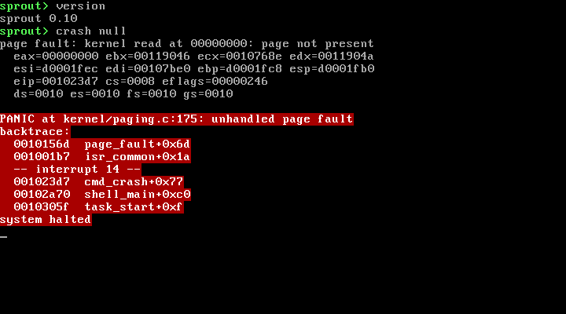

# Chapter 10 — Debugging and Next Steps

You have met every kind of kernel bug by now. Some give silence (Chapter 4's `wronglink`), some
a triple fault that resets the machine (Chapter 5), some a race (Chapter 8), and some show up in
a task that did nothing wrong (Chapter 9's `esp0once`). So far we found them by reading code and
adding `kprintf`s. This chapter gives sprout and you real tools. A panic now names the guilty
function: the kernel walks the **frame-pointer chain** and looks the addresses up in a
**symbol table it carries inside itself**. `addr2line` and gdb turn an address into a line of
source. **QEMU's interrupt log** explains the crashes that leave no output at all. And **gdb
attached to QEMU** follows the machine from the reset vector to ring 3. sprout becomes version
0.10: no new features for users, one new boot line. The chapter ends with where to go next.

Previous: [Chapter 9](09-user-mode.md). Next: [Appendix A](appendix-a-cheat-sheet.md).

## What a panic should tell you

Chapter 4's `panic` gives a message, a file and a line, and Chapter 7's page fault handler adds
a register dump. That is enough when the panic is in the function that has the bug. When it is a
`kassert` deep inside a helper, the question is *who called it?*, and the registers don't say.
Here is sprout 0.10's answer to `version` and `crash null`:



Read the backtrace bottom-up: `task_start` ran `shell_main`, which ran `cmd_crash`, which was
interrupted by a page fault (vector 14) at 001023d7. The handler, `page_fault`, called `panic`.
Each line is an address and *function+offset*. The addresses depend on your gcc version, the
names and the shape don't. That is also why no backtrace goes into `tests/boot.expected`: the
boot test still never panics.

## Following the frame pointers

With frame pointers, every function starts with the classic prologue, `push ebp; mov ebp,
esp`. So inside any function, `[ebp]` is the caller's ebp and
`[ebp+4]` is the return address into the caller. The frames form a linked list through the
stack:

```
     higher addresses
                    +---------------------+
                    | ret: into _start    |  [A+4]
  A: kmain's frame  | saved ebp: 0        |  [A]    the end of the chain
                    +---------------------+
                    | kmain's locals ...  |
                    | ret: into kmain     |  [B+4]
  B: f's frame      | saved ebp: A        |  [B]
                    +---------------------+
                    | f's locals ...      |
                    | ret: into f         |  [C+4]
  C: g's frame      | saved ebp: B        |  [C]   <-- ebp, while g runs
                    +---------------------+
     lower addresses
```

In C, a frame is `struct frame { const struct frame *next; uint32_t ret; }`, and walking the
chain is `f = f->next`. The chain ends where the kernel started it: `entry.asm` sets ebp to 0
before calling `kmain`, and `task_spawn_in` (Chapter 8) puts a saved ebp of 0 and a return address
of 0 at the bottom of every task's stack.

**gcc `-O2` omits frame pointers.** The GCC manual lists `-fomit-frame-pointer` among the flags
`-O` turns on, and gcc agrees:

```console
$ gcc -O2 -Q --help=optimizers | grep -E "fomit-frame-pointer|foptimize-sibling-calls"
  -fomit-frame-pointer        		[enabled]
  -foptimize-sibling-calls    		[enabled]
```

Without a frame pointer, ebp is just one more register, and there is no chain. So the kernel's
flags gain `-fno-omit-frame-pointer` (the `nofp` example shows what happens without it). The
cost is a register and two instructions per call: 153 bytes of sprout's code. Linux's own
`Kconfig.debug` says its frame pointer unwinder makes "kernel text size … grow by ~3%" and
performance "degrade by roughly 5-10%". Linux still uses exactly this unwinder by default on
32-bit x86.

`kernel/backtrace.c`, without its includes and the body of `mapped()`:

```c
struct frame {
    const struct frame *next;       /* the caller's saved ebp */
    uint32_t ret;                   /* the return address */
};

extern const char isr_common[];     /* kernel/isr.asm */

/* The chain may be garbage (that's often why we are panicking): only
 * follow pointers into mapped memory, and only upwards, so we can't fault
 * or go round in circles. */
static bool frame_ok(const struct frame *f, const struct frame *below)
{
    uint32_t a = (uint32_t)f;
    return a != 0 && (a & 3) == 0 && f > below
        && mapped(a) && mapped(a + sizeof *f - 1);
}

/* One line: the address, and function+offset. A return address is
 * looked up at addr - 1: the call may be a function's last instruction
 * (say, a call to a noreturn function), and then addr is already in the
 * next function. */
static uint32_t print_addr(uint32_t addr, bool is_return)
{
    uint32_t start;
    const char *name = ksyms_lookup(is_return ? addr - 1 : addr, &start);
    if (name)
        kprintf("  %08x  %s+0x%x\n", (unsigned)addr, name,
                (unsigned)(addr - start));
    else
        kprintf("  %08x  ?\n", (unsigned)addr);
    return name ? start : 0;
}

void backtrace_from(uint32_t ebp)
{
    const struct frame *f = (const struct frame *)ebp;
    const struct frame *below = NULL;

    kprintf("backtrace:\n");
    for (int depth = 0; depth < 32 && frame_ok(f, below); depth++) {
        if (f->ret == 0)                /* task_start's frame (task.c) */
            break;
        below = f;
        if (print_addr(f->ret, true) != (uint32_t)isr_common) {
            f = f->next;
            continue;
        }
        /* f is the frame of the function isr_common called, so its first
         * argument is a pointer to the interrupted code's registers
         * (interrupt_dispatch's, or the handler's that it tail-called:
         * same argument, same place). Carry on from there: the
         * instruction that was interrupted, then its caller. */
        const struct regs *r = ((const struct regs *const *)f)[2];
        if (!frame_ok((const struct frame *)r, below))
            break;
        kprintf("  -- interrupt %u --\n", (unsigned)r->vector);
        if (FROM_USER(r)) {
            kprintf("  %08x  (user mode)\n", (unsigned)r->eip);
            return;
        }
        print_addr(r->eip, false);
        f = (const struct frame *)r->ebp;
    }
}
```

- **A panic runs on a stack that may be broken**, often the very reason for the panic, so the
  walker trusts nothing. `frame_ok` wants a non-null, 4-byte aligned frame, mapped (through
  `paging_lookup_in`, or below 5 MiB if paging is still off), and *above* the previous one.
  Stacks grow down, so callers are always higher: the walk can't loop. With a depth limit of 32,
  it always ends. A fault inside the panic handler would be the worst possible outcome.
- **Look up `ret - 1`, print `ret`.** A return address points *after* the call. If the call is
  a function's last instruction (a call to a noreturn function such as `panic_at`), `ret` is
  already in the next function.
- `backtrace.h` defines `backtrace()` as a macro,
  `backtrace_from((uint32_t)__builtin_frame_address(0))`, so the walk starts at the frame of
  whoever wrote `backtrace()`. `panic_at` (`kernel/kprintf.c`) calls it just before
  `system halted`, so the first line is the return address into the function that panicked.

## Through an interrupt

The chain crosses `isr_common` (Chapter 5). It is NASM without a C prologue, but it calls the C
dispatcher with `push esp; call interrupt_dispatch`. So when a return address lies in
`isr_common` (`isr.asm` now says `global isr_common`), the frame `f` belongs to the C function
it called, and that function's first argument, at `[ebp+8]`, is `r`, the saved registers:

```
                +---------------------------+
                | eip=001023d7 cs eflags    |  the CPU                \
                | error code, vector 14     |  the stub                |  struct regs
                | eax ... edi (ebp too)     |  pusha                   |
                | ds es fs gs               |  isr_common             /
       r -----> +---------------------------+
                | r                         |  push esp: the argument   [F+8]
                | ret: isr_common+0x1a      |  call interrupt_dispatch  [F+4]
                | saved ebp                 |                           [F]
       F -----> +---------------------------+  page_fault's frame
                | ret: page_fault+0x6d      |
                | saved ebp: F              |
  panic_at ---> +---------------------------+  where backtrace() starts
```

The walker prints `-- interrupt N --`, then `r->eip`: the exact instruction that was
interrupted, not a return address, so no `- 1`. Then it carries on from `r->ebp`, the
interrupted function's frame. If `FROM_USER(r)`, it prints `(user mode)` and stops: the user
stack is not the kernel's business, and the kernel has no names for it.

The first line says `page_fault`, not `interrupt_dispatch`. At `-O2`, gcc's
`-foptimize-sibling-calls` turns a call in tail position into a `jmp`: `interrupt_dispatch`
jumps to the handler, which reuses its frame. That is fine for the walker, because `r` is still
the first argument in the same place. Similarly `crash div` shows `interrupt_dispatch+0xf8`
first, because the code for unhandled exceptions was inlined into it. A backtrace shows
*frames*, not the calls in the source: inlined functions and tail calls disappear.

## Names: a symbol table inside the kernel

`nm -n --defined-only kernel.elf` lists the kernel's symbols by address. Types `t` and `T` are
functions (in text). `tools/mksyms.sh` turns that list into NASM source with an awk script:

```sh
if [ $# -gt 0 ]; then
    nm -n --defined-only "$1"
fi | awk '
BEGIN { n = 0 }
($2 == "t" || $2 == "T") && $3 !~ /^__/ { addr[n] = $1; name[n] = $3; n++ }
END {
    print "; generated by tools/mksyms.sh: do not edit"
    print "section .ksyms progbits alloc noexec nowrite align=4"
    print "global ksyms_count, ksyms_addr, ksyms_name"
    printf "ksyms_count: dd %d\n", n
    print "ksyms_addr:"
    for (i = 0; i < n; i++)
        printf "    dd 0x%s\n", addr[i]
    print "ksyms_name:"
    for (i = 0; i < n; i++)
        printf "    dd .s%d\n", i
    for (i = 0; i < n; i++)
        printf ".s%d: db \"%s\", 0\n", i, name[i]
}'
```

The output is three arrays: a count, the sorted addresses, and pointers to the names (linker
script names such as `__text_end` are skipped). Without an argument the script prints an empty
table. `kernel/ksyms.c` searches it:

```c
const char *ksyms_lookup(uint32_t addr, uint32_t *start)
{
    if (ksyms_count == 0 || addr < ksyms_addr[0]
        || addr >= (uint32_t)__text_end)
        return NULL;

    /* Binary search for the last function that starts at or below addr. */
    uint32_t lo = 0, hi = ksyms_count;     /* the answer is in [lo, hi) */
    while (hi - lo > 1) {
        uint32_t mid = lo + (hi - lo) / 2;
        if (ksyms_addr[mid] <= addr)
            lo = mid;
        else
            hi = mid;
    }
    *start = ksyms_addr[lo];
    return ksyms_name[lo];
}
```

`__text_end` is a new symbol in `linker.ld`, just after `.text`: an address in `.rodata` or on
a stack is not in any function, even if a function starts below it. The offset printed is
`addr - start`.

**The chicken-and-egg problem.** The table is part of the kernel, and the kernel's addresses
are what go into the table. Adding the table could move the functions it describes. The
solution, the same as Linux's: **link twice**.

```
  kernel objects + symtab0.o (ksyms_count: dd 0)  --ld-->  kernel0.elf
  kernel0.elf  --mksyms.sh-->  symtab.asm  --nasm-->  symtab.o
  kernel objects + symtab.o                       --ld-->  kernel.elf
  kernel.elf   --mksyms.sh-->  cmp with symtab.asm: must be identical
```

The trick is where the table goes. `linker.ld` puts the output section `.ksyms : { *(.ksyms) }`
after `.data` and before `.bss`, "so that the second link, which adds it, moves nothing", as its
comment says. Everything a function's address depends on comes before it, so the table's size
can't move any function. The Makefile doesn't take that on faith (the `symtab` rules run
`mksyms.sh` and NASM):

```make
$(BUILD)/kernel0.elf: $(KOBJS) $(BUILD)/symtab0.o kernel/linker.ld
	$(LD) $(KLDFLAGS) -o $@ $(KOBJS) $(BUILD)/symtab0.o

...
$(BUILD)/kernel.elf: $(KOBJS) $(BUILD)/symtab.o kernel/linker.ld
	$(LD) $(KLDFLAGS) -o $@ $(KOBJS) $(BUILD)/symtab.o
	sh tools/mksyms.sh $@ | cmp -s - $(BUILD)/symtab.asm \
	    || { echo "kernel.elf: functions moved in the second link"; \
	         rm -f $@; exit 1; }
```

If a future change ever moved a function, the build would stop instead of producing a kernel
that prints wrong names. Linux's `scripts/link-vmlinux.sh` does the same, with up to three
links and the same final check (see In the wild).

## From an address to a line of source

The kernel has been compiled with `-g` since Chapter 4, so `kernel.elf` has DWARF line tables
(`objcopy -O binary` leaves them out of `kernel.bin`). `addr2line -f -s -e build/kernel.elf
001023d7` prints the function and `shell.c:231`. `gdb -q -batch build/kernel.elf -ex "list
*cmd_crash+0x77"` does the same from the *function+offset* in the backtrace, and lists the
source around it. Neither runs the kernel: a backtrace from someone else's machine is enough,
with their `kernel.elf`. Linux's bug-hunting guide does the same with `gdb vmlinux` and
`l *vt_ioctl+0xda8`. The `crash` example below shows both.

## When there is no output: QEMU's log

A triple fault resets the CPU. With `-no-reboot` QEMU just exits: no panic, no message, nothing
to read. But QEMU saw everything. `-d int,cpu_reset -D build/qemu.log` logs every interrupt and
exception (with the registers) and the CPU state before a reset. `qemu-system-i386 -d help`
lists the log items:

```console
$ qemu-system-i386 -d help | grep -E "^(int|cpu_reset) "
int             show interrupts/exceptions in short format
cpu_reset       show CPU state before CPU resets
```

The Makefile has a new variable, `QEMUEXTRA`, added to the QEMU flags of `run`, `run-nox` and
`debug`: `make run QEMUEXTRA="-d int,cpu_reset -D build/qemu.log"`. Each logged event starts
with a line like `0: v=20 e=0000 i=0 cpl=0 IP=0008:00103530 ...`: the vector in hex (`v`), the
error code (`e`), the CPL, and where the CPU was. A fault while delivering another fault adds
`check_exception old: 0xe new 0xe`, and the end of the road is `Triple fault`. The `triple`
example reads such a log. In our runs the log starts at the kernel's first interrupt: the BIOS's
real-mode interrupts were not in it.

## gdb on a live machine

QEMU contains a gdb server. `-s` is "Shorthand for -gdb tcp::1234", and `-S` means "Do not
start CPU at startup": the machine waits, before the BIOS's first instruction, until gdb says
`continue`. The new target `make debug` runs QEMU with `-serial stdio -s -S`, and `make gdb`
runs `gdb -q -x tools/gdbinit`. Run `make debug` in one terminal (`make debug
QEMUEXTRA="-display none"` without a window) and `make gdb` in another. `tools/gdbinit`, after
its header comment, sets gdb up:

```
set confirm off
set pagination off
set disassembly-flavor intel

# The kernel's symbols and debug info. It runs at the addresses it was
# linked for, so gdb needs no offset. For a user program, add its symbols
# too: add-symbol-file build/user/count.elf
file build/kernel.elf

# Before the kernel runs, the CPU is in 16-bit real mode, but gdb still
# disassembles 32-bit code (set architecture i8086 does not help with
# QEMU). To read the boot sector, dump it and use ndisasm:
#   dump binary memory build/mem.bin 0x7c00 0x7c20
#   shell ndisasm -b 16 -o 0x7c00 build/mem.bin

target remote localhost:1234
```

The kernel runs at the address it was linked for, so gdb needs no offsets: `break`, `bt`, `next`
and `print` work as on any C program. Here gdb's commands come from a pipe instead of the
keyboard:

```console
$ make debug QEMUEXTRA="-display none"        # terminal 1
$ printf "break kmain\ncontinue\nbt\nnext\nnext\ninfo registers eip\nkill\n" | make gdb
gdb -q -x tools/gdbinit
0x0000fff0 in ?? ()
(gdb) Breakpoint 1 at 0x100df0: file kernel/kmain.c, line 29.
(gdb) Continuing.

Breakpoint 1, kmain (magic=1414680659, bi=0x500) at kernel/kmain.c:29
29	    console_init();
(gdb) #0  kmain (magic=1414680659, bi=0x500) at kernel/kmain.c:29
#1  0x00100024 in _start ()
(gdb) 30	    vga_set_color(VGA_LIGHT_GREEN, VGA_BLACK);
(gdb) 31	    kprintf("sprout %s\n", SPROUT_VERSION);
(gdb) eip            0x100e0b            0x100e0b <kmain+27>
(gdb) [Inferior 1 (process 1) killed]
(gdb) 
quit
```

Terminal 1 shows the eight loader lines, then `qemu-system-i386: QEMU: Terminated via
GDBstub`: gdb's `kill` ends QEMU. (`detach` instead lets the machine run on, and Ctrl-C in gdb
stops it wherever it is.) Four things are different from debugging a Linux process:

- **Breakpoints and watchpoints are free.** QEMU's gdb page: "For TCG system emulation we
  advertise an infinite number of hardware assisted breakpoints and watchpoints". On a real
  x86 CPU there are four debug registers; under QEMU, `watch` on a kernel variable doesn't slow
  the machine down (exercise 4).
- **Single-stepping masks interrupts** by default (QEMU's `sstep` flags: no IRQs, no timers),
  so `stepi` through kernel code never wanders into the timer handler.
- **Real mode is decoded wrong.** gdb disassembles 32-bit code even when the CPU is in 16-bit
  mode. The QEMU page suggests `set architecture i8086`; with gdb 12.1 and QEMU 6.2 here it did
  not help. Dump the bytes and use `ndisasm` (the `gdbboot` example).
- **gdb doesn't know about address spaces.** QEMU's breakpoints match virtual addresses, in
  whatever address space is loaded. Every user program is linked at 0x40000000, so a breakpoint
  in one program fires in all of them. The QEMU page says that debugging user space in system
  emulation "presents challenges". The `gdbuser` example shows the trap and how to check.

## Examples: four bugs and three gdb sessions

`examples/ch10/` uses the same pattern as Chapters 8 and 9: each target copies the Chapter 10
snapshot to `build/NAME`, changes one thing or nothing (the diff is printed), builds it and boots
it headless. The gdb targets run QEMU with `-s -S` and gdb with `tools/gdbinit` plus `NAME.gdb`,
so they need port 1234 free.

`examples/ch10/Makefile`

```make
# Makefile — Chapter 10 examples: finding bugs in sprout.
#
# Each target copies the Chapter 10 snapshot to build/NAME, changes one
# thing or nothing (the diff is printed), builds it and boots it headless.
#
#   make crash      a kernel bug's panic: backtrace, then addr2line and gdb
#   make nofp       the same panic built without frame pointers
#   make sysbug     a panic inside a system call made by a user program
#   make triple     the classic unpacked struct idt_ptr: a triple fault,
#                   hunted with -d int,cpu_reset
#   make gdbboot    gdb: from the reset vector to kmain
#   make gdbkernel  gdb: a breakpoint on the page fault handler
#   make gdbuser    gdb: a breakpoint in a user program
#   make clean
#
# The gdb examples run QEMU with -s -S, like make debug, so they need
# localhost:1234 to be free.

QEMU ?= qemu-system-i386
GDB ?= gdb
PROJECT := ../../project/ch10
IMG = -drive format=raw,file=build/$@/build/sprout.img

# $(call copy,NAME): a fresh copy of the snapshot in build/NAME.
define copy
	rm -rf build/$(1) && mkdir -p build
	cp -r $(PROJECT) build/$(1)
	rm -rf build/$(1)/build
endef

# $(call build,NAME): show what changed, then build quietly.
define build
	diff -ru -x build $(PROJECT) build/$(1) || true
	$(MAKE) -s -C build/$(1)
endef

# $(call type,TEXT,SECONDS): boot, type TEXT into COM1 once the shell is
# up, wait SECONDS, and show COM1 from the first prompt on (and keep it
# in build/NAME/serial.log).
define type
	(sleep 2; printf '$(1)'; sleep $(2)) | timeout $$((3 + $(2))) $(QEMU) -m 128M $(IMG) \
	    -display none -no-reboot -serial stdio -monitor none 2>/dev/null \
	    | tr -d '\r' | sed -n '/^sprout> /,$$p' | tee build/$@/serial.log
endef

# $(call gdb,TEXT): boot stopped (-s -S), type TEXT into COM1 3 seconds
# after gdb lets the machine go, and run gdb with tools/gdbinit and
# NAME.gdb. Then show COM1 (from the first prompt on, if there is one).
define gdb
	cd build/$@ && { (sleep 3; printf '$(1)'; sleep 8) | timeout 30 $(QEMU) -m 128M \
	    -drive format=raw,file=build/sprout.img -display none -no-reboot \
	    -serial stdio -monitor none -s -S >serial.log 2>&1 & \
	    sleep 1; timeout 30 $(GDB) -q -batch -x tools/gdbinit -x ../../$@.gdb; wait; }
	@echo "--- COM1:"
	@tr -d '\r' < build/$@/serial.log | if grep -q '^sprout> ' build/$@/serial.log; \
	    then sed -n '/^sprout> /,$$p'; else cat; fi
endef

crash:
	$(call copy,$@)
	$(call build,$@)
	$(call type,crash null\r,1)
	@echo
	@echo "--- where in cmd_crash? addr2line turns the address into a line:"
	cd build/$@ && addr2line -f -s -e build/kernel.elf \
	    $$(sed -n 's/^  \([0-9a-f]*\)  cmd_crash+.*/\1/p' serial.log)
	cd build/$@ && sed -n "$$(addr2line -e build/kernel.elf \
	    $$(sed -n 's/^  \([0-9a-f]*\)  cmd_crash+.*/\1/p' serial.log) | cut -d: -f2)p" kernel/shell.c
	@echo
	@echo "--- or let gdb read name+offset straight from the backtrace:"
	cd build/$@ && $(GDB) -q -batch build/kernel.elf \
	    -ex "list *$$(sed -n 's/^  [0-9a-f]*  \(cmd_crash+0x[0-9a-f]*\)$$/\1/p' serial.log)"

nofp:
	$(call copy,$@)
	sed -i 's/ -fno-omit-frame-pointer -std=c11/ -std=c11/' build/$@/Makefile
	$(call build,$@)
	$(call type,crash null\r,1)

sysbug:
	$(call copy,$@)
	sed -i '/user_access_ok((const void \*)buf, count, false)/{n;s/$$/\n    kassert(count < 16);/}' \
	    build/$@/kernel/syscall.c
	$(call build,$@)
	$(call type,run hello\r,1)
	@echo
	@echo "--- the user program's side: eip is the instruction after its int 0x80"
	objdump -d -M intel --no-show-raw-insn build/$@/build/user/hello.elf | grep -A1 "int    0x80" | head -2

triple:
	$(call copy,$@)
	sed -i '/^struct idt_ptr {/,/^}/s/^} __attribute__((packed));/};/' build/$@/kernel/idt.c
	$(call build,$@)
	timeout 5 $(QEMU) -m 128M $(IMG) -display none -no-reboot -serial stdio -monitor none \
	    -d int,cpu_reset -D build/$@/qemu.log 2>/dev/null | tr -d '\r' | tail -3
	@echo
	@echo "--- QEMU exited: a triple fault resets the CPU, and -no-reboot turns that into an exit."
	@echo "--- build/$@/qemu.log has $$(wc -l < build/$@/qemu.log) lines; the interrupts and exceptions:"
	grep -E ': v=|check_exception|Triple fault' build/$@/qemu.log
	@echo
	@echo "--- the IDT register at the first interrupt, and where idt really is:"
	sed -n '/ v=20 /,/^IDT=/{/^IDT=/p}' build/$@/qemu.log
	nm build/$@/build/kernel.elf | grep ' idt$$'
	@echo
	@echo "--- the interrupted instruction:"
	addr2line -f -s -e build/$@/build/kernel.elf \
	    $$(sed -n 's/.* v=20 .* pc=\([0-9a-f]*\) .*/\1/p' build/$@/qemu.log)

gdbboot:
	$(call copy,$@)
	$(call build,$@)
	$(call gdb,)

gdbkernel:
	$(call copy,$@)
	$(call build,$@)
	$(call gdb,run snoop\r)

gdbuser:
	$(call copy,$@)
	$(call build,$@)
	$(call gdb,run count\rspawn spin\r)

clean:
	rm -rf build

.PHONY: crash nofp sysbug triple gdbboot gdbkernel gdbuser clean
```

The outputs below leave out the copy, diff and build lines unless the diff matters.

### `make crash`: from a panic to a line of source

```console
$ make crash
...
sprout> crash null
page fault: kernel read at 00000000: page not present
  eax=00000000 ebx=00119046 ecx=0010768e edx=0011904a
  esi=d0001fec edi=00107be0 ebp=d0001fc8 esp=d0001fb0
  eip=001023d7 cs=0008 eflags=00000246
  ds=0010 es=0010 fs=0010 gs=0010

PANIC at kernel/paging.c:175: unhandled page fault
backtrace:
  0010156d  page_fault+0x6d
  001001b7  isr_common+0x1a
  -- interrupt 14 --
  001023d7  cmd_crash+0x77
  00102a70  shell_main+0xc0
  0010305f  task_start+0xf
system halted

--- where in cmd_crash? addr2line turns the address into a line:
...
cmd_crash
shell.c:231
...
        kprintf("%d\n", *p);

--- or let gdb read name+offset straight from the backtrace:
...
0x1023d7 is in cmd_crash (kernel/shell.c:231).
...
230	        int *volatile p = NULL;
231	        kprintf("%d\n", *p);
232	    } else if (strcmp(how, "code") == 0) {
...
```

- The register dump's `eip=001023d7` and the backtrace's line after `-- interrupt 14 --` are
  the same address: the faulting instruction. The backtrace adds who called it.
- `addr2line` and gdb both land on line 231, the dereference of the NULL pointer. The sed in
  the Makefile just picks the address or `cmd_crash+0x77` out of the saved serial log.

### `make nofp`: the same panic without frame pointers

```console
$ make nofp
...
-           -mgeneral-regs-only -fno-omit-frame-pointer -std=c11 -O2 -g -Wall -Wextra -Werror \
+           -mgeneral-regs-only -std=c11 -O2 -g -Wall -Wextra -Werror \
...
kernel.bin: 36627 bytes, 72 sectors
...
sprout> crash null
page fault: kernel read at 00000000: page not present
  eax=00000000 ebx=00119046 ecx=0010774e edx=0011904a
  esi=00000002 edi=d0001fec ebp=d0002000 esp=d0001fb0
  eip=00102309 cs=0008 eflags=00000246
  ds=0010 es=0010 fs=0010 gs=0010

PANIC at kernel/paging.c:175: unhandled page fault
backtrace:
  001014f8  page_fault+0x68
  00119046  ?
system halted
```

- The first line is right: `panic_at` still has a frame, because `__builtin_frame_address(0)`
  forces one, and its return address is in `page_fault`.
- `page_fault` itself has no frame: it starts `push edi; push esi; push ebx`. So the "saved ebp"
  that `panic_at` pushed is whatever ebp held, the interrupted code's ebp, d0002000 in the dump.
  The walker reads a "return address" there, 00119046 (the same value as `ebx`: a pointer into
  the shell's line buffer, not code, hence `?`), and the next frame fails `frame_ok`. The walk
  stops instead of faulting: the checks earn their keep.
- `.text` is 0x4955 bytes instead of 0x49ee, but `kernel.bin` is the same size: `.rodata` and
  `.data` start on alignment boundaries after the code.

### `make sysbug`: a panic in a system call

A `kassert(count < 16);` in `sys_write`, after the pointer check. `hello` writes 18 bytes:

```console
$ make sysbug
...
+    kassert(count < 16);
...
sprout> run hello

PANIC at kernel/syscall.c:31: assertion failed: count < 16
backtrace:
  00102c50  syscall_handler+0x190
  001001b7  isr_common+0x1a
  -- interrupt 128 --
  40000096  (user mode)
system halted

--- the user program's side: eip is the instruction after its int 0x80
objdump -d -M intel --no-show-raw-insn build/sysbug/build/user/hello.elf | grep -A1 "int    0x80" | head -2
40000094:	int    0x80
40000096:	mov    eax,0x1
```

- `sys_write` was inlined into `syscall_handler`, and `interrupt_dispatch` tail-called that:
  two functions of the source, gone from the trace.
- Vector 128 is `int 0x80`, and the walk stops at the ring boundary. For `int`, the saved EIP
  is the *next* instruction: a fault reports the instruction that failed, a trap returns after.

### `make triple`: silence, and QEMU's log

The classic bug: `struct idt_ptr` without `__attribute__((packed))`.

```console
$ make triple
...
 struct idt_ptr {
     uint16_t limit;
     uint32_t base;
-} __attribute__((packed));
+};
...
frames: 32176 of 32224 free (128704 KiB), 4 KiB each, 00200000-07fe0000
paging: on; RAM identity-mapped up to 07fe0000 except page 0, kernel code read-only
heap: kmalloc from 0xd0000000

--- QEMU exited: a triple fault resets the CPU, and -no-reboot turns that into an exit.
--- build/triple/qemu.log has 535 lines; the interrupts and exceptions:
grep -E ': v=|check_exception|Triple fault' build/triple/qemu.log
     0: v=20 e=0000 i=0 cpl=0 IP=0008:00103530 pc=00103530 SP=0010:0010cfd4 env->regs[R_EAX]=000000e8
check_exception old: 0xffffffff new 0xe
     1: v=0e e=0000 i=0 cpl=0 IP=0008:00103530 pc=00103530 SP=0010:0010cfd4 CR2=d0c00101
check_exception old: 0xe new 0xe
     2: v=08 e=0000 i=0 cpl=0 IP=0008:00103530 pc=00103530 SP=0010:0010cfd4 env->regs[R_EAX]=000000e8
check_exception old: 0x8 new 0xe
Triple fault

--- the IDT register at the first interrupt, and where idt really is:
sed -n '/ v=20 /,/^IDT=/{/^IDT=/p}' build/triple/qemu.log
IDT=     d0c00001 000007ff
nm build/triple/build/kernel.elf | grep ' idt$'
0010d0c0 b idt

--- the interrupted instruction:
...
timer_hz
timer.c:49
```

The output stops at the line before interrupts are enabled. The log tells the rest:

```
  sti, first timer tick: vector 0x20
    read IDT entry 0x20 at d0c00001 + 0x100 = d0c00101: not mapped  -> #PF (v=0e)
      read IDT entry 0x0e at d0c00001 + 0x70: not mapped            -> #DF (v=08)
        read IDT entry 0x08 at d0c00001 + 0x40: not mapped          -> triple fault: reset
```

- `IDT= d0c00001 000007ff`: the limit is right, the base is nonsense. Without `packed`, gcc puts
  2 bytes of padding after the 16-bit limit. `lidt` reads its 6 bytes anyway, so the "base" is
  the 2 padding bytes (garbage, 01 00) plus the low half of the real base, 0010d0c0 (c0 d0).
- `addr2line` on the interrupted pc gives `timer_hz`: where interrupts happened to get
  enabled. Nothing is wrong there. **The place where the CPU gives up is rarely the bug**; the
  log says *what* the CPU was trying to do.
- One line would have caught it at compile time:
  `_Static_assert(sizeof(struct idt_ptr) == 6, "struct idt_ptr must be packed");`.

### `make gdbboot`: from the reset vector to `kmain`

`examples/ch10/gdbboot.gdb`

```
# gdbboot.gdb — from the reset vector to kmain (make gdbboot).
# tools/gdbinit has already loaded the kernel's symbols and connected.

# QEMU stopped before the first instruction: the reset vector, F000:FFF0.
info registers eip cs

# The BIOS has loaded our boot sector and jumps to it with the boot
# drive in DL.
break *0x7c00
continue
info registers eip cs dl
x/2xb 0x7dfe

# gdb disassembles real-mode code as 32-bit code: wrong.
x/3i $pc
# So let ndisasm do it.
dump binary memory build/mem.bin 0x7c00 0x7c11
shell ndisasm -b 16 -o 0x7c00 build/mem.bin

# Stage 2, then the kernel, in protected mode, with symbols.
break *0x8000
continue
break kmain
continue
info registers eip cs cr0
print/x magic
print *bi
bt
kill
```

```console
$ make gdbboot
...
0x0000fff0 in ?? ()
eip            0xfff0              0xfff0
cs             0xf000              61440
Breakpoint 1 at 0x7c00

Breakpoint 1, 0x00007c00 in ?? ()
eip            0x7c00              0x7c00
cs             0x0                 0
dl             0x80                -128
0x7dfe:	0x55	0xaa
=> 0x7c00:	jmp    0x31fa:0x7c05
   0x7c07:	ror    BYTE PTR [esi-0x713f7128],0xd0
   0x7c0e:	mov    esp,0xfcfb7c00
00007C00  EA057C0000        jmp word 0x0:word 0x7c05
00007C05  FA                cli
00007C06  31C0              xor ax,ax
00007C08  8ED8              mov ds,ax
00007C0A  8EC0              mov es,ax
00007C0C  8ED0              mov ss,ax
00007C0E  BC007C            mov sp,0x7c00
Breakpoint 2 at 0x8000

Breakpoint 2, 0x00008000 in ?? ()
Breakpoint 3 at 0x100df0: file kernel/kmain.c, line 29.

Breakpoint 3, kmain (magic=1414680659, bi=0x500) at kernel/kmain.c:29
29	    console_init();
eip            0x100df0            0x100df0 <kmain>
cs             0x8                 8
cr0            0x11                [ ET PE ]
$1 = 0x54525053
$2 = {boot_drive = 128, e820_count = 6, e820_map = 1536}
#0  kmain (magic=1414680659, bi=0x500) at kernel/kmain.c:29
#1  0x00100024 in _start ()
[Inferior 1 (process 1) killed]
...
```

- The whole of Chapters 1 to 4 in one session: CS:IP = F000:FFF0, the reset vector; the boot
  sector at 0x7c00 with DL = 0x80 and its 0x55 0xAA signature; stage 2 at 0x8000; then `kmain`
  with CS = 0x08, CR0 = PE without PG (paging is not on yet), the magic `'SPRT'` and the boot
  info at 0x500 (`e820_map = 1536` is 0x600).
- gdb's `x/3i` at 0x7c00 is garbage (`jmp 0x31fa:0x7c05`), ndisasm's is our boot sector.

### `make gdbkernel`: stopping on a page fault

`examples/ch10/gdbkernel.gdb`

```
# gdbkernel.gdb — stop the kernel on a page fault (make gdbkernel).
# The Makefile types "run snoop" into COM1 a few seconds after boot.

break page_fault
continue

# Where are we, and who called us? gdb stops at isr_common: it can't
# see through the interrupt frame. sprout's backtrace can.
bt
print/x *r
print/x r->cs
print/x r->error_code
print/x $cr2
printf "%s\n", current->name

# The faulting instruction is in the user program, which gdb knows
# nothing about until we load its symbols.
x/i r->eip
add-symbol-file build/user/snoop.elf
x/i r->eip
info line *r->eip
kill
```

```console
$ make gdbkernel
...
Breakpoint 1 at 0x101500: file kernel/io.h, line 78.

Breakpoint 1, page_fault (r=0xd000404c) at kernel/io.h:78
78	    __asm__ volatile ("mov %%cr2, %0" : "=r"(value));
#0  page_fault (r=0xd000404c) at kernel/io.h:78
#1  0x001001b7 in isr_common () at kernel/isr.asm:100
$1 = {gs = 0x23, fs = 0x23, es = 0x23, ds = 0x23, edi = 0x0, esi = 0x0, ebp = 0x0, esp_pusha = 0xd000407c, ebx = 0x1, edx = 0x21, ecx = 0x40000170, eax = 0x21, vector = 0xe, error_code = 0x5, eip = 0x400000f8, cs = 0x1b, eflags = 0x246, user_esp = 0x80000000, user_ss = 0x23}
$2 = 0x1b
$3 = 0x5
$4 = 0x100000
snoop
   0x400000f8:	mov    eax,ds:0x100000
add symbol table from file "build/user/snoop.elf"
   0x400000f8 <_start+120>:	mov    eax,ds:0x100000
Line 50 of "user/snoop.asm" starts at address 0x400000f8 <_start+120> and ends at 0x400000fd <_start+125>.
[Inferior 1 (process 1) killed]
...
```

- The breakpoint reports `kernel/io.h:78`: the first instruction of `page_fault` belongs to the
  inlined `read_cr2()`. At `-O2`, line numbers jump around and some variables are "optimized
  out". `-Og` would be easier to debug, but we debug the kernel we ship.
- gdb's `bt` stops at `isr_common`: it can't unwind through the interrupt frame. Our backtrace
  can. But gdb shows everything else: the whole `struct regs` (user selectors, `user_esp`
  0x80000000), CR2, and `current`. Error code 5 is present, read, user, as Chapter 9 said.
- `add-symbol-file` works for user programs too, even NASM ones: `nasm -g -F dwarf` made line
  50 of `snoop.asm` findable.

### `make gdbuser`: a breakpoint in ring 3

`examples/ch10/gdbuser.gdb`

```
# gdbuser.gdb — debug a user program (make gdbuser).
# The Makefile types "run count", then "spawn spin", into COM1.

add-symbol-file build/user/count.elf
break main
continue
print $cs & 3
printf "%s\n", current->name
print &n
next
next
next
next
next
print n
print pid

# count is done; spin starts. Its main is at the same address as
# count's, in another address space, and gdb can't tell them apart.
continue
info registers eip cs
x/2i $pc
printf "%s\n", current->name
kill
```

```console
$ make gdbuser
...
add symbol table from file "build/user/count.elf"
Breakpoint 1 at 0x40000090: file user/count.c, line 12.

Breakpoint 1, main () at user/count.c:12
12	    int pid = getpid();
$1 = 3
count
$2 = (int *) 0x40001000 <n>
15	    __asm__ ("mov %%cs, %0" : "=r"(cs));
16	    printf("count %d: ring %d, n is at %p\n", pid, cs & 3, (void *)&n);
17	    for (int i = 0; i < 3; i++) {
18	        n += pid;
19	        printf("count %d: n = %d\n", pid, n);
$3 = 2
$4 = 2

Breakpoint 1, main () at user/count.c:12
12	    int pid = getpid();
eip            0x40000090          0x40000090 <main>
cs             0x1b                27
=> 0x40000090 <main>:	jmp    0x40000090 <main>
   0x40000092 <main+2>:	xchg   ax,ax
spin
[Inferior 1 (process 1) killed]
--- COM1:
sprout> run count
count 2: ring 3, n is at 0x40001000
count 2: n = 2
count 2: n = 4
count 2: n = 6
task 2 (count) exited with status 6
sprout> spawn spin
task 3 (spin) started
sprout> qemu-system-i386: QEMU: Terminated via GDBstub
```

- `break main` was set before `count` existed: QEMU's breakpoints match an address, whatever
  is mapped there. The first hit is real: `$cs & 3` is 3, `current->name` is `count`, and
  `next` steps through C source in ring 3 (each `next` over a `printf` runs a whole system call).
- The second hit is a lie. gdb says `main () at user/count.c:12`, but the instruction is `jmp
  0x40000090`: `spin`'s `for (;;) ;`, whose `main` happens to be at the same address in its
  own address space. **When a breakpoint fires in user space, check `current->name` first.**
  Kernel debuggers that know about processes exist (Linux's kgdb, for one), but plain gdb on
  QEMU sees one CPU and one set of addresses.

## The project: sprout 0.10

New: `kernel/backtrace.[ch]` (84 + 26 lines), `kernel/ksyms.[ch]` (36 + 18), `tools/mksyms.sh`
(34) and `tools/gdbinit` (24). Changed: the Makefile (`-fno-omit-frame-pointer`, `QEMUEXTRA`,
the two-pass link, `debug` and `gdb`), `linker.ld` (`__text_end`, `.ksyms`), `isr.asm` (`global
isr_common`), `kprintf.c` (`panic_at` calls `backtrace()`), `kmain.c` (one boot line),
`version.h` and `tests/boot.expected`. `make` shows both links (the `cmp` check prints nothing):

```console
$ make
...
sh tools/mksyms.sh > build/symtab0.asm
nasm -f elf32 -o build/symtab0.o build/symtab0.asm
ld -m elf_i386 -nostdlib -T kernel/linker.ld -o build/kernel0.elf build/kernel/entry.o ...
sh tools/mksyms.sh build/kernel0.elf > build/symtab.asm
nasm -f elf32 -o build/symtab.o build/symtab.asm
ld -m elf_i386 -nostdlib -T kernel/linker.ld -o build/kernel.elf build/kernel/entry.o ...
...
kernel.bin: 36627 bytes, 72 sectors
...
$ make test
...
unit: 22 passed, 0 failed
sh tools/qemu-test.sh "qemu-system-i386 -m 128M" build/sprout.img tests/boot.expected tests/boot.in
PASS: build/sprout.img (91 lines of serial output match tests/boot.expected)
```

Look at what the second link made:

```console
$ head -6 build/symtab.asm; tail -1 build/symtab.asm
; generated by tools/mksyms.sh: do not edit
section .ksyms progbits alloc noexec nowrite align=4
global ksyms_count, ksyms_addr, ksyms_name
ksyms_count: dd 212
ksyms_addr:
    dd 0x00100000
.s211: db "strncmp", 0
$ nm -n build/kernel0.elf | grep -w -e cmd_crash -e ksyms_count; nm -n build/kernel.elf | grep -w -e cmd_crash -e ksyms_count
00102360 t cmd_crash
0010800c R ksyms_count
00102360 t cmd_crash
0010800c R ksyms_count
$ objdump -h build/kernel.elf | grep -E "^ +[0-9]" | head -5
  0 .text         000049ee  00100000  00100000  00001000  2**4
  1 .rodata       00003424  00104a00  00104a00  00005a00  2**5
  2 .data         00000009  00108000  00108000  00009000  2**2
  3 .ksyms        00000f07  0010800c  0010800c  0000900c  2**2
  4 .bss          00010164  00109000  00109000  00009f13  2**12
```

212 functions, 3847 bytes of table. `kernel.bin` grows from 32777 to 36627 bytes (65 to 72
sectors): mostly the table, plus the backtrace code and the frame-pointer code. The boot
transcript (`make demo`) is the same as sprout 0.9's, except for `sprout 0.10` and one line just
before `type help for a list of commands`: `panics print a backtrace, with function names`.
`kmain` prints `without names (no symbols)` instead if `ksyms_size()` is 0, so the boot test
also proves that the second link happened.

## Choosing a tool

| symptom | first tool |
|---|---|
| a PANIC with a backtrace | read it bottom-up; `addr2line`, or gdb `list *func+0xoff` |
| silence, and QEMU exits (or reboots, without `-no-reboot`) | `QEMUEXTRA="-d int,cpu_reset -D build/qemu.log"`, then the last `v=` lines |
| silence, and QEMU keeps running | `make debug` + `make gdb`, Ctrl-C, `bt`, `info registers` |
| a variable gets a wrong value, and nobody knows who wrote it | gdb `watch` (free under QEMU) |
| the boot sector or stage 2 | gdb `break *0x7c00` and registers; `ndisasm` for the code |
| wrong only sometimes | Chapter 8's lessons: interrupts and races; make it deterministic first |

The old tricks still work: a `kprintf`, a `jmp $` (Chapter 1) to see whether the code gets that
far, and bisecting by commenting code out. OSDev's "Kernel Debugging" page collects more.

## Where to go next

sprout is small on purpose, and honest about what it lacks: a file system (the programs are
linked into the kernel), `fork`, `exec` and `wait` for user programs, a shell in user mode, a
disk driver (ATA PIO is the classic next step; only stage 2 reads the disk, through the BIOS),
and more than one CPU (the APIC instead of the 8259 PIC). Each is a good project on top of
sprout 0.10. Beyond it:

- **64-bit long mode.** The jump needs paging already on, with four-level tables (an extension
  of Chapter 7's two levels), and a GDT with a 64-bit code segment. System calls use `syscall`
  and `sysret` instead of `int 0x80`.
- **Real boot loaders.** Nobody writes a boot sector twice. GRUB loads a kernel that follows the
  [Multiboot specification](https://www.gnu.org/software/grub/manual/multiboot/multiboot.html)
  and hands it a memory map. [Limine](https://github.com/limine-bootloader/limine) is "a
  modern, secure, portable, multiprotocol bootloader" for IA-32, x86-64, aarch64, riscv64 and
  loongarch64.
- **UEFI** replaces the BIOS services this course used: no INT 13h disk reads, and the memory
  map comes from `GetMemoryMap()` instead of INT 15h E820 (the
  [specifications](https://uefi.org/specifications)).
- **Linux's real boot path.** Its [boot protocol](https://docs.kernel.org/arch/x86/boot.html)
  begins: "On the x86 platform, the Linux kernel uses a rather complicated boot convention."
  After sprout, you can read it.
- **xv6** is "a re-implementation of Dennis Ritchie's and Ken Thompson's Unix Version 6", small
  enough to read whole, with a boot loader, traps, a scheduler and system calls that map onto
  sprout's chapters, plus a file system, `fork` and `exec`. The x86 version is no longer
  maintained; read [xv6-riscv](https://github.com/mit-pdos/xv6-riscv).
- **The OSDev wiki and forum** for every piece of hardware, and **Intel SDM Volume 3** as the
  final authority on the CPU.

## In the wild: kallsyms, oopses and unwinders

Linux faces the same problems as sprout, at a larger scale.

- **kallsyms.** Linux carries its own symbol table too, and `scripts/link-vmlinux.sh` builds it
  the way sprout does: a first link with an empty symbol list (`.tmp_vmlinux0.syms`), then
  `.tmp_vmlinux1`, `.tmp_vmlinux2` and, if the sizes still changed, a third link. At the end it
  compares the final symbols with the last table (`cmp -s System.map`) and stops with
  "Inconsistent kallsyms data", suggesting `KALLSYMS_EXTRA_PASS=1`. sprout gets away with two
  links because `.ksyms` comes after everything it describes.
- **The oops format.** A Linux crash report prints a `Call Trace:` with the same
  *function+offset* lines, plus the function's size: the bug-hunting guide's examples include
  `dump_stack+0x44/0x64` and `module_put+0x57/0x70`. To find the line, the guide uses `gdb
  vmlinux` and `l *0xc021e50e`, or `l *vt_ioctl+0xda8`: the `crash` example's method.
- **Unwinders.** `arch/x86/Kconfig.debug` offers several. The frame pointer unwinder is
  sprout's, with the cost quoted earlier, and it is the default on 32-bit x86 (`default
  UNWINDER_FRAME_POINTER if X86_32`). On x86-64 the default is ORC (`default UNWINDER_ORC if
  X86_64`), which needs no frame pointer: it "uses a custom data format which is a simplified
  version of the DWARF Call Frame Information standard", generated at build time.
- **xv6's gdb setup.** xv6's `.gdbinit.tmpl` is sprout's `gdbinit` with one more idea: a
  `hook-stop` that switches gdb to `set architecture i8086` whenever CS is neither of xv6's
  protected-mode code selectors, and prints `x/i $cs*16+$eip`. It may work with other gdb and
  QEMU versions; with gdb 12.1 and QEMU 6.2 the switch did not help here.

## Summary

- A backtrace follows the frame-pointer chain (`[ebp]` the caller's ebp, `[ebp+4]` the return
  address), so the kernel needs `-fno-omit-frame-pointer`: `-O2` omits frame pointers.
- The walker trusts nothing (aligned, mapped, rising frames, a depth limit), looks up `ret - 1`,
  crosses interrupts through `isr_common`'s argument `r`, and stops at ring 3. Inlining and
  tail calls remove frames.
- The kernel's symbol table comes from `nm` via `mksyms.sh`. Two links, with `.ksyms` after all
  code and data and a `cmp` check, solve the chicken-and-egg problem.
- `addr2line -f -s -e kernel.elf ADDR` or gdb's `list *func+0xoff` give the source line.
- With no output, `-d int,cpu_reset -D log` shows what the CPU tried. Where it gave up is
  rarely the bug.
- `make debug` and `make gdb` attach gdb from the reset vector on. Under QEMU, watchpoints are
  free and stepping masks interrupts; real mode needs ndisasm, and gdb can't tell address
  spaces apart.

## Exercises

1. **A `bt` shell command.** Add a command `bt` that prints a backtrace of the shell. What does
   it print, and why isn't `cmd_bt` in it?

   <details><summary>Solution</summary>

   In `kernel/shell.c`, `#include "backtrace.h"`, the command, and an entry in the command table
   before `reboot`:

   ```c
   static void cmd_bt(int argc, char *argv[])
   {
       (void)argc, (void)argv;
       backtrace();
   }
   ...
       { "bt",       "",       "print a backtrace",            cmd_bt },
   ```

   ```console
   sprout> bt
   backtrace:
     00102a80  shell_main+0xc0
     0010306f  task_start+0xf
   ```

   The walk starts at `cmd_bt`'s own frame and prints its *return address*, which is in the
   caller, `shell_main`. A function never appears through its own frame, only through its
   callee's: that is why `panic_at` isn't in a panic's backtrace either. (The addresses moved by
   16 bytes: `cmd_bt` sits before `shell_main` in the code.) `make test` still passes.
   </details>

2. **A gdb `ps`.** Add a command `ps` to `tools/gdbinit` that lists sprout's tasks from the
   kernel's memory: id, name, page directory, state, and which one is current. Test it at a
   breakpoint on `sys_nanosleep` with `spin` and `count` running.

   <details><summary>Solution</summary>

   Before `target remote` in `tools/gdbinit`:

   ```
   define ps
     set $i = 0
     while $i < sizeof(tasks) / sizeof(tasks[0])
       if tasks[$i]
         printf "%3d  %-6s space %08x  ", tasks[$i]->id, tasks[$i]->name, tasks[$i]->space
         output tasks[$i]->state
         if tasks[$i] == current
           printf "  <- current"
         end
         printf "\n"
       end
       set $i = $i + 1
     end
   end
   document ps
   List sprout's tasks: id, name, page directory, state.
   end
   ```

   With `break sys_nanosleep`, `continue`, `ps`, after typing `spawn spin` and `run count`:

   ```console
   Breakpoint 1, sys_nanosleep (req=2147483564) at kernel/syscall.c:41
   41	    if (!user_access_ok((const void *)req, sizeof(struct timespec), false))
     0  idle   space 00000000  TASK_READY
     1  shell  space 00000000  TASK_BLOCKED
     2  spin   space 00234000  TASK_READY
     3  count  space 0023e000  TASK_RUNNING  <- current
   ```

   `output` prints the enum's name. The obvious alternative, `printf "%s", $_as_string(...)`,
   fails: gdb needs `malloc` *in the program* to build that string, and the kernel has none.
   Kernel tasks have no space of their own (NULL, the kernel directory).
   </details>

3. **Fail fast.** A panicking kernel hangs in `hlt` until the test's `timeout` kills QEMU (10 s
   by default). Use QEMU's `isa-debug-exit` device, which ends QEMU when the guest writes to its
   port, so that a panic stops the machine at once with a status of its own.

   <details><summary>Solution</summary>

   At the end of `panic_at`, after `system halted`:

   ```c
       outb(0xf4, 1);                      /* QEMU isa-debug-exit: exit status 3 */
   ```

   and in the Makefile's `test` and `demo` targets, the QEMU command becomes
   `"$(QEMU) -m 128M -device isa-debug-exit,iobase=0xf4,iosize=0x04"`. QEMU exits with
   `(value << 1) | 1` (`debugexit.c`), so the guest can't fake a success:

   ```console
   $ (sleep 2; printf "crash null\r"; sleep 3) | timeout 8 qemu-system-i386 -m 128M -drive format=raw,file=build/sprout.img -display none -no-reboot -serial stdio -monitor none -device isa-debug-exit,iobase=0xf4,iosize=0x04
   ...
   system halted
   [exit status 3]
   ```

   `poweroff` still exits with 0, and without the device the same panic ends with `timeout`'s
   124. So a harness can tell a pass, a panic (3) and a hang (124) apart, and a failing boot
   test now fails in under a second instead of after the timeout (`qemu-test.sh` itself ignores
   the status; it still compares the output). Without QEMU, the `outb` to an unused port does
   nothing and the kernel halts as before.
   </details>

4. **Who writes esp0?** Use a hardware watchpoint, `watch tss.esp0`, to find every write to the
   TSS's esp0 while `spin` and `count` run. Then do the same on Chapter 9's `esp0once` kernel
   (copy the two changes from `examples/ch09/Makefile`). What does the watchpoint tell you?

   <details><summary>Solution</summary>

   A gdb script (`set output-radix 16`, `watch tss.esp0`, then `continue` and `bt 2` a few
   times), with `spawn spin` and `run count` typed into COM1:

   ```console
   Hardware watchpoint 1: tss.esp0

   Old value = 0x0
   New value = 0xd0002050
   0x0010073c in tss_set_kernel_stack (esp0=0xd0002050) at kernel/gdt.c:99
   ...
   #1  0x00102d16 in schedule () at kernel/task.c:88
   ...
   Old value = 0xd0004098
   New value = 0xd00060e0
   ...
   #1  0x00102d16 in schedule () at kernel/task.c:88
   ```

   Every write comes from `schedule()`: the shell's stack top (d0002050), then spin's
   (d0004098), then count's (d00060e0), then they alternate. gdb only stops when the value
   *changes*: a write of the value already there doesn't show. `current` is already
   the new task at that moment: `schedule` sets `current = next` before it sets esp0. On the
   `esp0once` kernel there are only two writes, both from `user_main`:

   0x0 to 0xd0004098 (spin), then 0xd0004098 to 0xd00060e0 (count), both with
   `#1  0x0010358f in user_main () at kernel/user.c:20`.

   After that esp0 never changes again, though the tasks keep switching: that *is* the bug.
   COM1 then shows `count 3: ring 3` twice, a `page fault: kernel read at 80000000` with
   `eip=7ffffebf cs=0008`, and a panic whose backtrace ends in `7ffffebf  ?`: the kernel is
   executing at a user stack address. The watchpoint answered "who writes this?" without a
   single `kprintf`, and under QEMU it cost nothing.
   </details>

Sources for this chapter: [REFERENCES.md](REFERENCES.md#chapter-10--debugging-and-next-steps)
