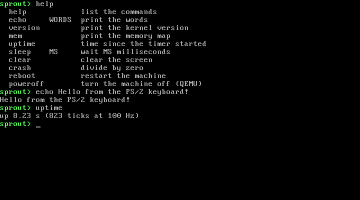
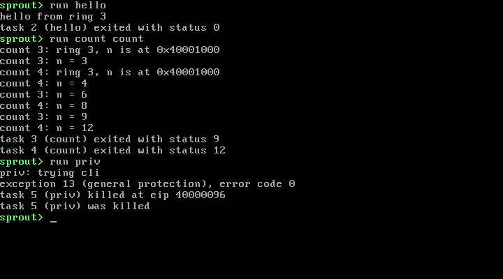
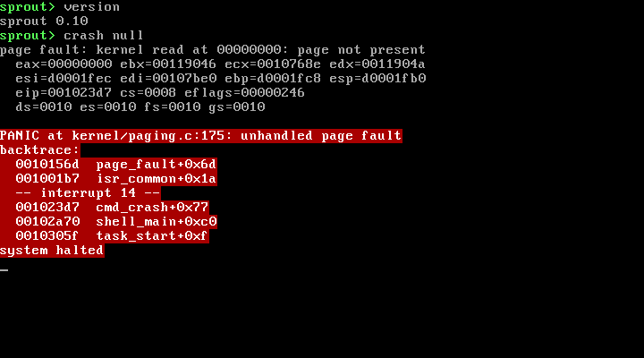

# Learn OS Development by Booting Your Own Kernel

An operating system is the program that owns the machine. It starts first, takes control of the
CPU, memory and devices, and then shares them out among other programs, which cannot get at the
hardware or at each other except through it. Every other program you have written ran on top of
one. In this course you write one.

The kernel is called **sprout**. It is a 32-bit x86 (i386) kernel with its own two-stage BIOS
loader written in NASM, a kernel written in freestanding C, and a handful of user programs. It
runs on QEMU, an emulated PC, so a crash costs you a restart and not a reboot. It starts as a
512-byte boot sector that prints one line. By the end it has interrupts, a keyboard shell, paging,
preemptive tasks, programs in ring 3 that make system calls, and a panic that prints a symbolic
backtrace.

The course borrows from two classics. As in *Go by Example*, every idea comes with a small,
complete example and the output it really printed. As in *The Rust Programming Language*, the
chapters tell a story: each one explains *why* the code works the way it does, and shows the
mistakes, triple faults and page faults you are likely to meet. And the whole course grows one
project, sprout, chapter by chapter, from an empty boot sector to a kernel with a shell and user
programs.

By the end you can:

- write a BIOS boot sector and a second-stage loader, read the disk with `int 0x13`, and ask the
  BIOS for the memory map;
- switch the CPU to 32-bit protected mode with your own GDT, and drive VGA text memory and the
  COM1 serial port without the BIOS;
- build freestanding C with the host gcc and a linker script, and write `kprintf` and `panic`;
- install an IDT, write interrupt entry stubs, remap the 8259 PIC and run the timer at 100 Hz;
- read the PS/2 keyboard and COM1 into a line editor and a small shell;
- manage physical frames, turn on two-level paging, catch page faults and run a kernel heap;
- switch between kernel tasks, cooperatively and preemptively, with sleep, wait, kill and a lock;
- run ELF programs in ring 3 in their own address spaces, with a TSS and system calls through
  `int 0x80` that never trust a user pointer;
- debug a kernel: frame-pointer backtraces with names, `addr2line`, QEMU's `-d` log, and gdb
  attached to the running machine;
- test a kernel the boring way: every snapshot boots headless and its serial output is compared
  with a file.

## Prerequisite

This course builds on two sipak-gh courses:

- **[learn-c](https://github.com/sipak-gh/learn-c)**: C11, pointers and Makefiles.
- **[learn-linux-nasm](https://github.com/sipak-gh/learn-linux-nasm)**: NASM syntax, registers,
  the stack and calls.

The 16-bit and 32-bit assembly of the course is new, but every instruction in it is one you know
from 64-bit code with a smaller register. The chapters recap the rest briefly and link back. They
don't re-teach it.

## Requirements

Every console output in the course comes from these versions:

| Tool | Version | Used for |
|------|---------|----------|
| Linux x86-64 | any modern kernel | everything |
| NASM | 3.02 | the boot sector, the loader and the kernel's assembly; `ndisasm` comes with it |
| gcc | 11.4 | the kernel in freestanding C with `-m32` (Chapter 4 on) |
| GNU ld (binutils) | 2.38 | the linker script; `objcopy`, `objdump`, `nm`, `addr2line` |
| GNU make | 4.3 | every build |
| QEMU (`qemu-system-i386`) | 6.2, with SeaBIOS 1.15 | the PC every chapter boots on |
| gdb | 12.1 | debugging the running kernel (Chapter 10) |

On Ubuntu or Debian:

```console
$ sudo apt install build-essential nasm qemu-system-x86 gdb
```

No cross-compiler and no `gcc-multilib` are needed: the host gcc builds 32-bit freestanding code
with `-m32 -ffreestanding`, and sprout never links libgcc (Chapter 4 explains why, and what to do
when gcc asks for `__udivdi3`).

The course was verified with NASM 3.02. Ubuntu 22.04 ships NASM 2.15; everything should assemble
with it, but that was not tested. If you build NASM 3.02 from its source release yourself, put
its `bin` directory first in your `PATH`, and check with `nasm -v`.

## How to use this course

- **Read in order.** Each chapter uses only what earlier chapters (and the prerequisites) taught.
- **Type the code.** Run every command. Commands start with `$` and are followed by their real
  output, captured from QEMU's serial port or screen.
- **Examples:** `examples/chNN/` holds the example programs of chapter NN, most of them broken
  on purpose, with a `Makefile`. In Chapters 1–3, `make` builds every example image and
  `make serial NAME=x` boots one headless; from Chapter 4 on each example is a target of its own
  (`make divzero`, `make nosave`, `make crash`, ...).
- **Project snapshots:** `project/chNN/` is sprout as it stands at the end of chapter NN, with
  its own `README.md` and `Makefile`. `make run` boots it in a QEMU window, and `make test` runs
  the host unit tests and boots it headless, comparing COM1 with `tests/boot.expected`. If you
  get stuck, compare your code with the snapshot.
- **Figures:** `images/` holds every screenshot, taken from real runs of the course code.
- **Exercises** end each chapter. Their solutions are hidden in collapsible blocks.
- **In the wild and History:** every chapter ends with a section on how real systems did the
  same thing: SeaBIOS, GRUB, Linux 0.01, xv6, 32-bit Linux and the IBM PC itself.
- **[Appendix A](appendix-a-cheat-sheet.md)** collects the commands, ports, bit layouts, error
  messages and the growth of sprout on one page.

## What you'll build

One project, sprout, grows through all ten chapters:

| Chapter | sprout | `kernel.bin` | Snapshot |
|---------|--------|--------------|----------|
| 1 | a 512-byte boot sector that prints on screen and COM1 | – | [project/ch01](project/ch01/README.md) |
| 2 | a second stage, loaded by LBA, that prints the E820 memory map | – | [project/ch02](project/ch02/README.md) |
| 3 | protected mode: A20, a GDT, VGA text and COM1 without the BIOS | – | [project/ch03](project/ch03/README.md) |
| 4 | a C kernel at 1 MiB with `kprintf` and `panic` | 4529 bytes | [project/ch04](project/ch04/README.md) |
| 5 | an IDT, exceptions, the remapped PIC and a 100 Hz timer | 7393 bytes | [project/ch05](project/ch05/README.md) |
| 6 | the keyboard, COM1 input, a line editor and a shell | 10185 bytes | [project/ch06](project/ch06/README.md) |
| 7 | a frame allocator, paging, page faults and a kernel heap | 16393 bytes | [project/ch07](project/ch07/README.md) |
| 8 | kernel tasks, a preemptive round-robin scheduler, `ps` and `kill` | 20489 bytes | [project/ch08](project/ch08/README.md) |
| 9 | ring 3: a TSS, address spaces, ELF programs and system calls | 32777 bytes | [project/ch09](project/ch09/README.md) |
| 10 | backtraces with names, and gdb on the live machine | 36627 bytes | [project/ch10](project/ch10/README.md) |

**Chapter 6.** sprout's first shell, typed into on the PS/2 keyboard:



**Chapter 9.** Programs in ring 3: `hello`, two `count` tasks sharing the CPU at the same virtual
address, and `priv`, killed for trying `cli`:



**Chapter 10.** A NULL dereference in the kernel, and the panic it now prints:



## Table of contents

| # | Chapter | Topics |
|---|---------|--------|
| 1 | [Power On](01-power-on.md) | What an OS is, from power-on to 0x7C00, real mode, a boot sector, `int 0x10`, COM1, why 0x7C00 |
| 2 | [Loading More Code](02-loading-more-code.md) | Two stages, sectors and LBA, `int 0x13` extensions, the disk and memory layout, E820, GRUB's stages |
| 3 | [Protected Mode](03-protected-mode.md) | The A20 line, the GDT and selectors, the switch, VGA text and COM1 by hand, triple faults, the 286 |
| 4 | [Hello from C](04-hello-from-c.md) | Freestanding C, `-m32` with the host gcc, the linker script, `entry.asm`, port I/O, `kprintf`, `panic`, Linux 0.01's boot |
| 5 | [Interrupts](05-interrupts.md) | The IDT, what the CPU pushes, entry stubs, `struct regs`, the 8259 PIC, the PIT, the 18.2 Hz clock |
| 6 | [Keyboard and a Shell](06-keyboard-and-a-shell.md) | The PS/2 keyboard and the 8042, scancodes, a ring buffer, the lost wake-up, COM1 input, a line editor, the shell, power off |
| 7 | [Memory Management](07-memory-management.md) | Frames, two-level paging, the identity map, the TLB, page faults, read-only code, `vm`, a heap |
| 8 | [Tasks](08-tasks.md) | The context switch, the scheduler, yield, sleep, blocking, preemption, idle, exit and wait, a lock |
| 9 | [User Mode](09-user-mode.md) | Rings, the TSS, `iret` to ring 3, esp0, address spaces, ELF, system calls, user pointers |
| 10 | [Debugging and Next Steps](10-debugging-and-next-steps.md) | Backtraces, a symbol table in the kernel, `addr2line`, QEMU's log, gdb, where to go next |

| | Appendix | Contents |
|---|----------|----------|
| A | [Cheat Sheet](appendix-a-cheat-sheet.md) | Commands, QEMU flags, memory layout, BIOS calls, ports, descriptor and page-table bits, error messages, the growth of sprout |

**References:** [REFERENCES.md](REFERENCES.md) lists the sources behind each chapter, with
archived copies in case a link breaks.
